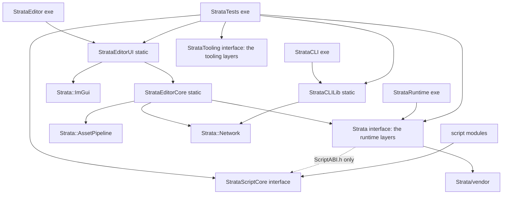

# Strata architecture

How the engine, the editor, the runtime and the tools fit together, for an engineer joining the project. Rules and
conventions (code style, testing, the review checklist) are in [AGENTS.md](../AGENTS.md), their details in
[DeveloperGuide.md](DeveloperGuide.md), and are not repeated here; task playbooks are the skills in
[.claude/skills/](../.claude/skills/). Every section names the code it describes: when that code changes, update this
file in the same commit (AGENTS.md, review checklist item 5).

Paths are relative to the repository root. Engine modules live in `Strata/src/Strata/<Module>/`, so `Scene/Scene.h`
means `Strata/src/Strata/Scene/Scene.h`.

1. [Targets and dependencies](#targets-and-dependencies)
2. [Engine modules](#engine-modules)
3. [Application and frame loop](#application-and-frame-loop)
4. [Scene runtime lifecycle](#scene-runtime-lifecycle)
5. [Threading model](#threading-model)
6. [Asset pipeline](#asset-pipeline)
7. [Streaming and residency](#streaming-and-residency)
8. [Render scene](#render-scene)
9. [Animation](#animation)
10. [Scripting](#scripting)
11. [Editor](#editor)
12. [Export and the runtime](#export-and-the-runtime)

## Targets and dependencies

The root `CMakeLists.txt` adds `Strata/vendor`, `StrataScriptCore` and `Strata`, then the optional targets
(`STRATA_BUILD_EDITOR`, `STRATA_BUILD_RUNTIME`, `STRATA_BUILD_CLI`, `STRATA_BUILD_TESTS`). An arrow means "links".

**The layer table is the build.** `Strata/CMakeLists.txt` calls `strata_add_layer_libraries` (`CMake/StrataLayers.cmake`)
with `StrataTests/Architecture/Layers.json`: it globs the engine's sources once (the extensions `LayeringAnalyzer` reads,
other operating systems' `Platform/<OS>/` folders left out), gives each file to the one layer whose `Paths` match it and
whose `Exclude` does not (the same glob semantics as `MatchesGlob`; a file in no layer or in two fails the configure,
naming it), and makes one static library per layer, `Strata_<Layer>` (alias `Strata::<Layer>`), that links `PUBLIC`
exactly the built layers of its `MayInclude`: a library can only link what its layer may include. Every layer library
gets `strata_configure_target`, the precompiled header `stpch.h` and `StrataEngineCodegen` (`PRIVATE`: the instruction
sets Jolt requires of its users and its definitions, the code generation every engine object had while the engine was one
library that linked Jolt; `strata_engine_cpu_options` gives builds without the physics module the same instruction sets,
and the configure checks them against Jolt's whenever Jolt is built). Layers the table marks `"Tooling": true`
(AssetPipeline, Network, ImGui) are `EXCLUDE_FROM_ALL`; a layer with `"Option"` is built only when that CMake option is
on: Physics, Audio and Animation (`STRATA_WITH_PHYSICS`, `_AUDIO`,
`_ANIMATION`, with their vendor libraries; `ST_WITH_*` definitions tell code which it has, Docs/DeveloperGuide.md,
"Optional modules"). `Strata` is an `INTERFACE` library of every built layer a
game contains, `StrataTooling` one of the tooling layers. CMake writes `<build>/Strata/LayerLibraries.json` at the end of
the configure (each layer's target, whether it is built, its sources and the layers its library really links, read from
the target once every directory added its links), which `Architecture.Libraries` checks against the table. A new layer is a `Layers.json` entry only.



The layer libraries link each other along the layer table (Core at the bottom, Engine at the top: the composition root
and the entry point), so static-library order follows the layer DAG on every linker; registration is explicit (the
composition root calls every module's registration function), so no object depends on self-registration surviving the
linker. Vendor and system libraries attach to the layers that use them (`strata_layer_link` in `Strata/CMakeLists.txt`):

| Layer | Links |
| --- | --- |
| Core | `PUBLIC` glm, EnTT, spdlog, nlohmann_json, Tracy when enabled; `PRIVATE` shell32, ole32, bcrypt, dbghelp (Windows), CoreFoundation (Apple), Threads and dl (Linux); the generated `Version.h` and `VersionCommit.h` (`StrataVersionCommit`) |
| App | `PRIVATE` glfw, Vulkan headers (`VulkanLoader`), stb (window icon) |
| Asset | `PRIVATE` zstd_decompress |
| Renderer | `PUBLIC` nvrhi; `PRIVATE` nvrhi_vk, Vulkan headers, glfw, stb, MikkTSpace, meshoptimizer; the shaders (`strata_add_shaders(Strata_Renderer ...)`) and the default font |
| Physics | `PRIVATE` Jolt |
| Audio | `PRIVATE` miniaudio |
| Scripting | `PRIVATE` StrataScriptCore (`ScriptABI.h` only) |
| Network | `PRIVATE` ws2_32 (Windows) |
| ImGui | `PUBLIC` imgui |
| AssetPipeline | `PRIVATE` stb, cgltf, meshoptimizer, zstd_compress |

The vendor libraries only tools use (imgui, ImGuizmo, cgltf, zstd_compress, nfd) are `EXCLUDE_FROM_ALL`, and stb has one
object per header (`Strata/vendor/Implementations/Stb*.c`; rect_pack and truetype share one), so the linker leaves out
what a program never calls. **Games link no tooling**, proven twice: at configure time `strata_check_link_closure`
walks what `StrataRuntime` links (`LINK_LIBRARIES` and `INTERFACE_LINK_LIBRARIES`, transitively, at the end of the
configure, once every directory has defined its targets) and fails on a tooling layer, imgui, ImGuizmo, nfd, cgltf,
zstd_compress, the editor's or the CLI's libraries or doctest, naming the path; and the CTest `StrataRuntime.NoTooling`
reads the linker map StrataRuntime is linked with (`StrataRuntime.map` next to it: `/MAP`, `-Map=`, `-map,`; exports copy
the executable only), requires the objects every runtime contains (`RuntimeApplication`, `Application`: a map without
them proves nothing) and fails when it names an object or a library of Dear ImGui, the ImGui layer, ImGuizmo, the asset
pipeline, the network layer or zstd's compressor
(`StrataTests/Architecture/CheckNoTooling.cmake`). Dist builds also leave NVRHI's validation layer out
(`VulkanGraphicsDevice.cpp`: a validation request logs a warning and makes the plain device).

Each target is defined in the `CMakeLists.txt` of its directory; script modules by `strata_add_script_module()` in
`StrataScriptCore/CMake/StrataScriptModule.cmake`. The brand assets (the strata mark as PNGs, raw RGBA and `.ico`, in
`StrataEditor/Resources/Brand/`) are drawn by `Tools/GenerateBrandAssets.py` and committed; `Core/Version.h` (from
`Version.h.in`) carries the version and, through `Core/VersionCommit.h`, the git commit of the build (`c_EngineCommit`),
which the `StrataVersionCommit` target reads at every build (`CMake/StrataVersionCommit.cmake`; the header changes only
when the commit does).

| Target | Kind | What it is |
| --- | --- | --- |
| `Strata_<Layer>` (`Strata::<Layer>`) | static libraries | One per layer of `Layers.json`: the engine modules, platform code, embedded shaders and default font (`Strata/src/`). |
| `Strata`, `StrataTooling` | interface libraries | Every built layer a game contains; the tooling layers (AssetPipeline, Network, ImGui). |
| `StrataEngineCodegen` | interface library | The compile options and definitions every engine object shares: Jolt's instruction sets, also without the physics module (`strata_engine_cpu_options`), and with it Jolt's definitions. |
| `StrataScriptCore` | interface library | Script C ABI and header-only C++ SDK; links glm only (`StrataScriptCore/`). |
| `StrataEditorCore` | static library | The editor without UI (`StrataEditor/src/Editor/`); links `Strata`, `Strata::AssetPipeline` and `Strata::Network`. |
| `StrataEditorUI` | static library | The ImGui interface on the core: `EditorLayer`, panels, widget kit, theme, embedded fonts; links `Strata::ImGui`, and `ImGuizmo` and `nfd` privately (`StrataEditor/src/UI/`, `Panels/`, `EditorLayer.*`). |
| `StrataEditor` | executable | Runs the UI: `EditorApplication` (options, theme and fonts, `EditorHost`) (`StrataEditor/src/EditorApplication.cpp`). Embeds the window icon (`EditorIcon.h`); on Windows `StrataEditor.rc.in` adds the `.ico` and version information. |
| `StrataRuntime` | executable | Plays exported games (`StrataRuntime/src/RuntimeApplication.cpp`); links `Strata` only; on Windows `StrataRuntime.rc.in` gives it (and every exported game) the `.ico`. |
| `StrataCLILib`, `StrataCLI` | static library, executable | Automation client and MCP server (`StrataCLI/src/`); links `Strata::Network` only (Core comes with it). |
| `StrataTests` | executable | doctest suites; builds the test script modules as dependencies (`StrataTests/`). |
| script modules | `MODULE` libraries | Game code: the tests' modules and every game project's `Scripts/`. |

CTest runs the `StrataTests` suites in groups selected by suite name (`StrataTests/CMakeLists.txt`; the groups and
labels are listed in DeveloperGuide.md, "Testing"): the suites without a CTest of their own in the shards of
`StrataTests/CoreShards.json` (`StrataTests.Core.<Shard>`, label `core`), which `ctest -j` runs side by side, and the
corruption sweeps again in full in `StrataTests.Fuzz` (Release and Dist). The perf lab is one of them: suites `Perf.*` and `PerfGPU.*`
(`StrataTests/src/Perf/`) measure metrics against the budgets in `StrataTests/Perf/Budgets.json`, in Release and Dist
only, confirm a metric over its budget by measuring it again before failing (`Perf::CheckBudgetsConfirmed`), and write
`<build>/PerfResults/<config>.json` with every attempt; `Tools/PerfStability.py` runs them repeatedly and reports how
stable each metric is. `Perf.Scene`, `Perf.Scripting`, `Perf.Physics` and `PerfGPU.Renderer` measure scenes built by
`Perf/SceneGenerators.h` (flat roots, a nested tree, scripted entities, stacks of falling boxes, grids of cubes and
point lights); `Perf.Editor` (editor commands), `PerfGPU.Editor` (the real `StrataEditor`'s frame times on generated
100,000- and 1,000,000-entity scenes, read from its `editor.wait` results) and the editor frames of `PerfGPU.Renderer`
(`RendererFramePerfTests.cpp`) live in `src/Editor/`, which only builds with the editor.

What may depend on what:

- The engine's libraries know nothing about the editor, the runtime executable, the CLI or the tests. The Scripting
  layer links `StrataScriptCore` privately and only for `StrataScript/ScriptABI.h`; it never includes the C++ SDK. The
  public dependencies are glm, EnTT, spdlog and nlohmann_json (Core), NVRHI (Renderer) and Dear ImGui (the ImGui layer,
  tooling); everything else is private to the layer that uses it (the table above), so dependents do not see its
  headers. ImGuizmo is the editor UI's own.
- Script modules link `StrataScriptCore` only and never the engine; only two entry points are exported
  (`StrataScriptModule.cmake`). See [Scripting](#scripting).
- `StrataEditorCore` holds the editor's state and commands; `StrataEditorUI` only draws that state and calls the
  commands, and reaches the application only through `EditorHost` (`StrataEditor/src/EditorHost.h`), so tests link both
  and draw the UI without a window or GPU (`StrataTests/src/Editor/ImGuiHarness.h`).
- StrataCLI's logic lives in `StrataCLILib` so that `StrataTests` can link it (`STRATA_TESTS_HAVE_CLI`). Editor and
  CLI tests compile only when those targets exist (`StrataTests/CMakeLists.txt`).
- Platform code is in `Strata/src/Platform/` (`Windows`, `Posix`, `GLFW`, `Vulkan`), filtered per OS by
  `strata_add_layer_libraries`; engine modules reach it through interfaces such as `Core/Platform.h`, `Core/Window.h`,
  `Core/CrashGuard.h`, `Core/Process.h`, `Core/DynamicLibrary.h`, `Core/FileChangeNotifier.h` and
  `Renderer/GraphicsDevice.h`. Engine code outside `src/Platform/` includes no OS headers.

Applications built on `Application` (editor, runtime) get `main` from `Engine/EntryPoint.h`, which calls the program's
`CreateApplication` (`Engine/ApplicationLaunch.h`), runs the composition root with the options it returned
(`ApplicationLaunch::Registration`), makes the application (`ApplicationLaunch::Create`), runs it and returns its exit
code (see [Composition root and registries](#composition-root-and-registries)). `StrataCLI` has its own `main` and no
`Application`. On Windows
the editor and the runtime (and so every exported game) are GUI-subsystem programs, so that no console window opens with
them; they keep `main` (`/ENTRY:mainCRTStartup`, `StrataEditor/CMakeLists.txt`, `StrataRuntime/CMakeLists.txt`). Before
anything prints or the log opens its console sink, `main` asks the client what kind of run the command line is
(`GetProgramRun`, defined next to `CreateApplication`) and passes it to `Platform::ConnectStandardStreams`, which keeps
the streams callers pass (pipes, files, the null device: CTest, StrataCLI, CI get the output and the exit code as from a
console program). A `ProgramRun::Console` run (`--version`, `--help`, usage errors, headless and scripted runs) attaches
to the console of the process that started it (a terminal) for the streams it was not given; a `ProgramRun::Interactive`
run (a person's window) never does, because a process attached to a console ends with it: the terminal's Ctrl+C or
closing it would kill the editor, and its log would run into the shell's prompt (shells do not wait for windowed
programs). `main` then installs `Platform::InstallInterruptHandler`: Ctrl+C, Ctrl+Break and the console closing on
Windows (a console control handler), SIGINT and SIGTERM on POSIX (a handler that only counts the request, async-signal
safe) become a request the main loop honors after its frame (`Application::Run` polls `Platform::IsInterruptRequested`
and closes with exit code 130 unless the run had failed), so layers shut down as after any close (the editor cancels
commands, removes its automation session, closes the project); a second request goes to the default handler and ends the
process. Failures that end a program before it could do anything go through `Application::ReportFatalError`: logged as
critical and, where nobody would read that (`Platform::ShouldShowErrorDialogs`: an Interactive run whose stderr is no
terminal, pipe or file), shown in a native dialog with the advice and the log's path (`Platform::ShowErrorDialog`:
MessageBoxW on Windows, osascript on macOS, zenity or kdialog on Linux, without new dependencies; nothing else is left
when none can show). The Application constructor reports an engine module that could not start this way, once the
modules that started ended and its window closed (`EngineModule::GetStartFailure`): the Graphics module says that no
usable graphics device was found, with the driver advice of `GraphicsDevice::GetDriverInstallAdvice`; the runtime reports a missing manifest and a game
that cannot start. Console runs never show dialogs, so tools and servers are never stopped by one;
`STRATA_ERROR_DIALOG_FILE` makes `ReportFatalError` write the dialog's title and text to that file instead (tests).
`EndToEnd.StandardStreams` checks pipes, the terminal (through a helper with a hidden console, `Tests::RunInConsole`,
which also presses Ctrl+C), SIGINT and SIGTERM on POSIX, the dialogs' text and the executables' subsystems;
`GPU.Startup` an editor whose Vulkan loader finds no driver; `StrataEditor.Install` the installed executables'
subsystems.

## Engine modules

**Core** (`Core/`). `Application` owns the window, the layer stack, the program's engine modules
(`Core/EngineModule.h`: the graphics device, audio, ImGui, the project; see
[Application and frame loop](#application-and-frame-loop)) and the main-thread queue and runs the frame loop;
`Layer`/`LayerStack` hold the client's behavior; `Window` is implemented by
`Platform/GLFW/GLFWWindow` (`SetIcon` takes RGBA images of several sizes; macOS and Wayland windows have no icon of
their own and ignore it). Services: `Log` (spdlog; `LogBuffer` backs the editor console and `log.read`; the console and
the log file are written by the `BackgroundLogSink`'s thread, so a log call waits for them only for warnings and errors,
which are flushed before the call returns, and while 65,536 messages are queued (a burst the writer cannot keep up
with): writing a line to a console, a pipe or a file blocked the frame for milliseconds), `Assert`, `JobSystem`,
`FileSystem` (UTF-8 paths), `FileReader` (one open file read at explicit offsets by any number of threads: overlapped
`ReadFile` on Windows, `pread` on POSIX), `FileWatcher`, `FileLock`, `Platform` (OS services, private directories,
process memory with peaks: `GetProcessMemory`, process uptime: `GetProcessUptime`), `Process` (child processes),
`DynamicLibrary`, `CrashGuard`, `UUID`, `Hash` (FNV-1a, and CRC-32C with the processor's CRC instructions where it has
them), `Crypto` (SHA-256, peer authentication), `Base64`, `CommandLine`, `Timer`/`FramePacer`, `JsonUtils`
(exception-free JSON reads), `SequenceLock` (lock-free hand-off to the audio thread), `EngineServices` (process-wide
interfaces a module or the program running a game offers the modules that may not include it, such as the audio output's
master volume, `IAudioOutput`, the game's window, `IGameWindow`, and its save directory, `IGameSaves`), `SaveFiles` (a
game's save files: names checked before any path is formed, atomic writes; `SaveDirectory`), `FrameProfiler` (the
always-on timer of the main thread's frame stages, see [Frame profiler](#frame-profiler)) and `Profiling`
(`ST_PROFILE_STAGE`; Tracy with `STRATA_ENABLE_TRACY`).

**Events** (`Events/`). Window, key and mouse events (`ApplicationEvent.h`, `KeyEvent.h`, `MouseEvent.h`, including
`WindowFileDropEvent` and `WindowContentScaleEvent`, raised when the window moves to a display with another DPI setting
or the setting changes) are dispatched synchronously: `Application::OnEvent` hands each one to the layers from the top
down until one marks it handled (`EventDispatcher`). An unhandled `WindowCloseEvent` ends the application, so a layer
can veto closing (the editor asks about unsaved changes).

**Input** (`Input/`). `Input` is a static polling API: down state, per-frame pressed/released transitions, mouse
position relative to the input viewport, deltas, scrolling and gamepads (up to four, the GLFW gamepad mapping:
`GamepadCodes.h`; sticks -1 to 1 with +Y up, triggers 0 released to 1 pressed, which `GLFWWindow` converts GLFW's values
to; out-of-range and non-finite values are clamped or read at rest). `GLFWWindow` feeds it (`Input::Process*`);
Input reaches the window only through `InputWindow` (size, cursor mode), which `Window` implements, so the input layer
stays below the application shell. It also has a virtual device for tools (`SimulateKey`, `SimulateGamepadButton`,
`SimulateGamepadAxis` and friends) merged with the real devices (a gamepad simulated input used counts as connected; an
axis it holds wins over the device's until released), `SetEnabled` (device input off, e.g. while the editor's game view
has no focus; sticks and triggers then read at rest) and `SetSuspended` (input frames follow the game's updates). The
cursor mode a game asks for (`SetGameCursorMode`, scripts' `Input::SetCursorMode`) applies to the window only while input
is enabled: disabling input gives the cursor back, enabling it applies the game's mode again, so a locked cursor in the
editor stays in the focused game view (the editor's UI ignores the mouse meanwhile, and the game view says that Shift+F1
frees it and Ctrl+P stops the game) and Shift+F1 frees it. `InputNames` maps key, button and gamepad control names for
the `input.*` commands.

**Math** (`Math/`). Engine conventions in `Math.h`: right-handed, +Y up, -Z forward, reversed-Z projections, Euler
angles in degrees. `AABB`, `Frustum`, `Ray`, and `Random` (thread-local generators).

**Reflection** (`Reflection/`). `PropertyType` (Bool to Entity), `PropertyInfo` (ranges, enum options, flags),
`PropertyBuilder`, `ComponentRegistry` (`ComponentInfo`: metadata plus type-erased ECS operations; components are
registered while the composition root runs and the registry is frozen afterwards, see
[Composition root and registries](#composition-root-and-registries)) and `PropertyJson` (canonical JSON plus lenient
parsing for automation). Reflection is the single description of component data: `SceneSerializer`, the inspector
(`StrataEditor/src/UI/PropertyWidgets.h`), the `component.*` commands, undo snapshots and script property access all
go through it, mostly via `Scene/ComponentAccess`.

**Scene** (`Scene/`). `Scene` owns the EnTT registry, the UUID map, the hierarchy and the cached world transforms,
and while it runs its scene systems (see [Scene runtime lifecycle](#scene-runtime-lifecycle)). `Entity` is a
non-owning handle. Components are plain structs, each declared and registered with a stable name by the module that
owns it (`<Module>/<Module>Components.h`, registered from `Register<Module>Module`): Scene's `Components.h` holds ID,
Name, Transform, Relationship, Tag, Inactive, PrefabInstance and Camera (registered in `ComponentRegistration.cpp`) and
the types of two components other modules register because sibling layers read them (`MeshRendererComponent`, registered
by the renderer: physics' mesh colliders and animation read it; `SkinComponent`, registered by animation: the renderer,
which may not include Animation, makes skinned proxies from it); `Renderer/RendererComponents.h` the lights, SkyLight,
PostProcess and Text; `Physics/PhysicsComponents.h` RigidBody, the colliders and CharacterController;
`Audio/AudioComponents.h` AudioSource and AudioListener; `Animation/AnimationComponents.h` Animator and AttachToJoint;
`Scripting/ScriptingComponents.h` Script. The composition root's module order keeps `ComponentRegistry::GetAll` in one
order (Scene's, the renderer's, physics', audio's, animation's, then Script), so the Inspector, Add Component and
`component.list` list them as before (`Reflection.ComponentSchema` checks names, metadata and order against
`StrataTests/Architecture/ComponentSchema.json`).
`ComponentAccess`
reads and writes them with validation and change signals, `SceneSerializer` writes versioned JSON (keeping components
it cannot read, see
[Composition root and registries](#composition-root-and-registries)), and `Prefab.h` defines the scene-shaped assets
(`EntityTemplate`, `Prefab`, `Model`, `SceneAsset`), whose entities are copied into scenes from compiled prototypes
(`EntityPrototype`, see [Scene runtime lifecycle](#scene-runtime-lifecycle)). `SceneServices.h` defines the interfaces through which the systems
of a playing scene use each other (see [Scene services](#scene-services)). See [Scene caches](#scene-caches) for how
per-frame cost follows what changed.

**Asset** (`Asset/`). `AssetManagerBase` (registry, asynchronous loading and residency, dependencies, bounds and group
loads), `AssetStreamingQueue` (the order and admission of loads), `AssetResidency` (memory pools, budgets, `AssetPin`,
eviction), `AssetManager` (the process-wide active manager), `AssetPack` (reads packs by byte range), `EditorAssetManager`
(project files, `.meta` sidecars, imports, dependency records, hot reload, pack planning), `RuntimeAssetManager` (reads
mounted `AssetPack`s), `AssetPackWriter` and `AssetDependencies` (tooling: writing packs, finding what documents
reference), `AssetImporter` with the built-in importers
(`AssetImporters.cpp`, `GltfImporter`, `TextureImporter`), `AssetLoaderRegistry` (the loaders, registered by the
modules that own the types) and `BuiltinAssets` (fixed handles; the owning module provides each object through a
factory). The asset types are Scene, Prefab, Model, Mesh, Material, Texture, AudioClip, Font, Skeleton, AnimationClip and
AnimationController (`AssetTypes.h`; the animation types belong to the Animation module). See
[Asset pipeline](#asset-pipeline) and [Streaming and residency](#streaming-and-residency).

**Renderer** (`Renderer/`). `GraphicsDevice` is the device interface (NVRHI on Vulkan, implemented in
`Platform/Vulkan/VulkanGraphicsDevice.cpp`; it owns the swapchain and frames in flight, 2 by default). `Renderer`
holds the process-wide services: the device, `ShaderLibrary` (SPIR-V compiled from `Strata/shaders` by glslang at
build time and embedded, `CMake/StrataShaders.cmake`), samplers, fallback textures, `BindlessTextureTable`,
`StagingPool` (staging memory for texture and mesh uploads, reused), `DeferredReleaseQueue` (`ReleaseDeferred`:
resources dropped while the GPU may still use them, held until an event query set at the release completes, never
waiting; NVRHI's Vulkan backend keeps what command lists reference alive, but not the textures of clears. Destroying a
texture costs the driver about 0.1 ms, so every frame destroys what completed within `c_FrameDestroyBudget` (0.25 ms,
the oldest first, at least one) and every release as many as it hands over, which keeps the queue bounded without
frames) and the blocking `ReadTexture`. `RenderScene` keeps a scene's render proxies in a `SpatialIndex`,
and `SceneRenderer` extracts each frame's draws from it (`SceneRendererExtraction.cpp`, resolving assets through its
`AssetResolveCache`; see [Render scene](#render-scene)). `SceneRenderer` draws a scene (light clustering, shadow cascades,
depth/normal/entity-ID prepass, GTAO, forward PBR, sky, transparents, exposure, bloom, tone mapping, FXAA, then overlays
and text) into render targets of its viewport size, which it hands to the `DeferredReleaseQueue` when it is resized
(the viewport panel, the game window) or freed (captures); its output texture exists only once a frame needed it (one
without a target, or composing overlays or text before copying into the target), so a game without text renders
straight into the back buffer and never allocates one. Its image-based lighting comes from the sky light's
environment map or its procedural sky (`IBL/ProceduralSky.comp` writes mip 0 of the environment cube, then the shared
filtering chain runs), computed again only when the source or the procedural parameters change (an environment map's
maps are shared by the renderers lighting with that texture, so a second renderer of the scene computes nothing); editor
views can ask for preview lighting, leave out screen-space text and tint entities (`SceneRenderOptions::EntityTints`: the
first overlay, `Overlay/StatusTint.frag`, blends the listed entities' colors over exactly their pixels of the entity-ID
buffer, found by binary search in a sorted (id, color) buffer like the selection outline's). How a mesh's level of
detail is chosen is a pure function (`LODSelection::GetScreenFraction`, `SelectLOD`), so tools show the level the
renderer draws: a submesh whose simplified levels all have errors (`MeshLOD::Error`, `MeshUtils::HasLODErrors`) draws
the coarsest level whose error, projected, spans at most `SceneRendererSpecification::LODErrorPixels` (1) pixels of the
viewport height (`SelectLODByError`: the screen fraction times the error relative to the mesh's bounding radius,
`MeshUtils::GetRelativeLODError`, against `GetErrorThreshold`, one multiplication the GPU's culling repeats bit for bit);
levels without errors halve the screen fraction against `LODThreshold` as before. A level that changes cross-fades
(`FadeLevelsOfDetail`): for `RenderData::c_LODFadeFrames` frames both levels are drawn, the new one on step/16 of the
pixels of a 4x4 ordered dither and the old one on the others, the draw list entry carrying the code
(`LODSelection::UpdateLODFade`, a state per renderer and instance with its entity, so a reused instance slot or a
frame without the instance starts over; a camera cut or another scene skips a frame number, so they switch at once).
Assets: `Mesh` (skinned meshes also have a skin stream, four joint influences per vertex, and a `MeshSkinBinding`: the
skin's joints in the skeleton, their inverse bind matrices and the bind-pose extent of what each joint moves; each
level of detail its `MeshLOD::Error`, how far its surface departs from full detail; cooked mesh format version 3,
versions 1 and 2 still load, their levels with error 0, "unknown"), `Material`, `Texture`, `Font`; procedural primitives come from `MeshFactory`;
texture formats, the cooked texture format and the block decoders are `TextureFormat`, `CookedTexture` and
`BlockCompression` (see [Texture cooking](#texture-cooking)). Also `TextRenderer`/`FontAtlas`, `DebugDraw`/`SceneGizmos`, `TextureReadback`
(non-blocking GPU readback) and `ImageWriter` (PNG). Conventions and rules: AGENTS.md, "Architecture rules", and
DeveloperGuide.md, "Rendering".

**Physics** (`Physics/`). `PhysicsSystem` is the "Physics" scene system (Play and Simulate). `PhysicsWorld` builds a
Jolt world from RigidBody and collider components and steps it; `PhysicsRuntime` reference-counts Jolt's global
state; `PhysicsJobSystem` runs Jolt's jobs on the engine's worker pool; `PhysicsMeshShapes` cooks mesh collider shapes
on jobs and caches them process-wide; `AssetMeshProvider` supplies mesh data from the active asset manager, reading
the triangles through `MeshGeometryRegistry` (`Asset/MeshGeometry.h`: the renderer registers the reader of its `Mesh`,
the full-detail level of every submesh with indices offset by its base vertex), so physics never depends on the renderer.
`PhysicsTypes.h` has the settings and statistics. Collision layers are the scene's (`SceneSettings::PhysicsLayers`,
`Scene/PhysicsLayerSettings.h`: names for up to 32 layers and a symmetric matrix of which collide, everything by
default); `PhysicsSystem` gives its world that matrix, restricted by the default settings' (`GetDefaultSettings`), when
it creates the world and before every step after it changed (`scene.setSettings`, undo, the inspector, scripts'
`Physics::SetLayersCollide`, `PhysicsSystem::SetLayersCollide`; `PhysicsWorld::SetLayerCollisionMasks` wakes the bodies,
and character controllers read the world's live matrix). A world's capacities are fixed when it is created: those the
scene does not set (`SceneSettings::PhysicsCapacity`) are sized from the bodies the scene starts with
(`PhysicsWorld::ResolveCapacities`: at least 65,536 bodies, the next power of two of twice the bodies; four body pairs per
body slot; at least 10,240 contacts, two per body; scratch memory for them), bodies that find the world full wait for a
slot and are reported in one error, steps that overflow the pair or contact buffers are counted
(`PhysicsStats::BodyOverflowCount`, `ContactOverflowSteps`), and what a world lacked is remembered per scene
(`Scene::GetLineageID`: the scene asset it was loaded from or saved as, else the scene and its copies; never another
scene of the same name), so the scene's next world is sized for it. Jolt reserves a world's buffers when it is created
and does not survive a failed allocation, so the capacities a scene may ask for are limited (`PhysicsCapacitySettings`:
about 80 bytes per body, 90 per body pair and 830 per contact constraint, about 940 MiB at the limits). Other systems
use physics through the scene services `PhysicsSystem` offers (`ICollisionEventSource`, `IBodyMotionQuery`,
`IBodyControl`, `IPhysicsQueries`, `ICharacterControl`, with `CollisionEvent`, `RaycastHit` and `CharacterState`, in
`Scene/SceneServices.h`); collision events
collected during a step are dispatched
afterwards on the main thread to the listeners. Contacts are tracked only for pairs someone wants (every pair while a
listener of all entities is registered, otherwise pairs with a watched entity, such as one whose script has contact
callbacks): Jolt's job threads record those into buffers of their own, without a lock, which are merged and sorted after
the step, and each touching pair knows its position in the pair lists of both its entities, so it is added and removed
in constant time (`PhysicsStats::PairIndexOperations` counts the list writes). Bodies created while changes are applied
(play start, a prefab spawn, a streamed cell) join the simulation in one batch per activation mode
(`AddBodiesPrepare`/`AddBodiesFinalize`), and destroyed bodies leave it in one batch, when `ApplyPendingChanges` ends;
each Jolt body index leads to its entity and record in constant time (`BodySlot`). Jolt rebuilds a broad phase tree, and
frees the nodes of the bodies removed from it, only while the tree holds bodies, and aborts the process when its fixed
node pool runs out: so every world keeps one static anchor body in each of its two trees (static and moving bodies), on a
layer outside the 32 that collides with nothing and that no query accepts, beside its body capacity
(`c_BroadPhaseAnchorCount`). Bodies spawned and removed again before every step then cost nodes only until the next step
(`Physics.Capacity` runs such spawns in a helper process). Around each step the work on awake
bodies runs on the job system: the synchronization skips, in parallel chunks, the bodies whose entity is where the last
step put it (`Scene::FindCurrentWorldTransform` reads only current cached matrices), and the write-back writes the poses of
bodies without a dynamic ancestor in parallel chunks, each touching only its own record and `TransformComponent` through
pointers fetched beforehand, against parent world transforms read before the writes, then tells the scene about all of them
at once (`Scene::MarkTransformsChanged`, no `on_update`); bodies below other written dynamic bodies follow one by one,
parents first, and the rare cases (scale edits, failed writes, descendants to update) are handled on the main thread in body
order, so the results do not depend on the number of threads. Body order comes from a bitmap over the body indices of
which only the words that got bits are sorted, read and cleared, so a step costs what moved, not the world's capacity.

**Character controllers** (`Physics/CharacterControllers`, `CharacterControllerComponent`). An entity with an active,
enabled controller and no rigid body (an entity with both is the rigid body, with a warning) is a Jolt `CharacterVirtual`:
an upright capsule standing on the entity's origin (its rotation and scale do not change it) that moves by collision
queries, plus a kinematic presence body (90% of its radius, its top at the capsule's, carrying the entity's UUID) through
which dynamic bodies land on it, triggers detect it and queries hit it. Each fixed step, after the bodies are synchronized
and before Jolt's step, `CharacterControllerSet::Step` moves every controller: its velocity is the walk velocity its
script set (`ICharacterControl::MoveCharacter`, kept until the next call; the vertical part only without gravity), a
pending jump, accumulated root motion (`AddCharacterMotion`: the animation system's, see Animation, Root motion) and
gravity times its `GravityScale`; standing on walkable ground it takes on the ground's velocity (moving platforms), in
the air its vertical velocity goes on (a ceiling stops a rise). Jolt's `ExtendedUpdate` then slides it along walls, walks
it up steps up to `StepHeight` and keeps it on the ground walking down, against the layers its layer collides with (the
world's live matrix) and never its own entity's bodies. The moves run in parallel batches on the job system (bounded
scratch memory per batch), each reading only the world before the step and writing only its own controller: Jolt would push dynamic
bodies from many threads in any order, so the set disables that and pushes afterwards, on the main thread in entity order
(`PushBodies`: an inelastic push, the body's effective mass at the contact times the speed the character closes in on it
along the normal, never downwards and at most `PushStrength` newtons over the step; and the character's weight, 70 kg
under its gravity, pressing on a dynamic body it stands on: all of it while it stands, the part across the surface while
it slides down steep ground), moves the presence bodies and writes each entity's translation
(`Scene::MarkTransformsChanged`; its rotation and scale stay). So the results do not depend on the number of threads
(`Physics.Character`), and 1,000 walking controllers take about 0.8 ms per step (`Perf.Physics.Characters1000Step`). An
entity moved from outside (a script writing its transform, the editor) teleports its controller at the next step. The
controllers' contacts (`GetActiveContacts`, one per touched body) join the step's contact reports, so `CollisionEvent`s
and the scripts' `OnCollisionEnter/Exit` report them like any body's; triggers and bodies landing on a controller reach
it through its presence body (`OnTriggerEnter/Exit`). The ground state (on ground, on steep ground, not supported, in
air), ground normal, velocity and entity are `CharacterState` (`ICharacterControl::GetCharacterState`).

**Audio** (`Audio/`). `AudioEngine` wraps the miniaudio mixer, output device, listener and one-shots (main-thread
API; mixing runs on miniaudio's audio thread, or is pulled with `AdvanceNullDevice`/`ReadFrames` without a device).
`AudioClip` is immutable sound data, decompressed or streamed; `AudioClipAsset` is its asset, `AudioSource` a voice
with settings, and `AudioSystem` the "Audio" scene system (Play only), which offers the scene service `IAudioPlayback`;
the module registers the engine service `IAudioOutput` (master volume). Details: DeveloperGuide.md, "Audio".

**Animation** (`Animation/`). Skeletal animation: the assets `Skeleton` (joint names, parents in topological order, rest
pose; the cooked `STSK` form), `AnimationClip` (per-joint translation, rotation and scale channels with step, linear and
cubic spline interpolation, bound to skeletons by joint name; the cooked `STAC` form; `ReduceKeys` is the importer's
keyframe reduction) and `AnimationController` (the `.stanimator` document: parameters, states, transitions, events);
`AnimatorInstance` (one animator's playback: state machine, cross-fades, events, root motion, poses) and
`AnimationSystem`, the "Animation" scene system (Play only), which offers the scene services `ISkinningPoses`,
`IAnimatorControl` and `IAnimationEventSource`. `AnimationTypes.h` has the joint pose and its math. See
[Animation](#animation).

**Scripting** (`Scripting/`). `ScriptEngine` (the loaded module, hot reload, faults, optional watchdog),
`ScriptModule` (loading, validation and guarded calls), `ScriptSystem` (the "Scripting" scene system: instances and
callbacks), `ScriptHostAPI` (the host function table), `ScriptValue` (ABI value conversions), `ScriptTypes`
(class, field and fault descriptions) and `ScriptWatchdog`. See [Scripting](#scripting).

**Project** (`Project/`). `Project` is a game project: the `.stproj` file (with the export settings,
`Export.AlwaysInclude` and `Export.LoadingScene`), the asset directory, the script sources and the intermediate
directory `.strata/` (`Cache/`, `Scripts/Build/`, `Scripts/Bin/`), plus the process-wide active project. `GameManifest`
is the `.stgame` file of an exported game (name, asset pack and patch packs, start scene, loading scene, script module,
window settings).

**Runtime** (`Runtime/`). `GameRuntime` runs an exported game without depending on windowing or rendering: it opens
the pack, loads the script module, starts scenes and honors their requests. `GameRenderer` draws the running scene
from its primary camera, or a message frame that names the problem, with a scene renderer that writes no entity-ID
buffer (`SceneRendererSpecification::EntityIDs`: games do not pick by pixel). See
[Export and the runtime](#export-and-the-runtime).

**Network** (`Network/`). `TcpSocket`/`TcpListener`/`SocketPoller` (`Socket.h`, implemented in
`Platform/Windows/WindowsSocket.cpp` and `Platform/Posix/PosixSocket.cpp`), `JsonRpc` (newline-delimited JSON-RPC
2.0), `RpcServer` (network thread, `RpcAuthentication` handshake, handlers on the main thread), `RpcClient`
(synchronous) and `EditorSession` (session files and discovery). Used by editor automation and StrataCLI; the
runtime does not use it. Protocol and security model: DeveloperGuide.md, "Automation (editor RPC + MCP)".

**ImGui** (`ImGui/`). `ImGuiLayer` owns the Dear ImGui context; `Application` pushes it as an overlay when ImGui is
enabled and a window and graphics device exist, and calls `Begin`/`End` around the layers' `OnImGuiRender`. It styles
the UI for the window's content scale, on attach and on every `WindowContentScaleEvent`: the style is rebuilt from
ImGui's dark defaults by the application's style callback (`SetStyleCallback`; the editor installs its Bedrock theme) and
the fonts' DPI scale (`ImGuiStyle::FontScaleDpi`) follows; `SetContentScaleOverride` fixes the scale (`--ui-scale`).
`ImGuiPlatform` is the platform backend, written for the engine (the vendored GLFW backend is not built): ImGui's input
comes from the window's events (keys by what they type in the keyboard layout, `Window::GetLayoutKey`, with their
modifiers; typed text, also from input methods; the mouse, its wheel and `MouseLeaveEvent`; focus), its clipboard and
cursor shapes from the window (`Window::SetCursorShape`, only when ImGui asks for another shape and while the cursor
mode is Normal), and on Windows ImGui's own input method support places candidate lists through the window's handle
(`Window::GetPlatformHandle`). A frame asks the system only for the framebuffer's size: for multi-viewport support the
editor does not use, the vendored backend set the window's mouse passthrough (`SetWindowLongW`) and enumerated the
monitors every frame, and hooked the window procedure, about 0.05 ms of an idle editor frame in all.
`ImGuiRenderer` is the NVRHI backend (user textures are `nvrhi::ITexture*`); it copies the draw lists straight into
vertex and index buffers the CPU writes and the GPU reads, mapped once, one set per frame the GPU may still be drawing
(an event query says when the GPU is done with a set). Only the editor enables it. Draw callbacks
set how the following draws sample (ImGui's linear and nearest sampler callbacks) and show their textures
(`AddImGuiTextureDisplay`: `ImGuiTextureDisplay` as a push constant of `ImGui.frag`), so a texture whose stored layout
would look wrong as sampled (sRGB, one channel standing for gray, a two-channel normal map) shows its content
(`GetImGuiTextureDisplay`).

**Engine** (`Engine/`). `BuiltinModules`, the composition root (below), and nothing else: the only code that knows every
runtime module (tooling, the asset pipeline, is handed in by the programs that use it).

### Layers

The modules form a stack of layers, defined by path patterns in `StrataTests/Architecture/Layers.json`, and each layer
is a library of its own (`Strata_<Layer>`, made from the table: see [Targets and dependencies](#targets-and-dependencies)).
A file may include files of its own layer and of the layers it lists, which are always lower ones; layers marked
`Tooling` (AssetPipeline, Network, ImGui) are never part of a game:

| Layer | Files (under `Strata/src`) | May include |
| --- | --- | --- |
| Core | `Core/**` except the application shell, `Math/**`, `stpch.h`, `Platform/Windows`, `Platform/Posix` (not the sockets) | nothing |
| Input | `Events/**`, `Input/**` | Core |
| App | `Core/Application.*`, `EngineModule.*`, `Layer.*`, `LayerStack.*`, `Window.h`, `Platform/GLFW/**`, `Platform/Vulkan/VulkanLoader.*` | Core, Input |
| Asset | `Asset/**` except the pipeline files | Core (and no NVRHI or Vulkan header) |
| Reflection | `Reflection/**` | Core, Asset |
| Scene | `Scene/**` | Core, Asset, Reflection |
| Renderer | `Renderer/**`, `Platform/Vulkan/**` | Core, Input, App, Asset, Reflection, Scene |
| Physics | `Physics/**` | Core, Asset, Reflection, Scene |
| Audio | `Audio/**` | Core, App (its engine module), Asset, Reflection, Scene |
| Animation | `Animation/**` | Core, Asset, Reflection, Scene |
| Scripting | `Scripting/**` | Core, Input, Asset, Reflection, Scene |
| Project | `Project/**` | Core, App (its engine module), Asset, Reflection |
| Runtime | `Runtime/**` | Core, Input, App, Asset, Reflection, Scene, Renderer, Physics, Audio, Scripting, Project |
| Network (tooling) | `Network/**`, `Platform/*/*Socket.cpp` | Core |
| ImGui (tooling) | `ImGui/**` | Core, Input, App, Renderer |
| AssetPipeline (tooling) | `Asset/EditorAssetManager.*`, `AssetImporter.*`, `AssetImporters.cpp`, `GltfImporter.*`, `TextureImporter.*`, `TextureCooker.*`, `BC7Encoder.*`, `AssetPackWriter.*`, `AssetDependencies.*` | Core, Asset, Reflection, Scene, Renderer, Audio, Animation (the glTF importer writes skeletons and clips) |
| Engine | `Engine/**` | the layers a game contains: Core, Input, App, Asset, Reflection, Scene, Renderer, Physics, Audio, Animation, Scripting (shipped games link the composition root and the entry point too; see below) |

`Architecture.Layering` (`StrataTests/src/Architecture/LayeringTests.cpp`, in the shard `StrataTests.Core.Core`) reads every C, C++ and
Objective-C(++) source and header under `Strata/src` (`STRATA_SOURCE_DIR`; `.h`, `.hpp`, `.inl`, `.c`, `.cpp`, `.m`, `.mm`,
so the macOS platform code too), parses its `#include`s, quoted and angle-bracketed (`Strata/src` is a public include
directory, so `<Strata/...>` reaches engine headers too; `LayeringAnalyzer`: comments, literals and `#if 0` blocks
skipped; resolved like the preprocessor, quoted includes next to the file first, both forms from `Strata/src`; standard
and third-party headers match no layer and are checked only against the prefixes a layer may not include, its
`MayNotIncludeExternal`: the asset layer's `nvrhi/`, `vulkan/` and `vk_`), maps both ends to their
layers and fails on every file that is in no layer or in several, on every forbidden include that is not in
`StrataTests/Architecture/LayeringAllowlist.txt`, and on every allowlist line that matches nothing. Each allowlist line
names the include, the roadmap workstream that removes it and the reason; the list holds exactly `MaxAllowlistEntries`
lines, so it can only shrink; it is empty (`MaxAllowlistEntries` 0). The application shell, which used to start the
renderer, audio and ImGui and release the project itself, runs engine modules instead (`Core/EngineModule.h`, in App:
Audio and Project implement it, a downward dependency their `Notes` record), and physics, which used to read the
renderer's `Mesh`, reads mesh geometry through the registry the renderer fills (`Asset/MeshGeometry.h`). Scripting
and Audio, which used to include the physics and audio systems, reach them through scene services (see
[Scene services](#scene-services)); the asset layer, which used to record uploads on the renderer's command list, records
them into the `AssetUploadContext` the renderer provides through the engine service `IAssetGraphics`
(`Asset/AssetUploadContext.h`, see [Streaming and residency](#streaming-and-residency)).

### Composition root and registries

The engine is extended through registries rather than through code that knows its modules: `ComponentRegistry`
(components), `AssetLoaderRegistry` (stored bytes to asset objects, and the prefixes partial loads read),
`AssetImporterRegistry` (source files to stored bytes), `AssetManagerExtensionRegistry` (work modules do for every asset
manager: the texture streamer), `BuiltinAssets` (objects of the built-in assets), `MeshGeometryRegistry` (the triangles of
mesh assets for modules that do not draw them: physics) and `SceneSystemRegistry` (runtime systems of playing scenes).
`Engine::RegisterBuiltinModules` (`Engine/BuiltinModules.cpp`) fills them, once per process, before anything reads
them. Its modules are a table (`c_BuiltinModules`: a name and a registration function each, lower layers first), run in
order but for those `ModuleRegistrationOptions::Exclude` names; `Engine::GetBuiltinModuleNames` lists the table and
`Engine::GetRegisteredModules` what registered:

```text
open the registries (BeginRegistration; not the importers')
RegisterSceneModule        Scene/SceneRegistration.cpp         its components (ComponentRegistration.cpp); Scene, Prefab, Model
                                                               loaders
RegisterRendererModule     Renderer/RendererRegistration.cpp   its components (RendererComponents.cpp: MeshRenderer, lights, sky,
                                                               post-processing, text); Texture (with its prefix), Mesh, Material,
                                                               Font loaders; built-in meshes and material; the texture streamer
                                                               of every manager; the Mesh geometry reader
RegisterPhysicsModule      Physics/PhysicsRegistration.cpp     its components (PhysicsComponents.cpp, with collider gizmos);
                                                               "Physics" system
RegisterAudioModule        Audio/AudioRegistration.cpp         its components (AudioComponents.cpp); AudioClip loader, "Audio"
                                                               system
RegisterAnimationModule    Animation/AnimationRegistration.cpp its components (AnimationComponents.cpp: Skin, Animator,
                                                               AttachToJoint); Skeleton, AnimationClip, AnimationController loaders,
                                                               "Animation" system
RegisterScriptingModule    Scripting/ScriptingRegistration.cpp the Script component (ScriptingComponents.cpp); "Scripting" system
options.AssetPipeline      RegisterAssetPipeline, Asset/AssetImporters.cpp: opens the importer registry, importers
options.Extra              registrations of games, tools and tests
ComponentRegistry::Freeze
log the registered modules, the scene systems' update order and the soft constraints naming absent systems
```

- **Leaving modules out.** A build without an optional module has no row for it in the table (`#if ST_WITH_<MODULE>`, the
  only place outside the asset pipeline, the runtime program and tests that tests one). In a full build,
  `ModuleRegistrationOptions::Exclude` registers the engine without some of its modules, as a game without them would run
  (tests: `--strata-test-helper=register-without`). Scene and Renderer are part of every
  engine: excluding them is refused with an error, as is a name the table does not hold. Nothing else changes for the
  absent modules: their components load as unknown components and save back unchanged, the other modules' soft
  constraints ignore their systems, and scripts calling into their services are told that the scene plays without them
  ("the scene plays without physics (the engine has no physics module)") and get their calls' failure values.

- **Callers.** The entry point calls it (`Engine/EntryPoint.h`), after the program's `CreateApplication` returned its
  `ApplicationLaunch` and before `ApplicationLaunch::Create` makes the application, with the options the program put in
  `ApplicationLaunch::Registration`: the editor hands in the asset pipeline
  (`ModuleRegistrationOptions::AssetPipeline = RegisterAssetPipeline`), StrataRuntime nothing (games read cooked packs,
  and since the composition root never names the importers, the Engine layer may not include AssetPipeline, the linker
  leaves them out of the runtime). `StrataTests` calls it in `main`, before doctest runs and the helper modes start.
  `Application` never calls it: a program that forgot it stops at the first registry it uses (below). A second call is
  a no-op (with an error when it carries an asset pipeline or `Extra` registrations, which would be lost).
- **Use before registration** fails `ST_CORE_VERIFY` with a message naming `Engine::RegisterBuiltinModules`, in every
  registry: a program that forgot the composition root stops at its first lookup instead of running without
  components or loaders. The importer registry stays closed in programs without the asset pipeline, so a game that
  reached for an importer stops there too.
- **Extra data and its references.** A component may keep data its properties cannot express (the Script component's
  scripts and field values), which it serializes itself (`ComponentInfoBuilder::Extra`), and describes the entity and
  asset references in it (`ComponentInfoBuilder::ExtraReferences`, `ComponentExtraReferences`: `Visit` reports each with
  a slot and subslot the component chooses, `Set` writes one, `Equals` compares two components' extra data with the
  first one's entity references mapped, `VisitJson` reads them from the serialized form). Code that works on every
  component uses these and never names the type: `SceneSerializer`'s entity remapping (copies, duplicates, pastes),
  `EntityPrototype`'s reference list and the instantiation that writes the copies' references, `EntityTemplate::CompareInstance`
  (prefab status) and `AssetDependencies::ScanEntities` (the assets a document references). The `custom-component` helper
  mode checks them with a game's component.
- **Component lifecycle.** `ComponentRegistry` is closed, then open (`BeginRegistration`: `Register<T>` is valid from
  any registering code), then frozen (`Freeze`): the set of components never changes afterwards, so reads take no lock
  and are safe from any thread (asset loads deserialize scenes on workers). `Register<T>` after `Freeze`, for a type
  that is registered already or under a name that is taken (ignoring case), logs an error and returns a builder that
  converts to false and discards what it is given; nothing aborts. A game registers its components through
  `ModuleRegistrationOptions::Extra`.
- The loader, importer, built-in asset, manager extension and scene system registries stay open: tools and tests register
  more later (a later loader or importer replaces or overrides the built-in one; an extension applies to managers made
  afterwards).
- **Components of modules a build lacks survive.** A scene, prefab or snapshot can name components this build does
  not register (a game module that is not loaded, a newer engine). `SceneSerializer::DeserializeEntities` keeps them
  verbatim in the runtime-only `UnknownComponentsComponent` (`Scene/UnknownComponents.h`; not registered, so the
  editor, reflection and the feature test never see it) and warns once per component name per load
  (a scene asset logs its warnings once, when its scene is taken, `SceneAsset::TakePreparedScene`); the writer puts them back next to the registered components, so a save
  writes them unchanged. `Scene::Copy` (play mode), prefab snapshots (`SerializeEntities`), `Scene::DuplicateEntity`
  and the editor's undo snapshots (`EntityState`, `Editor/SceneEdit.cpp`) carry them; restoring undo snapshots does not
  warn again (`EntityInstantiationOptions::ReportUnknownComponents`).

## Application and frame loop

`Application` (`Core/Application.cpp`) creates the window and runs the loop; every engine service a program uses runs
as an **engine module** (`Core/EngineModule.h`, App layer) that the program lists in
`ApplicationSpecification::Modules` (factories). `Application` includes no module's header and calls no module's code:
it calls the modules' hooks.

- **The interface.** `EngineModule`: `GetName`, `GetDependencies` (`EngineModuleDependency { Name, Required }`; a
  dependency that is not required only orders, if the module is there), `OnInit(EngineContext&)` (the application, its
  window or null, the modules), `GetStartFailure` (what a person is told when `OnInit` failed), `OnBeginFrame`
  (returns `EngineFrameAction::Continue`, `Skip` or `Close`), `OnUpdate`, `OnRenderUI`, `OnEndFrame`, `OnEvent`,
  `OnStop`, `OnRelease`, `OnShutdown`. The frame hooks get an `EngineFrame` (the timestep, `WaitSeconds`, the layer
  stack).
- **The registry.** `EngineModuleRegistry` (same files; `Application::GetModules`) makes the modules and sorts them
  topologically, keeping the program's listing order where the dependencies leave a choice (Kahn's algorithm taking the
  first ready module). It refuses to start a program, naming the modules, for a factory that makes none, two modules of
  one name, a missing required dependency or a cycle (the message leaves out modules that only wait for the cycle).
  `Find<T>()` finds a module by `T::c_Name` (no RTTI); `GetAll()` lists them in order.
- **The built-in modules**, each in its own module's folder:

  | Module | `c_Name`, specification | What it does |
  | --- | --- | --- |
  | `Renderer/GraphicsModule` | `"Graphics"`, `GraphicsModuleSpecification { Validation, TransferQueueUploads }` | The device (a swapchain only with a window), `Renderer::Init`/`Shutdown`, the frame's begin and present, back-buffer captures (`RequestBackBufferCapture`), `GetDevice` |
  | `Audio/AudioModule` | `"Audio"`, `AudioModuleSpecification { NullDevice }` | `AudioEngine::Init` (a failure is logged, "Audio is unavailable; continuing without sound", and the program runs on), the null device's mix, `AudioEngine::Update`, `Shutdown` |
  | `ImGui/ImGuiModule` | `"ImGui"`, requires Graphics, `ImGuiModuleSpecification { LayoutFile }` | Pushes the `ImGuiLayer` overlay (`GetLayer`: theme, fonts, UI scale) and draws the UI; fails without a window |
  | `Project/ProjectModule` | `"Project"` | Lets the active asset manager and project go (`AssetManager::SetActive(nullptr)`, `Project::SetActive(nullptr)`) |

- **The programs' lists:**

  | Program | Modules |
  | --- | --- |
  | StrataEditor, windowed | Graphics, Audio, ImGui (`--layout` or the user's layout file), Project |
  | StrataEditor `--headless` | Graphics (offscreen), Audio (null device), Project |
  | StrataEditor `--no-gpu` | Audio (null device), Project |
  | StrataRuntime, windowed | Graphics, Audio, Project: no ImGui |
  | StrataRuntime `--headless` | Audio (null device), Project: no window, no Graphics |
  | `Core.Application` tests | none, or Audio (null device) |

  Code that needs a module finds it: the editor's `ApplicationEditorHost` reaches the device, the UI scale and
  screenshots through `GetModules().Find<GraphicsModule>()` and `Find<ImGuiModule>()`; without the Graphics module a
  screenshot is answered with an empty image on the next frame (`SubmitToMainThread`), or, when it was asked for on the
  last frame, once the loop ends, while the layers that asked still exist.
- **Job threads per program.** Each program sets its `JobSystemSpecification`: StrataRuntime runs the default workers,
  2 I/O and 2 background threads (a game's only background work is `Scene::ReleaseInBackground`); the editor and the
  tests keep the defaults, whose background pool imports and compresses.

Startup (`Application::Application`): opt the process out of execution-speed power throttling
(`Platform::DisableExecutionSpeedThrottling`: Windows 11 otherwise runs processes whose windows are in the background or
covered at a lower quality of service, on hybrid processors on the efficiency cores, where an editor frame takes 1.3 to
1.9 times as long; the test runner does the same, so perf suites measure what applications get), set the working
directory, `JobSystem::Init`, create the window unless headless, `Input::Reset`, then make, order and start the modules
(`OnInit` in dependency order). A module whose `OnInit` fails is logged as "Engine module '<name>' could not start; the
application cannot run"; the layers the modules that started pushed (ImGui's overlay) detach, those modules get
`OnRelease`, the job system stops, they get `OnShutdown`, the window closes, then `Application::ReportFatalError` tells
the person what the module described (`GetStartFailure`), and the application does not run (exit code 1). The program's constructor then pushes its layer (`EditorLayer`,
`RuntimeLayer`) when `IsRunning()`.

The hooks, in the order of the program's frame:

| Hook | Order | When, and what the built-in modules do there |
| --- | --- | --- |
| `OnInit` | dependency | Application constructor, after `JobSystem::Init`, the window and `Input` |
| `OnEvent` | dependency | Each event, after the application's own bookkeeping (minimized), **before** the layers. A handled event stops there. |
| `OnBeginFrame` | dependency | After the Input stage. Graphics: vsync, `GraphicsDevice::BeginFrame` (its wait added to `frame.WaitSeconds`), `Renderer::BeginFrame`. `Skip`: the frame is not counted and the loop waits 16 ms; `Close`: device lost. The modules after one that skipped or closed get no `OnBeginFrame`, and no module the frame's other hooks. |
| `OnUpdate` | dependency | After the layers' `OnUpdate`. Audio: `AdvanceNullDevice` on the null device, `AudioEngine::Update`. |
| `OnRenderUI` | dependency | ImGui: the `Editor.UI` stage, `ImGuiLayer::Begin`, every layer's `OnImGuiRender`, `Renderer::PrepareBackBuffer`, `End(backBuffer)`. The frame's work time ends after this hook. |
| `OnEndFrame` | **reverse** | Rendered frames only. Graphics, last because everything depends on it: `PrepareBackBuffer`, back-buffer captures, the `Present` stage, `EndFrame`. |
| `OnStop` | reverse | Once, when `Run`'s loop ends. Graphics answers outstanding captures with an empty image and waits for the device to idle. |
| `OnRelease` | reverse | In `~Application`, after the layers are cleared. Project: `AssetManager::SetActive(nullptr)`, `Project::SetActive(nullptr)`. |
| `OnShutdown` | reverse | After the main-thread queue, `JobSystem::Shutdown` and the queue again. Audio: `AudioEngine::Shutdown`; Graphics: `Renderer::Shutdown`, then the device. |

Modules that never started get no hook after `OnInit`. One frame (`Application::Run` and `RunFrame`) with the editor's
and the runtime's modules:

```text
 1  ExecuteMainThreadQueue           functions queued with Application::SubmitToMainThread
 2  Input::BeginFrame                new input frame; queued simulated input applies
 3  Window::ProcessEvents            glfwPollEvents: Input::Process*, events through the modules and the layers
                                     window minimized: sleep 16 ms, frame skipped (not counted)
 4  EngineModule::OnBeginFrame       Graphics: vsync, GraphicsDevice::BeginFrame (cannot begin, e.g. mid-resize: Skip,
                                     sleep 16 ms; device lost: Close), Renderer::BeginFrame
 5  Layer::OnUpdate(timestep)        every layer in stack order: the editor's or the game's work, below
 6  EngineModule::OnUpdate           Audio: AudioEngine::AdvanceNullDevice (only while mixing without an output device),
                                     AudioEngine::Update (reclaims finished one-shots)
 7  EngineModule::OnRenderUI         ImGui: ImGuiLayer::Begin, every Layer::OnImGuiRender, Renderer::PrepareBackBuffer (the
                                     GPU waits for the swapchain image from here on), ImGuiLayer::End
 8  EngineModule::OnEndFrame         reverse; Graphics: Renderer::PrepareBackBuffer (frames without UI), back-buffer
                                     captures, GraphicsDevice::EndFrame (present)
    frame counted; MaxFrames (--frames) closes the application; the frame pacer waits (frame rate cap)
```

`Application::GetLastFrameWorkTime` is the CPU time of the last frame: steps 1 to 7 without what the modules report
waiting for (`EngineFrame::WaitSeconds`: the wait inside `GraphicsDevice::BeginFrame` for the GPU's earlier frames and
the swapchain image), so it measures what a frame costs whatever the display's refresh rate. The editor records it every frame (`EditorContext::RecordFrameTime`) and
`editor.wait` reports statistics of the frames it waited through (`frameTimes`), which is how command scripts and the
`PerfGPU.Editor` perf test measure editor frames.

The timestep is the wall time since the previous frame, clamped to `ApplicationSpecification::MaxTimestep` (0.25 s).
Windowed applications are paced by vsync when it is on (`WindowSpecification::VSync`) and by their frame rate cap;
headless ones by the cap alone, which the editor and the runtime set to 60 (`MaxFrameRate`,
`StrataEditor/src/EditorApplication.cpp`, `RuntimeApplication.cpp`). The cap is the application's `FramePacer`
(`Core/Timer.h`) and can change while it runs (`Application::SetMaxFrameRate`; setting the current rate keeps the frame
schedule): the editor lowers it while it is idle (see [Editor](#editor)). The pacer's wait comes after step 8, so
`Application::GetLastFrameWorkTime` leaves it out as well: a capped frame rate changes the rate, not the cost of a
frame. An exception escaping a frame (e.g. a lost device inside NVRHI) is logged and ends the loop.

The editor's layer update (`EditorLayer::OnUpdate`, `StrataEditor/src/EditorLayer.cpp`), after recording the previous
frame's work time:

1. `EditorContext::Update`: `ScriptEngine::Update` (hot reload), `ScriptBuilder::Update` (build processes),
   `EditorAssetManager::Update` (file changes, finished imports, load finalization, eviction), then either the running
   scene's `OnUpdateRuntime` followed by the script-fault check and the game's quit and scene-load requests, or the
   edited scene's `OnUpdateEditor`; then simulated input holds, input suspension, selection pruning and viewport picks.
2. `EditorCommandRunner::Update`: polls deferred commands.
3. `EditorAutomation::Update`: mirrors new commands as RPC methods, moves the session file with the project, and runs
   queued requests (`RpcServer::ProcessRequests`) through the runner.
4. The `--commands` script advances; quit, idle-timeout and last-frame checks run.

In step 7 the editor draws its shell and panels (`EditorLayer::OnImGuiRender`); the viewport panel renders the scene
there through `ViewportRenderer`. Last, idle throttling picks the frame rate cap for the next frames
(`EditorLayer::UpdateFrameRate`).

The runtime's layer update (`RuntimeLayer::OnUpdate`, `StrataRuntime/src/RuntimeApplication.cpp`):
`GameRuntime::Update` (asset finalization and eviction, `Scene::OnUpdateRuntime`, script-fault check, scene requests),
then the headless script-crash and quit checks, then `GameRenderer::Render` into the back buffer (windowed only) and the
`--screenshot` request on the last frame. The runtime runs no ImGui: its programs list no ImGui module.

Shutdown: when `Run`'s loop ends, the main-thread queue drains (what the last frame posted runs as the next frame would
have run it, before `main` reads the exit code), then the program's `OnShutdown` and the modules' `OnStop` run (reverse). In
`Application::~Application` the layers detach and are deleted top-down, the modules get `OnRelease` (reverse: the
Project module releases the active asset manager and project), the main-thread queue drains, `JobSystem::Shutdown` runs
the queued jobs and joins the threads, the queue drains again, the modules get `OnShutdown` (reverse: audio, then the
renderer and the device) and are destroyed, and the window goes.

### Frame profiler

`FrameProfiler` (`Core/FrameProfiler.h`) times the stages of every frame, always (not only with Tracy), and keeps the last
600 frames in a ring. `Application::RunFrame` begins the profiler's frame at its start and ends it with the frame's work
time after presenting, so its frame time is `GetLastFrameWorkTime`; a frame the application skips is never ended and is
discarded. Code marks a stage with `ST_PROFILE_STAGE("Name")` (`Core/Profiling.h`, also a Tracy zone) for the rest of a
scope; scopes on other threads than the one that drives the frames, and outside frames, do nothing. Stages nest and record
their self time (the stages inside them excluded), so a frame's stages never add up to more than the frame, and a stage
entered several times in a frame adds up. Its cost is about 0.6 microseconds per frame of 16 stages
(`Perf.FrameProfiler`). The built-in stages, registered first in this order (`c_BuiltinFrameStages`):

| Stage | Where |
| --- | --- |
| `Input` | `Input::BeginFrame` and the window's events (`Application::RunFrame`) |
| `Assets.Update` | `AssetManagerBase::Update` and `EditorAssetManager::Update` (file changes, imports, eviction) |
| `Assets.Finalize` | `AssetManagerBase::ProcessCompletions`: finalizing arrivals, GPU uploads |
| `Scene.Load` | scene loads' main-thread work: preparing a loaded scene (`SceneLoadOptions::Prepare`: its render proxies) and swapping it in (`EditorContext::UpdateSceneLoad` and `UpdateRuntimeSceneLoad`, `GameRuntime::UpdateSceneLoads`: stopping the old scene, starting the new one's systems) and creating sub-scenes' entities (`Scene::UpdateSubScenes`) |
| `Scene.Scripts`, `Scene.Physics`, `Scene.Audio` | the scene systems' start and update callbacks (`SceneSystemDescriptor::ProfileStage`; `Scene.Animation`, the animation system's, is registered when a scene first plays, or by `FramePerfLog::Create`) |
| `Scene.Transforms` | `Scene::UpdateWorldTransforms` when something is dirty |
| `Render.Extract` | `SceneRenderer::Render`'s `RenderScene::Sync` and `PrepareExtraction`, then `CullView` (or `ApplyFeedback`), `FindShadowCasters`, `ResolveAssets`, `GatherDraws`, `GatherShadowDraws` and `CollectLights` (`SceneRendererExtraction.cpp`) |
| `Render.Submit` | the rest of `SceneRenderer::Render`: recording and submitting the command list, text |
| `Editor.UI` | `ImGuiModule::OnRenderUI`: the layers' `OnImGuiRender` and ImGui's drawing (the viewport's render nests in it) |
| `Present` | `GraphicsDevice::EndFrame` (`GraphicsModule::OnEndFrame`), after the work time is measured (outside the frame time) |

Modules and games register more (`RegisterStage`, up to 64); a scene system names its stage in its descriptor. Each frame
also records how busy the job system's worker, I/O and background threads were since the previous frame
(`JobSystem::GetStats`: per-thread busy time and completed jobs, written by each pool thread under a sequence lock and
read without stopping it).
`Summarize` gives mean, nearest-rank 50th and 95th percentiles and maximum per stage; frame listeners
(`AddFrameListener`) receive every recorded frame. The editor reports it through `editor.perf`, the Performance panel and
the status bar's frame pill (see [Editor](#editor));
`StrataRuntime --perf-log` writes it as CSV (`Runtime/FramePerfLog`, see
[Export and the runtime](#export-and-the-runtime)).

**GPU stages.** Stages of `FrameStageKind::GPU` are the GPU's time for passes of the frame. They are never entered on the
CPU (`BeginStage` refuses them), never part of the work time, `StageSum` or `Untimed`, and their times arrive frames late:
`RecordGPUFrame(frameIndex, times)` attaches them to the frame's record while it is still in the ring (`FrameSample::HasGPU`,
`GPUBusyMs`, `GPUStageMs`, `GPULatencyFrames`). Listeners choose their timing: `Immediate` (when the frame ends) or `WithGPU`,
called in frame order once a frame's GPU times arrived (or are known not to come), after `c_MaxGPULatencyFrames` (8) later
frames without them at the latest, at once while no GPU times are expected (`SetGPUTimesExpected`), and for every frame left
by `FlushGPUListeners`. `Summarize` takes GPU stages' statistics over the frames with GPU times and adds `GPU`: those frames,
their busy time, the observed latency and `BoundBy` (`ClassifyFrameBound` of the medians: `GPU` when the GPU's busy time is
at least 90% of the frame interval and above the work time, `CPU` when the work time is at least 90% of it, `Capped` when
neither is: vsync, a frame-rate cap or idle throttling sets the pace; `Unknown` without GPU times).

The renderer measures them (`Renderer/GPUProfiler`, `Renderer::GetGPUProfiler`) with the device's own 64-bit timestamps
(`GraphicsDevice::CreateTimestampPool`, read with their availability and never waited for; NVRHI's timer queries read 32-bit
values and end render passes). A ring of `MaxFramesInFlight + 2` frame slots of 256 timestamps: `Renderer::BeginFrame` closes
the frame's slot (an event query marks the end of its submissions), hands the oldest slots the GPU completed to the frame
profiler (every renderer's intervals added up per stage, like CPU stages) and opens the next one, whose timestamps are reset
by a command list executed at once (query commands of a queue run in submission order). A slot still in use when its turn
comes is dropped (`GPUProfilerStats::DroppedFrames`), as is a frame whose timestamps are still not readable a frame after the
GPU completed its work (recorded into a command list that was never executed; MoltenVK makes timestamps readable a little
after the completion is signaled, so a completed slot waits that one frame); nothing waits for the GPU. `GPUPassTimer` times
consecutive passes of a command list with one timestamp per boundary, so stages tile it without gaps; a `GPUTimerRecord`
keeps a user's own intervals (`SceneRenderer::GetGPUStats`).
The renderer's stages, registered by `RegisterRendererModule` (`RendererGPUStages`):

| Stage | Where |
| --- | --- |
| `GPU.Uploads` | the upload queue's graphics batches (`GPUUploadQueue::SubmitBatch`) |
| `GPU.Setup` | a scene renderer's environment maps, scene data uploads and light clusters |
| `GPU.Cull` | culling dispatches and depth pyramids |
| `GPU.Shadows`, `GPU.Prepass`, `GPU.AO`, `GPU.Opaque` (with the sky), `GPU.Transparent` | the scene passes |
| `GPU.Post` | exposure, bloom, tone mapping and FXAA |
| `GPU.Overlays` | grid, tints, outline, debug lines, text and the copy into a target |
| `GPU.ImGui` | the editor's UI (registered by `ImGuiLayer` on first use, so games have no such column) |

Drivers of tile-based GPUs may write a timestamp recorded inside a render pass instance when the pass ends: MoltenVK samples
Metal's GPU counters at encoder boundaries, so on macOS a stage that begins inside a pass that continues (`GPU.Transparent`
after `GPU.Opaque` in the forward pass) shows its time in the stage before it. Stages that begin where a pass ends (shadows,
prepass, opaque, post-processing) are exact everywhere.

## Scene runtime lifecycle

A `Scene` that plays owns scene systems (`Scene/SceneSystem.h`), created from `SceneSystemRegistry` in update order.
The built-ins (registered by their modules, see [Composition root and registries](#composition-root-and-registries))
are, in update order:

| System | Class | Modes | Order | Role |
| --- | --- | --- | --- | --- |
| Scripting | `ScriptSystem` | Play | | Script instances of the active `ScriptEngine` (null engine: no scripts). |
| Animation | `AnimationSystem` | Play | After Scripting, Before Physics (soft) | Animators in `OnUpdate`: poses, root motion, attachments, events (see [Animation](#animation)). |
| Physics | `PhysicsSystem` | Play, Simulate | After Scripting (soft) | Jolt world; steps in `OnFixedUpdate`, then dispatches contacts. |
| Audio | `AudioSystem` | Play | After Scripting, Animation, Physics (soft) | Sources and listener, in `OnLateUpdate` after everything that moves them. |

- **Update order.** A `SceneSystemDescriptor` names the systems it runs `After` and `Before`. The registry keeps the
  order of these constraints that follows registration order as far as they allow: the first registered system runs as
  early as the constraints allow, then the second, and so on (built from the back, placing the latest registered system
  whose successors are placed). A system thus moves ahead of earlier registered ones only when it has to run before a
  system that runs ahead of them, and a system no constraint involves runs after every system registered before it: a
  later "Wind" that runs `Before` Physics does not pull an unconstrained "CameraFollow" registered between them ahead of
  Physics. The order is recomputed on every `Register` and `Unregister` (`Scene/SceneSystem.cpp`).
  Constraints are hard (`After`, `Before`: the named system must be registered) or soft (`AfterIfPresent`,
  `BeforeIfPresent`: they order the system against the named one when it is registered, are ignored while it is not, and
  apply as soon as it registers, the order being recomputed over every registered system). Constraints toward another
  module's system are soft, so that a build without that module runs (the built-ins' are); hard ones are for systems of
  one module or of a module it cannot work without. A hard constraint that names an unregistered system, a constraint
  that names the system itself, or one (hard or soft) that closes a cycle makes `Register` return false with an error
  naming the systems (e.g. `TestA -> TestB -> TestA`) and leaves the registry unchanged; so does unregistering a system
  others name in a hard constraint (soft ones never keep a system from going). `GetAbsentSoftConstraints` lists the soft
  constraints that name absent systems, which the composition root logs with the update order. Changes are refused while any scene runs (`Scene::GetRunningSceneCount`): the
  running scenes created their systems from the registry.
- **Lookup.** `MakeSceneSystemDescriptor<T>` records the class (`SceneSystemDescriptor::Type`); `OnRuntimeStart` maps
  it to the created system, so `Scene::GetSystem<T>` is a hash lookup of the exact class (null for a class that is not
  registered, not created in the current mode, or a base class). Systems of other modules use each other through scene
  services instead (below), never through `GetSystem` of a class they would have to include.
- **Per-frame calls.** A frame calls `OnUpdate`, `OnFixedUpdate` and `OnLateUpdate` only on the systems whose descriptor
  asks for them (`SceneSystemDescriptor::CallsUpdate`, `CallsFixedUpdate`, `CallsLateUpdate`; all three for a descriptor
  built by hand). `MakeSceneSystemDescriptor<T>` sets them from the callbacks `T` overrides, told apart at compile time by
  the type of `&T::OnUpdate`, so the built-ins cost an idle play frame seven calls (Scripting all three, Animation
  `OnUpdate`, Physics `OnUpdate` and `OnFixedUpdate`, Audio `OnLateUpdate`) and a new system adds only the phases it uses
  (`Perf.Scene.IdlePlayFrame1M`). `OnUpdateRuntime` walks one list of systems per phase, built when the scene starts. A
  paused frame (no step due) calls `OnPausedUpdate` instead (`CallsPausedUpdate`; of the built-ins only Animation's), for
  work the paused frame shows that advances no time.
- **Profiling.** A system's start and update callbacks run in the frame profiler stage its descriptor names
  (`SceneSystemDescriptor::ProfileStage`: `Scene.Scripts`, `Scene.Animation`, `Scene.Physics`, `Scene.Audio`; empty: not
  timed on its own),
  resolved when the scene starts; scenes updated outside a profiled frame (tests) skip the stages altogether.

```text
OnRuntimeStart(mode)   reset time, pause, steps and requests; create the systems the mode runs;
                       every OnRuntimeStart, then every OnRuntimeStarted (scripts' OnCreate: physics already runs)
OnUpdateRuntime(dt)    paused without steps: only world transforms
                       dt = timestep * time scale (one fixed step while stepping)
                       OnUpdate -> OnFixedUpdate x N (accumulator, at most MaxFixedStepsPerFrame = 8, backlog
                       dropped; with time dilation catch-up steps stop once the update's steps took longer than
                       they simulated) -> OnLateUpdate, each on the systems that take part in it -> flush
                       deferred destruction -> world transforms
SetPaused(bool)        OnPausedChanged on every system; Step(n) runs n single fixed steps while paused
OnRuntimeStop()        OnRuntimeStop in reverse order, systems destroyed in reverse order, destruction flushed
```

- While systems run (`Scene::IsUpdating`), `DestroyEntity` is deferred to the end of the update; before an entity
  goes, every system gets `OnEntityDestroying` (descendants first), so scripts receive `OnDestroy` with the entity
  still valid (`Scene.cpp`). The deferred requests of an update are destroyed in one batch, like `DestroyEntities`.
- Systems react to edits through EnTT signals; `ComponentAccess` and `Entity::MarkModified` emit `on_update`.
- Debug builds end every `OnUpdateRuntime` and `OnUpdateEditor` by asserting that the scene's caches match a full
  recomputation (`Scene::ValidateWorldTransforms`, `ValidateHierarchy`; see [Scene caches](#scene-caches)).
- Gameplay asks the scene's owner to quit or to switch scenes (`Scene::RequestQuit`, `RequestSceneLoad`); owners honor
  the requests after the update. The owners are the editor's play mode (`EditorContext::StartRuntime` plays a
  `Scene::Copy` of the edited scene; `Stop` discards it) and `GameRuntime`. The game's shell (its window and save files,
  engine services, see [Scene services](#scene-services)) belongs to the program running it: play mode records window
  requests without touching the editor's window and keeps saves in the project (`<project>/.strata/Saves`); starting and
  stopping play forget the requests and set the game's cursor mode back to Normal (`EditorContext::ResetGameShell`).
- **`Scene::Copy`** makes an independent scene with the same entities, components and caches. Its entities keep the
  source's EnTT identifiers (made with the source's handles, the free indices after them as the source would reuse
  them), so every storage is copied whole: the copyable registered components, the hierarchy links, the cached world
  transforms and the unknown components, each type's storage by itself and the types on the job threads at once
  (`ComponentInfo::AssureStorage` creates every storage first, then `CopyStorage` touches only its own type's), largest
  first, the entities themselves (`registry.create(hint)`) as one more such copy; the UUID map (an `entt::dense_map`, two
  arrays) and the root list are copied as they are, and the dirty list and the transform pass carry over, so the copy
  needs no recomputation. The copy's signals are connected only afterwards: copying emits none, as a deserialized scene's
  construction emits none before its systems start. Then the modules' context copiers run
  (`Scene::RegisterContextCopier`): the Renderer module's clones the render scene, so the copy's first frame builds no
  proxy and uploads nothing (see [Render scene](#render-scene), "Clones"). Copying is mostly the system handing out fresh memory (page faults),
  which the threads share: a 1,000,000-entity scene copies in about 43 ms (`Perf.Scene.Copy1M`; about 0.7 s entity by
  entity before), and the editor's frame that starts playing it takes about 47 ms (`PerfGPU.Editor.PlayStart1MMaxFrame`).
  Systems starting must not walk the hierarchy either: `ScriptSystem` sorts the scripted entities into hierarchy order
  when they are few (`c_SortedScriptStartRatio`) instead of walking a million entities for them.
- **Time dilation** (`Scene::SetTimeDilation`): owners driven by the wall clock (the editor's play mode outside scripted
  runs, `EditorContextSpecification::TimeDilation`; exported games outside `--frames` runs,
  `GameRuntimeOptions::TimeDilation`) let a simulation that cannot keep up with real time slow down: an update stops its
  catch-up fixed steps once they took longer, in wall time, than the time they simulated, and drops the steps still due
  (`GetDroppedFixedStepCount`, also `PhysicsStats::DroppedSteps`). Otherwise a frame that runs eight expensive steps
  makes the next one owe even more. Tests and tools keep the default, every due step up to `MaxFixedStepsPerFrame`.
- `SceneSettings` holds gravity, the fixed timestep (1/60 s), `MaxFixedStepsPerFrame`, `MaxEntitiesInstantiatedPerFrame` (see
  additive scenes below), the physics world's capacities
  (`PhysicsCapacity`: bodies, body pairs and contact constraints; 0, the default, sizes one automatically; each up to a
  limit that bounds the memory a world reserves) and the collision layers (`PhysicsLayers`: names, unique ignoring case,
  and the pairs that do not collide; saved as `"PhysicsLayers": {"Names": {"<index>": name}, "NoCollisions": [[a, b]]}`,
  which scenes from before load as all colliding, without a format change). All of it is saved with the scene and
  changed with `scene.setSettings` (one undo step); capacities apply when a world is created, at play start, the layer
  matrix at the next step.
- **Scene assets are read once.** The scene loader (`SceneAsset::Deserialize`, on the loading worker) reads the
  document into a scene, which validates it, and keeps that *prepared scene* instead of the parsed JSON, which is dropped
  at once. `SceneAsset::TakePreparedScene` hands it over without a copy (the first call; the asset is spent afterwards,
  reports no memory and is unloaded by whoever took it, so the next load reads the file again) and logs the warnings
  the read collected once; `CreateScene` makes copies (`Scene::Copy`) for tools and tests while the asset still holds
  it. `SceneSerializer::GetDeserializeCount` counts the documents read, so tests check that a load reads its scene
  once.
- **Compiled prefabs.** A prefab or model (`EntityTemplate`) compiles its snapshot once, when it is created or loaded (on
  the loading worker), into an `EntityPrototype` (`Scene/EntityPrototype.h`): the entities in hierarchy order, with
  each entity's ID and parent index, its registered components (real objects of their types, kept in one compact array
  per type, `ComponentValueArray`: an EnTT storage allocates a page of 1,024 elements at a time, which made a small
  prefab's private registry cost about 400 KiB) and the entity references among them (entity properties, and entity
  references in components' extra data: script fields, through `ComponentInfo::ExtraReferences`). The JSON is not kept (`GetSnapshot` and `Serialize`
  write it from the prototype). Instantiating copies the prototype (`Scene::BeginInstantiation`,
  `ContinueInstantiation`, `Instantiate`; `Scene/SceneInstantiation.cpp`): the scene's capacity is checked first, the
  components are copied with `ComponentInfo::EmplaceCopy` (on_construct), the entities are linked parents first, references
  among the copies are remapped to their fresh IDs, every entity is linked to the asset (`PrefabInstanceComponent`) and
  every component then emits on_update, the signals that deserializing the snapshot emitted. A 1,000-entity prefab
  instantiates in about 0.3 ms (it took about 17 ms when every instance read the JSON). `EntityTemplate::InstantiateMany`
  makes many instances in one call, each placed by a transform; `CompareInstance` lists an instance's entities with their
  prototype entities and the components that differ (what applying and reverting instances work from). Instantiation can
  also run in slices (`ContinueInstantiation` with a limit), each slice's entities complete when it returns, and keep the
  prototype's own IDs (`InstantiationOptions::KeepIDs`; an ID the scene has already fails before anything is created).
- **Scene loads never stop the frame** (`Scene/SceneLoader.h`). `SceneLoader::LoadAsync(scene, options)` returns a
  `SceneLoadRequest`: the scene asset and what it uses load in the background, pinned at the load's priority so that none
  of it is evicted meanwhile (`AssetManagerBase::RequestLoadGroup`); its owner calls `Update` once per frame. What it uses
  is its dependency closure without the other scenes it names (`AssetClosureScope::Load`: a script field holding the next
  level, or a sub-scene streamed in later, would otherwise load whole levels with it), as far as the residency budgets have
  room: a pool's members load with the scene when all of them fit in the room the pool has beside what is resident when
  the load starts, their memory estimated by what their first loads read (`AssetManagerBase::EstimateFirstLoadBytes`) in
  their type's pool (textures in GPU textures, meshes in GPU buffers and system memory, the rest in system memory; members
  already loaded always count; while loads read prefixes a texture is estimated by its header and mip tail, which is
  what its load brings in and when it counts as loaded, see Group loads, and its finer levels follow the views within
  the texture budget, `TextureStreamer`). A pool they do not all
  fit is left to the scene, which requests what it draws once it runs, and so are members that depend directly on one of
  its members (requesting them would prefetch it): the load cannot know which part the scene draws first, and any other
  part would fill the room it needs, to be evicted again (`GetSkippedAssetCount`). A level larger than a budget never
  pushes the pool past it. States: `LoadingScene` (the document is read and the
  scene prepared on the loading worker, its world transforms included), `LoadingDependencies` (the prepared scene is
  taken and the spent asset unloaded; the rest goes on loading), `Preparing` (enough of it is in, and
  `SceneLoadOptions::Prepare` works on the scene once per frame until it returns true: owners that render the scenes
  they load, the editor with a GPU and `StrataRuntime` with a window (`GameRuntimeOptions::PrepareRenderScenes`), build
  its render proxies so, `RenderScene::PrepareLoadedScene`, see Render scene), `Ready` (the share of the stored bytes it
  waits for that `SceneLoadOptions::RequiredProgress` asks for is in: all of it by default; a dependency that fails, or is
  deleted meanwhile, counts as finished, the scene shows a fallback for it; and the scene is prepared), `Failed` (the
  scene asset could not be loaded, or was deleted before it was read) and `Cancelled`. `GetProgress` is the
  group's share of stored bytes (it never decreases); while the document is read, the read's own progress counts for the
  document's share (`Scene/SceneReadProgress.h`: the scene asset's loader, `RegisterSceneModule`, registers a
  `SceneReadProgress::Tracker` per read, and
  `SceneAsset::Deserialize` reports the parse by bytes, `JsonUtils::Parse` with a `JsonParseProgress` at no cost to the
  parse, then each pass over the entities, `EntityReadProgress`; a million entities read in about 5.7 s, Release), so a
  bar never stands still for seconds. `TakeScene` hands the scene over once, `Cancel` releases every pin
  and abandons what only the request started (a request destroyed unfinished cancels itself). The owner drops the request
  once the scene it took has started, so that its assets are what the scene requests from then on. The owners: the
  editor's `scene.open` (`EditorContext::BeginOpenScene`), play-mode switches (`EditorContext::SwitchRuntimeScene`) and
  `GameRuntime` (start scene, loading scene, switches). While a switch loads, the running scene goes on and its scripts
  read the progress (`Scene::GetSceneLoadProgress`, set by the owner every frame); asking again for the scene that is
  loading keeps its load (scripts ask in every update while their condition holds), a request for another scene replaces
  it (the new request starts first, so what both use keeps loading), and the loading scene starting itself over loads
  again beside the start scene's load. The new scene replaces the running one between updates, then its systems start and
  the trim of what only the previous scene used is scheduled. The scene it replaces is let go with
  `Scene::ReleaseInBackground`: stopped on the main thread (systems, scripts' `OnDestroy`, bodies, voices; its sub-scene
  loads and their pins dropped), then destroyed by a background job, since destroying a million entities takes tens of
  milliseconds (also the edited scene `scene.open` replaces, the copy `play.stop` ends and a scene a cancelled or failed
  load had read). The registry signals nothing while it is destroyed and its render scene is plain data, so nothing the
  main thread uses goes with it. The swap, the per-frame advance of the loads and sub-scene slices are the frame
  profiler's `Scene.Load` stage.
- **Additive scenes** (sub-scenes, `Scene/SceneSubScenes.cpp`, `Scene/SubScene.h`): `Scene::LoadSubScene(asset, options)`
  loads a scene asset into a running scene next to what it holds (a level's streamed part, a room; world partition loads
  its cells this way), and `BeginAdditiveLoad(preparedScene)` adds a scene made otherwise. The asset and its closure load
  through `SceneLoader` (pinned at `SubSceneOptions::Priority` until every entity exists), the prepared scene is compiled
  into an `EntityPrototype` on the job system (which also drops the prepared scene, so the main thread never pays for
  destroying it), and its entities are created by `Scene::UpdateSubScenes`, which `OnUpdateRuntime` and `OnUpdateEditor`
  call first: in slices of at most `SceneSettings::MaxEntitiesInstantiatedPerFrame` entities per update for all sub-scenes
  together (default 5,000; saved with the scene, `scene.setSettings`, the Inspector's Streaming section), cut in chunks of
  512 and stopped once `Scene::c_MaxInstantiationMillisecondsPerFrame` (2 ms) went by. Each slice's entities are complete
  when it returns (`ContinueInstantiation`), so systems treat them like any other: their component signals give scripts
  `OnCreate` at the next sync point, physics its bodies in its batches, audio its voices and the render scene its proxies.
  An entity whose parent an earlier slice created and gameplay or the editor destroyed since is not created, nor are its
  descendants (they would have gone with it; `SubSceneStatus::SkippedEntities`).
  The entities keep their IDs, so a sub-scene with an ID the scene has already fails with that ID in its error: checked for
  all of them before the first entity exists, and again per slice for IDs the scene gained meanwhile, where the failure
  destroys what the sub-scene created. Its top-level entities carry a runtime-only `SubSceneComponent` (not registered:
  never saved, copied or shown) naming it, and `UnloadSubScene(id)` cancels the load (releasing every pin) and destroys
  them with `DestroyEntities` (systems hear `OnEntityDestroying`; deferred while the scene updates). `GetSubSceneStatus`
  reports the state (`Loading`, `Instantiating`, `Loaded`, `Failed` with the error), the progress (half the closure's
  bytes, half the entities), the entities created and the slices; failed sub-scenes stay until unloaded. A sub-scene's own
  settings (gravity...) are not applied. Scripts load sub-scenes with `Scene::LoadAdditive` (the SDK's `SubScene`), read
  an asset closure's progress with `Assets::GetLoadProgress` (`ScriptSystem::GetAssetLoadProgress`, an
  `AssetGroupRequest` the scene pins until `Assets::Release`) and make many prefab instances with
  `Scene::InstantiateMany`; the editor's commands are `scene.loadAdditive` (play mode; deferred until the sub-scene's entities
  exist), `scene.unloadAdditive` and `scene.loadStatus` (`subScenes`).
- A scene knows the scene asset it was loaded from or saved as (`Scene::GetSourceAsset`, set when a scene asset's
  scene is taken or copied and by the editor's save-as) and keeps an ID across its copies (`GetLineageID`: the source
  asset, else an ID of its own), by which systems recognize it from one play session to the next.

### Scene services

Systems of different modules use each other through interfaces in the Scene layer (`Scene/SceneServices.h`), so that
Scripting and Audio never include Physics or Audio headers (the layers above) and never read another module's components:
the services answer what the consumer would have read (which body moves an entity, whether a body is dynamic, whether
an entity has an audio source or an animator). A system registers each interface it offers
with its scene for as long as it exists (`Scene::RegisterService<T>` in its constructor, `UnregisterService` in its
destructor; one provider per interface, a second one is refused with an error), so a service is available from the first
`OnRuntimeStart` of any system to the last `OnRuntimeStop`; consumers look it up (`Scene::GetService<T>`) and handle null,
which means the module is not in the build or its system does not run in this mode.

| Service | Provider | Consumers |
| --- | --- | --- |
| `ICollisionEventSource`: collision listeners (all entities, or only watched ones) and watched entities | `PhysicsSystem` | `ScriptSystem` (contact callbacks), tools and tests |
| `IBodyMotionQuery`: bodies, velocities, the velocity of a point moving with a body, the body that moves an entity (`GetSimulatingBody`: its own or its nearest ancestor's), whether a body is dynamic | `PhysicsSystem` | script host (`RigidBody`), `AudioSystem` (Doppler) |
| `IBodyControl`: velocities, forces, impulses, gravity scale, wake-up, teleport | `PhysicsSystem` | script host (`RigidBody`) |
| `IPhysicsQueries`: raycasts and overlaps | `PhysicsSystem` | script host (`Physics`) |
| `ICharacterControl`: character controllers' walk velocity, jumps, teleports, root motion and state | `PhysicsSystem` | script host (`CharacterController`), animation's root motion |
| `IAudioPlayback`: sources (and whether an entity has one, `HasSource`) and one-shots | `AudioSystem` (an adapter object) | script host (`AudioSource`, `Audio`) |
| `ISkinningPoses`: each animator's pose (model-space joint matrices with a version), and which animators renderers drew | `AnimationSystem`; the editor's pose preview for edited scenes | `RenderScene` (palettes of skinned meshes), `SceneRenderer` (reports the animators of what it drew) |
| `IAnimatorControl`: play, cross-fade, parameters, speed, state queries, joint transforms, whether an entity has an animator (`HasAnimator`) | `AnimationSystem` | script host (`Animator`), tools and tests |
| `IAnimationEventSource`: listeners of the events controller states fire | `AnimationSystem` | `ScriptSystem` (`OnAnimationEvent`), tools and tests |

What outlives scenes is an engine service (`Core/EngineServices.h`): a module registers it in its registration function
while the composition root runs, e.g. the Audio module's `IAudioOutput` (the master volume, which scripts change in any
scene, also one that plays without audio). What belongs to the program running a game is provided for as long as it runs
the game (`EngineServices::ScopedProvider`, which restores the provider it replaced; scopes end in reverse order):

| Service | Provider | Consumers |
| --- | --- | --- |
| `IGameWindow`: window mode, resolution, vsync, the size the game renders at | StrataRuntime's `GameWindowService` (applied after the frame, `ApplyRequests`; headless: accepted and reported back), the editor's `EditorGameWindow` (recorded and reported, never applied: `editor.status` and a notice over the game view) | script host (`Game::SetWindowMode` and friends) |
| `IGameSaves`: the save directory | `GameRuntime` (`<user data>/<game>/Saves`, `GameRuntimeOptions::SaveFilesDirectory`), `EditorContext` (`<project>/.strata/Saves`) | script host (`Game::WriteSaveFile` and friends, through `SaveFiles`) |

### Scene caches

A frame of a scene where nothing changed costs (almost) nothing, however many entities it holds (`Scene/Scene.h`,
`Scene.cpp`):

| Cache | Kept by | Read through |
| --- | --- | --- |
| Hierarchy links: parent, first and last child, siblings, depth, child count, sibling position (`HierarchyComponent`, `Scene/SceneHierarchy.h`) | every structural operation (`CreateEntity`, `SetParent`, `SetSiblingIndex`, `PlaceEntities`, `DestroyEntities`, `DuplicateEntity`, `Copy`, deserialization), next to `RelationshipComponent`, which stays the serialized form and the authoritative child order | subtree walks, `IsDescendantOf`, `CompareHierarchyOrder`, `Entity::GetParent`/`GetChildren`; sibling positions are recomputed per sibling list when asked after a change (`GetSiblingIndex`) |
| World matrices (`WorldTransformComponent::Matrix`) | `UpdateWorldTransforms`: only the subtrees of entities marked dirty, each from its parent's cached matrix; returns at once when nothing is dirty | renderer, gizmos, bounds; `GetWorldTransform` returns the cache unless the entity or an ancestor is dirty (then it computes the same matrix top-down) |
| Activity (`WorldTransformComponent::ActiveInHierarchy`) | at once, for the affected subtree, when `InactiveComponent` is added or removed or an entity is reparented | `IsActiveInHierarchy` (constant time), script dispatch, renderer |
| Hierarchy order | `GetEntitiesInHierarchyOrder`, once per hierarchy version | serializer, physics start, script update order after a module reload |
| Hierarchy moves (a bounded log of the entities reparented or reordered, by hierarchy version) | `SetParent`, `SetSiblingIndex`, `PlaceEntities` | `GetHierarchyMoves`: the script update order places only the scripted entities that moved |
| Name and tag indices (hash buckets with constant-time removal) | `NameComponent`/`TagComponent` signals, after the first lookup built them | `FindEntityByName`, `FindEntitiesByTag` (cost: the entities with that name or tag) |

- **Dirty transforms.** `TransformComponent` `on_construct`/`on_update` (and `MarkTransformChanged` or, for many entities,
  `MarkTransformsChanged`, which physics uses for written-back poses because its own listeners must not hear them) mark the
  entity. An update drops the marked
  entities with a marked ancestor (memoized, so all checks of one update are linear), then recomputes the remaining
  subtrees level by level; once a level has 1,024 independent subtrees or more they are walked in parallel with
  `JobSystem::ParallelFor`. Writers must signal (the transform contract, AGENTS.md "Architecture rules");
  `ValidateWorldTransforms` names the entity whose write was not.
- **Change reports.** `GetTransformsVersion` changes with every cache change; `GetWorldTransformChanges(since)` lists
  the entities whose matrix or activity changed since a version, or returns false once more than
  `c_MaxTransformChanges` changes were dropped, like `AssetManagerBase::GetContentChanges`.
- **Primary camera.** `GetPrimaryCameraEntity` examines only the entities with a `CameraComponent` (an EnTT view), reads
  `Primary` and the cached activity, and keeps the first in hierarchy order.
- **Hierarchy moves.** Creating and destroying entities never changes the order of the other entities relative to
  each other; only moves do. `GetHierarchyMoves(since)` lists the entities moved since a hierarchy version, or returns
  false once more than `c_MaxHierarchyMoves` moves were dropped, so a cache of the hierarchy order of some entities
  updates only the subtrees of those.
- **Sibling positions.** `GetSiblingIndex` and `CompareHierarchyOrder` read cached positions; the first query after a
  change of a sibling list other than an append renumbers that list (linear in its length).
- **Batches.** `DestroyEntities` tells the systems about every subtree, then compacts each sibling list once;
  `PlaceEntities` rebuilds each sibling list it touches once. The editor's undo uses both, and the destruction
  deferred during an update is flushed the same way.
- **Capacity.** EnTT identifiers have a 20-bit index: a registry holds at most `Scene::c_MaxEntities` (1,048,575) live
  entities. `CreateEntity` fails with an error at that limit and deserialization reports it; so do the callers that
  create entities for people and scripts (`entity.create` and `prefab.instantiate` fail, the scripts' `CreateEntity`
  and `Instantiate` report a problem and return no entity, glTF imports reject files with more nodes).
- Diagnostics count the work: `GetTransformUpdateCount`, `GetParallelTransformUpdateCount`,
  `GetHierarchyOrderBuildCount`, `GetLookupVisitCount` and `GetLookupIndexBuildCount` (tests use them to prove that
  lookups and clean updates traverse nothing).

## Threading model

The main thread owns the scene, input, scripts, editor state and rendering submission (AGENTS.md, "Architecture
rules"). Other threads:

- **Job workers** (`JobSystem::Init`, `Core/JobSystem.cpp`; hardware threads - 1 by default, at the normal thread
  priority): `JobSystem::Submit` and `ParallelFor` work such as asset decoding, Jolt's jobs, mesh shape cooking, world
  transform propagation, the renderer's extraction of draws (see [Render scene](#render-scene)) and PNG encoding of
  captures. Much of it is frame work: a frame that waits for a batch or a Jolt job a worker has started goes on only once
  that worker has the processor again, so workers keep the main thread's priority (below it, a machine whose processors
  other programs keep busy, a build for one, would starve them and stall frames for seconds).
- **Background threads** (`JobSystem::Init`; by default every hardware thread but four, at least half of them and at
  most as many as workers, `JobSystem::GetDefaultBackgroundThreadCount`): long work no frame waits for, submitted with
  `JobPriority::Background` - imports (the project scan's and the background re-imports, with their texture
  compression) and the block compression of game exports. They run below the normal thread priority
  (`Platform::SetCurrentThreadPriority`): a pool as large as the processors busy with long jobs (an import compressing a
  4096x4096 texture keeps every thread busy for seconds) would otherwise share them evenly with the main thread, the
  workers and the graphics driver's threads, and the editor's frames, which take about 3 ms, would stretch to 10-30 ms by
  whole scheduling quanta. The lower priority alone did not keep the frames free: with every processor running background
  work, a thread of the normal priority that became ready (the graphics driver's, which the frame's
  `vkBeginCommandBuffer` waited for) waited up to a quantum for a processor, which held the editor's frames 5-27 ms while
  an import compressed to BC7; so the pool leaves processors to the frame's threads (20 of 24 hardware threads: those
  frames took 2.0-2.8 ms). What background work starts (`Submit`, `ParallelFor`) stays on the background threads.
- **I/O threads** (`JobSystem::Init`; 2 by default): `JobSystem::SubmitIO` work such as asset reads (dispatched by the
  streaming queue, at most two per I/O thread at a time; a pack read hands its blocks to worker jobs to decompress while
  it reads on, and never runs other jobs while it waits for them), searches of what documents reference, saving
  captures and game exports (the pack writer compresses blocks with `ParallelFor` on the background threads).
- **File watchers** (`FileWatcher::Start`): one thread per watcher, for the project's asset directory
  (`EditorAssetManager`) and for the script module's directory (`ScriptEngine`, hot reload). Each rescans its tree when
  the platform reports a change (`FileChangeNotifier`: change notifications on Windows,
  `Platform/Windows/WindowsFileChangeNotifier.cpp`) or its poll interval has passed (Linux and macOS only poll).
- **Audio** (miniaudio): mixes for the output device. The `AudioEngine` API stays on the main thread; the listener's up
  vector reaches the mixer through a `SequenceLock` (`Audio/AudioEngine.cpp`).
- **RPC network** (`RpcServer::Start`): all socket I/O of editor automation and the built-in `rpc.*` methods.
- **Script watchdog** (`ScriptEngine::SetWatchdogTimeout`): off unless a timeout is set; only logs long script calls.
- **Process output readers** (`Core/Process.h`): read a child's output pipes (script builds).
- **Log writer** (`Core/BackgroundLogSink`, started by `Log::Init` when it writes a console or a log file): writes them
  in the order messages were logged. Warnings and errors wait for it (flush), and so does a thread that logs while
  65,536 messages are queued; `Log::Shutdown` and process exit stop it.
- **MCP input** (`StrataCLI/src/CLI/McpServer.cpp`, in the StrataCLI process): reads stdin lines into a queue.

Jobs submitted before `JobSystem::Init` or after `Shutdown` run inline. A thread that waits for a job runs it itself when
no thread has started it yet (whoever claims a job first runs it), so waiting inside a job cannot deadlock; it never runs
other queued jobs, which could hold it far longer than what it waits for (a frame waiting for its own work would
otherwise pick up an import's compression). `ParallelFor`'s calling thread runs batches until none is left and then waits
only for the batches its helpers are running; helpers that had not started are dropped (`Core/JobSystem.h`). Jolt's step
is called on the main thread and its jobs run on the worker pool, with the stepping thread running them itself when the
workers are busy (`Physics/PhysicsJobSystem.cpp`).

Results come back to the main thread by polling, never through callbacks into engine state from other threads:

| Producer | Hand-off | Consumed by (main thread) |
| --- | --- | --- |
| Asset load jobs | completion queue (`AssetManagerBase::PushCompletion`) | `AssetManagerBase::Update` |
| Background imports | `BackgroundWork::CompletedImports` (only the results of imports still wanted) | `EditorAssetManager::Update` |
| File watchers | change queue | `FileWatcher::PollChanges` in `EditorAssetManager::Update`, `ScriptEngine::Update` |
| RPC network thread | request queue | `RpcServer::ProcessRequests` from `EditorAutomation::Update` |
| Job-based commands | `JobHandle` | deferred command polls, e.g. `viewport.capture` (`EditorViewportCommands.cpp`) |
| Game export | `GameExport`'s shared state (atomics, outcome under a mutex) | `GameExport::Update` from `EditorContext::Update`; `project.export`'s poll |
| Child processes | captured output | `ScriptBuilder::Update` |
| Any thread | `Application::SubmitToMainThread` | start of the next frame (after the last frame: when `Run`'s loop ends) |

`RpcResponder::Respond` is thread-safe, so an answer may be produced on any thread; in the editor, answers are given by
the runner's completions on the main thread.

## Asset pipeline

Rules (handles in `.meta`, the cache, importer version bumps, `ReadImportDependency`, sub-asset and built-in
handles) are in DeveloperGuide.md, "Asset pipeline". The data flow:

```text
 Editor                                                          Shipped game
 Assets/<file> + <file>.meta (handle, import settings)
   | EditorAssetManager::Scan, FileWatcher
   v
 AssetImporter (by extension) -- ReadImportDependency --> other files under Assets/
   | stored bytes; sub-assets with DeriveSubAssetHandle
   v
 .strata/Cache/<handle>.bin + <handle>.import  -- PlanAssetPack + WriteAssetPack -->  <Game>.stpak (+ patch packs)
 (JSON assets and fonts: the source file itself)                         | RuntimeAssetManager (mounted packs)
   |                                                                     |
   +-------------------------- ReadAssetData (I/O thread) ---------------+
                                     v
 AssetManagerBase: streaming queue -> I/O read -> worker decode (AssetLoadFunction) -> completion queue
                                     v
 AssetManagerBase::Update (main thread): room for the arrival, FinalizeOnMainThread (GPU uploads in steps through
                                         staging) within the upload and time budgets -> Ready; then eviction of the
                                         pools over budget
```

- **Importing** (`Asset/EditorAssetManager.h`). `Scan` registers every file with a known importer, creates missing
  `.meta` files, takes current imports from the cache and imports stale assets: in parallel before it returns
  (`ScanImports::Wait`: tools, tests, scripted editor runs), or as background jobs that `Update` applies
  (`ScanImports::InBackground`: the editor, so a project with textures to compress opens at once and its frames go on).
  Until an asset's first import is applied, a load of it waits, `Loading`, instead of failing (the manager does not
  dispatch it while `IsAwaitingImport` says so, and `ResumeLoadsAwaitingImport` starts it with the import's data or
  error); its sub-assets are registered once the import is. Afterwards the file watcher
  reports changes; `Update` re-registers files and queues re-imports as background jobs, and applies finished imports
  through `ReloadAsset`: loaded assets load again, and every reloaded asset gets a new source revision
  (`GetSourceRevisions`), announced as a content change at once when no object of it is loaded. The cache record
  (`<handle>.import`) remembers the source state, settings, importer version and dependencies, so a current import is
  reused. Editor commands take the same background path: `SetImportSettingsInBackground` saves the `.meta` and queues
  the import, `ReimportAssetInBackground` queues one even when the cached import is current (`ImportRequest::Force`;
  assets stored as-is reload at once and their references are searched again), and `IsImportPending` tells a deferred
  command (`asset.setImportSettings`, `asset.reimport`) when `Update` applied it; `SetImportSettings` and
  `ReimportAsset` import on the calling thread (tools, tests).
- **Importing external files** (`EditorAssetManager::ImportExternal`, `asset.import`). Nothing of it runs in a frame: an
  I/O job copies the files (`ExternalCopy`, which uses no manager state) and `Update` registers what it copied
  (`RegisterAddedFile`, with the copied `.meta` files' handles where they are free) and queues their imports as
  background jobs like re-imports; the import is `Finished` once every asset it brought is imported, and the command,
  deferred, answers then. Copies run one at a time in the order of the calls (`StartNextExternalCopy`), so two never pick
  the same free name, and a copy never writes over a file (`std::filesystem::copy_options::none`; what a failed copy left
  is removed). The file watcher leaves the files of a copy alone until `Update` registers them complete: the copy names
  each file before it creates it (`CopyTask::Claimed`), because a large file still being written can look settled to the
  watcher (its directory entry changes only when the copy closes it) and would be imported half written. A file goes into
  the target folder (" (n)" added when its name is taken); the files its importer reads besides it
  (`AssetImporter::FindExternalFiles`: a glTF model's buffer and image URIs, parsed by cgltf without loading) come with
  it, keeping their layout below their nearest common folder (at most two folders above the file), in a new folder named
  after it, so `ReadImportDependency` finds them inside the asset directory. URLs and absolute paths are refused. A
  folder goes there with its tree: its asset files, their `.meta` files and the files its models read inside it (hidden
  folders, links and other files stay out). An item whose import fails is removed again (`RollBackExternalFiles`: its
  files, `.meta` files and the folders the copy made; for a folder, only the assets that failed) unless
  `KeepOnFailure`; the failure is logged once (by `ApplyImportOutcome`, or by `FinishExternalImport` for a copy that
  failed) and the command fails with the items in its error's data. Files dropped on the editor import into the Content
  Browser's folder (`ContentBrowserPanel::ImportFiles`), leaving out files no importer reads (the command refuses a
  request that names one): the log names them all, and a warning toast counts them and names the first three.
  Importers' messages, which third-party decoders may fill with bytes of the file, are made valid UTF-8
  (`StringUtils::MakeValidUTF8`) before they reach records, logs and results. Closing the project ends an import: a copy
  that has not finished removes what it copied. `ImportExternalFile` copies the same way and imports on the calling
  thread (tools, tests).
- **Cancelling imports.** Nothing in the editor waits for a background import. Each is a `BackgroundJob` with a
  cancellation flag, the importer's `ImportContext::Cancel`: importers check it as they go (the texture cooker per block
  of a compressed level and between mip levels, the texture importer around decoding, the glTF importer between a
  model's images, primitives, levels of detail and animation channels, and every 256 keys of a channel's keyframe
  reduction, `AnimationClip::ReduceKeys`) and stop, and a cancelled import reads no more project files
  (`ImportContext::ReadFile` returns nothing). An import is cancelled when its result would be out of date or is no longer
  wanted: `QueueImport` replaces a queued or running import of the same asset (new settings, a changed file, a
  re-import) at once instead of running after it, `MoveAsset` cancels the asset's import before the file moves and queues
  it again at the new place, `DeleteAsset` and a file removed on disk cancel it before its cache goes, `ReimportAsset`
  cancels it before importing on the calling thread, and `Close` (project close, opening another project or a sample,
  quitting) cancels everything. Other assets' imports go on. A queued job that is cancelled never starts; a running one
  stops at its next check on its own. It stores nothing: an import writes its cache files under numbered temporary
  names, then publishes them and its record together under the exclusive file lock, and only while it is still wanted;
  whoever cancels sets the flag before changing files under that lock, so a cancelled import never publishes after a
  move or delete changed what it read. Results are handed over only by jobs still wanted (`BackgroundWork::Finish`, under
  the lock that cancels), and `Update` applies a result only while it comes from the source's current job. An import that
  replaced one which may have published unapplied reloads the asset even when it finds the cache current
  (`ImportRequest::Replaced`). Jobs use only `BackgroundWork` (the directories, the file lock, the job set and the
  results; `ImportContext::ResolveAsset` reaches the manager through a pointer `Close` clears), which they keep alive, so
  `Close` and the destructor return without waiting for any import; a job that outlives its manager finishes alone.
  `WaitForImports` and `BuildAssetPack` still wait for every wanted import: tools and tests. A wait for a scene load
  outside frames (`EditorContext::WaitForSceneLoad`: a headless editor opening its project's start scene before its first
  frame) applies imports as they finish (`WaitForImportProgress`), since loads that wait for a first import resume only
  when it is applied. The editor's export polls
  `HasPendingImports` between frames instead (`GameExport`, "Waiting for asset imports to finish").
- **References and bounds** (`Asset/AssetDependencies.h`). What an asset references is recorded with its import:
  importers add what their stored form does not show as a document (`ImportResult::References`; a glTF mesh's default
  materials) and the local bounds of meshes (`Bounds`), and `AssetDependencies::Scan` reads the documents (scenes,
  prefabs and models: every asset property of every registered component, found through `ComponentRegistry`, and every
  script field of asset type; materials: their texture maps). Import records (version 2) keep both per asset and
  sub-asset. Engine-native assets, which are never imported, get a record of their own (`"Native": true`, cached per
  content like imports: size and time, else the content hash) written when they are scanned, saved or changed on disk:
  saving records what the caller found in the JSON it serialized (`EditorContext::SaveScene` passes
  `AssetDependencies::ScanDocument` of the scene, so a save parses no document again: a 200,000-entity scene saves in
  the time it took before references were recorded), and a file changed on disk (`asset.reimport`, the file watcher) is
  searched on an I/O job whose result, record included, the next update applies unless a later search or a save started
  meanwhile (a search that a save overtook may have read the file before the save; its record would pair the old
  references with the new file's time). Searches read the file, its size and its time together under the shared file
  lock, and so does whatever else reads documents beside saves (`ReadStoredData`, e.g. the export's check for scripts):
  a save replaces a file under the exclusive lock, which an open reader would make fail on Windows.
  The manager hands them to `AssetManagerBase::SetAssetReferences`, which keeps each valid handle once and leaves out the
  asset itself (`NormalizeReferences`); packs carry them as their dependency table and entry bounds, so `GetDependencies`
  and `GetBounds` answer the same in the editor and in the game, before anything loads.
- **Folders, the trash and who uses an asset** (`EditorAssetManager`). The manager keeps three indexes on the main
  thread, so that views and checks never walk the disk or parse documents: the folders of the asset directory (found by
  `Scan`, kept by the manager's own operations and by files added in them; the file watcher also reports folders that come
  and go, `FileWatcherSettings::ReportDirectories`, so an empty folder made or removed in a file manager shows or leaves at
  once, and so do the assets whose files a removed folder took along: `ProcessFolderChange`), the source assets per folder
  (`GetFolders`, `GetAssetsInFolder`, `GetAssetsBelowFolder`), and the
  inverse of the recorded references (`GetReferencers`: every `SetAssetReferences` goes through `RecordReferences`, every
  unregistration through `ForgetReferences`). `GetChangeVersion` changes with every registration, move, removal, applied
  import, import start or end and folder change, so a view rebuilds only then. File operations keep handles:
  `MoveFolder` renames a folder in one step (files that are no assets, such as a model's buffers, move with it) and
  registers its assets at their new paths like `MoveAsset`; models in it that read other files import again, as do models
  outside it that read files in it. `MoveToTrash` moves an asset's file with its `.meta` and its cached import (or a folder
  with everything in it and the cached imports of its assets) into a new folder of the trash directory
  (`EditorAssetManagerSpecification::TrashDirectory`, the editor's `<project>/.strata/Trash/<UTC time>`, described by a
  `Trashed.json`) after cancelling their imports, then unregisters them; `RestoreFromTrash` moves them back and registers
  them with their handles, taking their imports from the cache that came back (`RegisterAddedFile`: nothing is imported
  anew). `PurgeTrash` removes trash folders older than 30 days when the editor opens the project. `DeleteAsset` (permanent)
  remains for tools.
- **Import settings** are a JSON object per asset (the importer's `GetDefaultSettings`, merged with the `.meta`'s
  `ImportSettings`). `AssetImporter::GetSettingsProperties` describes them as reflected properties of that object (built
  with `ImportSettingsBuilder`: getters read a setting or its default, setters write its canonical JSON), so the asset
  inspector draws them with the property widgets, `asset.info` lists them (`importSettingsProperties`) and
  `NormalizeImportSettings` checks and canonicalizes what `asset.setImportSettings` is given (a number outside its
  setting's range is refused with the range rather than clamped into it).
- **Importers and stored forms** (`Asset/AssetImporters.cpp`; the loaders that read the stored form are registered by
  the module that owns each type, one `Deserialize` per type, `Font::Create` for fonts):

  | Type | Sources | Importer | Stored form |
  | --- | --- | --- | --- |
  | Scene, Prefab, Material, AnimationController | `.stscene .stprefab .stmat .stanimator` | `NativeAssetImporter` | the JSON source |
  | Texture | `.png .jpg .jpeg .tga .bmp .psd .gif .hdr` | `TextureImporter` | cooked `STTX` texture (see [Texture cooking](#texture-cooking)) |
  | Model | `.gltf .glb` (also `EXT_meshopt_compression`, decoded with meshoptimizer) | `GltfImporter` | entity template; Mesh (skinned ones with their skin), Material, Texture, Skeleton and AnimationClip sub-assets |
  | AudioClip | `.wav .mp3 .flac .ogg` | `AudioClipImporter` | `STAU` header + the encoded file |
  | Font | `.ttf .otf` | `FontImporter` | the source, validated on import |

- **Loading** (`Asset/AssetManager.h`). `GetAsset` never blocks: it returns null until the asset is Ready and requests
  the load. `RequestLoad` queues the load in the streaming queue, which reads on the I/O pool (`ReadAssetData` of the
  subclass); decoding runs on the worker pool and queues a completion. The loader (`AssetLoadFunction`) gets the read
  bytes as an `AssetLoadData`: it reads them as a span, or takes them over (`TakeBytes`) when its asset keeps them
  (textures keep their cooked bytes and read pixels in place, fonts keep their file), so a load never holds two copies.
  `Update` finalizes completions on the main thread: `Asset::FinalizeOnMainThread` creates GPU resources in one batch of
  the upload context (see the upload seam below), in steps, until the frame's upload or time budget is used up (`AssetFinalizeResult::Pending`: the asset
  continues next frame, first in line). Generations discard results of loads that were superseded by a reload, unload
  or cancellation. `LoadAssetSync` is for tools and tests (unbudgeted: it finishes at once; scenes load through
  `SceneLoader`, which never waits);
  `ReplaceLoadedAsset` publishes an object made in memory for a registered asset at once (editors' document edits).
  Budgets,
  eviction, uploads and the queue are described in [Streaming and residency](#streaming-and-residency).
- **Streaming**. Assets load on first use and code handles "not loaded yet" every frame: `SceneRenderer` skips or
  substitutes what is pending and counts it (`SceneRendererStats::PendingAssets`), `AssetMeshProvider` reports meshes
  as unavailable until they load, and audio sources start when their clip is ready. The content version and change
  list (`GetContentVersion`, `GetContentChanges`) let caches revalidate only what changed. Source revisions
  (`GetSourceRevisions`, `AssetSourceRevisions`: the source's, changed by registration and by every `ReloadAsset`, and
  the loaded object's) tell a cache that keeps data derived from an asset while it is evicted whether that data is still
  the source's: an eviction leaves the source's revision as it is, a reimport changes it. Revisions are unique in the
  process, so a cache that moves to another manager sees every asset as another source.
- **Built-in assets** (`Asset/BuiltinAssets.h`) are memory assets with handles 1 to 255, registered by every
  `AssetManagerBase`. Without a project the editor keeps a manager with only these active.
- **Packs** (`Asset/AssetPack.h`, written by `Asset/AssetPackWriter.h`). Version 2 (version 1 packs still load, and the
  writer can still write them): a 64-byte header with checksums, the entries' stored forms from 4 KiB boundaries, each
  cut into 256 KiB blocks compressed with zstd (stored as they are when that saves less than an eighth,
  `AssetPack::c_MinCompressionSaving`: block-compressed textures shrink by a few percent only, which does not pay for
  decompressing them), then the tables:
  entries (handle, type, parent, names, size, a 64-bit content hash, first block, dependency range, bounds of meshes),
  shared strings, blocks (file offset, stored size, size, CRC-32C of the stored bytes, codec) and dependencies. `Open`
  reads the header and the tables in two reads and validates all of them (sizes, ranges, overlapping or non-consecutive
  blocks, checksums), so a corrupt file fails with an error. Tables may point at shared targets, so `Open` also bounds
  what it builds by the file's size: entries may name no more blocks and dependencies than the tables hold (so no entry
  claims more bytes than its blocks decode to), and the names they copy, counted per entry, at most
  `AssetPackFormat::GetMaxNameBytes` (16 bytes per byte of the file, plus 1 MiB; the writer refuses more); running out
  of memory fails with an error as well. `ReadRange` reads and checks only the blocks a range covers, through one
  `FileReader` per pack that every I/O thread shares: consecutive blocks merge into chunks of up to 2 MiB
  (`c_ReadChunkBytes`; 8 MiB chunks streamed the stress world 10% slower), read up to three ahead into buffers the pack
  lends and keeps for the next reads (at most six of 2 MiB, freed with the pack, `AssetPackStats::BufferBytes`); runs of
  stored blocks wholly inside the range are read straight into the destination instead, where they are only checked
  (`AssetPackStats::BlocksReadInPlace`). Each chunk's blocks are published as soon as it is read, and the reading thread
  and worker jobs it asks for help (high priority, as many as there are blocks waiting, up to the worker count) claim
  them one at a time and check and decompress them (one decompression context per thread), so a large entry streams
  close to the speed of an uncompressed one (the stress world, with block-compressed textures, streams from version 2
  about as fast as from version 1: PerfGPU.Pack). The reading thread never waits in the job system, which would make it
  run unrelated queued jobs (a texture's decoding, a mesh cook) while the reads behind it stall: it decodes blocks of its
  own read, or sleeps until the blocks its helpers claimed are done (`AssetPack::BlockDecoding`). zstd is built with
  its BMI2 bit readers (MSVC: `/arch:AVX2`, which the engine's instruction sets require already). The writer runs on any thread, compresses each
  batch of 64 blocks in parallel on the background threads, reports progress and stops when cancelled; zstd's
  compressor is linked only by it, so shipped games contain the decompressor only.
- **Pack layout** (`EditorAssetManager::PlanAssetPack`, then `WriteAssetPack`; `BuildAssetPack` does both, blocking). Packs
  are ordered by first use: the start scene's dependency closure breadth first, then each other scene's closure (by
  path), then the rest by path. With `Prune`, only the scenes' closures and what `AlwaysInclude` names (assets or folders,
  the project's `Export.AlwaysInclude`) with their closures ship; the plan lists what it left out. A plan is a snapshot:
  the export writes it on an I/O thread while the editor goes on, reading the files as they are then. So that a pack
  never disagrees with its plan, `WriteAssetPack` scans every document it packs (scenes, prefabs, models, materials) and
  fails, naming it, when one now references what the plan did not record for it (a scene saved meanwhile with a new
  material would ship without it); other changes ship as they are read. The scan is compared as recorded references are
  made (`AssetManagerBase::NormalizeReferences`: valid handles, without the document itself), so a scene whose script
  loads it again, or a prefab whose script spawns copies of itself, exports.
- **Mounts** (`RuntimeAssetManager::Mount`). A game mounts its pack, then the manifest's `PatchPacks` in order: an entry of
  a later pack replaces the one with the same handle, and assets loaded from a replaced entry reload from the new one.
  Nothing is imported at runtime.

### Texture cooking

Textures are stored the way the GPU samples them: block-compressed, with their mips, smallest level first.

- **Formats** (`Renderer/TextureFormat.h`; the numbers are part of the cooked format, appended only):

  | Format | Value | Storage | Used for |
  | --- | --- | --- | --- |
  | `RGBA8`, `RGBA8SRGB` | 1, 2 | 4 bytes per texel | uncompressed data and color, textures made at runtime |
  | `RGBA16F`, `RGBA32F` | 3, 4 | 8, 16 bytes per texel | HDR (environment maps import as `RGBA16F`) |
  | `R8`, `RG8` | 5, 6 | 1, 2 bytes per texel | uncompressed gray data; what BC4 and BC5 decode to |
  | `BC1`, `BC1SRGB` | 7, 8 | 8 bytes per 4x4 block | opaque color at `Fast` quality |
  | `BC3`, `BC3SRGB` | 9, 10 | 16 bytes per block (BC4 alpha + BC1 color) | loaded and encoded, not chosen by the importer (BC7 stores alpha better) |
  | `BC4` | 11 | 8 bytes per block | one channel (gray data) |
  | `BC5` | 12 | 16 bytes per block | normal maps (X and Y) |
  | `BC7`, `BC7SRGB` | 13, 14 | 16 bytes per block | color (sRGB) and data of several channels (linear), with or without alpha |

  `GetTextureFormatInfo` gives block size, bytes per block, channels and color space; `GetMipByteSize` rounds a level up
  to whole blocks and is the size every count uses (validation, row pitches, uploads, `Texture::GetMemoryUsage` and so
  residency, staging).
- **Import** (`Asset/TextureImporter`, cooking in `Asset/TextureCooker`, both pipeline-only). Settings (`.meta`):
  `Usage`, `Compression` (`Auto`, the default, or `Uncompressed`), `Quality` (`High`, the default, or `Fast`: opaque
  color as BC1, half of BC7's bytes, and translucent color's BC7 searched over modes 6 and 5 only; normal maps, data and
  HDR are stored the same at either quality), `GenerateMips`, `Filter`, `Wrap`,
  `MaxSize`, `FlipVertically`. The importer writes every setting into a new `.meta`; files from before keep the
  defaults for keys they lack (the feature project's `.meta` files hold every key, which its test checks). The image
  decodes with only the channels its format needs (color keeps RGB or RGBA, gray color becomes RGB, normal maps XYZ,
  data its own channels), and `TextureImporter::ChooseFormat` picks the format: color `BC7SRGB` (at `Fast`, `BC1SRGB`
  when every texel is opaque), normal maps `BC5`, data `BC4` for one channel (marked grayscale, below), else `BC7`, HDR
  `RGBA16F`; `Uncompressed` gives `RGBA8SRGB`, `RGBA8` or `R8`. The channels of data vary independently (occlusion,
  roughness and metallic in one texture): the colors of a BC1 or BC3 block lie on one line through RGB space, so a
  metallic edge inside a block would shift the roughness beside it by up to a sixth of its range, while BC7 splits such
  a block into subsets or stores one channel apart (the 256x256 test texture of `Asset.TextureImport` keeps every
  channel at 45.9 dB or more). BC7's single-subset modes 6 and 5, which `Fast` tries, have BC1's line too (in mode 6
  alone that texture's roughness falls to 31 dB, with errors up to 31 of 255), so data's BC7 is searched over every
  mode at either quality. `GltfImporter` cooks a model's textures the same way (base color and emissive as color, the
  normal texture as a normal map, metallic-roughness and occlusion as data; its `TextureCompression` and
  `TextureQuality` settings).
- **Mips** are filtered from the previous level with stb_image_resize2's Mitchell filter: sRGB color in linear space,
  color with alpha weighted by it (alpha is coverage), edges read the way the texture wraps (repeat, clamp, mirror), and
  normal maps renormalized in every level (level 0 too). HDR mips use a box filter: a sharper one rings around a bright
  sun into negative light. `TextureUtils::GenerateMips` (a 2x2 box) stays for textures made at runtime. Cooking holds
  two levels' texels at a time: each level is encoded, then the next is filtered from it.
- **Encoding** (`TextureCooker::EncodeLevel`): stb_dxt for BC1 and BC3 (two endpoint refinements at `High`, one at
  `Fast`), BC4 and BC5; Strata's own BC7 encoder (`Asset/BC7Encoder`, written from the format's definition in
  `Renderer/BC7Format.h`, which the decoder shares) for BC7. Batches of block rows (`TextureCooker::GetEncodeBatchCount`;
  256 blocks per batch for BC7, 4096 for the others) run in parallel on `JobSystem::ParallelFor`, the same bytes with or
  without workers.
- **BC7** (`BC7Encoder::EncodeBlock`; details in its header). Every candidate is fitted alike: per subset the principal
  axis of its texels gives the endpoints, quantized to the mode's precision with p-bits; each texel takes the nearest
  interpolated color; least-squares refits of the endpoints to that assignment follow while they lower the error, and
  anchor indices are fixed up by swapping endpoints. `High` screens every mode - mode 6; modes 4 and 5 in the channel
  rotation their estimate prefers (mode 4 with both index selections); the 64 partitions of modes 1, 3 and 7 and of
  modes 2 and 0 ranked by an estimate (the part of each subset's spread off its principal axis, from per-row sums of
  the block, plus quantization along it) and the best two of each mode (mode 0: one) - then fits the two best and
  mode 6 in full (three refits, every p-bit combination), so no block ends worse than mode 6 alone. Blocks of one color
  are mode 5, exact; once a candidate errs by at most one squared step per texel, partitions are not searched; mode 7
  is skipped in opaque blocks, where mode 3 stores everything it can. `Fast` fits mode 6 (and mode 5 when alpha varies)
  with one refit; the importer uses it for color only. Opaque blocks always decode with alpha 255 (alpha endpoints are
  pinned to 255). The error is the sum of squared RGBA differences; the encoder reports it and the texels it predicts,
  which the tests compare with the
  decoder. Measured (Release, one thread of an i7-13700K, `Perf.TextureCook.BC7High` and `BC7Fast`): about 15 us per
  block at `High` and 1.2 us at `Fast` on the stress textures' noise (every block searched in full); the feature
  test's checker is exact and a smooth 256x256 gradient reaches 54 dB at `High` (BC1: 43.6 and 45.6 dB).
- **Where imports run**: on the background threads (`JobPriority::Background`, below the frame's priority), and so does
  their encoding (`ParallelFor` from background work stays there). `EditorAssetManager::Scan` imports what needs it as
  background jobs when the editor opens a project, or in parallel while its caller waits (tools, tests, scripted runs);
  re-imports after file changes run as background jobs and are applied between frames, and so do `asset.reimport` and
  `asset.setImportSettings` (see
  [Importing](#asset-pipeline): their commands answer once the import is applied), as does `asset.import`, which copies
  on an I/O job and imports in the background (`ImportExternal`), so no frame cooks.
- **Cooked form** (`Renderer/CookedTexture.h`, `STTX` version 2): a 40-byte header (format, size, mip count, flags,
  filter, wrap, name length, data offset), a mip table (width, height, offset, size per level), the debug name, then the
  levels smallest first, each 16-byte aligned. The mip tail - every level up to a size, 128x128 by default - is therefore
  one range right after the header (`CookedTextureLayout::GetMipTailByteRange`, `Texture::GetMipTailByteRange`), and so
  is every run of the levels above it (`GetLevelsByteRange`). The tail is a texture's first residency: a first load
  reads the header and the levels up to 32x32 (`Texture::c_ResidentTailDimension`; 1.4 KiB of a 2048x2048 BC7 texture)
  as a prefix of the stored form (`ParseCookedTexturePrefix`, which checks every level against the whole stored size,
  and `GetCookedTexturePrefixSize`, which finds from the header how many first bytes hold the levels up to a size), and
  the finer levels are read by range as views need them (see [Streaming and residency](#streaming-and-residency), Mip
  streaming). The editor's thumbnails read the same prefix by byte range, without loading the texture. `ParseCookedTexture` validates everything (format, sizes per level in whole blocks, offsets inside the
  data and aligned, levels that do not overlap and are stored smallest first, known flags) and returns a
  `CookedTextureView` that refers to the data without copying; `Texture::Deserialize` builds on it and keeps the levels'
  `CookedTextureLayout` (offsets, sizes and their format) after the CPU copy is gone. Version 1 (the
  uncompressed formats, largest level first) is still read: packs exported before contain it. Flags: `Grayscale`
  (bit 0) marks one-channel textures that stand for gray.
- **Loading on devices without BC support**: `Renderer::Init` sets `Texture::SetBlockCompressionSupported` from the
  device (`GraphicsDeviceInfo::SupportsBCCompression`); without it the texture loader decodes block-compressed data on
  its worker (`Texture::Decompress`, decoders in `Renderer/BlockCompression`, written from the formats' specifications)
  to `RGBA8`/`RGBA8SRGB`, `R8` (BC4) or `RG8` (BC5), and residency counts the decoded size. The decoded texture keeps the
  cooked layout of the data it came from (block-compressed, where streaming reads levels again). GPUs decode BC7 exactly
  like the CPU decoder; BC1 to BC5 interpolation may differ by a fraction of a block's endpoint distance (the
  specifications leave it open; the GPU tests measure it).
- **Uploads** go in runs of whole rows of blocks through staging buffers, in which the rows of blocks lie as tightly as
  in the cooked data (each level at a multiple of 16 bytes), copied into the texture by
  `GraphicsDevice::RecordBufferToTextureCopies`; a chain's smaller levels go together while they fit a step: a
  2048x2048 BC1 chain (2.8 MB) goes up in one step, through a staging buffer of 4 MiB (see Streaming and residency,
  Staging).
- **Shading**: material texture slots carry a grayscale bit (`RenderData::c_TextureSlotGrayscale`), so `BC4`/`R8` data
  samples as `(r, r, r, 1)` like the gray image it came from; `Forward.frag` reconstructs every normal map's Z from X and
  Y (`sqrt(saturate(1 - dot(xy, xy)))`), so `BC5` and `RGBA8` normal maps shade alike.

## Streaming and residency

Asset memory is bounded by budgets, not by everything a session ever touched (`Asset/AssetResidency.h`,
`Asset/AssetStreamingQueue.h`, `AssetManagerBase` in `Asset/AssetManager.h`).

- **Accounting**. Every asset reports what it holds per pool (`Asset::GetMemoryUsage`, an `AssetMemoryUsage` of `Cpu`,
  `GpuTextures` and `GpuBuffers`): textures their CPU mips until uploaded, then their GPU mip chain; meshes their CPU
  geometry and their GPU buffers, each counted once (once uploaded, the CPU keeps only the positions and indices physics
  reads; the vertex attributes live on the GPU alone); materials their parameters; fonts
  and audio clips their data; prefabs and models their compiled prototype (`EntityPrototype::GetMemoryUsage`); scenes the scene they prepared
  (`Scene::EstimateMemoryUsage`, nothing once it was taken). The manager reads it when an
  asset is published and keeps per-pool totals (`AssetManagerStats::Resident`; `LoadedMemory` is their sum).
  `AssetMetadata::StoredSize` is the size of what a load reads: the cache file or engine-native source in the editor,
  the pack entry at runtime.
- **Budgets** (`AssetResidencyBudgets`). With a graphics device, GPU textures may use 50% and GPU buffers 15% of the
  device's memory budget (`GraphicsDevice::GetMemoryBudget`, VK_EXT_memory_budget); without one they are unlimited. The
  CPU pool is unlimited; loads in flight may hold 128 MiB; finalization may upload 16 MiB and take 4 ms per frame, of
  which its upload steps (writing staging memory, recording copies) 2 ms, and texture and mesh uploads may hold 32 MiB of
  staging (see Staging). `AssetManagerBase::SetResidencyBudgets` replaces
  them (`GameRuntimeOptions::AssetBudgets`, StrataRuntime's `--asset-budget-mb`, the editor's `asset.setBudget`).
- **Requests and pins**. Requests (`GetAsset`, `RequestLoad`, `Pin`) stamp an asset with the manager's frame counter,
  which `Update` advances. Whatever draws or uses assets requests them every frame (`SceneRenderer` requests the meshes,
  materials and textures of what is in view, each once per frame, through its `AssetResolveCache`; see
  [Render scene](#render-scene)), so the stamp is a least-recently-used signal; arriving is no request. Each
  pool keeps its resident evictable assets that hold memory of it ordered by the stamp (a map keyed by frame and request
  order: a request moves an asset to the end in constant time, an arrival is placed by its latest request in logarithmic
  time), so eviction for a pool looks only at assets that free its memory. An `AssetPin` (`AssetManagerBase::Pin`) keeps
  an asset resident while it lives; pins add up and refer to their manager weakly. The scripts of a playing scene pin
  what they request (`Assets::RequestLoad`, `ScriptSystem::RequestAsset`) until they release it (`Assets::Release`, the
  host function `ReleaseAsset`) or play stops.
- **Eviction** (`Update`, after finalization). For each pool over its budget, the least recently requested assets that
  hold memory of it are evicted until it fits. Never evicted: pinned assets, assets requested within the grace window
  (`GetEvictionGraceFrames`: the device's frames in flight plus two), memory and built-in assets, and assets still in
  use outside the manager (a `Ref` held elsewhere, or `Asset::IsDataShared`, e.g. a voice playing a clip): evicting
  those would free nothing, and the next request would load a second copy. An evicted asset is Unloaded with a new
  generation and a published content change (caches revalidate; physics keeps the colliders it built and audio keeps
  playing clips), and it loads again on its next request. `TrimUnused(frames)` evicts every evictable asset not
  requested in that many frames, whatever the budgets (assets holding no memory stay: evicting them would free nothing);
  `ScheduleTrim` runs it a few updates later, sparing the assets it is given. `GameRuntime` and the editor
  (`EditorContext::BeginOpenScene` and its scene switches in play mode, `EditorContext::SwitchRuntimeScene`) schedule
  `TrimUnused(3)` three frames after a loaded scene replaced the previous one, sparing what the scene's load brought in
  (`SceneLoadRequest::GetAssets`), so what goes is what only the previous scene used: the new scene's assets stay whether
  it drew or requested them by then or not (they were read for it, and budgets evict them when room is needed). `AssetManagerStats::EvictionChecks` counts the assets
  eviction looked at.
- **Streaming queue** (`AssetStreamingQueue`). A request marks the asset Loading and queues it keyed by priority, then
  score (higher first; e.g. how large on screen it is needed), then request order; repeating it raises a queued request,
  never lowers it. Loads are dispatched to `JobSystem::SubmitIO` while the stored bytes of loads not yet finalized stay
  below `InFlightBytes` (1 MiB counts for an unknown size; one load always runs when none does) and fewer than two
  reads per I/O thread are outstanding, so a burst of requests cannot fill memory with data the main thread has not
  finalized. Requests, `Update`, finished reads and handled completions pump it; a pump requested while one runs is
  left to that one, so loads that run inline (no job system) never recurse. `CancelLoad` and `UnloadAsset` remove queued
  requests; dispatched loads check their generation before reading and before decoding.
- **Room before arrival**. Before an asset is finalized, the manager asks what it will hold (`GetFinalizedMemoryUsage`)
  and, when the asset is in use (requested within the grace window, so it will stay), evicts what that would put over
  budget in the pools it needs first (`MakeRoomFor`), beside the memory reserved for earlier arrivals that made room and
  are not published yet; its own memory stays reserved until it is published. GPU memory of evicted textures is released
  only when no frame in flight can use it (the bindless table holds them frames in flight + 1 frames), so with a
  renderer an arrival that allocates GPU memory and evicted some waits that long before it uploads: the device holds the
  budget, not the budget plus the arrivals. Arrivals that allocate no GPU memory (materials, documents) never wait for
  that. Arrivals are finalized in order: those behind a waiting one wait for it, but make room at once for up to a
  frame's upload budget of GPU memory in all, so that arrivals that need room in the same frame wait their releases out
  together instead of one after another. Making room further ahead, or letting them overtake (they would allocate, and
  materials would request their textures, while what the waiting arrival replaces and its loaded data are still held),
  raised the peak private memory of the stress sweep by 20 to 60 MB. An arrival nobody requested lately makes no room;
  it may be evicted itself.
- **Bounded uploads** (`Renderer/GPUUploadQueue.h`). Every asset upload goes through the renderer's upload queue
  (`Renderer::GetUploadQueue`), whose batches are the managers' (`RendererUploadContext`): textures smallest level first,
  several whole levels one after the other in one staging buffer while they fit the step, else runs of rows of a level
  (rows of 4x4 blocks for block-compressed formats, a power of two of them, filling staging buffers of a power of two of
  bytes); meshes in ranges of their buffers (powers of two from 64 KiB, like their staging buffers). A step that writes
  512 KiB or more into staging the pool had already spreads its writes over the worker threads
  (`JobSystem::ParallelFor`, pieces of 256 KiB): one thread reading the decoded data and writing write-combined memory
  took 0.4 to 1.2 ms for 4 MiB in the exported stress game, spread 0.15 to 0.3 ms. Staging just created is written by
  the main thread alone: its first writes fault its pages in, which the system serializes (spread, 4 MiB took up to
  4.3 ms). Steps are sized by the queue (`GPUUploadQueue::PlanStep`) to what is left of the call's share of the frame:
  its upload bytes (`AssetFinalizeContext::UploadBudget`), its upload time (`UploadMsBudget`, from
  `AssetResidencyBudgets::UploadMsPerFrame`, 2 ms) and the time until the finalization deadline, at the speed of the
  latest steps (measured: `GPUUploadQueueStats::BytesPerMs`), keeping a tenth of the frame's upload time
  (`AssetFinalizeContext::UploadMsFrameBudget`) and of the time until the deadline in reserve: a step's speed strays
  from the average by a tenth and more, so steps planned to the budget's end overshot it as often as not (frames that
  filled their 2 ms took up to 2.18 ms), and so did steps that each kept a share of what was left of the frame's time
  (which still add up to its end: 1.99 to 2.07 ms). A step for which the pool has no idle staging of its size
  (`StagingPool::HasIdleBuffer`) creates the buffer first and writes fresh memory: it is planned with the time creation
  takes (`StagingCreateMs`: a slow creation counts at once and decays over the next ones; at most half the time left, so
  where creating is slow, as under the validation layers, steps still make progress and staging of their size comes
  about) and the speed of such steps (`ColdBytesPerMs`). Creating staging took from 0.03 to 1.1 ms in the stress sweeps,
  so planning without it let a frame's upload steps end up to 0.3 ms over their 2 ms. Steps are in whole granules (a
  row of blocks, and 64 KiB where a level has that much), at most `c_AssetUploadStepBytes` (4 MiB): no frame uploads
  more than `UploadBytesPerFrame`, and its steps end within nine tenths of its upload time but for a step that runs
  slower than planned (a busy machine's memory bandwidth, a slow staging creation). Only the frame's first step (the
  frame's first call, nothing uploaded in the frame yet) goes whatever the budgets say, one granule at least, so every
  frame makes progress; a later call past the deadline does not even create its GPU resource. Before, steps were a fixed
  4 MiB and a frame's first was exempt from the deadline: one BC7 step cost up to 2 ms on its own. Texture and mesh
  steps also wait for staging room (see Staging): the frame's first step within the staging budget, the later ones
  within the budget less a step
  (`AssetFinalizeContext::GetStagingRoom`), the step they leave for the next frame's first, so staging never exceeds the
  budget (a single step larger than all of it goes once nothing else is in flight). With the GPU keeping up, every
  frame's first step finds room, also without device frames; a frame whose staging is all still in flight waits for
  the GPU. A texture is published (and gets its bindless slot) once its whole chain is uploaded;
  its CPU copy goes then. Freeing a large copy takes milliseconds (its pages go back to the system), so it is timed like a
  step and waits for the next call when it would end after the deadline; it stays on the main thread, because freed on a
  worker it would still be held while the frame's next arrivals allocate. Uploads report the bytes they copied
  (`AssetFinalizeContext::UploadedBytes`) and the time their steps took (`UploadMs`); the managers' statistics have both
  (`AssetManagerStats::UploadedBytesLastFrame`, `UploadMsLastFrame` and their maxima), the queue counts steps and bytes per
  frame and per kind (`GPUUploadQueue::GetStats`) and tracks the completion of its batches with event queries (`GetTicket`,
  `IsComplete`). The copies run on the graphics queue ahead of the frame's rendering, so an asset may be drawn as soon as
  the batch with its last step was submitted. They no longer wait for the display either: the GPU waits for the acquired
  back buffer only once the frame's first work on it is about to be submitted (`Renderer::PrepareBackBuffer`, called by
  the application before the UI and by the runtime before the game renders into the back buffer;
  `GraphicsDevice::PrepareBackBuffer`), so the frame's uploads and offscreen rendering run while the display still holds
  the image. Before, the acquire wait was submitted first in the frame with ALL_COMMANDS, and every upload waited for it.
- **The transfer queue** (`RendererSpecification::TransferQueueUploads`, from
  `ApplicationSpecification::TransferQueueUploads`, or `GPUUploadQueue::SetTransferQueue`; where the device has a
  dedicated transfer queue: `GraphicsDevice::HasTransferQueue`). Off by default: with the display wait out of the way it
  did not load the exported stress game faster on the reference machine and held more memory meanwhile, since each
  upload is handed over a frame after its last copy (measured with whole textures, before mip streaming: every texture
  resident from frame 10-11 with it, 10 without; peak private memory 595-622 MB with it, 582-595 MB without). Uploads the managers may wait for (their budgeted updates:
  `AssetFinalizeContext::MayWait`) then run on that queue, beside the graphics queue's work; an upload keeps the queue it
  started on (`GPUUploadQueue::ChooseQueue`). NVRHI creates resources for one queue family at a time and records no queue
  family ownership transfers, so the queue does what it needs: on the transfer queue's command list (not an immediate one:
  only one of those may be open) it tells NVRHI's tracking each level's state before a copy (undefined before the level's
  first copy, so the transition into a copy destination is one the transfer queue can make; a copy destination after),
  and gives the resources' initial states back to the tracking before the list closes, so NVRHI records no transition into
  shader states there. After an asset's last copy the release half of the ownership transfer is recorded
  (`ReleaseToGraphics`, `GraphicsDevice::RecordQueueTransfer`: the copy destination layout to the shader read layout, the
  transfer family to the graphics family); the asset ends its finalization `AwaitingGPU`, and the manager goes on with the
  arrivals behind it and calls it again in later frames; once the release's batch is complete (`IsComplete`, polled) the
  acquire half goes into the graphics list of that frame's batch (`AcquireOnGraphics`), before anything samples the
  resource, and the asset is published. Finalizations that must finish at once (`LoadAssetSync`, `AddMemoryAsset`,
  `ReplaceLoadedAsset`: `MayWait` false) start on the graphics queue, and one that started on the transfer queue waits for
  its copies there (`WaitForTicket` submits the open batch first when the ticket is its own). Staging released by the
  transfer queue's copies is fenced on that queue (`StagingPool::FenceReleased(nvrhi::CommandQueue::Copy)`). Tests run the
  uploads on both queues (`GPU.UploadQueue`).
- **Staging** (`Renderer/StagingPool.h`). Texture steps and mesh ranges go through CPU-writable staging buffers of the
  renderer's pool (powers of two from 64 KiB; mesh ranges are copied from them with `copyBuffer`, texture levels with
  `GraphicsDevice::RecordBufferToTextureCopies`, since NVRHI copies into textures only from staging textures, whose
  shape - format, width and height - each upload's would have to match: the pool reused few of them, and the exported
  stress game created staging in most of its steps, 0.1 to 0.3 ms each and their pages faulted in on first write), reused
  once the GPU has copied from them, so streaming allocates no staging memory once warm. NVRHI's command lists do not
  reference what those copies write, nor the staging they read: the upload queue keeps the textures of each batch until
  it completed, and the pool holds every staging buffer released to it until the GPU has run the copies from it, also
  what it does not keep for reuse (what is released while more than `StagingPool::c_MaxPendingBytes`, 256 MiB, waits for
  the GPU, as unbudgeted loads of large textures release, is freed then instead of becoming idle; before, it was dropped
  at once, and its copies read freed memory). An
  event query set after the command lists with the copies were executed tells when: the renderer's upload context sets it
  as soon as it submitted a batch of uploads (`RendererUploadContext::Submit`, `StagingPool::FenceReleased`), and
  `Renderer::BeginFrame` sets one for whatever else was released. The queries are polled, never waited for: at
  `BeginFrame`, before staging is acquired and when a budgeted step finds no room. The GPU runs a frame's uploads ahead
  of its rendering, so the staging of a frame's uploads is reusable in the next frame once the GPU has run them (fenced
  only at the next `BeginFrame`, it waited for the frame's rendering too and was polled a frame later: reused two frames
  after its release, half the budget per frame). Budgeted uploads wait while the staging still in flight leaves no room
  within the staging budget (`AssetResidencyBudgets::StagingBytes`, 32 MiB; less the step kept for the next frame's
  first, for steps after the frame's first), and staging handed out for them (new or idle) first releases other idle
  staging until the pool as a whole (idle, in flight and handed out) fits the budget, also when unbudgeted uploads left
  more idle staging than that: the graphics driver keeps freed staging
  memory committed for a while, so a process pays for the most staging it ever held, and idle staging must not come on
  top of the budget (before, idle staging and NVRHI's upload chunks of mesh ranges came on top of 64 MiB in flight: the
  exported stress game held about 86 MiB of host-visible memory more while it loaded, and kept it). Sustained uploads
  reach the budget less a step per frame (28 MiB) when the GPU has run a frame's uploads by the next frame's
  finalization, which it does when frames take longer than the copies (a frame that finalizes for milliseconds); when
  frames follow each other faster, frames that find the previous one's staging still in flight take only their first
  step, about half the budget per frame on average. `UploadBytesPerFrame`, `UploadMsPerFrame` and `FinalizeMsPerFrame`
  bound them too (a loading screen raises them all). Idle staging is kept up to 16 MiB and all of it is returned after 120 frames
  without uploads (device frames, `StagingPool::BeginFrame`, or manager updates, `RendererUploadContext::EndFrame`, which
  `AssetManagerStats::StagingReleases` counts). Nothing records `writeBuffer` into the upload batches, so NVRHI's upload
  manager (which pools the staging chunks of each command list without a limit) holds nothing for them.
- **Mip streaming** (`Renderer/TextureStreamer`, partial residency in `Asset/AssetManager.h` and `Renderer/Texture`).
  Texture memory follows the screen, not the content:
  - *Partial loads.* A loader type may register a prefix function (`AssetLoaderRegistry::RegisterPrefix`,
    `AssetPrefixFunction`): a load then reads the first 64 KiB of the stored form (`c_AssetPrefixHeadBytes`), asks the
    function how much of it the first residency needs, reads the rest of that prefix if any, and the loader gets partial
    data (`AssetLoadData::IsPartial`, `GetStoredSize`). Textures register one: a first load holds the header and the
    resident tail (levels up to 32x32), which upload like any texture and make it Ready; the streaming queue counts such
    a load at the head's bytes. Managers load partly while an extension refines what they load
    (`AssetManagerExtension::RefinesPartialAssets`: the texture streamer, while the manager uploads through the
    renderer) and `SetPartialLoads` allows it (on by default; tests of whole-asset residency and the baseline sweep turn
    it off). Tools and tests without a renderer load whole textures.
  - *Range reads* (`AssetManagerBase::RequestRange`, `PollRange`, `RaiseRange`, `CancelRange`). A read of a byte range of
    a loaded asset's stored form waits in the streaming queue beside loads (`AssetStreamingRequest::RangeId`; priority,
    score, in-flight bytes and per-I/O-thread reads like a load), runs `ReadAssetRange` on an I/O thread (pack blocks at
    runtime, the cache file in the editor) and keeps its bytes counted in flight until its owner polls them or cancels it,
    so data the main thread has not taken bounds what else is read. A read of an asset that is unloaded, evicted or
    reloaded meanwhile fails. `HasPendingLoads` ignores range reads: their owner polls them.
  - *Memory changes* (`AssetManagerBase::UpdateMemoryUsage`). An asset whose memory changes without being replaced (a
    texture raising or dropping levels) is reported, and the manager moves its usage between the pool totals and the
    per-pool recency orders without changing its place in them (its latest request decides it) or its state, under the
    lock like every bookkeeping change, so pool totals, per-state counts and eviction order stay exact.
  - *Manager extensions* (`Asset/AssetManagerExtension.h`). A registry the renderer module fills
    (`AssetManagerExtensionRegistry`; the composition root opens it) gives every manager its texture streamer. The manager
    calls it once per `Update` after the frame's arrivals, inside the same upload batch, with what is left of the frame's
    upload bytes, upload time and deadline (`OnUpdate`), and before evicting for a pool over budget lets it free memory
    (`ReleaseMemory`); its counters join the statistics (`AssetManagerStats::Detail`).
  - *Wanted levels.* Each `SceneRenderer` reports what it drew after a frame (`TextureStreamer::ReportView` with
    `GetVisibleTextures`: per loaded texture map of a material it drew, the texture's size and levels as the frame
    resolved them, so the report looks nothing up in the manager, with its material's use from `GetVisibleMaterials`: the
    largest projected size, its texture coordinate tiling and `UVPixels`, the most pixels a unit of the meshes' texture
    coordinates spans where it is drawn, worked out only for draws of materials with loaded texture maps, so frames of
    untextured materials pay nothing for streaming). `UVPixels` follows texel density where a
    surface is nearest the camera, not the size of its bounds: the pixels a world unit spans at the point of a proxy's
    bounds nearest the camera (`TextureStreamingPolicy::GetWorldPixels`: the view's height over twice the tangent of half
    its field of view, over that distance, at least the near plane), over the texture coordinates per world unit of its
    submeshes (`GetUVPixels`: `Submesh::UVDensity`, which `Mesh::Create` computes from LOD 0, the square root of texture
    coordinate area over surface area for the surfaces facing each axis, divided by the geometric mean of the instance's
    scales along the two axes they span; the sparsest surfaces decide, since they show each texel largest). A large floor
    seen from just above it therefore
    needs the levels its near part shows, and a texture tiled over it the finer ones its tiling asks for; a surface seen at
    a grazing angle spans as many texels across the view as facing it, which is what the 16x anisotropic samplers sample
    by. Per texture the streamer takes `floor(log2(size * tiling / UVPixels))` (`ComputeWantedLevel`, clamped to its
    levels), the finest over every use and view; shadow passes report nothing. Detail rises at once and falls only under
    GPU texture pressure (`ReleaseMemory`, `MakeRoom`) or once nothing needed it for 30 s (`c_IdleDropSeconds`, by a
    steady clock rather than frames; `TextureStreamer::SetIdleDropSeconds`), least recently needed first, a few textures
    per frame: levels the budget has room for stay while the view looks elsewhere instead of being read again when it
    looks back (before, they dropped after 120 frames, 2 s, with gigabytes of headroom). A texture nobody needs falls to its
    tail and is forgotten at twice that time. Raised levels fade in: the swap points the texture's table entry at the new
    texture with a minimum level of detail of the levels it gained (`TextureTable::SetFadeIn`), which falls linearly to 0
    over `TextureTable::c_FadeInSeconds` (0.25 s); `SampleMaterialTexture` (`Include/MaterialTextures.glsl`, fragment
    shaders) scales both sampling gradients until the anisotropic level of detail reaches it (`textureGrad`), so the new
    detail blends in from what the old texture showed, and filtering keeps its footprint's shape. Material data does not
    change, only the table entries of the fading textures, once per frame. Raises for a view that needs the texture whole
    (no streaming: exact pixels) do not fade, and renderers of single images that wait for their levels (the editor's
    capture renderer, thumbnails) ignore fades (`SceneRendererSpecification::FadeTextureLevels`). A still frame costs the
    streamer nothing per texture: a frame's needs are kept in the targets they update (no allocation for a texture needed
    before), and `OnUpdate` looks only at textures whose target changed in a way that can call for another level
    (`TextureStreamingPolicy::GetChanged`: new or forgotten, another level, needed now and not before or the other way
    round), whose asset object changed (`AssetManagerBase::GetContentChanges`: loaded, reloaded, evicted), that are
    streaming, or that are not settled yet (below their wanted level, or above it where levels can still go); the rest
    keep their wanted level until something changes them (`GetTexturesLookedAt` counts what a frame looked at,
    `PerfGPU.Renderer.IdleFrame3kStreamedTextures` measures the idle frame of 3,000 textures in view). Views without
    streaming (`SceneRendererSpecification::TextureStreaming` false) need level 0 and count a texture as pending until it
    is whole; with streaming a texture whose tail is resident is not pending. `RequestLevel` asks for a level outside
    views in the frame it is called (the asset inspector's preview). `TextureStreamer::Hold` keeps a texture whole in every
    frame for as long as its owner keeps the `TextureHold`, whether or not anything draws it: a renderer holds the sky
    light's environment map until it has computed the environment from its whole chain (only the cube is sampled
    afterwards, and the map drops back to its tail), so a renderer that draws only now and then - the capture renderer of a
    headless editor, whose captures may lie further apart than the idle drop time - finds the map whole at its next frame
    instead of raising it for one frame and losing it again before the next. Renderers share the environment computed
    from a map while any of them lights with it, so one that starts drawing the scene later, such as the editor's capture
    renderer beside the viewport's, takes it over in its first frame instead of waiting for the map's levels.
    A texture that is only requested (`GetAsset`) and that no view draws keeps what its first load holds; thumbnails do
    not load textures at all, they read the cooked header and mip tail by byte range (`ThumbnailCache`, "Thumbnails"), and
    the Asset tab's preview asks for the level its pixels need (`RequestLevel`).
  - *Raising* (`Texture::RaiseLevels`, `ContinueLevelChange`). The streamer reads the missing levels as one range
    (`CookedTextureLayout::GetLevelsByteRange`) at Low priority, scored by missing levels times coverage (a view that
    jumped - moved 10 units or turned 45 degrees since its previous frame, `TextureStreamingPolicy::IsCameraCut` - reads
    at Normal, before older reads); a read still queued rises with its texture's rank (`AssetManagerBase::RaiseRange`), so
    a cut also serves first what older views had queued and the new one needs. The GPU texture budget's room, less what the
    reads under way will add, goes to the textures below their level in rank order: one whose level does not fit takes the
    finest levels of textures needed less (not needed by the latest frame first, then smaller on screen; only as many
    levels as it misses, at most 8 textures a frame, and never from one needed as much or more, so two textures never take
    levels from each other in turns; what a view without streaming needs counts as needed most), and what still does not
    fit gets the finest level the room holds. Then a new GPU texture of the levels from the new finest one is
    created, the resident levels are copied into it on the GPU, the new ones upload through the upload queue within the
    frame's budgets (a change may span frames), and the new texture replaces the old with a new bindless slot; the old
    slot keeps its texture until no frame in flight samples it, and `SceneRenderer::ResolveTexture` resolves the slot every
    frame, so materials change nothing and nothing that was drawn shows the loading fallback again.
  - *Dropping.* Levels no longer needed go by a GPU copy into a smaller texture (`Texture::DropLevels`; at most 8 a
    frame), never past the resident tail. Under GPU texture pressure (`ReleaseMemory`) the least needed textures - those
    the latest frame did not need, longest unneeded first, then those in view, smallest on screen first - give up their
    finest levels, only as many as the budget takes and never their tail, before the manager evicts whole assets; what a
    view without streaming needs keeps every level, and a manager that loads whole textures keeps them whole. A texture
    dropped for the budget is raised again once the budget holds the level it needs. Levels a budget took count in
    `AssetDetailStats::LevelsDroppedForBudget` too.

- **The upload seam** (`Asset/AssetUploadContext.h`). The asset layer knows no graphics API: finalizations record their
  uploads into the `AssetUploadContext` of `AssetFinalizeContext::Upload`. The renderer implements it
  (`Renderer/RendererUploadContext`, which its textures and meshes downcast to; another implementation, such as a test's,
  makes them finalize as without a device) and hands it to every manager through the engine service `IAssetGraphics`
  (registered by `RegisterRendererModule`), which also gives the managers the device's frames in flight (their eviction
  grace) and memory budget (their default budgets). A manager opens a batch (`Begin`) before the finalizations of an
  update (and its extensions' work: one batch per update), of `LoadAssetSync`, `ReplaceLoadedAsset` and `AddMemoryAsset`
  and submits it after them (`Submit`), so what a batch recorded reaches the GPU before anything renders with what it
  finalized; `EndFrame` follows each update. The upload queue opens a batch's command lists with the first thing it
  records, so an update that uploads nothing submits nothing.
  `AssetManagerBase::SetUploadContext` replaces the renderer's context for one manager (tools and tests;
  `Asset.Finalize` drives the finalize contract with a fake one, without a GPU).
- **Dependency prefetch** (`AssetManagerBase::GetDependencies`). When the read of a requested asset completes, its
  direct dependencies are queued at its priority with a lower score (`c_DependencyPrefetchScore`, behind direct
  requests), before its read slot frees: a material's textures load alongside the material, a mesh's default materials
  alongside the mesh. Documents that place entities (scenes, prefabs, models) prefetch nothing: what their entities use
  is requested by whatever draws or plays it, once it is needed (prefetching a scene's meshes and materials raised the
  stress sweep's peak private memory by 60 to 100 MB; loading screens take a closure with a group load). Prefetches
  never evict anything: a dependency is prefetched only while its stored size fits in every pool with a budget beside
  what is resident, reserved for arrivals, on its way (the stored bytes of every load queued or in flight, prefetches
  included, until it is finalized) and a window of `InFlightBytes` kept free for the requests to come, so tight budgets
  prefetch nothing (the stress sweep's 128 MB for 447 MB of textures: prefetching textures into the room beside what was
  on its way still raised its peak by about 25 MB on average); and an arrival nobody requested meanwhile is dropped
  unfinalized when what it holds does not fit beside what is resident, reserved and on its way (it would be uploaded
  only to be evicted). They are not requests either: no use is recorded, so their arrivals make no room and are evicted
  first until something requests them, and they do not chain: an asset that was only prefetched prefetches nothing, and
  its finalizer requests nothing (`AssetFinalizeContext::Prefetched`), until something requests it (`GetAsset`,
  `RequestLoad`, `Pin`); its dependencies are prefetched then, as they are when a requested asset is read. The queue
  bounds them like every load. `asset.stats` reports the prefetches started and dropped. Requested materials request the
  textures no prefetch is loading when they are finalized (all of them, from managers that know no dependencies:
  version 1 packs), as they always did; a material that arrives only prefetched leaves its textures to whatever draws
  with it (requests make room by evicting, which a prefetch must never cause).
- **Group loads** (`RequestLoadWithDependencies`, `RequestLoadGroup`, `AssetGroupRequest`). A loading screen pins what
  using an asset needs (`GetDependencyClosure` with `AssetClosureScope::Load`, breadth first: the closure without other
  scenes it names, which load as levels of their own; `AssetClosureScope::All`, everything referenced, is what export
  plans ship), or a group the caller chose (`RequestLoadGroup`, e.g. the part of a scene's closure that fits in the
  budgets), at a priority: `Progress` (the share of the members' stored bytes that finished, never decreasing; a member
  that is unregistered meanwhile counts as failed; a texture loaded partly counts whole once its mip tail is resident and
  it is Ready, since its finer levels stream as views need them), `IsComplete`, `HasFailed` and `Cancel` (releases the
  pins and abandons the loads that have not finished: queued reads never start). `IsLoadedWithDependencies` tells whether
  such a closure is Ready, and
  `ReadStoredRange` reads part of an asset's stored form without loading it (packs decode only the blocks it covers).
- **Statistics** (`GetStats`, `GetResidencyInfo`): resident bytes and budget per pool, queued loads per priority, loads
  and bytes in flight with their high-water mark, uploaded bytes and finalization milliseconds (last frame and maximum
  of the last 120) with the staging budget, evictions and eviction checks, cancellations, staging releases, dependency
  prefetches started and dropped, partial loads and range reads, what the extensions keeping assets partly resident did
  (`Detail`: mip levels raised and dropped, and of those dropped the ones a budget took, bytes read for them, textures
  below their wanted level, level reads and changes under way), and the `GetAsset` calls made (tests take differences to count what a frame looks up); per asset
  its state, memory, latest request and pins, and for assets kept partly resident their levels (`Detail`: resident,
  wanted, count, resident bytes). `GetStats` costs the same with any number of assets: the
  counts of assets per state and of pinned assets change with the entries (`SetStateLocked`, `AddEntryLocked`,
  `RemoveEntryLocked`, `Pin`, `Unpin`; every change of an entry's state goes through them), so the editor reads them
  every frame. `GetResidencySamples` gives the per-asset part without names into a vector the caller reuses, and
  `GetMetadataVersion` changes with every registration and metadata change, so a view of tens of thousands of assets
  reads names only when they change.
  The editor reports them, apart from the `GetAsset` calls, through `asset.stats` (`mipStreaming`; the rows of streaming
  textures with `residentMip`, `wantedMip`, `mipCount` and `residentBytes`), the `assets` section of `editor.status`, the
  Streaming panel (its Mip column: resident / wanted level) and the status bar's assets pill.
- **Measured** by the perf test `PerfGPU.Streaming` (`StrataTests/src/Perf/StreamingPerfTests.cpp`): it writes the
  stress project (`StrataTests/src/Perf/StressProject.h`: 16 textures of 2048² and one of 4096², which cook to 111.8 MB
  of BC7 (447.4 MB of RGBA8 before texture cooking v2), one material per district of a 2000-unit world, 2,000 objects
  over a 512² terrain grid), imports it and builds its pack, then runs camera sweeps at 60 frames per second in
  helper processes (peak memory belongs to a whole process):
  - the evicting sweep: 600 frames at 1280x720 with a 32 MB texture budget (the share of the textures the 128 MB budget
    held of their RGBA8 form), with whole textures (`StreamingSweepSettings::TextureStreaming` false: it gates the
    residency budgets and eviction, which mip streaming would leave little to do). Every sweep must keep the textures within the budget plus the largest one, evict, settle
    every camera stop and fail no load; `StrataTests/Perf/Budgets.json` judges its peak private bytes, largest resident
    texture memory, longest frame finalization and the most frames a stop took to settle. A sweep over a budget is
    confirmed by up to two more sweeps (the graphics driver's commit charge varies by about 150 MB from sweep to sweep,
    and a frame the machine's other work preempted finalizes for longer);
  - the all-resident sweep: 300 frames at 1920x1080 over twelve stops whose views take in every district, with a budget
    that holds every texture and whole textures, confirmed like the evicting one. Every sweep must bring every texture
    in, evict none and fail no load; `Budgets.json` judges its peak private bytes (at most 650 MB, texture cooking's
    limit) and its longest frame finalization (below the 8 ms the streaming work allows any frame);
  - mip streaming's sweep: 600 frames at 1920x1080 over six districts of the `Flight` scene (`WriteStressFlightScene`:
    the world with its terrain textured, the first texture tiled 40 times, so the ground under the camera needs that
    texture's finest level, as any textured ground does), 3 units above the ground looking 20 degrees down, with a 96 MB
    texture budget; flown with mip streaming, again with mip streaming within 8 MB (a budget its needs exceed, so levels
    go for the budget too), and with whole textures within 96 MB (the baseline: the renderer's `TextureStreaming` and the
    manager's partial loads off), one of each per attempt. All must stream correctly; the streaming runs must raise and
    drop levels; the one within 96 MB must have the ground's texture at level 0 at some point, hold more than that texture
    whole and less than the baseline, and match the baseline's last frame by 40 dB PSNR or more, over the whole frame
    and its bottom third (the ground just ahead of the camera); the one within 8 MB must drop levels for the budget and
    stay within it. `Budgets.json` judges, of both streaming runs, the peak private memory (at most 550 MB, mip
    streaming's limit), the most bytes and upload-step milliseconds of a frame (24 MB, 2 ms) and the longest frame to the
    baseline's (the CPU time of the manager's update and the rendering, without the first frame, which creates the
    renderer's pipelines in all; a ratio, since budgets are not negative: the acceptance limit, 2 ms over the baseline's,
    is 1.8 to 1.4 there, for the baseline's longest frames of 2.5 to 4.5 ms).

  Then it exports the stress game (`.stgame` manifests next to the pack) and runs `StrataRuntime` in a window of
  1920x1080 pixels (`--resolution`, whatever the display's scale; each run checks its swapchain's size) for 600 frames
  from the world's overview camera with `--perf-log` and the evicting sweep's texture budget, again confirmed by up to two
  more runs: every log must have a row per frame, and `Budgets.json` judges the slowest frame's `Assets.Finalize` stage
  (the first frame, which finalizes, within the frame's finalization budget, what the start scene's load read while the
  window opened).
  Then the game runs with its own budgets (nothing evicted) from the overview camera, which shows about two thirds of the
  textures while the world's load brought in all of them at their mip tails, as they fit its budgets
  (`RuntimePeakPrivateMemory`, the peak private memory its log ends with), and last the whole world in view
  (`RuntimePeakPrivateMemoryAllInView`, budget 550 MB, mip streaming's limit): 300
  frames of the game started in the stress project's `TopDown` scene, the world seen from above
  (`WriteStressTopDownScene`), with its own budgets; at the end every texture must be at the level its view needs
  (`MipsBelowWanted` 0), none evicted and none loading. Texture cooking's criterion read "with all textures resident";
  with mip streaming the world seen at once needs only what its 1920x1080 pixels show. `Perf.TextureCook` (`TextureCookPerfTests.cpp`) imports the same project cold (once per
  attempt) and checks the import time, the stored sizes of its largest 2048x2048 texture, of its 4096x4096 texture and of
  all of them, and the pack size, and measures the BC7 encoder's time per block on one thread.
  `GPU.Assets.Streaming` runs the same sweep on a small stress project under the validation layers.

## Render scene

The renderer's CPU cost and asset traffic follow what is visible and what changed, not the size of the scene
(`Renderer/RenderScene.h`, `SpatialIndex.h`, `AssetResolveCache.h`, `SceneRenderer.h` and `SceneRendererExtraction.cpp`).
A frame of `SceneRenderer::Render`:

```text
RenderScene::Get(scene).Sync()   world transforms, then the proxies of signaled mesh renderers and changed transforms,
                                 then the mesh layouts of meshes the asset manager loaded, reloaded or dropped since
AssetResolveCache::BeginFrame    the frame's asset manager
RenderSceneGPU::Update           the render scene's GPU copy: what changed since its last update (shared by the
                                 scene's renderers), new proxies within the frame's budget, the mesh and material
                                 tables after the asset manager's content changes; executed at once
CullView                         SpatialIndex::QueryFrustum; screen fractions and request priorities (parallel chunks);
                                 meshes of unknown bounds as if in view; QuerySphere for the prefetch distance
  or ApplyFeedback               (GPU-driven, VisibilityFeedback) the marks and screen sizes of an earlier frame's GPU
                                 culling; the users of transparent materials and the skinned proxies in view
FindShadowCasters                cascade boxes; QueryPlanes per cascade (a job each, merged in cascade order), then
                                 the exact test in light space in parallel chunks (casters below a texel of a cascade
                                 left out of it), animator reports and the assets casters need merged in chunk order
                                 (feedback frames: the boxes, and the skinned proxies out of view for their animators)
ResolveAssets                    each mesh and material used once: Resolve, Prefetch or FindResident; materials used
                                 as in the frame before: their flags, their assets looked up in one call (below)
GatherDraws, GatherShadowDraws   draws per chunk on the job system, merged in chunk order; RadixSort; batches (the
                                 GPU-driven path: transparent draws, the materials' screen sizes and the cascades only)
BuildDrawArguments               the batches' indirect arguments at their meshes' places in the geometry pool
PrepareGPUCulling                (GPU-driven) the frame's buckets and their draw slots, the culling constants
UploadSceneData                  the changed range of each draw list (and the bucket table)
RunGPUCulling                    (GPU-driven) Cull.comp counts (and writes visibility feedback), CullBuild.comp places
                                 the draws, CullFeedback.comp packs the feedback, Cull.comp writes the draw list; the
                                 passes then draw each bucket indirectly
RunShadowOcclusionPhase          (GPU-driven, after the cascades' first-phase draws) HZBBuildArray.comp's pyramid per
                                 cascade, CullShadow.comp's second phase and its shadow draws
RunOcclusionPhase                (GPU-driven, after the first phase's prepass) HZBBuild.comp's depth pyramid, Cull.comp's
                                 second phase and its prepass draws
ReleaseFrameAssets               (when Render returns, however it ends) every reference the frame took, and the manager
```

- **Proxies** (`RenderScene`). One per entity with a `MeshRendererComponent` (and a world transform), kept in
  structure-of-arrays form: 3x4 world matrix, local and world bounds, mesh and material override with their slots, flags
  (active, casts shadows, mirrored, indexed, bounds from the mesh) and the entity ID. A scene's render scene lives in its
  registry's context, created on first use and shared by every renderer of the scene (the viewport's and the captures').
  It listens to the component's signals: created and signaled (`on_update`: `ComponentAccess`, `MarkModified`) mesh
  renderers are read at the next `Sync`, destroyed ones lose their proxy at once; world transforms and activity come
  from `Scene::GetWorldTransformChanges` (every proxy is compared when the scene no longer knows). Writes to
  `MeshRendererComponent` (and light component) fields must therefore signal, like transform writes (AGENTS.md,
  "Architecture rules"); Debug
  builds compare the proxies with the scene after every `Sync` (`RenderScene::Validate`). Signaled entities wait for the
  next `Sync` in a queue that holds each entity once (destroyed ones leave it), so a scene that changes while nothing
  renders it (a hidden view, an agent capturing now and then) queues no more than its entities. A scene's first sync
  builds every proxy (about 36 ms for 100,000 mesh renderers, Release), so a loaded scene is prepared before it is shown:
  `RenderScene::Prepare` syncs chunks of `c_PrepareChunk` queued entities (`Sync(assets, maxPending)` reads the latest
  queued ones and leaves the others queued) until its budget is spent, and `PrepareLoadedScene`, the scene loads'
  `SceneLoadOptions::Prepare` where the owner renders, spends `c_PrepareFrameBudget` (4 ms) per frame. The frame that
  swaps the scene in then builds no proxy (the longest frame of opening 20,000 prefab instances of five cubes in the
  editor: 51-52 ms before, 15.5-17 ms with it, most of it the first frame's upload of every instance and the
  Hierarchy's rows).
- **Lights** (`Renderer/RenderLights.h`, `RenderScene::GetLights`). Point and spot lights are records too: one per light
  component (`RenderData::LightRecord`: world position and range, color, direction, cone and the bounding sphere of the
  region it reaches; inactive or unlit lights keep a record marked not drawn), kept like the proxies from the
  components' signals and the world transform changes, with a change log the GPU copy follows (`RenderSceneGPU`'s light
  record buffer, `RenderSceneGPUUpdate::LightBytes`). The GPU-driven path culls them on the GPU in the `GPU.Cull` stage:
  `Scene/LightCull.comp` tests each record against the camera-relative frustum and counts each work group's lights in
  view, `Scene/LightCompact.comp` packs those, in record order, into the light buffer (camera-relative, with view-space
  bounds) and writes their count, which `Scene/LightClusters.comp` reads (`FrameConstants::LightCounts.y`). Nothing caps
  them (10,000 lights in view draw 10,000; `MaxLights` caps only the CPU path), and a cluster that more lights reach than
  `MaxLightsPerCluster` keeps the most relevant by finding the relevance of its last kept light bit by bit (the CPU path
  sorts its lights by relevance instead). The CPU path walks the records instead of the registry. The counts come back
  with the culling's (`CullCounters::VisibleLights`, `DrawnLights`).
- **Clones** (`RenderScene::CopyIntoScene`, the Renderer module's `Scene::SceneContextCopier`). `Scene::Copy` of a scene
  with a render scene (play start) clones it into the copy: the copy's entities keep the source's EnTT identifiers, so
  every proxy, instance, mesh and material slot and palette index stays the same, and the clone is the source's arrays
  copied member by member, the large ones on the job system at once (`Core/ParallelClone.h`); it records its source
  (`GetCloneSource`) and the source's change versions (`GetCloneVersions`), connects its listeners to the copy's
  registry without queueing an entity, and reads a transform change the source had not read yet with a full comparison
  at its first `Sync`. A renderer whose render scene was the source adopts the clone (`PrepareExtraction`): its per-slot
  state, feedback, visibility history and view state carry over, so the copy's first frame is a steady frame. The clone's
  GPU copy is made from the source's (`RenderSceneGPU::CreateClone`: its CPU state copied the same way, its buffers by
  GPU copies executed at once) when that holds exactly the versions the clone started from (`HoldsVersions`), so it
  uploads nothing; otherwise it fills by uploads like a new one. Its buffers double the scene's mirror memory while both
  live (`renderStats.sceneMirrorMB`; the source's mirror goes once it was unused for `c_UnusedFrames`). Starting play on
  1,000,000 rendered cubes takes 12-15 ms for the clone and 10-12 ms more for the copy's first `Render`, most of it the
  GPU copy's CPU state and its buffers (Apple M2 Max under load, `PerfGPU.Renderer.PlayStartRender1MCubes`, 22-27 ms in
  all; without the clone the first `Render` took 329 ms and the next frames uploaded the mirror for eight more).
  Copy-on-write pages shared between the two would make the clone near free but add an indirection to every hot loop of
  the render scene; the deep copy stays until a measurement on the reference machine says the pages cost nothing there.
- **Mesh layouts**. The bounds, submeshes and submesh materials of a mesh are learned from the loaded mesh
  (`SetMeshLayout`) and kept when it is evicted. `Sync(assets)` keeps them current with the asset manager whatever the
  renderers look at: it reads the manager's content changes since its own content version (all of them when the
  manager changed or forgot that far back, so a scene that was not rendered for a while catches up), and compares the
  meshes that changed, and the meshes new to the scene, with their loaded objects. A reload with other bounds or
  submeshes therefore applies at the next sync even when the old bounds were out of view, or the scene was not rendered
  when it happened; a sync after which nothing loaded, reloaded or was dropped compares no mesh
  (`RenderSceneStats::LastSyncMeshChecks`). A mesh that is not loaded keeps its layout while its source revision is the
  one the layout was learned from (`AssetSourceRevisions`): an eviction keeps it, but a reimport of the evicted mesh,
  which publishes a content change without loading anything, makes the render scene forget it: the bounds the reimport
  recorded stand in (below), or, without a record, its bounds are unknown, so it is never culled with bounds it may no
  longer have. While a reload of a loaded mesh is under way the
  previous version's layout stays, as renderers draw that version meanwhile.
- **Unknown bounds are visible**. Until a mesh's layout is known, the bounds the asset database recorded for it stand in
  (`RenderScene::ResolveUnloadedBounds`: `AssetManagerBase::GetBounds`, from the editor's import records and from the
  bounds table of a game's pack), so an imported or packed mesh is culled and requested where it is before it ever
  loads; recorded bounds that change (an import finished after the scene was first drawn, a patch pack) are content
  changes, which the next sync reads. A mesh with neither (one the manager does not know, a record without bounds) has
  unknown bounds (`GetMeshesWithoutBounds`): its proxies sit in the spatial index with placeholder
  bounds (`GetPlaceholderBounds`, a box of one unit around the entity's origin, scaled with it) that say nothing about
  the mesh, so every renderer requests such a mesh as if it were in view, at Normal priority (High where a placeholder
  is large in view), while any of its proxies is active (`GetIndexedUserCount`;
  `SceneRendererStats::MeshesWithoutBounds`). A terrain or level mesh whose origin is out of view is thus loaded, gets
  its real bounds and is drawn; meshes that failed to load, or that the manager does not know, are asked for every
  frame (one lookup each), so that a fixed or newly imported one shows.
- **Skinned proxies**. A proxy whose entity has a `SkinComponent` (`RenderProxyFlags::Skin`) and whose mesh layout has a
  skin binding (`MeshSkinBinding`, kept with the layout like the bounds) is posed while the scene's `ISkinningPoses` has a
  pose for the animator the component names (`RenderProxyFlags::Skinned`; `EvaluatePose`). `Sync` then computes its
  palette, per joint of the mesh's skin `inverse(proxy world) * animator world * joint model transform * inverse bind
  matrix` (3x4 rows, `RenderData::AffineTransform`), into a palette range of its own in one array (`GetPalette`), and its
  posed bounds: every joint's bind-pose extent (`MeshSkinBinding::JointBounds`) transformed by its palette entry, unioned
  (each skinned vertex is a weighted average of points inside those boxes), which replace the mesh's bounds for culling,
  the spatial index and the shadow casters, so a limb swung outside the bind pose is neither culled nor loses its shadow.
  A pose of an animator that does not compute it every update (`WhenVisible`) carries its reach (`SkeletonPose::Reach`:
  where its clips take the joints), which the posed bounds take in too, grown by the farthest a vertex lies from a joint
  that moves it (`MeshSkinBinding::MaxJointExtent`, times the joints' scale): a view of any place its clips take it finds
  it, and a frozen pose cannot hide it from the view that would pose it. Palettes are computed only when the pose's
  version, the skin binding (another mesh of the same skin, a reimport) or the transform from the animator to the proxy
  changed, in batches of 16 proxies on the job system (each writes its own range and bounds), and logged by version like
  the instances (`GetPaletteChanges`), so renderers upload only changed joints into their joint buffer (`ST_SRV(15)`); a
  still frame skips the pass entirely (poses, transforms, hierarchy and layouts unchanged). Instances of posed proxies
  carry `c_InstanceSkinned` and the palette's first joint (`InstanceData::SkinPalette`, where the padding was: still 64
  bytes), and their draws a sort key bit of their own: they batch per mesh, submesh, level of detail and pipeline state
  like every draw, and draw with the skinned variants of the mesh and shadow vertex shaders (`Scene/MeshSkinned.vert`,
  `ShadowMeshSkinned.vert`: `ST_SKINNED`), which blend the palette entries of a vertex's four influences (the mesh's
  skin stream, vertex buffer 2) before the instance's world transform, in the prepass (entity IDs and normals), the
  forward passes and the shadow cascades. Without a pose (no animator, nothing playing) a Skin proxy shows its bind pose
  through the ordinary pipelines. Every influence names a joint of the skin, also those without weight (the shaders read
  all four palette entries; `Mesh::CreateSkinned` refuses others). Renderers report the animators of the Skin proxies in
  their view (`ISkinningPoses::ReportVisible`), which animators that animate only while seen read, and of the shadow
  casters out of view whose shadows can fall on what the view shows (`SceneRenderer::CanShadowView`: the caster's box
  swept along the light as far as the visible proxies' bounds reach, clipped to the part of the view within the shadow
  distance, must not be separated from that part of the view by one of its planes; the cascades themselves reach far
  behind and beside the view). Unskinned scenes do none of this (`HasSkinProxies`). For GPU-driven rendering: a posed
  instance needs its palette range (`SkinPalette` and the mesh's joint count) and its posed world bounds, both current
  after `Sync`.
- **Render transforms**. A poses provider that may not change the scene (the editor's `AnimationPreview` of a scene that
  does not play) lists entities drawn elsewhere than the scene has them (`ISkinningPoses::GetRenderTransforms`, with a
  version): the attachments of posed animators and the mesh renderers under them, at their joints. `Sync` takes the list
  when its version changes and places those proxies at their render transforms (`GetDrawnTransform`), and the others
  back at their entities' transforms; `Validate` expects the same. Scenes without such a provider pay nothing for it.
- **Slots and instances**. Meshes and materials get dense slots shared by their users. Every submesh of a proxy whose
  mesh layout is known has an `InstanceData` (64 bytes: the 3x4 world matrix, the material slot, the entity ID, flags) in
  one array that persists between frames. Changes are logged by version (`GetInstanceChanges`, the latest 65,536), and
  so are the proxies themselves (`GetProxyChanges`: placement, flags, mesh slot, instance range, creation, destruction;
  a proxy changed several times between two reads is logged once, and taking the version, `GetProxyVersion`, counts as
  a read) and the palettes. Shaders find an instance through the frame's draw list (`u_DrawList[gl_InstanceIndex]`) and
  derive the normal matrix from the 3x4 rows.
- **The GPU copy** (`Renderer/RenderSceneGPU.h`). The instances, the palettes and a 64-byte culling record per proxy
  (`RenderData::GPUProxy`: local and world bounds, instance range, mesh slot, flags) live in buffers of a mirror per
  render scene, which every renderer of the scene shares (`Renderer::GetRenderSceneGPUs`, keyed by
  `RenderScene::GetId`, not in the registry context: scenes die on background jobs). `Update` follows the three change
  logs and uploads what changed through staging (`GPUUploadQueue::RecordSceneUpload`, counted as the frame's
  `SceneDataBytes` and in `--perf-log`'s `UploadQueue*` columns) in a command list it executes at once, so a second
  renderer of the scene uploads nothing. A proxy is drawn once it is resident (its record and instances uploaded in one
  update): changes of resident proxies upload at once; new proxies (a scene's first frame, new entities, a reused proxy
  index) upload oldest first within `SceneRendererSpecification::NewInstanceBytesPerFrame` (16 MiB) per device frame, at
  least one a frame, and wait meanwhile with a record of zeros (`SceneRendererStats::DeferredInstanceBytes`,
  `DeferredProxies`); a destroyed proxy's record is cleared at once. Buffers grow by a GPU copy into larger ones (the
  old ones released deferred), so growth uploads nothing again. `PrepareLoadedScene` fills a loaded scene's mirror too,
  within `c_PrepareUploadBytes` a frame, so the frame that shows the scene uploads no proxy. A render scene's
  destructor posts its id (any thread) and `Renderer::BeginFrame` releases its mirror; mirrors no renderer updated for
  `RenderSceneGPUCache::c_UnusedFrames` (300) frames go too, and a later frame of their scene uploads it again.
  The mirror also holds the scene's asset tables, by slot: the mesh table (per mesh slot the `GeometryHandle` of the
  loaded mesh, with its arena; 0 while it is not loaded or not in the geometry pool), and per material slot its GPU data
  (`RenderData::MaterialData`, `MaterialGPU::Build`) and flags (available, double-sided, alpha-masked, transparent), of
  the loaded material or, while it is not loaded, of the default material. They follow the asset manager's content
  changes (`AssetManagerBase::GetContentChanges`; another manager, or one that no longer remembers that far back,
  builds every slot) and the scene's slots (`RenderScene::GetSlotsVersion`, `FindMeshSlot`, `FindMaterialSlot`): a
  mesh or material is built again when it was loaded, reloaded or dropped, a material also when one of its textures or,
  for those drawn as the default material, the default material was (a reverse index from textures to the material
  slots naming them). Textures are named by texture table index, so a texture streaming levels builds nothing. Only
  the slots built upload (`RenderSceneGPUUpdate::MeshesChecked`, `MaterialsBuilt`, `MaterialBytes`). Both paths read
  the materials from this buffer, and the GPU-driven path culls with these tables, so it draws whatever is loaded; the
  mirror requests nothing (the renderers' extraction does) and is updated after the frame's requests, which publish
  nothing, so the CPU's flags and the tables agree.
- **Spatial index** (`SpatialIndex`). A loose grid: a proxy lives in the 32-unit cell that holds the center of its
  bounds, cells keep the union of their proxies' bounds and form blocks of 8x8x8 cells, and proxies longer than four
  cells are kept in a list of their own. Queries (frustum, convex planes, sphere) skip blocks and cells outside the
  volume, take those inside whole and test the proxies of straddling cells with the same test a brute-force scan applies,
  so results are exact. Edits cost constant time; bounds grow at once and shrink at `Refresh` (each `Sync`).
- **Requests follow visibility** (`AssetResolveCache`). Proxies in the view frustum request their mesh and materials at
  High priority above `HighPriorityScreenFraction` (5%) of the viewport height and at Normal below; proxies within
  `PrefetchDistance` (100 units) of the camera request them at Low (also a mesh another lookup of the frame found not
  loaded); meshes of unknown bounds are requested as if in view (above); shadow casters outside the view and the
  prefetch distance are drawn only from what is resident. GPU-driven frames learn these uses from the GPU's culling of an
  earlier frame (visibility feedback, below) and walk the view on the CPU only where it cannot tell. Each distinct mesh, material and texture is looked up once
  per frame (one `GetAsset`, which also
  stamps it for the least-recently-used order; `AssetManagerStats::GetAssetCalls` counts them at the manager). The
  references are held only while the frame is rendered (the command lists keep the GPU resources they use, the bindless
  table its textures), and the manager only during the frame (a weak reference tells the next frame whether it is the
  same one), so what leaves the view becomes evictable after the manager's grace frames, also when the renderer stops
  rendering (a capture renderer between captures, a hidden view), and a closed project's manager goes with it. Two
  caches outside the resolve cache keep assets across frames: `SceneRenderer`'s environment cache holds the sky light's
  environment map (the source of its cube maps) until the environment changes, also while the renderer idles or after
  its project closed (the maps computed from a map, and with them the map, are shared by every renderer lighting with it
  and released with the last one; until a renderer has computed them it holds the map whole in the texture streamer,
  `TextureStreamer::Hold`, also through frames it does not draw), and `TextRenderer`'s glyph atlases hold their fonts as
  long as the fonts are loaded.
  Batches name meshes by slot (`SceneDrawBatch::MeshSlot`), so what `GetOpaqueBatches` reports after the frame holds no
  pointers.
- **Materials taken over by still frames** (`SceneRenderer::MaterialResolution`). Resolving a material requests it and
  its textures, one lookup per material and texture: 0.58 of the 1.0 ms a still frame of 3,000 streamed textures took
  (`PerfGPU.Renderer.IdleFrame3kStreamedTextures`). A frame whose material slots, their uses and their handles are those
  of the latest frame that resolved them one by one takes that frame's flags and texture maps over when nothing they
  come from changed: the materials and textures are still
  the loaded objects it found (compared by ownership under one lock of the manager, `AssetManagerBase::TouchLoadedAssets`,
  which also stamps them as used, as the lookups would). The materials' GPU data is the render scene's GPU copy's
  (above), built when a material or its textures change, not per frame. It names textures by their index in the texture table
  (`Renderer/TextureTable.h`, `Renderer::GetTextureTable`), which a texture keeps for its life: a texture that streams
  levels moves to a new bindless slot and releases its old one, and only its table entry follows (`Texture::
  SwapResidentTexture`; the renderers upload changed entries before they draw, `TextureTable::RecordUploads`), so
  material data never names a released slot and a level change rebuilds no material. A freed index draws white and is
  reused only once frames in flight completed. The lookups are those
  the resolving frame recorded (`AssetResolveCache::BeginRecording`, `EndRecording`), replayed with the statistics they
  counted (`Replay`); frames that drew a material as the default material, found an asset loading or counted one
  pending are not replayed. Loaded materials are not changed in place (edits publish new objects), so their properties
  need no comparison, and no frame compares material data. The camera takes no part: views that move over the same materials reuse them too. Still frames of
  3,000 streamed textures went from 1.01-1.06 ms to 0.61 ms, of 10,000 materials from 1.33 to 0.61 ms, and the editor's
  frames of 10,000 materials from 1.82 to 0.99 ms.
- **The GPU-driven path** (`SceneRendererSpecification::GPUDriven`, Auto where the device has
  `drawIndirectFirstInstance`; `SceneRendererGPUDriven.cpp`, `Scene/Cull.comp`, `CullBuild.comp`, `Include/Culling.glsl`).
  The GPU culls the render scene's GPU copy and builds the opaque and shadow draws; the CPU path (Off) stays as the
  reference and the fallback. The CPU requests the frame's assets, places the cascades' squares and gathers transparent
  draws, sorted; the GPU culls with the mirror's mesh table and material flags (above: whatever is loaded, whether this
  frame requested it or not), and the CPU uploads the bucket table and the constants (`RenderData::CullConstants`). `Cull.comp` runs one thread per proxy, for the view and (variant `ST_CULL_SHADOW`) for
  the cascades: the decisions are the CPU path's on the same data (active and indexed, the frustum, the screen size of
  `MinProjectedPixels` for the view, the light-space box and the sub-texel rule for cascades, per instance the material
  and the level of detail, `ChooseLOD` and `Include/LODSelection.glsl`: the pool's `GeometryLOD` records carry each
  level's relative error and `GeometrySubmesh::Flags` whether the submesh chooses by them), and each instance counts on
  its (bucket, LOD record). Buckets are
  pipeline states and vertex arenas: mirrored, double-sided and geometry (Static arena, Skinned arena in its bind pose,
  posed) for the view, alpha-masked and cascade too for shadows; only the buckets the frame can have get dense indices
  and storage. `CullBuild.comp` gives each record with instances a range of the draw list and an indirect draw in its
  bucket, then `Cull.comp` runs again and writes each instance into its record's range (the same decisions, counting
  the record down). The passes then draw each bucket with one `drawIndexedIndirectCount` (devices with
  `drawIndirectCount`), one `drawIndexedIndirect` over the bucket's draw slots (`NoCount`: as many slots as the meshes the
  CPU's marks found have LOD records in that arena, those without instances zeroed; storage for every loaded mesh's
  records), or one per slot (`PerDraw`), through the
  vertex shaders' `u_DrawList[gl_InstanceIndex]` as before. MoltenVK has no `drawIndirectCount`: there the `NoCount`
  path runs. The counts (instances, draws, triangles, levels, shadow casters, visible and size-culled proxies) come back
  2-3 frames late through a readback (`BufferReadback`, `SceneRendererGPUStats`, `AddGPUCounts`). The opaque pixels do not
  depend on the order of a record's instances; shadows' receiver plane bias follows the receiver's normal, not
  screen-space derivatives, which on some GPUs depend on how draws group pixels into quads (`Include/Shadows.glsl`), so
  both paths agree to the pixel (`GPU.SceneRenderer.GPUDriven`, `IndirectFallback`).
- **Visibility feedback** (`SceneRendererSpecification::VisibilityFeedback`, on by default; `Cull.comp`'s counting
  passes, `Scene/CullFeedback.comp`, `SceneRenderer::ApplyFeedback`). What a GPU-driven frame requests comes from the GPU's
  culling of an earlier frame instead of the CPU walking the view's proxies. For every proxy within the prefetch distance,
  in the view (frustum and screen-size tests) or casting into a cascade, whether its mesh is loaded or not (unloaded ones
  are placed by their recorded bounds), the counting pass marks its mesh slot and its materials' slots (its instances',
  or its override material, which the proxy record carries above its flags, while its mesh's layout is unknown) with the
  use (view, high above `HighPriorityScreenFraction`, prefetch, shadow: the CPU's request marks) and the largest projected
  size, and for textured materials the UV pixels texture streaming follows (`Include/TextureStreaming.glsl`, the port of
  `TextureStreamingPolicy::GetWorldPixels` and `GetUVPixels`). The first touch of a slot appends it to a list, so the
  pack pass and the CPU's read are proportional to the distinct assets in use, not to the proxies; slots are read
  before their atomics, so a million proxies of one mesh cost one atomic each slot. The records come back with the
  counters, 2-3 frames late (`BufferReadback` reads at offsets), and a frame applies the newest: it marks the slots,
  takes the screen sizes for `VisibleMaterialUse`, and walks on the CPU only the users of transparent materials
  (`RenderScene::CollectMaterialUsers` over `RenderSceneGPU::GetTransparentMaterialSlots`: the CPU draws them, sorted) and
  the skinned proxies (their animators learn that they are seen; cascades take the shadowed part of the view as their
  receivers) in the frustum, and the meshes of unknown bounds. The CPU's walk (`CullView`) runs instead on a renderer's
  first frames, after a camera cut (until feedback of a later frame arrives), whenever the mirror's tables changed since
  the feedback's frame (an asset loaded, edited or dropped: its users were not seen with it), when the feedback is more
  than 8 frames old, and once after a frame whose draws overflowed the slots the feedback foresaw (paths without a
  GPU-written count bound each bucket's draws by the records of the meshes the feedback saw in view, plus a quarter and
  16, and count what lies beyond as overflow). Feedback is a few frames late by design: a material no longer drawn is
  requested until the GPU saw it go. The casters are the GPU's too: on feedback frames `FindShadowCasters` only places the
  cascades and tests the skinned proxies out of view for their animators (with the shadowed part of the view as their
  receivers: it may report more animators than the CPU's walk, never fewer), the shadow buckets' slots follow the meshes
  the feedback saw cast, and the cascades' depth ranges are fitted on the GPU the same frame.
- **Occlusion culling** (`SceneRendererSpecification::OcclusionCulling`, on by default; `Cull.comp`'s second phase,
  `Scene/HZBBuild.comp`, `RunOcclusionPhase`). The view is culled in two phases. The first draws, of the proxies that pass
  the frustum and size tests, those the view saw in the previous frame into the depth prepass. A depth pyramid of that
  depth follows: level 0 is half the depth buffer, each texel the farthest (smallest, reversed-Z) depth of the 2x2 below
  it, odd edges left out, so a texel of level m covers exactly the pixels p with p >> (m + 1) equal to it; one sample of a
  minimum-filtering sampler where the device has `samplerFilterMinmax`, four loads otherwise (MoltenVK). The second phase
  tests every proxy in the frustum against the pyramid (its box's screen rectangle at the finest level it spans in at most
  2x2 texels, against the box's nearest depth; boxes reaching the camera's plane are visible), records whether it is
  visible, and draws into the prepass those visible now that the first did not draw: something that comes into view is
  drawn in that frame, never a frame late. The forward pass draws both phases' buckets (the second phase has view buckets
  of its own) with the `EQUAL` depth test, and ambient occlusion, entity IDs, outlines and tints read the final depth. The
  per-proxy visibility is two bits that alternate frame by frame (the previous frame's, this frame's), cleared on a camera
  cut, a renderer's first frame or another render scene: the first phase then draws nothing and the second tests
  everything against an empty pyramid. Orthographic views work alike. The CPU path does none;
  `SceneRendererGPUStats::OccludedProxies` (`renderStats.occludedProxies`) counts what the second phase found hidden.
  Visibility feedback still marks occluded proxies' assets as in view, so requests do not depend on it.
- **The cascades' occlusion culling** (the same switch; `CullShadow.comp`'s second phase, `Scene/HZBBuildArray.comp`,
  `RunShadowOcclusionPhase`). Each cascade is culled in two phases too, around its shadow map: the first draws the casters
  that were drawn into it in the previous frame (a visibility bit per cascade and parity, beside the view's), a depth
  pyramid per cascade follows (a layer each of one array texture; level 0 a quarter of the shadow map each way, each
  texel the farthest of 4x4 texels, about 5.6 MB for four 2048 cascades), and the second phase tests every caster in the
  cascade's box against it and draws those visible now that the first did not draw. The test is the caster's light view
  box (the one the box and sub-texel tests use): its texel rectangle from the cascade's square and its nearest depth from
  the cascade's orthographic depth range, the near plane's z coming from `CascadeFit.comp` (`CascadeData::Parameters.w`).
  The fit still sees every caster in the box, both phases', since it runs before the first phase draws. Casters reaching
  past the near plane (flattened onto it) are never hidden, and the shadow bias only moves depth away from the light, so
  what is left out could not have changed the map: the shadows are the same. The cascades' second phase has shadow buckets
  of its own (`c_CullShadowSecondPhase`), which `CullBuild.comp` builds in its own pass (mode bit 2), before the view's.
  A caster that comes out from behind another is drawn in that frame; one that a new occluder hides is left out from the
  second frame after it appeared (the occluder is drawn by the second phase first, then by the first, which finds the
  caster hidden). `SceneRendererGPUStats::OccludedCasters` (`renderStats.occludedCasters`) counts the casters found hidden
  per cascade. The pass costs GPU time of its own (about 1 ms at 100,000 and 300,000 casters on the M2 Max, mostly the
  pyramids' wait for the first phase's shadow maps and the second pass over the proxies), so it runs while it pays: while
  the latest frame that ran it with history found at least a sixteenth of the cascades' casters hidden, and otherwise
  every 16th frame, to look again (`SceneRendererStats::ShadowOcclusionCulled`). Frames without it draw the cascades whole
  and record what they drew as the next frame's history, so a look sees the whole picture; frames without history
  (camera cuts, a renderer's first frame) do the same.
- **Camera-relative rendering** (Docs/DeveloperGuide.md, "Camera-relative space"). Scene shaders work with the camera at
  the origin: the frame's view matrices are rotation-only, vertex shaders subtract the camera's position from the
  instance's translation before anything is added to it (`TransformPositionRelative`), and lights, the clusters' bounds,
  debug lines, world-space text and the cascades are uploaded relative to the camera (subtracted in double; the cascades
  texel-snapped in absolute light space in double first, so their edges stay still). Vertices near the camera keep full
  precision however far from the origin it is, and the sky is drawn from a rotation-only ray. What remains is the scene's
  own float32 transforms: entity origins quantize to 7.8 mm at 100 km (`InstanceData` stays world space, 64 bytes).
- **Cascades fitted on the GPU** (`Scene/CascadeFit.comp`, `RenderData::CascadeFitConstants`, `CascadeData`). Each
  cascade's projection reaches from the far side of its view slice's bounding sphere to the nearest drawn caster toward
  the light (at most `c_MaxShadowCasterDistance` beyond the sphere; `ShadowMesh.vert` pancakes the casters beyond). One
  compute thread per cascade builds it (`Math::OrthographicReverseZ` times the light view) into `u_Cascades`, which the
  shadow pass and the receivers read, on both paths: the CPU path hands it the nearest casters it found
  (`GatherShadowDraws`), the GPU-driven path's shadow culling records them (`u_CasterDepths`, an atomic maximum of
  order-preserving encoded floats, `Include/OrderedFloat.glsl`) before the fit runs. So no frame waits for the GPU and
  both paths build the same matrices from the same inputs.
- **Batching**. Draws are gathered in chunks of 2,048 proxies on the job system and merged in chunk order (the same
  result on any number of threads), then sorted with a stable radix sort (`Core/RadixSort.h`) of 64-bit keys: cascade,
  alpha mask, winding, culling, mesh slot, submesh and level of detail. The sort reads the keys once to find the bytes
  that differ and spends passes and histograms on those only (draws of one mesh share a key: nothing to sort). The
  material is not in the key, so the instances of a mesh share a draw call whatever their materials: shaders read
  `u_Materials[instance.MaterialIndex]` (`SceneRendererSpecification::BatchAcrossMaterials` off splits batches by
  material, for comparisons). Transparent surfaces stay one draw each, back to front. Material data (by slot) is the
  render scene's GPU copy's, built and uploaded where a material or its textures changed.
- **A still frame** updates no proxy and uploads no instance, proxy record, material or draw list
  (`SceneRendererStats::ProxyUpdates`, `InstanceBytesUploaded`, `ProxyBytesUploaded`, `MaterialBytesUploaded`). Each frame publishes the materials it drew with their largest size
  on screen and texture tiling (`GetVisibleMaterials`, and their loaded texture maps, `GetVisibleTextures`, for mip
  streaming) and its counts and times (`VisibleProxies`,
  `ProxyUpdates`, `InstanceUploadRanges`, `ExtractMs`, `SortMs`, `RequestsByVisibility`, `PrefetchRequests`,
  `GetAssetCalls`, `MeshesWithoutBounds`, `OpaqueDrawCalls`, `ShadowDrawCalls`), most of which the viewport's stats
  overlay shows.
- **Overlays that scale**. `DrawSceneGizmos` given the view (`SceneGizmoView`) leaves out shapes outside it or beyond
  `MaxDistance` and draws lights and cameras whose shapes would be smaller on screen than `MinShapePixels` (too small to
  read) as icons of `IconPixels`; the editor draws collider shapes of the selection only unless
  `ViewportSettings::AllColliders`; circles take their points from tables.
  `ViewportRenderer` keeps the selection's subtrees until the selection or the scene's hierarchy changes, and
  `SceneRenderer` keeps the sorted outline IDs and their upload while the same entities stay selected.

## Animation

Skeletal animation lives in the Animation module (`Strata/src/Strata/Animation/`, a layer of its own above Scene; the
renderer and the script host never include it and reach it through scene services). Poses belong to the animation
system, not to entities: a character's joints add no entities and no transform changes to the scene.

- **Assets.** A `Skeleton` holds joint names (unique, since clips bind by name), parents in topological order (parents
  first), the rest pose (each joint's local translation, rotation and scale) and the root motion joint. An
  `AnimationClip` holds channels per joint and path (translation, rotation, scale) with step, linear or cubic spline
  keys (channels with the same key times share them); it lasts until its last key, and before a channel's first or after
  its last key the channel holds that key. `AnimationClip::Bind` maps a clip's channels to a skeleton's joints once
  (`AnimationClipBinding`; targets the skeleton lacks are skipped). An `AnimationController` (`.stanimator`) holds
  parameters (float, bool, trigger), states (a clip or none, a speed, looping, events) and transitions. Their loaders
  validate everything (truncated and garbage bytes are rejected).
- **Import.** `GltfImporter` (version 7) makes one skeleton per model (sub-asset "Skeleton": the joints of every skin,
  the animated nodes and their ancestors, parents first; the root motion joint is the topmost joint of a skin), a clip
  per animation ("Animation/<name>", or its index; keyframes reduced) and skinned meshes (see Asset pipeline,
  `MeshSkinBinding`). The model's root entity is its animator (`AnimatorComponent` with the skeleton and the first
  clip). Skinned mesh entities sit under it with a `SkinComponent` naming it. Joints are no entities, except joints with
  content (a rigid mesh, an imported camera or light, or a child outside the skeleton), which become entities under the
  root with an `AttachToJointComponent` at the joint's rest pose, so rigid parts and node animation follow the pose.
- **Components** (`Animation/AnimationComponents.h`; `SkinComponent`'s type in `Scene/Components.h`; category Animation). `AnimatorComponent`: `Skeleton`, `Controller` (none: the
  simple mode, which plays `Clip`), `Clip`, `Speed` (negative plays backwards), `Loop` (the clip without a controller,
  and clips scripts play directly), `PlayOnStart`, `ApplyRootMotion` and `CullingMode` (`AlwaysAnimate`, `WhenVisible`).
  `SkinComponent {Animator}` makes a mesh renderer skinned by an animator's pose; the skeleton belongs to the animator,
  so several meshes (a body, its clothes) share one pose, and `MeshRendererComponent`, its signals and the render
  proxies stay as they were (a skin is one more component a proxy reads). `AttachToJointComponent {Animator, Joint}`
  places an entity at a joint.
- **Playback** (`AnimatorInstance`, no scene involved). The animator is in one state, the target of the latest
  transition or command. After every update the transitions from any state, then those of the current state, are tested
  in order; the first whose conditions all hold and whose exit time the update reached fires: the triggers it tests are
  reset and a cross-fade to its target starts. An exit time is the state's normalized time (time over the clip's
  duration, counting loops: the loop boundaries the playhead crossed, counted where its time wraps, `Playing::Loops`, so
  the normalized time, exit times and root motion follow the playhead itself): a looping state with an exit time below 1
  offers the transition once per loop, at that point; otherwise once the normalized time reaches it. Any-state
  transitions skip their own target unless `CanTransitionToSelf`. A cross-fade blends up to four entries: the target's
  weight grows linearly over the duration while the others keep the proportions they had, so the weights add up to 1 (a
  fifth entry drops the faintest). Poses blend translations and scales linearly and rotations by a normalized weighted
  sum on one hemisphere. Events of the current state (not of states fading out) fire each time the playhead passes them,
  in order, also across a loop boundary (at most four loops per update). Commands and parameters set while the
  controller loads wait for it; a reloaded controller keeps the values of parameters with the same name and type. A
  state without a clip, or whose clip did not load, shows the rest pose.
- **The system** (`AnimationSystem`, "Animation", Play only, After Scripting and Before Physics, stage
  `Scene.Animation`). Every active entity with an `AnimatorComponent` has an animator, started with `PlayOnStart` when
  the scene starts or the entity becomes active (deactivating resets it); animators with the same skeleton, controller
  and clip share an asset set, whose assets are requested once per update and held while animators use them. An update
  resolves the sets, then goes over every animator on the job system (`ParallelFor` in batches of
  `c_EvaluationBatchSize`; the jobs read the registry and the sets and write only their own animator's record, so the
  results do not depend on the threads): an animator whose activity, assets and played clip are as they were advances
  and poses right there, the others are queued for the main thread, brought up to date there (in record order) and
  stepped on the job system in turn. So the serial part of a frame does not grow with animators that only advance
  (10,000 unseen animators cost a fraction of a millisecond). Then, on the main thread and animator by animator in record
  order, the update publishes the poses (new versions for `ISkinningPoses`), applies root motion, places attachments and
  dispatches the events to the listeners of `IAnimationEventSource`. Record order is entity order when the scene starts
  (the order a scene that was just loaded created them in), then the order animators were added; a removed animator's
  record is flagged and leaves at the next compaction (`CompactRecords`, one pass at the start and end of an update), so
  the others keep their order. Without animators an update ends right after resetting its stats, so scenes that do not
  animate pay only for the system's calls.
- **Root motion.** With `ApplyRootMotion` the root motion joint's horizontal travel and turn about +Y during the update
  are taken out of the pose and move the entity: measured per pass through the clip, split where the playhead crossed the
  loop boundary (`AdvanceEntry` counts the crossings, forward and backward, whole loops included), weighted by the
  blend, in the frame the root faced when the clip started; the pose holds the root's subtree where (and facing how)
  each clip started. `AnimationSystem::ApplyRootMotion` is the one place that moves the entity: the move, in the
  entity's space, goes through its world transform (scale included) and its parent's inverse into the local translation,
  the turn multiplies its rotation, and the write is signaled (`MarkModified<TransformComponent>`). On an entity with a
  character controller (`ICharacterControl::AddCharacterMotion` accepts it: enabled, active, no rigid body) the move goes
  to the controller in world space instead and is walked at its next fixed step, colliding like walking (walls stop it,
  steps and slopes are climbed as far as the controller climbs them, gravity keeps it on the ground), and only the turn
  is written to the entity (the controller writes its position back and keeps its rotation). The animation system
  updates before physics, so a frame's root motion is walked in that frame's first fixed step.
- **Culling.** A `WhenVisible` animator computes its pose only when a renderer drew (or would have drawn) a mesh it skins
  in its view, or that mesh's shadow on what its view shows, since the previous update (`ISkinningPoses::ReportVisible`,
  which `SceneRenderer` calls for the animators of the Skin proxies it culled in and of the casters out of view whose
  shadows can reach the view), or when it has no pose yet; its time, state machine, events and root motion go on, so
  gameplay does not depend on the camera. Such an animator publishes with its pose its reach (`SkeletonPose::Reach`: the
  union of the reaches of the clips playing, `AnimationReach`, computed when a clip is bound: the box of every joint's
  origin over the clip, sampled at 15 per second and at most 48 times, with and without root motion; a change of it is a
  new pose version), which renderers bound its meshes with too, so a view of any place its clips take it finds it even
  while it shows an older pose (blends of clips may leave the reach by a little). The reach is worked out again only when
  what it follows changes: what plays (`AnimatorInstance::GetPlayRevision`: a state started, a cross-fade's end, a clip
  played directly), the asset set's clips and their reaches (`AssetSet::ReachVersion`), a sync of the animator (which may
  bind a played clip again), the culling mode or the root motion setting (`AnimationSystemStats::ReachUpdates` counts the
  animators that did). A renderer that draws such an animator's meshes with a pose older than its time learns it from
  `ReportVisible`'s answer (`SceneRendererStats::StalePoses`): the report poses the animator in the next update, and while
  the scene is paused, when no update runs, in the next paused frame at its time without advancing it
  (`AnimationSystem::OnPausedUpdate`, `AnimationSystemStats::PausedEvaluations`; attachments follow), so a capture
  (`viewport.capture`, which renders again while `StalePoses` is not 0) shows what the game is at, also in a headless
  editor whose only renderer is the capture's. Unseen animators thus cost an update of their state, a few comparisons and no sampling; a renderer
  shows a re-entering animator's previous pose for one frame. An animator that skins no mesh (no `SkinComponent` names
  it) but places attachments, a model of rigid parts, has no mesh a renderer could see it by: it computes its pose every
  update whatever its culling mode.
- **Attachments.** Each update the system writes an `AttachToJointComponent`'s local transform so that its world
  transform is the animator's world transform times the joint's pose: under the animator itself that is the pose, which
  does not change when the animator moves; elsewhere it goes through the parent's world transform. A placement equal to
  the last one, of an entity nobody moved since, writes nothing.
- **Skinning** is the renderer's: `RenderScene` turns the poses of `ISkinningPoses` into palettes and posed bounds, and
  the vertex shaders blend them (see [Render scene](#render-scene), "Skinned proxies").
- **Previews** (`AnimationPreview`): a scene that does not play has no animation system, so its skinned meshes show
  their bind pose. A preview offers `ISkinningPoses` for such a scene and poses the animators asked for (a state, a clip
  or what they play on start, at a time; `AnimatorSettings::Transitions` off, so the state machine holds it) once their
  assets arrive, again when the request, the component's assets or an asset object (a reload) change; a request is
  `Posed` only once its own pose is computed (an earlier pose shows meanwhile). Nothing in the scene changes: the
  attachments of posed animators, and the mesh renderers under them, are drawn at their joints through render transforms
  (`ISkinningPoses::GetRenderTransforms`, see [Render scene](#render-scene)), computed each update from the scene's
  transforms. The editor keeps one for its edited scene (`EditorContext::GetAnimationPreview`, `animation.preview`).
- **Editor.** `animation.createController`, `animation.setController`, `animation.info` and `animation.preview` give
  agents the whole workflow without hand-written JSON (DeveloperGuide.md, "Animation commands"); the Asset tab edits
  controllers as tables (`UI/AnimationAssetViews`; each field has a least width in font sizes, which is also its share
  of a wider table, and a tab narrower than a table's least width scrolls it sideways instead of squeezing names and
  numbers into ellipses) and shows skeletons and clips, and the Inspector shows a playing animator's state and
  parameters.

## Scripting

Rules for the ABI, host functions and the SDK are in AGENTS.md and DeveloperGuide.md, "Scripting"; writing scripts
is the `strata-scripting` skill. The layers:

```text
 game code (Script subclasses)    StrataScriptCore/Include/StrataScript/*.h   C++ SDK, header-only
 module entry points              StrataScriptCore/Source/ScriptModuleEntry.cpp
 ----------------------------- C ABI: StrataScript/ScriptABI.h --------------------------------------------
 ScriptModule        library loading, validation, CrashGuard around every call       Scripting/ScriptModule.h
 ScriptEngine        the loaded module, hot reload, faults, active engine            Scripting/ScriptEngine.h
 ScriptSystem        instances and callbacks of one playing scene                     Scripting/ScriptSystem.h
 ScriptHostAPI       StrataScriptHostAPI table: engine services for scripts           Scripting/ScriptHostAPI.cpp
```

- **ABI**. A module exports `StrataScript_GetABIVersion` and `StrataScript_Load`. The engine refuses a version other
  than `ST_SCRIPT_ABI_VERSION`, then calls `StrataScript_Load` with the host table and a `StrataScriptModuleAPI` whose
  `StructSize` bounds what the module may write. The module describes its classes (`StrataScriptClassDesc`: create,
  destroy, field access, callbacks) and fields; only plain C data crosses the boundary.
- **Loading** (`ScriptModule::Load`). The library loads in place or from a private copy (`ScriptModuleLoadMode`);
  copies live in a per-process directory under `Platform::GetUserRuntimeDirectory`. A file that is already loaded is
  always loaded from a copy. The ABI version query, `StrataScript_Load` and reading the description all run guarded;
  the description is validated before the module is used.
- **Active engine**. Scenes use the engine that is active when they start (`ScriptEngine::SetActive`). The editor
  owns one per open project (`EditorContext::OpenScriptEngine`) and activates it again on `Play`; `GameRuntime` owns
  the game's.
- **Instances** (`ScriptSystem`). One instance per Script component entry, constructed with its field overrides;
  `OnCreate` runs at the next sync point (in `OnRuntimeStarted` for the initial set). Updates follow hierarchy order,
  then entry order. At the start of a frame new instances are inserted at their entity's position (a binary search
  comparing hierarchy positions), instances of scripted entities that moved (`Scene::GetHierarchyMoves`) are placed
  again in a pass over the instances, and destroyed ones stay listed but skipped until they could make up an eighth of
  the order, which is then compacted; frames that only create, destroy or move entities without scripts leave it alone,
  and it walks the whole scene only after a module reload or for more changes than are worth placing one by one
  (`GetUpdateOrderRebuildCount`, `GetFullUpdateOrderBuildCount`). Each update callback walks a list of just the
  instances whose class implements it, reading activity from the cached `ActiveInHierarchy` through each instance's
  entity handle. Instances and the module's script objects are separate heap blocks, so the walk prefetches them a few
  instances ahead (`Prefetch`, `Core/Prefetch.h`): the hardware prefetchers anticipate such reads only when they
  recognize the pattern by the address of the reading instruction, which made the cost of a frame depend on how
  unrelated code moved the loop (6.6 or 9.8 ms for 300,000 trivial scripts with identical sources). Contacts come from
  the scene's `ICollisionEventSource` (the `PhysicsSystem`), whose listener only hears watched entities: each instance
  whose class has a contact callback watches its entity. Entity destruction requested by scripts waits until the scene
  can do it safely (`ScriptSystem::DestroyEntity`), and removed instances are destroyed at the next sync point.
- **Host functions** (`ScriptHostAPI.cpp`). Every function runs in `HostCall` (no exception unwinds into the module)
  and starts with `ResolveContext`, which rejects calls from other threads, outside callbacks or from a crashed module.
  The table is built from `ST_SCRIPT_HOST_FUNCTIONS`, which counts calls for the feature test.
- **Crash guard** (`Core/CrashGuard.h`). Windows: structured exception handling around the call
  (`Platform/Windows/WindowsCrashGuard.cpp`, `__try`/`__except`, with `_resetstkoflw` after a stack overflow); SDK
  modules turn `abort()` into a structured exception from a SIGABRT handler in their static C runtime. POSIX: handlers
  for SIGSEGV, SIGBUS, SIGFPE, SIGILL and SIGTRAP on an alternate signal stack, leaving through `siglongjmp` (Linux) or
  by returning into a recovery routine (macOS); SIGABRT is reported, not contained
  (`Platform/Posix/PosixCrashGuard.cpp`). What is and is not contained is listed in `Scripting/ScriptEngine.h`.
- **Faults**. An exception thrown by a script is caught by the SDK and disables only that instance. A crash faults the
  whole module: it is never called again, its instances are abandoned, and `ScriptEngine::IsFaulted`/`GetFault` report
  it. The editor stops play mode and refuses `play.start` until the module is rebuilt or reloaded; `GameRuntime`
  disables the scripts for the session.
- **Where a crash happened** (`Core/Symbolizer.h`). The crash guard keeps the faulting instruction and, on Windows x64,
  the return addresses of its callers, unwound from the exception's context with the functions' unwind data
  (`CrashInfo::Stack`). `ScriptModule::RecordFault` names every frame's module while the module is still loaded
  (`Symbolizer::Describe`) and resolves the module's own frames on an I/O job (`Symbolizer::Resolve`): on Windows DbgHelp
  reads the module's PDB (calls serialized, a session of its own, the module read from its file as built at the base and
  size it was loaded with, so hot-reload copies resolve too, `Platform/Windows/WindowsSymbolizer.cpp`), including the
  calls the compiler inlined at each address (`Symbolizer::Frame::Inlined`, from DbgHelp's inline trace), which come
  before their frame in `Stack` (`ScriptCodeLocation::Inlined`), so an optimized build names the line that ran rather
  than the call of the function it was inlined into; on Linux the
  function comes from the ELF symbol table of the module's file and on macOS from dladdr, never a file or line
  (`Platform/Posix/PosixSymbolizer.cpp`). `ScriptFault::Location` is the first of the module's frames with a source that
  is neither C runtime nor the SDK's entry code (the abort handler), `Stack` all frames; `ScriptModule::GetFault` merges
  the job's result once it is done (`Symbolized`). The editor reports the location when it arrives
  (`EditorContext::UpdateScriptFaultLocation`), as `GameRuntime` does. Script modules write a PDB in every configuration
  (`strata_add_script_module`).
- **Hot reload** (`ScriptEngine::Update`). With hot reload enabled the engine watches the module's directory (300 ms
  debounce, so the linker has finished) and reloads between frames, never while script code is on the stack; failed
  reloads of a file that is still busy are retried. Running systems snapshot fields (`BeginModuleReload`), the new
  module replaces the old one, and instances are recreated with their fields and get `OnReload`
  (`EndModuleReload`). A load that fails keeps the running module.
- **Watchdog** (`ScriptWatchdog`). Native code cannot be interrupted; with a timeout set the watchdog thread only
  logs calls that run too long.

## Editor

```text
 StrataEditor      EditorApplication      options, Bedrock theme and fonts installed into ImGuiLayer, EditorHost
 --------------------------------------------------------------------------------------------------------------
 StrataEditorUI    EditorLayer            owns everything below: menu bar, main toolbar, status pills, default
                                          layout, shortcuts, idle throttling, file dialogs (nfd)
                   EditorPanelRegistry    the panels (Viewport, Hierarchy, Inspector, Asset, Console, Problems,
                                          Content Browser, Streaming, Performance, Activity): windows, View
                                          menu, open state in imgui.ini
                   EditorActions          selection actions (delete, duplicate, cut, copy, paste, select all)
                                          for the Edit menu and the focus-scoped shortcuts
                   UI kit                 Theme (palette, ApplyTheme), EditorFonts, Icons, Widgets, ItemProbe
 --------------------------------------------------------------------------------------------------------------
 StrataEditorCore  EditorContext          project, EditorAssetManager, edited and running scene, play mode,
                                          selection, UndoStack, ScriptEngine + ScriptBuilder, EditorViewport,
                                          SimulatedInput, the game's shell (EditorGameWindow, save directory)
                   EditorCommandRegistry  every operation as a named command with a JSON Schema
                   EditorCommandRunner    deferred commands; EditorCommandScript runs --commands files
                   EditorAutomation       RpcServer exposing the commands; session files
```

- **UI** (`StrataEditorUI`). `EditorLayer` (`StrataEditor/src/EditorLayer.h`) reaches the application only through
  `EditorHost` (close, exit code, frame count, time, window title, size and focus, UI scale, frame rate cap, the last
  frame's work time, screenshots, process uptime, GPU description), which `EditorApplication.cpp` implements on
  `Application` and the UI tests fake. Each frame it draws either the **launcher** or the editor. While no project is
  open (and the user did not choose Continue without a project) it draws a window with a short menu bar (File, Help) and
  the launcher panel
  (`Panels/WelcomePanel`, registered with `EditorPanelPlacement::Launcher` and drawn by `EditorPanelRegistry::DrawLauncher`
  instead of the docked panels): a hero band with the strata, New Project, Open Project and Open Sample, the recent
  projects as cards (each with its project's picture, `<project>/.strata/Thumbnail.png`, read and decoded on an I/O
  thread while the launcher shows and read again when it shows next, and filtered by a search over names and paths:
  `WelcomePanel::MatchesSearch`, every word), template and sample cards, "Connect an AI agent" (the `claude mcp add` line for `StrataCLI mcp`
  next to the editor, and the automation server's state) and a footer with the version, commit, GPU and the startup time
  (process creation to the first frame on screen, `Platform::GetProcessUptime`). Otherwise it draws the
  dock space host (menu bar, the main toolbar under it, the dock space) and the status bar, then the panels through
  `EditorPanelRegistry` (`UI/EditorPanelRegistry.h`), which begins each open panel's window (`###<id>` names, so docking
  and settings survive title changes), asks the panel for window options, calls `OnImGuiRender` while it is visible
  and `OnHidden` otherwise, and saves which panels are open with the layout version in imgui.ini (`StrataPanels`); a
  saved layout of another version is replaced by the default one (`EditorLayer::c_LayoutVersion`, raised when the default
  layout gains a panel that is open by default, which an older layout would show floating over the viewport: version 4
  docks the Problems panel with the Console). Over either, the
  layer draws the dialogs it owns: New Project and Open Sample (`UI/ProjectDialogs`: template cards from
  `project.templates`, name and location fields, then `project.create` or `project.openSample`; the location they last
  used is kept in imgui.ini, `StrataLauncher`, first `<home>/StrataProjects`), About Strata (`UI/AboutDialog`: build,
  GPU, startup time, and `ThirdPartyNotices.md` compiled in and shown through `UI/Markdown`), Export Game
  (`UI/ExportDialog`, see [Export and the runtime](#export-and-the-runtime)), Recover Unsaved Changes
  (`UI/RecoveryDialog`), New Script and External Editor (`UI/ScriptDialogs`) and the unsaved-changes question. Panels
  reach them through `EditorPanelContext::Shell` (`UI/EditorShell.h`, implemented by `EditorLayer`), and agents through
  `editor.showDialog`.
  The question is the UI's half of a rule the commands enforce themselves: every command that replaces the edited scene
  (`scene.open`, `scene.new`, `project.open`, `project.create`, `project.close`, `project.openSample`, `editor.quit`)
  fails while it has unsaved changes unless `force: true` (`CommandUtils::CheckUnsavedChanges`) and reports
  `discardedChanges`, so neither an agent nor a script can throw away a person's work by accident; the UI asks first and
  then passes `force`. An answer covers the changes the scene had then: the question's Don't Save keeps the question open,
  saying why, when the scene changed while it waited (an agent or a script edited it; `UndoStack::GetVersion` against the
  version it was asked for), and New Project and Open Sample, which open after the question, ask again at Create when
  the scene changed meanwhile (against the version they opened with). Dialogs that ask while they stay open (the
  recovery dialog's Recover, those two) draw the question over themselves (`EditorShell::DrawDiscardQuestion` inside
  their modal): a modal opened over the whole window would close them, since ImGui keeps one popup per level.
  A `.stproj` file dropped on the window opens its project. The look comes from
  `UI/Theme` (the Bedrock palette and its meanings; `ApplyTheme` is the `ImGuiLayer` style callback), `UI/EditorFonts`
  (Inter, Inter SemiBold and JetBrains Mono embedded with `strata_embed_file`, Lucide's icons merged into the Inter
  fonts' Private Use Area, and behind them the system's fonts for Chinese, Japanese and Korean, read on an I/O thread)
  and the widget kit (`UI/Widgets`), whose widgets record their rectangles in `UI/ItemProbe`. Rules for UI code:
  DeveloperGuide.md, "Editor UI rules". **Idle throttling**: after drawing, `EditorLayer::UpdateFrameRate` sets the cap
  to 0 (full rate) while anything happens and to 30 (10 unfocused) frames per second otherwise; headless, `--frames` and
  command-script runs are never throttled. The frame time shown (status bar, viewport stats, `editor.status`) is
  `Application::GetLastFrameWorkTime` averaged over 60 frames: a frame's CPU time without the waits for the GPU, the
  display and the pacer, which panels get in `EditorPanelContext::Frame`. **Instruments**: the Streaming panel
  (`Panels/StreamingPanel`) and the Performance panel (`Panels/PerformancePanel`) are closed until the status bar's
  assets and frame pills (or the View menu) open them, docked beside the Console (`DockNewToolPanels` for layouts saved
  before them: it places panels closed by default the first time they open), and so is the **Activity panel**
  (`Panels/ActivityPanel`): the activity journal as a clipped table (source icon, command, compact parameters, result or
  error, milliseconds) filtered by text, source and "changes only" (kind Edit), its rows rebuilt only when
  `CommandJournal::GetVersion` or the filters change and the parameter previews made once per entry, with the selected
  entry's JSON (`CommandJournal::Describe`) and its actions: Copy as script (a one-step command script), Re-run (through
  the runner, from the UI) and Undo to here (`edit.undo`
  until the entry's step is the latest applied, so the journal shows the undos). The commands these run are journaled, and
  a full ring drops its oldest entry for each, possibly the one shown: they run after the details are drawn, with what
  they need copied from the entry (`ActivityPanel::RunAction`). A `force` the person gave was their
  answer to the unsaved-changes question then: Copy as script leaves it out of their commands, and Re-run of a command
  that takes `force` asks again (`EditorShell::RequestDiscardChanges`). `EditorShell::ShowActivity(entry)`
  selects and reveals an entry (the viewport's agent chip, the toasts). The status bar's pills (play state, frame,
  assets, automation, scripts, input holds, errors) choose between their full texts and compact ones
  (`EditorLayer::StatusPillText`) by the width the full texts took side by side in the previous frame, compact while
  that overflows the bar and full again once it fits with a margin of two font sizes, so a frame time's digits cannot
  make them flicker; `Editor.UI` checks that every pill shows within 1600x900 pixels at 150% (compact) and, with full
  texts, in the editor's 1600x900 window (`--windowed`) at 150% and at 100%. Panels collect what the status bar shows in
  `OnUpdate`, also while closed: the Streaming panel takes the active asset manager's `GetStats` once per frame after
  the frame's commands ran (so its totals equal what `asset.stats` returned in that frame) and keeps 120 frames of
  uploaded bytes, the Performance panel samples the job system for the frame pill's job count. The assets pill shows the
  pool closest to its budget (`GetMostPressuredPool`), whose pressure also colors it. The Streaming panel draws a budget
  bar per pool (Ochre, Sulfur from 85% of the budget, Cinnabar beyond it), the loads in flight against their limit (in a
  neutral color: it throttles reads, it is no memory budget), the queue per priority, an upload sparkline against the
  per-frame budget (saying so when nothing was uploaded), evictions and cancellations, and beside them (in a wide dock)
  a sortable, filtered, clipped table of the listed assets: failed ones first, loading ones in Sulfur and failed ones in
  Cinnabar as in the viewport's streaming view (`GetAssetStateColor`), sub-assets named by their file and key, types by
  short labels (`GetTypeLabel`; the row's tooltip names the type in full). At most four times a second, and when the
  sort or the filter changes, the main thread copies `GetResidencySamples` (and `GetAllMetadata` when
  `GetMetadataVersion` changed) and a job (`StreamingPanel::BuildTable`) names, sorts and filters the rows, which the
  table shows once the job finished; so no frame sorts or names tens of thousands of rows. A click on a row reveals the
  asset in the Content Browser (`ContentBrowserPanel::RevealAsset`). The Performance panel stacks the frame profiler's
  stage self times of the last 600 frames (newest at the right, untimed work on top, reference lines at 16.7 and 33.3
  ms), scaled to the 95th percentile frame (taller frames are cut at the top), marks spikes (frames over twice the
  median and a 60 FPS frame), explains the frame under the mouse, lists per-stage statistics under the frame's totals
  (frozen under the header) and copies `editor.perf`'s JSON (Copy as JSON); its statistics are computed four times a
  second. While GPU times arrive (or are expected) a GPU strip under the timeline stacks the GPU stages of the same frames
  at the same scale (frames without GPU times stay blank), and the table ends with a GPU section: what bounds the frames
  (`PerformancePanel::DescribeBound`: GPU-bound, CPU-bound, capped or unknown, by `FrameBound`), the GPU's busy time and
  each GPU stage. The status bar's frame pill keeps its text; its tooltip adds the same bound line (a summary of the last
  120 frames, made only while the tooltip shows). The viewport's stats overlay adds the GPU's time of the latest frame
  it is known for with its three largest stages, and the draw commands the CPU recorded beside the draws the GPU made. The timeline takes at most 40% of the panel's height, or sits beside the table in a short, wide dock, so the
  table keeps rows in view. Color swatches are drawn as rectangles: the monospaced font has no icons. **UI tests**
  (`StrataTests/src/Editor/ImGuiHarness.h`) create an ImGui context with the editor's fonts and theme (styled by an
  unattached `ImGuiLayer`), honor ImGui's texture requests without a renderer, inject input (clicks, keys, typed text),
  keep their own clipboard, and find kit widgets through the probe; the `Editor.UI` and `Editor.Launcher` suites draw
  the real `EditorLayer` this way, with a `FakeEditorHost` (`StrataTests/src/Editor/HarnessEditor.h`).
- **EditorContext** (`StrataEditor/src/Editor/EditorContext.h`) is the state with no UI. Opening a project creates and
  activates its `EditorAssetManager` (scan included), opens a `ScriptEngine` (hot reload on by default,
  `EditorContextSpecification::HotReloadScripts`) and loads the built module, restores the viewport state, starts
  opening the start scene in the background (`BeginOpenProject`; `OpenProject` waits for it) and puts the project at the
  front of the recent projects (`RecentProjects`, a JSON file in the user
  data directory that the user's editors share; changes a read-only list cannot save are kept in memory and applied over
  every read, and the launcher reads it and checks its projects on an I/O thread). Creating a project applies a template
  (`ProjectTemplates`: `empty`, or `basic3d` with a saved, lit start scene whose ground has a material of the project,
  `Materials/Ground.stmat`, and a static box collider whose top is the ground plane). Samples (`ProjectSamples`) are
  finished projects listed by `Samples.json` in a samples directory next to the executable, which the `StrataSamples` build target fills from the repository's `Samples/`
  (`CMake/StrataCopySamples.cmake`, without local `.strata` data); `project.openSample` copies one, again without its
  `.strata`, into a new directory and opens the copy, so the shipped sample never changes. Opening a scene restores the editor camera it was last shown with (stored per
  scene handle in the viewport state) or frames what it renders (`EditorViewport::FrameScene`, `SceneBounds`).
  `GetActiveScene` is the running copy while playing, else the edited scene. The **inspection target** says what the
  inspectors show: the selected entities, or one asset (`SetInspectedAsset`, from the Content Browser or
  `selection.set {asset}`), which keeps the entities selected. Selecting an entity, deleting the asset or closing the
  project returns to the entities; `GetInspectionVersion` changes with every switch and every asset inspected (also
  the one shown already), so the panels bring the matching inspector to the front.
- **Commands** (`EditorCommands.h`). Handlers take a JSON object and return an `EditorCommandResult`: a value, an error
  with an `EditorCommandError` kind, or `Defer(poll)`. The built-in groups are registered by
  `EditorSceneCommands.cpp` (scene, entity, component, `prefab.instantiate`), `EditorPrefabCommands.cpp` (`prefab.status`,
  `prefab.apply`, `prefab.revert`, `prefab.unpack`, `prefab.select`), `EditorAssetCommands.cpp` (asset, including
  `asset.findReferences`, `asset.createFolder`, `asset.moveFolder` and `asset.deleteFolder`, material, prefab,
  project, including `project.templates`, `project.samples`, `project.openSample`, `project.close`, `project.export`,
  `project.exportStatus`, `project.cancelExport` and `project.setExportSettings`),
  `EditorStateCommands.cpp` (edit, editor including `editor.recentProjects`, `editor.removeRecentProject` and `editor.perf`,
  log, play, selection), `EditorViewportCommands.cpp` (camera, viewport), `EditorScriptCommands.cpp` (script),
  `EditorInputCommands.cpp` (input), `EditorStreamingCommands.cpp` (`asset.stats`, `asset.setBudget`) and
  `EditorCommands.cpp` (`editor.commands`); the UI's `EditorLayer` adds `editor.showPanel` and `editor.showDialog` (the
  export, project, recovery, script and about dialogs), the commands about its window. Conventions:
  DeveloperGuide.md, "Command conventions".
  Every command has a kind (`EditorCommandKind`: Edit, the default, Query or Session), which `editor.commands` lists and
  replays use (`Editor.Journal` lists every built-in command's kind, so a new one is a decision), and queries whose
  results follow the editor's session rather than the project's content (the selection, `editor.status`, the journal,
  what is loaded or running) say so (`EditorCommandResults::Session`): replays never bind the IDs those show.
- **Command line** (`EditorApplication.cpp`). `CreateApplication` answers `--help` and `--version` and refuses arguments
  outside its table (`c_Arguments`; exit code 3 with the usage) before it starts the log, the modules or a window:
  `Application::SetStartupExitCode` is what `main` returns when no application was made. Options that take numbers
  (`--frames`, `--automation-port`, `--idle-timeout`, `--ui-scale`) are checked there too (`CheckValues`): a value they
  do not take exits 3 as well, so a typo never leaves a scripted run without its frame limit. With
  `--quit-after-commands` and `--screenshot`, the end of the command script requests the capture of that frame and the
  capture closes the editor (`EditorLayer::TakeScreenshot`), so the screenshot shows how the script ended, also when it
  ended before the first frame.
- **Notifications** (`EditorNotifications.h`, `UI/Notifications.h`). The context keeps what the person should hear about
  (`EditorNotification`: level, title, message, the journal entry, the asset, whether the Console, the Problems panel or
  the recovery dialog has more): at most `c_MaxActive` (4), identical ones merged with a count, and those of a `Group` merged into one that
  shows the latest (a post may stand for several: `Count`), each expiring after its level's lifetime (`Expire`,
  `KeepAlive` while hovered). Feeds: `NotifyCommandOutcome` for commands of the UI (`RunEditorCommand`, the runner when
  the origin is `CommandSource::UI`: failures and warnings, with `EditorCommandResult::JournalId`, which `Execute` now sets
  for every result; not for a failure a notification of its own announced, `EditorCommandResult::Announced`, which
  `script.build` and `play.start` set when the build they waited for failed: one toast per failure),
  `EditorContext::BuildScripts` and `OnScriptBuildFinished` (failed with Show Problems, cancelled as information),
  `StopOnScriptFault` (with Show Problems, whose panel leads with the crash), the end of a game
  export (`NotifyExportFinished`, once per export: an export that does not start leaves the announced one), imports that
  failed while nobody waited for them (`NotifyImportFailures`, below), files dropped on the editor that no importer reads
  (`ContentBrowserPanel::ImportFiles`), unsaved changes that a scene replacement discarded
  (`NotifyDiscardedChanges`, from `ResetScene`: who discarded them, from the command that runs now,
  `CommandJournal::GetOutermostRunningId`, which a deferred command is during its polls too; a warning naming the agent or
  the command script, information when the person answered Don't Save; Recover while the project stays open, where they
  are kept when it closes, and nothing when the person discarded what could not be kept), assets and folders an agent or a
  command script moved to the trash (`NotifyAssetsTrashed`, from `asset.delete` and `asset.deleteFolder`, found the same
  way: who did it, that Undo restores them, a warning when `force` left references missing, the command's entry for Show
  in Activity; the person's own deletes post nothing, as they asked and saw them go) and `EditorLayer` when the
  recovery dialog closes with changes still on offer. `UI::DrawNotifications` draws them as toasts in one window at the
  bottom right of the work area, above the status bar, kept in front without being focused (`BringWindowToDisplayFront`,
  `NoFocusOnAppearing`); it returns at once while there are none. A title too long for its line wraps before the close
  button, and its count then leads the message. Their actions go through the `EditorShell`: Show in Activity, Show Asset
  (`ShowAsset`: the Asset tab inspects it and the Content Browser reveals it), Show Problems (the Problems panel: a
  failed build's diagnostics, a crash's place and stack), Show in Console and Recover.
- **Import failures** (`EditorAssetManager::TakeImportFailures`). An import that fails while a caller waits for its
  outcome (`ReimportAsset`, `SetImportSettingsInBackground`, `ReimportAssetInBackground`, and `ImportExternal` for the
  assets whose failures its items report: a file's own, every asset of a folder: the source's `ImportAwaited`) is that
  caller's to report, e.g. `asset.reimport` and `asset.import` fail with it. The others, the scan's imports as a project opens and
  those of files changed on disk, are reported to nobody but the log: the manager keeps the latest `c_MaxImportFailures`
  (64) of them and how many failed, and `EditorContext::Update` takes them after the manager's update and posts one
  toast for all of them (group `AssetImport`: "Import failed", the latest path and error, the count, Show Asset and Show
  in Console). Checking for them costs a comparison per frame. Show Asset leads to the Asset tab, which says why the last
  import failed (and its warnings) under the asset's actions, above the settings that may fix it
  (`AssetInspectorPanel::DrawImportOutcome`).
- **Activity journal** (`CommandJournal.h`). `EditorCommandRegistry::Execute` records every command it runs in the
  context's journal: its origin (`CommandOrigin`: UI from `RunEditorCommand` and the panels, Automation with the client's
  name from `EditorAutomation`, CommandScript from `EditorCommandScript`, Internal for code and for commands that commands
  run, which are recorded as children of theirs), the parameters (whole up to 256 KB, a shortened copy beyond, flagged),
  whether the scene was playing, then the outcome: a summary of the result (scalars, containers by their size; kept as
  compact JSON text written straight from the result, since a JSON tree costs allocations per member) with every ID it
  holds by JSON pointer (written only for the IDs found), or the error and its kind, the duration, and the undo step it recorded with the
  entities it touched (the undo stack's record counter and `GetLastRecordedSerial` attribute steps to the command whose
  handler or poll recorded them). A deferred command's entry stays pending until `PollCommandResult` sees its final
  result, or the runner cancels it, so each command is recorded once with its real end. The ring keeps at most 2,000
  entries and 8 MB; recording costs about 1.5 us per command (`Perf.Editor.JournalPerCommand`, entity.get with the
  journal against without; about 0.8 us of an `entity.create`, spread over the parameters' copy, the undo step's note
  and the result's summary). The entry being recorded and the step just recorded are found at the ends of their rings
  first: the command's own work has pushed the rest out of the caches. `editor.activity {since, limit, source, command}`
  reads it.
- **Replays** (`CommandJournal::BuildReplayScript`, `editor.activity.export {path, since, overwrite}`). A session after a
  journal entry becomes a command script that repeats it on a copy of the project as it was then (a regression script made
  by doing the work once): the successful top-level commands of kind Edit that did not change a running copy, in order
  (an undo or redo repeats as one). Those run while playing count when they outlast play mode (materials, assets,
  `scene.save`); the commands that changed the running copy say so (`EditorCommandResult::RunningCopy`, set with their
  warning) and are left out (`skippedWhilePlaying`). Entities and assets the session created get new IDs in every run, so IDs are followed
  through the session: an ID a result of an edit or a query gave first is bound where that result gave it (`"bind":
  {"e12.id": "/id"}`) and replaced by a reference where later parameters use it (`{"$ref": "e12.id"}`), and a query whose
  result gave such an ID joins the script (a lookup, e.g. `entity.find` of a template entity). IDs used before any result
  gave them, results of session commands, of queries while playing and of edits of the running copy (it has the edited
  scene's IDs), results that follow the session (`EditorCommandResults::Session`: `selection.get` and `editor.status` show
  what the person selected, which a replay does not repeat; the journal collects no IDs of them) and built-in asset handles
  stay literal: they name what every copy has. The export fails rather than write a script that
  would not repeat the session: when the journal no longer holds every entry after `since` (its ring dropped the first
  ones; also for `since` 0, the session's start), or when the parameters of a command it needs were shortened.
  Continuous UI edits (inspector fields, gizmo drags, the material editor) record their undo steps directly, not through
  commands, so no script holds them: the journal counts the edits no command made (`NoteEditsOutsideCommands`, before
  every top-level handler and poll: the undo steps recorded since, one however many merges made it, as `UndoStack::
  GetStepCount` counts them, and merges alone into an earlier step as one) and the export reports them
  (`editsOutsideCommands`, with a warning), and so are the undo steps of commands it does not repeat (`scene.recover`,
  a Session command whose recovery file the copy does not have: `unrepeatableEdits`). Undo and redo from the UI run
  `edit.undo` and `edit.redo`. `StrataEditor.Replay` (`StrataTests/Editor/ReplaySession.cmake`) runs a session, exports it,
  runs the export on a copy made before the session and compares the scene and assets with references to assets by their
  paths (read from the projects' `.meta` files) and the other IDs numbered by appearance across the documents
  (`StrataTests --strata-test-helper=compare-documents`, `Tests::ProjectNormalizer` in `src/Editor/SceneComparison.h`);
  `Editor.Replay` does the same with 51 commands of an automation client in-process.
- **Runner** (`EditorCommandRunner.h`). `Run` executes a command; a deferred one is polled once per frame from the next
  frame on, in issue order, and reports through its completion callback. Automation and command scripts always use the
  runner. UI actions that finish at once call the registry through `RunEditorCommand`
  (`UI/EditorActions.cpp`), which rejects pending results; Build Scripts, Apply of import settings, Reimport and opening a
  scene use the runner (`RunEditorCommandDeferred`; `EditorLayer.cpp`, `Panels/AssetInspectorPanel.cpp`,
  `Panels/ContentBrowserPanel.cpp`), and so do opening projects and samples from the launcher, the File menu, a dropped
  project file and the Open Sample dialog (`StartEditorCommand`, which hands a failure known at once back to the dialog or
  the launcher that shows it).
- **Command scripts** (`EditorCommandScript`, also `EditorCommandRunner.h`): `--commands` files are arrays of steps
  `{command, parameters, expect, bind}` run one at a time through the runner. `bind` names values of a step's result by
  JSON pointer (`{"crate": "/id"}`, `""` for the whole result) and later parameters use them as `{"$ref": "crate"}`, or
  `{"$ref": "crate", "pointer": "/entities/0"}` for a part of the bound value, anywhere in their objects and arrays.
  Loading checks every reference against the names earlier steps bind, so a misspelt or out-of-order name fails the
  script before anything runs. A step that fails, or whose result holds nothing at a bound pointer, leaves those names
  without a value: steps referring to them fail as invalid parameters without running (the script goes on and the run's
  exit code becomes 1), never with a value of an earlier run of the step.
- **Opening scenes** (`EditorContext::BeginOpenScene`, `scene.open`). The scene's file is read again (the asset is
  unloaded first) through `SceneLoader` while the editor goes on drawing the edited scene, which is read-only meanwhile:
  `CommitEdit` rolls an edit back, mutating scene commands fail (their `Finish`), and so do `scene.setSettings`, undo and
  redo, script edits, property edits and gizmo drags (`EditorContext::CheckSceneEditable`, checked before anything
  changes); play mode is refused, the Hierarchy and the Inspector draw their contents disabled under a banner naming the
  scene that opens (`DrawSceneLoadBanner`, `UI/EditorActions.h`) and the viewport hides the gizmo. `Update` makes
  the loaded scene the edited one between frames (`FinishOpenScene`: the editor camera, the trim) once it and everything
  it uses are in; another `BeginOpenScene`, `NewScene` or closing the project cancels the load. `scene.open` answers
  deferred, one frame after the swap so that its `frameTimes` include the frame that swapped the scene in;
  `GetSceneLoadStatus` (and `editor.status`'s `sceneLoad`, `scene.loadStatus`) report its progress, the viewport draws a
  card with it over the image (`ViewportPanel::DrawSceneLoadOverlay`: the step, reading the scene or loading what it uses,
  and the share done) and the assets pill counts it. `OpenScene` and `WaitForSceneLoad` wait for the load (tools and
  tests).
  A project's start scene opens the same way (`BeginOpenProject`, the status's `StartScene`): the project is open at once
  with an empty, read-only scene that the start scene replaces; `project.open` and `project.openSample` answer once it is in
  (or say why not: `startSceneError`, also logged as a warning, since the project stays open), and a window started with
  `--project` draws its first frames meanwhile (`EditorOptions::OpenStartSceneInBackground`, set by the application for
  windowed sessions that are not scripted; scripted runs, headless editors and tests wait in `OpenProject`, so their first
  command finds the scene). With a 1,000,000-entity start scene the window's first frame comes after 1.0 s instead of 6.8 s
  (Release; the scene follows about 7 s later, while frames go on).
- **Undo** (`SceneEdit.h`, `UndoStack.h`). A `SceneEditTransaction` snapshots the entities an edit touches as
  `EntityState` (components as JSON, parent, sibling index from `Scene::GetSiblingIndex`); `Commit` records a
  `SceneEditAction` holding the states before and after, and undo or redo re-applies them with the same UUIDs
  (`SceneEdit::ApplyEntities`: one `DestroyEntities` batch, one recreation batch, one `PlaceEntities` batch of every
  recorded entity of each sibling list in which one differs, since positions can agree by chance while the order does
  not). Commands that change many entities record one step: `entity.setParent {entities, index}` (one `PlaceEntities`
  batch), `entity.duplicate {entities}` (one deserialization of all of them, so references between copies in different
  sibling lists are remapped too, then one placement batch), `entity.paste`, `entity.setActive {entities}`,
  `component.add {entities}`, `component.remove {entities}` (all or nothing) and `component.set {entities}`;
  Steps of commands name what they changed ("Create 'Wall'", "Delete 3 entities", "Set Color and Intensity of 'Lamp'",
  "Move 'Lamp' under 'Crate'"; one entity by its quoted name, more by their number), and copies, pastes and prefab
  instances get unique names among their siblings (`SceneEdit::MakeNameUnique`: "Crate (1)", the smallest free number
  after the name without its own; `Scene::HasChildNamed` looks at the parent's children or at the entities with that
  name in the name index, whichever are fewer, so neither long sibling lists nor a name many parents' children share
  make a copy cost more than the shorter of the two).
  `PropertyEdit`'s multi-entity `SetPropertyWithUndo` is the inspector's
  form (it writes only the vector components an edit changed). Continuous
  edits merge by key; the stack keeps 512 steps and a save point for the modified flag, which only steps that change the
  scene move (`EditorAction::ChangesScene`). Edits while playing are not recorded. The selection keeps its order in a
  vector and answers `IsSelected` from a set. Recorded states are shared and never change (a merge replaces the "after"
  vector), actions say what their effect is made of (`EditorAction::GetSceneChange`: entity states, settings, nothing of
  the scene, or something only a snapshot captures; a group of actions, `EditorActionGroup`, what its one member that
  changes the scene says, and Other when several do) and hand out their states (`GetEntityStates`), and the stack reports
  every step it records, merges (`merged`: the step's states replace what its notification before said), undoes or redoes
  to its `UndoStackObserver`, so journals follow the scene without copying it. Every action has a serial number that a merge keeps (`UndoStack::FindSerial`, `GoTo`).
- **Autosave and recovery** (`SceneRecovery.h`). `EditorContext` keeps a journal of the edited scene's unsaved changes in
  `<project>/.strata/Recovery/<scene>-<session>.strecovery`: a header line (scene handle and path, the SHA-256 of the
  saved scene file the changes apply to, hashed on an I/O job when the scene opens (at its new place by the operation of a
  move that came before that job ran), a megabyte at a time so that a scene of
  a million entities (170 MB) costs no memory of its size, or from the document when it is saved,
  the owning process, whether the changes were discarded on purpose) and a body with the scene's settings and the steps:
  the entity states the undo steps since the last save left, in order. Applied one after the other with
  `SceneEdit::ApplyEntities`, as redo would, they turn the saved file into the edited scene; a step that creates, removes
  or moves no entity folds into the step before it (positions recorded there stay true), so the file grows with the
  structural edits only, and drags and value edits keep one step. The journal follows the undo stack as its observer,
  which costs a reference per step on the main thread (a drag merges a frame at a time into its step, and each merge
  replaces the step's states waiting for the write, so a drag of many entities holds one frame's, not every frame's); a
  write hands the references to a background worker that folds and serializes them, and an I/O job writes the text (see
  below), so its cost follows the edits, not the scene's size. It is written `c_QuietSeconds` (2 s) after edits
  stop and at least every `c_MaxIntervalSeconds` (10 s) while they go on: the most work a crash can take is about ten
  seconds. Saving removes the file and so does undoing back to the save point. A scene that was never saved has no file
  to apply changes to: its journal is complete, its first step every entity the scene started with (a template's
  handful, captured on the main thread when it opens) and the edits after it; a step of kind Other turns a journal into
  a complete snapshot at the next write. Snapshots are taken only of scenes with at most `c_MaxSnapshotEntities` (256)
  entities; otherwise the journal is skipped until the scene is saved and `editor.status` (the `recovery` section's
  `journal.skipped`) says why. Whenever the edited scene is
  replaced with unsaved changes (`EditorContext::ResetScene`: a forced command, Don't Save, closing the editor) the
  journal is written at once and marked discarded, so nothing is lost even then (`EndScene` says whether it was kept:
  `DiscardOutcome`), the directory is scanned again after that write, so the changes are offered at once (File > Recover
  Unsaved Changes, `scene.recoveryStatus`), and the person is told who discarded them (Notifications, above). An agent that
  discards scene after scene must not bury the person in offers: a scan offers the newest `c_MaxOfferedDiscards` (8)
  changes discarded on purpose, those that still apply first, and moves the others to `Recovery/Discarded`; what a crash
  left is never moved. The dialog lists more than four entries in a scrolling list of a fixed height (an auto-sized one
  would measure itself only after the dialog was centered for its first size); asked for while a scan runs, it opens once
  the scan has finished, so it appears centered at its full size; and `UI::BeginModal` moves an open dialog that grew past
  the window back inside it (it never re-centers one, which would move a dialog under the person's pointer as an error
  line comes and goes). File operations (writes, removals,
  scans, reads) run one at a time on I/O jobs in the order they were asked for, so a removal after a save is never
  overtaken by an earlier write; a write's text is worked out by an operation of its own in that order on a background
  worker (`JobPriority::Background`), so the I/O threads, which asset loads and mip reads share, only write the file;
  the editor waits for them only when it closes. Opening a project scans the directory:
  a file whose owner process still runs (its id with the start time recorded, since ids are reused, also this process's)
  and has not discarded it belongs to that editor and is left out; the others are
  offered (the editor's Recover Unsaved Changes dialog, `UI/RecoveryDialog`, opens by itself once per opened project
  with changes that still apply, leaving out what this editor discarded itself since the project opened, whose toast
  offers it, `SceneRecovery::WasDiscardedHere`: a command script that discards changes in the editor's first frames does
  not open it; File > Recover Unsaved Changes reopens it) and listed by `scene.recoveryStatus`. An
  entry applies only while the scene asset exists and its file hashes to the recorded hash. Scenes are found by their
  handles: a scan looks for an entry's scene file where the asset manager has the scene now (`SetSceneLocator`, a snapshot
  of the scenes' paths taken when the scan starts), so changes of a scene that was moved or renamed (`asset.move`, the
  Content Browser) stay recoverable; the journal of the edited scene follows a move at the next frame (or before a
  discard) and names the new path from its next write (`EditorContext::FollowSceneMoves`, which looks only when the
  asset manager's metadata version changed), and entries of a scene that moved, also while a scan ran, are read again.
  `scene.recover {action: "apply"}` reads the file on an I/O job, opens the scene in the background like `scene.open`
  (`EditorContext::BeginRecovery`; a scene never saved: a new one of its name) and, once it replaced the edited scene,
  applies the steps as one undo step back to the saved state (`ApplyRecovery`, `SceneRecoveryAction`, also the settings);
  it refuses while another scene is being opened (that open would replace what it recovered; the dialog's Recover waits
  for it), and the scene stays modified, its own journal is written at once and the applied file removed after that
  write. `"discard"`
  moves the file to `Recovery/Discarded` (the newest 20 are kept); the dialog's Discard All does that for every entry.
  Measurements on the reference machine (Release, `Perf.Editor.RecoveryWriteMaxFrame100k`, `RecoveryWriteIOTime100k`,
  `RecoverySnapshotMaxEntities`): on a saved scene of 100,000 entities, a frame that asks for the write of an edit of
  10,000 of them costs 0.04 ms above an idle frame (handing over references and the settings); the seven writes of the
  test, whose journal grows by 10,000 states each, take 25 to 90 ms, of which the I/O threads spend about 5.5 ms on the
  median one (46 ms when the text was worked out on them), and a journal of all 100,000 takes about 180 ms, 10 to 14 ms
  of it on an I/O thread (170-177 ms before), while frames stay at 0.05 ms; capturing a snapshot costs about 2.3 us per
  entity on the main thread (0.6 ms for 256), which is why snapshots stop there.
- **Hierarchy model** (`HierarchyView.h`). The hierarchy panel's rows without UI: the visible entities of the active
  scene as a flat depth-first list (`HierarchyRow`: handle, ID, depth, has-children, expanded, match), walked along the
  scene's sibling links into expanded entities only, or, with a filter (`HierarchyFilter`: name words, `c:` component,
  `t:` tag, all case-insensitive substrings), the matches with their ancestors. `Update` rebuilds only when the scene
  (a weak reference, so a new scene at the same address is noticed), its hierarchy version, the expansion or the filter
  changed, or, while filtering, a name, tag or filtered component did: it connects to those types' signals through
  `ComponentInfo::Observe` only while a filter is on. An unchanged frame costs about 10 ns and rebuilding 100,000
  top-level rows about 0.6 ms (`Perf.Editor`). `Reveal` expands an entity's collapsed ancestors and returns its row,
  `GetDropTarget` maps a drop at a fraction of a row's height (top quarter before, bottom quarter after, the middle
  inside) to `entity.setParent`'s parent and final index, and `GetTopmostInHierarchyOrder` orders a selection for
  moving, copying and duplicating.
- **Asset files** (`AssetFileAction.h`, `AssetReferences.h`). `asset.delete`, `asset.deleteFolder`, `asset.move`,
  `asset.moveFolder` and `asset.createFolder` record `AssetFileAction`s (trash, move, folder): undo steps that share the
  history with scene edits, never change the scene (so they never mark it unsaved) and refer to the asset manager weakly.
  Deleting moves to the trash (`EditorAssetManager::MoveToTrash`), so undo restores the files, the `.meta`, the handle and
  the cached import, and references work again. Before deleting, `AssetReferences::Find` asks the index of referencers
  (`GetReferencers`) and walks the edited scene's components in memory (`FindInScene`: every asset property of every
  registered component and every script field of asset type), so unsaved uses count and name their entities; a delete with
  users fails with them in the error's data (`EditorCommandResult::ErrorData`, which automation sends as the JSON-RPC
  error's `data`) unless forced. The Content Browser asks the same through `UI/DeleteAssetDialog` and runs the commands;
  panels never write files themselves (`Editor.UI.Source` scans `Panels/` for file-system writes).
  Files can change outside the history (a new asset at a deleted one's path, a scene saved into a restored folder), so the
  steps check before they act: undoing a delete fails while something else is at the path, redoing one fails unless the
  path still holds exactly the assets it deleted and the command would delete them now (not the open scene; nothing uses
  them, unless the delete was forced), and undoing `prefab.create`'s file trashes only the asset it made.
  `EditorAction::Undo` reports failure like `Execute`: a step that cannot be undone stays applied as a whole
  (`UndoStack::Undo` keeps its position, an `EditorActionGroup` applies again what it had undone, and `edit.undo` fails
  with the reason), one that cannot be redone leaves the history with the steps after it.
- **Content Browser** (`Panels/ContentBrowserPanel`, rows in `Editor/AssetBrowserView`). Two panes in a resizable table: a
  folder tree (the asset directory and its folders as far as they are expanded) and the current folder's items as a grid
  of tiles (the asset's thumbnail, or the type's icon scaled to the picture, the name cut to the tile; a size slider for
  the tiles' width, which they keep, so names keep their room, while in a pane too short for a whole tile of that size, as
  the default layout docks it in a laptop-sized window, the picture above the name gets lower, down to
  `c_MinFitTileScale`; an expanded model and its sub-assets lie on one band, each sub-asset with its type in a corner) or a
  list, both drawn through `ImGuiListClipper` (only what is in view). Clicks and the keyboard's arrows select tiles and
  rows (`ImGuiSelectableFlags_SelectOnNav`), so Enter, F2 and Delete act on the item the keyboard is at; a folder clicked
  in the tree is the selection too. The Asset tab shows a clicked asset once the button is up, and never one whose press
  began a drag, so a drag onto another panel (the Inspector's fields, the Asset tab's material) leaves that panel in front.
  Above them: breadcrumbs (each a drop target), a search (every word in a name, below the current folder), type chips
  (`UI::ToggleChip`: scenes, prefabs, models, materials, textures, audio, fonts and animation controllers), the view mode,
  New (folder, material) and Import (files, a folder). `AssetBrowserView` (no UI, tested alone) holds the rows: folders
  first, then assets by name, an expanded model's sub-assets (meshes, materials, textures, a skinned model's skeleton and
  clips) right after it as drag sources of their own, which the Inspector's asset fields take when the type fits (an
  Animator's Skeleton, Clip and Controller). Skeletons, clips and controllers show their type's icon; models and meshes
  render, skinned ones in their bind pose (no animator poses a thumbnail's scene). The view rebuilds only when
  `EditorAssetManager::GetChangeVersion` (or the folder, search, filter or an expansion) changed, from one look at the
  manager's index (`ListAssets`), and counts its rebuilds: an idle editor rebuilds nothing (the browser used to copy
  every asset's metadata twice a second). Labels are made at rebuild time; tiles cut their names once per tile width. Every
  change runs a command: assets and folders dragged onto folders (tree rows, tiles, breadcrumbs, or the empty space of the
  current folder) move (`asset.move`, `asset.moveFolder`), New Folder and New Material create one, select it and rename
  it in place, Rename (F2) moves, Delete asks (`UI/DeleteAssetDialog`: every user listed, in a list that scrolls beyond a
  dozen lines; Cancel or Escape closes it). Double-click opens a folder, a scene (`scene.open` after the unsaved-changes
  question) or shows any other asset in the Asset tab. A tile shows an hourglass while its asset imports and a mark for
  failed imports and warnings; tooltips say which. Inspecting an asset from elsewhere (`selection.set {asset}`, the
  Streaming panel) reveals it (`RevealAsset`, from `OnUpdate` on a new inspection version): its folder opens, the tree
  expands and scrolls to it, the search and a type filter that would hide it are cleared, a sub-asset's model expands,
  and the grid scrolls to the item. The tree's second root, Scripts (`DrawScriptsRoot`, below the folders, which scroll
  above it), shows the project's script sources, which live outside the asset directory, through `UI/ScriptBrowser` in
  the items pane: the toolbar then holds Up (back to the assets, as Backspace), the root's name, New Script... and Open
  in IDE (`ScriptBrowser::DrawActions`) and a search of its own; a folder, a breadcrumb, a revealed asset or another
  project return to the assets. The files are listed only while the root shows. New > Script... (and the background
  menu's New Script...) open the editor's New Script dialog (`EditorShell::ShowNewScriptDialog`).
- **Thumbnails** (`Editor/ThumbnailCache`, owned by `EditorContext` while a project is open and a GPU runs; updated at the
  end of `EditorContext::Update`). The Content Browser's tiles and the Asset tab ask for an asset's thumbnail every frame
  it is on screen (`Request`: its texture once ready, else null and the tile draws the type's icon). Textures: an I/O job
  reads the cooked texture's header and then everything up to the end of the largest level of at most 128 texels a side
  (the levels are stored smallest first, so that is the mip tail; a texture without such a level has its smallest level
  read, up to 64 MiB) by byte range (`ReadStoredRange`; `GetCookedTexturePrefixSize` tells from the header how far to
  read and `ParseCookedTexturePrefix` validates what was read against the whole size) and decodes it
  (`MakeTextureThumbnail`: block-compressed levels through `BlockCompression`, one channel as gray, normal maps with their
  Z, HDR tone mapped), so a thumbnail never loads a texture. Materials (on a sphere), meshes, models and prefabs (instantiated) are rendered in a scene of their own under
  the preview lighting by one offscreen `SceneRenderer` (128x128, no entity IDs, one shadow cascade), one asset at a time:
  their dependency closure loads at Low priority (`RequestLoadWithDependencies`, pinned until the render is read back),
  the camera frames what renders (`SceneBounds`, `EditorCamera::FitBounds`; a material's sphere fills the view), the
  scene renders until nothing is pending for two frames and every texture it drew has the mip level the views want
  (textures load as their mip tail and stream in the levels the render drew them at, see Mip streaming; at most
  `ThumbnailCacheSpecification::MaxMipWaitFrames` frames, after which a texture budget's coarser level shows), and a
  `TextureReadback` takes the image without stalling.
  Images become RGBA8 textures of display colors (a few uploads per frame) that ImGui draws as they are. Every image is
  kept as a PNG in `<project>/.strata/Thumbnails/<handle>.png` (encoded and written on an I/O job) with its key in
  `Index.json`: a hash of the content stamps of the asset and everything it depends on
  (`EditorAssetManager::GetContentStamp`: the source file's size and time, the settings, the importer's version, the
  last import's success), which lasts across sessions, so an unchanged project reads its thumbnails back
  (`ImageReader::DecodeRGBA8`) instead of making them. Content changes of a thumbnail's sources (a reimport, a saved edit,
  also every load, which leaves the key as it was) make the cache compute its key again; a changed key makes it again once
  the sources stayed unchanged for a few frames, the old one showing meanwhile. Work waits while one of its sources is
  still importing; a failed import or render leaves the type's icon (`ThumbnailState::Unavailable`). Thumbnails nobody
  asked for in ten seconds are forgotten beyond 512 textures, and files of assets the project no longer has are removed.
  The Asset tab's large preview of a material, mesh, model or prefab (`RequestPreview`) is rendered the same way at the
  pixels it covers (rounded up to 32, 128 to 512 a side; the renderer's targets follow the image's size), before the
  thumbnails that wait, for one asset at a time and in memory only; the thumbnail shows until it is ready, and a change of
  its sources renders it again. Reads use the asset manager, so the cache waits for them when it goes (before the
  manager). `PerfGPU.Editor` measures the longest frame while the thumbnails of a stress project render
  (`ThumbnailsMaxFrame`).
- **Asset documents** (`AssetEdit.h`). Materials (and any engine-native document) are edited through `AssetEdit`:
  `ApplyDocument` validates the new document with the type's loader, writes the file (`EditorAssetManager::SaveNativeAsset`)
  and publishes the loaded object at once (`AssetManagerBase::ReplaceLoadedAsset`, which finalizes it, discards a load in
  flight and publishes a content change), so the viewport shows an edit in the frame it is made; `PreviewDocument` only
  publishes (`material.set {save: false}`, a value being dragged). `SetMaterialProperties` (used by `material.set` and
  the asset inspector) records an `AssetDocumentAction` holding the document's bytes before (the file, previews not
  included) and after; undo and redo apply them again, and steps with the same merge key
  (`Material/<handle>/<property>`) merge until `UndoStack::BreakMerge`, so a drag that saves every frame is one step.
  The action refers to the project's asset manager weakly and does not change the scene, so it never marks it unsaved.
- **Prefab instances** (`Scene/PrefabInstances.h`, `Editor/PrefabSync.h`, `EditorPrefabCommands.cpp`). Instantiating a
  prefab or model links every entity it makes (`PrefabInstanceComponent`: the prefab and the entity's id in it); an
  *instance root* is a linked entity whose parent is not linked to the same prefab, and the instance is its subtree (a
  prefab with several top-level entities gives one root per part). The root's transform and name are the instance's own:
  `PrefabInstances::Compare` leaves them out, `Replace` keeps them (with the root's parent and place), and `MakeTemplate`
  writes the prefab's own in their place. `Compare` turns the instance into the prefab's form (`MakeTemplate`: links
  removed, entity references remapped to the prefab's ids) and compares it entity by entity with the part of the prefab's
  snapshot below the root's id, giving the changed, added and removed entities (`prefab.status`). `prefab.create` links
  the entities it captured (`Link`, their UUIDs as the prefab's ids; the stored prefab holds no links) in one step with the
  new file (`EditorActionGroup` of an `AssetCreateAction`, whose undo moves the file to the trash, and the scene's
  change). `prefab.apply` writes `MakeTemplate`'s part into the prefab (`ReplaceTemplate`, in the part's place), links
  what was added to the instance, and updates the other instances that equalled the prefab before, one step for the file
  and the scene (`AssetDocumentAction` and the scene's action in a group); models are imported and refuse it.
  `prefab.revert` rebuilds the instance from the prefab (`Replace`: entities keep their UUIDs by prefab id, entities the
  prefab lacks go, missing ones are made; nothing changes when the prefab's part is missing or broken), `prefab.unpack`
  removes the links. A snapshot's part is found through the entities' parent links (`ExtractTemplate`, `ReplaceTemplate`),
  so documents written by hand that list a child before its parent work too. `PrefabSync`, updated by `EditorContext`
  once per frame in edit mode (not while a scene is being opened: the edited scene is read-only then, and its edits would
  be rolled back), keeps a baseline snapshot per prefab the edited scene uses and watches their source
  revisions: when a prefab's file changes (on disk, a reimport), instances that equalled the baseline take the new values
  in one undo step ("Update Instances of ..."), modified ones keep theirs. The editor's own writes set the baseline first
  (`SetBaseline`, also when `prefab.apply` is undone or redone), so they are never propagated twice. A prefab can also
  change while a scene that uses it is closed (applied from another scene, changed on disk or by version control), so an
  instance root records what it last took (`PrefabInstances::MarkSynced`, whenever an instance is made, created, applied,
  reverted or updated): `PrefabInstanceComponent::PrefabVersion`, a hash of its part of the prefab then
  (`GetPartVersion`: the part without the root's transform and name, its entities in id order), and `SyncedHash`, a hash of
  its own values then in the same form (`GetContentHash`). When an opened scene replaces the edited one
  (`PrefabSync::OnSceneOpened`, in the frame of the swap, before `scene.open` answers and before anything else runs on the
  scene: it reads the template of every prefab the scene uses, one file each), instances whose recorded version is not the
  prefab's and whose values still have the recorded hash take the prefab's values (`PrefabSync::CatchUp`), in one undo
  step per prefab; modified ones keep theirs and are *outdated* (`IsOutdated`):
  `prefab.status` says so, and `prefab.apply` refuses them unless `force`, since it would write their older values over
  the prefab's later changes. Instances without a record (scenes from before, game code's) are never caught up. It also
  caches per instance root whether it is modified and outdated, renewed when the undo history or a baseline changes, for
  the Hierarchy's mark. Comparing serializes the instance and finding the prefabs
  walks every link, so a run of edits that records a step every frame (a gizmo drag) does neither per frame: an edit
  after a pause is looked at at once, and during a run (edits less than `PrefabSync::c_SettleFrames` frames apart) the
  marks and the watched prefabs stay until it pauses; links that come or go are found at once.
- **Authoring panels** (`Panels/SceneHierarchyPanel`, `InspectorPanel`, `AssetInspectorPanel`, `UI/PropertyWidgets`,
  `UI/MaterialEditor`, `UI/EditorActions`). They draw state and run commands, and their cost follows what is on screen:
  - The **Hierarchy** draws `HierarchyView`'s rows through `ImGuiListClipper` inside one `ImGui::BeginMultiSelect` scope
    (the entity's handle as selection data, so a range still starts at the entity clicked first when rows appear above
    it, e.g. a parent opened with its arrow; requests applied to `EditorContext::SetSelection`, the row clicked last
    being the primary selection; clicks select on release so any row can be dragged, a box starts in the empty space;
    while filtering, Ctrl+A, ranges and boxes skip the ancestors shown for context).
    A primary selection that changed elsewhere is revealed (`HierarchyView::Reveal`, then the list scrolls to its row).
    Rows are tree nodes with the entity's icon (`UI/EntityIcons`), its name, a prefab badge on an instance's root (a
    click inspects the prefab; in the warning color while the instance differs from its prefab, `PrefabSync::IsModified`,
    and its tooltip, made only while it shows, says when the instance is outdated too)
    and an eye (`entity.setActive`); a drag carries the topmost dragged entities
    (`DragDrop::c_Entities`) and a drop asks `HierarchyView::GetDropTarget` for `entity.setParent`'s parent and index.
    Dropped on a Content Browser folder they become a prefab there (`prefab.create`). A row's menu creates a prefab from
    the selection (in `Prefabs/`) and, on entities of an instance, applies (an outdated instance's item says that it
    writes over the prefab's newer changes, and forces), reverts, unpacks, selects the instance's root or shows its prefab
    (the `prefab.*` commands).
    The rename field is drawn after the selection's scope and activated by id: a keyboard move out of that scope would
    make ImGui clear the selection. With 100,000 roots the panel costs about 0.012 ms per frame (it drew every root
    before: 12.9 ms; `Perf.Editor`).
  - The **Inspector** shows the components every selected entity has. `GetSharedProperty` gives each widget its value and
    which components (axes, Euler angles) differ, which `DrawPropertyWidget` shows as mixed; an edit goes through the
    multi-entity `SetPropertyComponentsWithUndo` with the components the widget changed (one step; each entity keeps its
    other components), or `SetPropertyWithUndo` for other types. Rotations of several entities go through a
    `RotationAnglesEdit` with the Euler angles the widget edited, kept by the Inspector until the widget reports the edit
    finished: each entity's own angles are read once, when the edit begins, in the form closest to the angles shown (a
    rotation has two sets, and reading one back from the quaternion folds a yaw past 90 degrees; at a yaw of exactly
    90 degrees only the difference of pitch and roll survives), and every frame of a drag replaces the edited angles in
    them. The edit continues only while the entities keep the rotations it gave them (`Continues`), and the first entity
    gets exactly the widget's angles: the rotation widget keeps the angles it edits only while the rotation is exactly
    the one they made, so any other change (an undo) shows the angles of the rotation the entity has. Axis labels reset
    their axis to the value of a new component (`GetDefaultPropertyValues`). Property tables (`UI::BeginPropertyTable`)
    are instances of one ImGui table per window, so the label column has one width in a panel, resizable by its
    divider; float fields show numbers as people write them ("0.8", "-4", up to three decimals; ImGui's own text is
    drawn transparent), and values and labels that do not fit end in an ellipsis with the whole text in a tooltip, so a
    laptop-sized window clips nothing. Colors are channel fields behind R, G, B, A labels in the axis colors and a
    swatch (the swatch alone where the fields would be unreadable) that opens a picker with the channels under it; mixed
    channels, colors and texts show "--". Sliders are a track with a handle and the number in a field beside it. A
    component's menu copies and pastes its settable values through the clipboard as JSON
    (`EditorActions::CopyComponentValues`) and runs `component.set`/`component.remove {entities}`. With nothing selected
    it shows the scene's settings (gravity, the fixed step, and the physics world's capacities: 0, automatic sizing,
    reads "Auto", `PropertyWidgetOptions::ZeroLabel`), applied by one `scene.setSettings` when a drag ends, the
    collision layers (the named ones edited in place, "Name a Layer" for the next one without a name, and a matrix of
    check boxes, one per pair of the layers shown: layer 0, the named ones and those with a pair that does not collide;
    every edit is one `scene.setSettings`), how many entities sub-scenes create per frame (Streaming,
    `MaxEntitiesInstantiatedPerFrame`) and the first active sky light (the renderer's), in sections that start
    closed: their headers sum them up ("Gravity 9.81 m/s² · 60 steps/s", "2 named · 1 pair passes through", the sky's
    source; the summaries are formatted again only when their values change), and their rows,
    live widgets that cost frame time while they are drawn, show once a section is opened (it stays open while the
    editor runs).
  - The **Asset** inspector is tabbed with the Inspector: `EditorLayer` brings the tab of the inspection target forward
    when `GetInspectionVersion` changes (`EditorPanelRegistry::ShowTab`, which leaves the keyboard focus where it is).
    Materials are drawn by `MaterialEditor` (a drag previews, its release saves: one write and one undo step), import
    settings as a draft of the settings JSON that Apply hands to `asset.setImportSettings` through the runner; a setting
    the draft's other settings leave without effect (`AssetImporter::GetInactiveReason`: a texture's Quality while it is
    uncompressed, data or HDR) is shown disabled, its label's tooltip saying why. A texture's preview shows its content as
    materials read it (`UI::TextureImage`: sRGB colors encoded again for the display, grayscale BC4/R8 as gray,
    two-channel normal maps with their Z), and its caption names the stored format Compression and Quality chose and what
    the texture takes on the GPU. Materials, meshes, models and prefabs show their thumbnail large; a model adds a summary
    of its sub-assets (meshes, their triangles and levels of detail once loaded, materials, textures, and the skeletons
    and animation clips of a model with skins or animations). An audio clip shows
    its length, rate and channels, a waveform (`Editor/AudioPreview`: per column the lowest and highest sample, computed on
    a job; streamed clips are decoded whole for it, up to ten minutes) and Play and Stop on a preview voice: an
    `AudioSource` of the `AudioEngine` that belongs to no scene, stopped when another asset is inspected or the tab hides.
  - **Shortcuts**: `EditorLayer` keeps the global ones (Ctrl+Z, Ctrl+Y, Ctrl+S, Ctrl+P, Ctrl+B); Delete, Ctrl+D, Ctrl+C,
    Ctrl+X, Ctrl+V, Ctrl+A, F2 and End (drop to the ground) are `ImGuiInputFlags_RouteFocused` shortcuts of the
    Hierarchy and the Viewport (`EditorActions::HandleSelectionShortcuts`), so they act only where the keyboard focus
    is; the clipboard holds `entity.copy`'s data.
- **Automation** (`EditorAutomation.h`, `Network/RpcServer.h`). The server's network thread does the socket work;
  each frame `EditorAutomation::Update` registers new or changed commands as methods and runs queued requests through
  the runner, so a deferred command answers when it completes. Clients find the editor through session files
  (`Network/EditorSession.h`). StrataCLI (`StrataCLI/src/CLI/`) connects with `RpcClient` (`EditorConnection`),
  starts editors (`EditorLauncher`) and serves MCP (`McpServer`, one tool per command). Clients may name themselves in
  `rpc.handshake` (`clientName`: at most 64 characters, control and text-direction characters removed by
  `SanitizeRpcClientName`, informational only and never used for trust): `RpcServer::GetClients` lists them, responders
  carry them (`RpcResponder::GetClient`) into the activity journal, and `editor.status` lists them under
  `automation.connectedClients`. StrataCLI names itself "StrataCLI"; its MCP server forwards the MCP client's
  `clientInfo.name` from `initialize` (reconnecting to the same editor when the name changes). **Presence**: the person
  sees who works with them. The automation pill reads "Agent connected · <name>" (several: "N agents connected"), its
  text made again only when `RpcServer::GetClientsVersion` changes and its tooltip (each client and when it connected)
  only while it shows. The journal keeps the latest finished automation command (`GetLatestAutomationActivity`: command,
  client, outcome, the entities its undo step touched); the viewport draws it as a chip at the image's top right ("Agent:
  entity.create · 3 s ago", while a client is connected or for `c_AgentChipSeconds` after; a click shows it in the
  Activity panel) and, for `c_AgentFlashSeconds` (600 ms), outlines the projected bounds of those entities (at most 64)
  in the accent, fading out (`ViewportPanel::DrawAgentFlash`, an `ImDrawList` rectangle per entity, bounds taken once when
  the command finished). While nothing of this shows the panel does no work for it, and only the fade keeps the editor at
  its full frame rate (`IsAnimating`, from the clock, so a viewport hidden mid-fade does not keep it there).
- **Viewport** (`EditorViewport.h`, `ViewportRenderer.h`). `EditorViewport` holds the editor camera (and the cameras of
  the project's other scenes), the settings and two `ViewportRenderer`s (panel and captures). The panel renders during
  `OnImGuiRender`; `ResolveViewportView` picks the scene's primary camera while playing and the editor camera otherwise,
  and `GetViewportRenderOptions` gives editor views (the editor camera outside play mode) preview lighting and a hidden
  HUD as the settings say (`viewport.getSettings`, `viewport.setSettings`). The settings' debug view
  (`ViewportDebugView`: `none`, `streaming`, `lod`, `mip`) colors every view of the viewport, the game view too: before each
  render `StreamingView` (`Editor/StreamingView.h`) takes the render proxies the scene's `RenderScene` finds in the view
  (its spatial index, culled with the bounds the renderer culls with: a mesh's own, else those the asset pipeline
  recorded) and lists tints for the renderer (`SceneRenderOptions::EntityTints`). It observes streaming without changing
  it: it reads the active asset manager's states and peeks at loaded objects (`AssetManagerBase::PeekLoadedAsset`), so
  it requests nothing and marks nothing as used, and what only the view looks at is evicted like anything else. The
  streaming view follows the renderer's choice of mesh, material and textures: entities with a mesh, material or texture
  still loading are tinted in the pending color, failed ones in the failed color, and entities whose mesh is not there
  (nothing is drawn, so nothing can be tinted) get a placeholder box of the mesh's recorded bounds, or a unit box without
  them (at most `c_MaxPlaceholderBoxes`). The LOD view tints each entity by the most simplified level its submeshes are
  drawn at (`LODSelection`, with the viewport renderer's `GetLODCriteria`), and its legend the largest error in pixels
drawn at each level chosen by errors (`StreamingViewStats::MaxErrorPixelsPerLOD`). The mip view tints each entity drawn with textures by
  the mip levels its worst texture lacks: the finest level resident against the finest one its views want
  (`Asset::GetDetailLevels`, which the texture streamer sets from what the renderers reported), none (Malachite), 1
  (Azurite), 2 (Sulfur), 3 or more or a material or texture still loading (Cinnabar); entities without textures stay
  untinted (`StreamingViewStats::EntitiesPerMipShortfall`). The colors are `ViewportSettings::DebugColors`, which the UI
  sets from the theme (not saved).
  Picking reads one pixel of the entity-ID buffer asynchronously and completes in `EditorContext::Update`.
  `viewport.capture` renders on the next frame (with its own `debugView` if given, and through a camera of its own, a
  copy of the editor camera with the given `position`, `target` and `fov`, which leaves the person's camera alone),
  renders again on the following frames while text glyphs or (`waitForAssets`, the default) assets of its view are
  pending, or textures it draws are coarser than the level its view wants (`TextureStreamingPolicy::ComputeWantedLevel` of
  the renderer's `GetVisibleTextures`, known from its first render on: a texture counts as loaded with its mip tail), up
  to a bound of frames each, polls a `TextureReadback`, encodes the PNG on a worker and saves on an I/O
  thread (`EditorViewportCommands.cpp`). The scene gizmos draw the range
  spheres and cones of the selection's lights only (`SceneGizmoSettings::AllLightRanges` off, the selection's subtrees as
  `LightRangeEntities`); other lights show as their icons, so a scene full of point lights stays readable.
- **Project pictures** (`Editor/ProjectThumbnail.h`). After each scene save (`EditorContext::OnSceneSaved`, from
  `SaveScene` and `SaveSceneAs`) the next frames render the saved scene from its primary camera (the editor camera without
  one) with the viewport's capture renderer, without overlays, at three times the picture's 480x270 (`c_RenderScale`: the
  size of a game's window, so the game's screen-space text, sized in pixels, covers the share of the picture it covers in
  the game), until nothing is loading, no glyph is pending and its textures have the levels the view wants
  (`ViewportRenderer::CountTexturesBelowWanted`, as captures wait; at most 120 frames), read it back without stalling,
  average it down to 480x270 (`ProjectThumbnail::Downscale`) and encode and write it as `<project>/.strata/Thumbnail.png`
  on an I/O job; a save while one is being made makes another after it. The launcher's cards show it (`DisplayImage::Upload` makes the texture, as
  the thumbnail cache does). Nothing happens without a GPU or while playing.
- **Placement** (`Editor/SceneRaycast.h`, `Editor/EditorPlacement.h`). `SceneRaycast::Cast` finds what a ray meets among
  the mesh renderers of a scene: the scene's `RenderScene` (synced first) answers which boxes lie along the ray (its
  spatial index, asked for a thin prism of planes around the segment), nearest first, and each is hit on its loaded mesh's
  triangles (positions and indices stay on the CPU; submesh bounds skip what the ray misses) or, while the mesh is not
  loaded, on its bounds; the entities being placed (and their children) are left out. `EditorPlacement` turns that into
  where content goes: `FindPivotSurface` (what lies under the view's pivot, the camera's target: a ray straight down from
  just above it, so a roof over the pivot is no surface under it; else the ray through the view's center, else the target),
  `FindSurfaceAt` and `CastAt` (a cursor's ray, else the pivot's surface), and `RestOn` (the translation that makes a box at
  the entity's origin touch the surface with its side facing it). The Hierarchy's create menus (the Entity menu too) put
  new top-level entities under the pivot, resting on the surface by their mesh's bounds (`GetMeshBounds`: the loaded
  mesh's, else the recorded ones), and send the translation with `entity.create`. Prefabs and models rest by the bounds of
  what they draw around their root's origin (`GetTemplateBounds`: instantiated into a scene of their own, the mesh bounds
  of the root's subtree with their transforms): dropped into the viewport on the cursor's surface, from the Content
  Browser's, the Asset tab's Add to Scene or a drop on the Hierarchy's empty space under the pivot
  (`EditorActions::InstantiatePrefab`, `prefab.instantiate` with the translation). A material dropped into the viewport
  goes to the mesh under the cursor (`component.set`, one undo step). `entity.dropToGround` (End, and Edit > Drop to Ground) moves each
  entity straight down by the nearest hit of rays from the bottom of its bounds (with its children; the center and four
  inset corners), in one undo step.
- **Script builds** (`ScriptBuild.h`). `ScriptBuilder` runs CMake configure and build as child processes (one build at a
  time, ended as a process tree when cancelled), polled once per frame; its output streams to the log and is parsed into
  diagnostics. It configures a new build tree, one made with another toolchain (removed first) and one whose script
  directory gained, lost or renamed files since it was configured (the stamp in the tree lists them): Visual Studio
  builds compile the projects as they were configured. When a build finishes, `EditorContext` loads or hot reloads the
  module. With a Visual Studio generator it first checks the build tree's depth (`CheckScriptBuildPathLength`):
  MSBuild's file tracker cannot create logs at paths over 259 characters, even where Windows allows long paths, and the
  build would fail without naming the cause, so a project in too deep a folder builds in a per-user directory instead
  (`ResolveScriptBuildLocation`: `<user data>/Strata/Builds/<hash>`, said in the build's log), and only one too deep
  even for that is refused, naming a shorter folder. Every build brings `Scripts/CMakePresets.json` up to date for IDEs
  (`UpdateScriptCMakePresets`: the same toolchain and `STRATA_ENGINE_DIR`, an IDE build tree of its own, the module's
  output where the editor loads it).
- **The toolchain of script builds** (`ScriptToolchain.h`). The editor's settings come from
  `ScriptBuildSettings::Detect`: in a build tree the toolchain and checkout the engine was configured with
  (`Editor/ScriptBuildConfig.h`); in an installed Strata (`StrataInstall.json` beside the executables,
  `FindEngineInstallation`) the installation as `STRATA_ENGINE_DIR`, with the baked toolchain (the build machine's) only
  as preferences (`FindToolchain`), as also where a baked tool no longer exists. A build with preferences starts in
  `ScriptBuildPhase::FindingToolchain`: an I/O job runs `ResolveScriptToolchain` against the machine
  (`ScriptToolchainEnvironment`, which tests replace with described machines) and the build configures once it has a
  toolchain, which later builds with the same preferences reuse while its files exist
  (`ScriptBuilder::GetFoundToolchain`; `EditorContext::GetScriptBuildSettings` then answers it, so presets and
  `script.status` show it). Windows: Visual Studio installations with the C++ tools from vswhere (2022 from 17.10, whose
  MSVC is 19.40, and 2026), the one the preferred compiler lies in first, then those of the preferred generator, then
  the newest, each with the first CMake 3.25 or later that knows its generator (the preferred one, PATH, Program Files,
  the one the installation ships), passed as `CMAKE_GENERATOR_INSTANCE`. Whether a CMake knows a generator is read from
  `cmake -E capabilities` (`ParseCMakeCapabilities`, CMake 3.7 and later; older ones answer `--version`, which only says
  they are too old), never inferred from its version: Visual Studio 2026 ships CMake 4.1.2-msvc8, which knows "Visual
  Studio 18 2026" although CMake's own releases only know it from 4.2. An editor's baked compiler counts only for
  generators that are given one (`ScriptBuildSettings::PicksOwnCompiler`: not Visual Studio or Xcode), so a Visual
  Studio update that replaced the versioned directory of `cl.exe` keeps the baked toolchain. Linux and macOS: the
  compiler (the preferred one, `CXX`, `c++`, `g++`, `clang++`; on macOS only once `xcode-select -p` names the Command
  Line Tools), Ninja (Ninja Multi-Config) or Make, and CMake 3.25 or later from PATH or the usual places. Script modules
  only talk to the engine through the C ABI (on Windows with a C runtime of their own), so another compiler of the
  platform builds them as well. Without a toolchain (or without the SDK) the build fails at once with a diagnostic that
  names what to install.
- **The scripting workflow**. `script.create` writes a class from a template (`Editor/ScriptProject.cpp`). The script
  sources are listed by `Editor/ScriptSources` (`ListScriptSources`: the script directory's code and CMake files without
  hidden folders and build trees, each code file read for its `ST_SCRIPT_CLASS` registrations outside comments, string
  and raw string literals and preprocessor lines, unchanged files lending what an earlier listing found; at most 4,096
  files and 65,536 directory entries) for `script.list` and for `UI/ScriptBrowser`, the view of the script sources a
  panel draws (the Content Browser's Scripts root, `ContentBrowserPanel::ShowScripts`, which a project opens without
  unless it was asked for in that project, also before the browser first drew it): it lists on an I/O thread
  (`ScriptSourceList`, whose job compares the new listing with the one before and shares it immutable, so the main
  thread neither copies nor compares files) when it is first drawn and every second while it is drawn, never while it is
  not, and rebuilds its rows only when the files or the search changed. New Script (`UI/ScriptDialogs`) runs
  `script.create` and starts a build at once, since the Inspector offers the classes of the loaded module only. Play builds
  first: `play.start` asks `EditorContext::GetPlayBuildReason` and, when there is a reason, starts the build
  (`StartPlayBuild`) and defers until it finished. The reasons: the project's module not loaded while a scene or prefab
  uses scripts (`DoScenesUseScripts`, the edited scene's Script components and a scan of the project's scene and prefab
  files on an I/O thread when the project opens), or the sources changed since the module was built. Every build stamps
  the sources it compiles when it starts (`StampScriptSources`: path, size and write time of the files `ListScriptSources`
  finds, without reading them), and a successful one keeps that stamp with the module file it left (its write time and
  size); while the module is still that file, the sources are compared with the stamp (`FindScriptSourceChange`: a file
  changed, added or removed), so a build that left the module as it was (an up-to-date build, a header nothing includes,
  a CMake comment) settles the reason, and deleted or renamed files count. A module someone else wrote (an IDE's build, an
  earlier session) has no stamp: a source newer than it is the reason then. A failed build fails the command and raises
  `GetProblemsPanelRequests`, which `EditorLayer` turns into showing the Problems panel; a cancelled one
  (`ScriptBuildResult::Cancelled`, the "Building to play" pill) fails `play.start` as `Cancelled` and asks for nothing.
  The Problems panel (`Panels/ProblemsPanel`) lists the last build's diagnostics and the crash with its stack (the crash
  row names the function that crashed besides the callback when they differ, the stack rows the callers, without the
  SDK's internal `Strata::Detail` frames), rebuilt only when the build or the crash changed; its summary leads with the
  crash. The project's files show relative to it, other paths cut at their start where the column is narrow, so file
  names stay readable, the cut texts computed again only when the column's width changes. Sources open in the person's
  code editor (`Editor/ExternalEditor`: `ExternalEditorLauncher` starts the command template's program directly, without a
  shell, from the user's settings or `STRATA_EXTERNAL_EDITOR`, else the default application). The program is found as
  the system finds programs (`Platform::FindProgram`: a path, or a name in the folders of PATH, on Windows with the
  extensions of PATHEXT), and VS Code's launcher in PATH (`bin/code.cmd`, a batch file) stands for `Code.exe` beside it;
  `script.setExternalEditor` refuses a program it cannot find, and the External Editor dialog shows the program a command
  starts and offers the editors found on the machine (`ExternalEditor::FindChoices`: VS Code, the Visual Studio of the
  engine's toolchain, CLion). The Problems panel's double click, the Console's click on a message naming a source line
  (`FindSourceReference`) and `script.open` go through `EditorContext::OpenScriptSource`, which opens only code, CMake
  and text files of the project or the engine. People's guide: [Manual/Scripting.md](Manual/Scripting.md).

## Export and the runtime

`project.export` (`StrataEditor/src/Editor/GameExport.cpp`) exports without blocking a frame. `GameExport::Start` checks
at once what it can and fails without side effects: a saved, stopped scene, a start scene (or the open scene), no
running script build, a loaded script module that is still the file that was loaded (scenes or prefabs that use scripts
need one), what `Export.AlwaysInclude` names (with `prune`; `EditorAssetManager::CheckAlwaysInclude` matches the entries
without planning), and a usable output directory (`CheckExportDirectory`: absolute, local, outside the project, not a
file, no reserved device names; each refusal says what to do instead). It then waits for background imports (polling
`HasPendingImports` once per frame, `WaitingForImports`; the frames go on), plans the pack once on the main thread (`EditorAssetManager::PlanAssetPack`) and writes everything on an I/O thread (failing, with
the document named, when a document saved meanwhile references what the plan does not hold), reporting its progress in
bytes and stage (`GetProgress`, `GetStage`; `project.exportStatus`); one export runs at a time
(`EditorContext::StartGameExport`), `project.cancelExport` stops it between blocks, and closing the project or the
editor cancels it and waits for it. The command answers when it finished, with the files, the asset count, the excluded
assets, the pack's size, the seconds it took and the editor's frame times from the frame that started it. The UI is the
Export dialog (`UI/ExportDialog`: File > Export Game..., or the main toolbar's Export button, which shows the share done
while an export runs): the command's fields with its defaults (no script symbols in Dist editors; the directory is
checked when its text changes or the dialog opens, since the check asks the file system) and the project's loading scene
(none or one of its other scenes, listed from the asset index while the choice is open; picking one runs
`project.setExportSettings` at once, as it is a project setting), then a strata-band progress bar
(`UI::StrataProgressBar`) and Open Folder. Exports that a command or an agent started show the same way while the
dialog is open, with Cancel.
It writes:

| File | Source |
| --- | --- |
| `<Game>.stpak` | `EditorAssetManager::WriteAssetPack` of the plan: every project asset, or with `prune` what the scenes and `Export.AlwaysInclude` use, ordered by first use |
| script module (and its PDB) | `EditorContext::ReadRunningScriptModule`: the loaded module, checked by digest |
| `<Game>.stgame` | `GameManifest` (version 4): name, pack, start scene, loading scene (`Export.LoadingScene`, optional), module, window settings |
| `<Game>[.exe]`, `ThirdPartyNotices.md` | `StrataRuntime` from the editor's directory, renamed (`includeRuntime`) |

The module's PDB is copied when it exists, except in Dist builds or with `includeScriptSymbols: false`
(`GameExportOptions::IncludeScriptSymbols`). Pruning is off by default: scripts may load assets by path, which no scene
shows, so a game that does lists them in `Export.AlwaysInclude` (`project.setExportSettings`). The project's loading scene
(`Export.LoadingScene`, `project.setExportSettings {loadingScene}`) is written into the manifest and kept in pruned packs
with what it uses.

`StrataRuntime` (`StrataRuntime/src/RuntimeApplication.cpp`) runs `--game <file>`, or the manifest found next to the
executable (`GameManifest::FindForExecutable`). It logs to `<user data>/<Game>/Logs/Game.log` and keeps the game's save
files in `<user data>/<Game>/Saves` (`<Game>` is the manifest's name made a safe directory name,
`SaveFiles::MakeGameDirectoryName`; `--save-directory <dir>` puts them elsewhere, as the CTests do). What the game asks
of its window (`Game::SetWindowMode`, `SetResolution`, `SetVSync`) applies after the frame (`GameWindowService`; the
swapchain follows at the next frame); what the window already is changes nothing and is not logged (a resolution asked for
again applies again only when the window was resized since), so a game may apply its options every frame; a headless run
accepts the requests and reports them back. `--headless` disables
the window and the renderer and paces at 60 frames per second; `--windowed` overrides a fullscreen manifest,
`--resolution <width>x<height>` opens a window of exactly that many pixels whatever the display's scale (the manifest's
window size is in screen coordinates, which the display's scale multiplies: 1280x720 is 1920x1080 pixels at 150%;
`WindowSpecification::SizeInPixels`), so perf logs and screenshots compare across displays, `--frames N` with
`--screenshot out.png` saves the last frame, `--asset-budget-mb <n>` sets the GPU texture budget
of the game's assets (the other budgets keep their defaults), and `--perf-log <csv>` writes a row for every frame, also
headless (`Runtime/FramePerfLog`, a frame profiler listener, so writing costs the measured frame nothing): the frame's
work time and interval, each stage's milliseconds, the job threads' busy percentages and the asset manager's streaming
numbers after the frame (loading, queued and in-flight loads, uploaded MB, finalization ms and its upload steps' ms,
resident MB per pool, evictions), the texture streamer's (`StreamedMB`: bytes read for raised mip levels in the frame,
`MipLevelsRaised` and `MipLevelsDropped` so far, `MipsBelowWanted`: textures below the level their views need, from
`AssetManagerStats::Detail`), the frame's steps through the upload queue (`UploadQueueMB`, `UploadQueueMs`,
`UploadQueueSteps`), the graphics device's memory in use and the upload staging of it (`DeviceMB`, `StagingMB`: with
the resident pools they tell what render targets and the swapchain take), the process's private memory with its peak
so far (`PrivateMB`, `PeakPrivateMB`) and the GPU: each GPU stage's column (`GPU.Shadows`...), `GPUFrame` (1 when the frame's GPU
times arrived) and `GPUBusyMs`. A row describes one frame: what the frame left is captured when it ends
(`FramePerfLog::CaptureFrame`) and the row is written by a `WithGPU` listener once its GPU times are known, so its CPU and GPU
columns belong together. `Create` registers every scene system's stage first, so `Scene.Animation` and every module's system
get columns; a stage registered after the header gets none and is warned about once, by name. A log that cannot be written
fails the run (exit code 1).
`GameRuntime::Create` loads the manifest, makes a
`RuntimeAssetManager` on the pack active (with `GameRuntimeOptions::AssetBudgets` when given; the manifest's optional
`PatchPacks` are mounted over it in order, and a missing one stops the game), loads the script module
into its own `ScriptEngine` without hot reload and makes it active, and starts loading the start scene (`SceneLoader`) and
the manifest's loading scene (version 4, `LoadingScene`; version 3 manifests load without one), so it returns at once.
The loading scene plays while the start scene loads (without one, renderers draw a black frame,
`GameRenderer::RenderEmpty`); the start scene replaces it once it and everything it uses are in. A start scene that cannot
be loaded is `GetStartError` (StrataRuntime exits with code 1); `WaitForStart` waits for it without running frames (tools
and tests). Each frame it finalizes loads, advances the scene loads (swapping in a scene that is ready), updates the scene
and honors requests: a quit ends the process with the game's exit code, a scene load (`LoadScene`) loads the next scene
while the running one goes on, then swaps it in, starts its systems and schedules the release of what only the previous
scene used ([Streaming and residency](#streaming-and-residency)). `--screenshot` fails a run whose last frame is still
black for want of a scene. Exit codes: 1 when the game cannot start, 2 when
the scripts crashed in a headless run (a windowed game keeps running without scripts), otherwise the code the game
quit with. Exported games are the end-to-end check of the whole pipeline: the CTest export chain
(`StrataEditor.Export`, `StrataRuntime.Smoke`, ...) is listed in the `strata-build-test` skill, the feature test
runners in DeveloperGuide.md, "Feature test".

**The installed layout.** `cmake --install` and `cpack` (`CMake/StrataPackaging.cmake`, included by the root
`CMakeLists.txt` when the editor, the runtime and the CLI are built) lay Strata out as one folder, which is what a
release archive holds: `StrataEditor`, `StrataRuntime` and `StrataCLI` side by side (the export copies the runtime from
beside the editor, `project.samples` reads `Samples/` beside it, the launcher's MCP line names the CLI beside it),
`StrataInstall.json`, `README.md` (`Docs/Releases/PackageReadme.md`), `ThirdPartyNotices.md`, `Samples/` (without
`.strata`), the script SDK in `StrataScriptCore/` (`CMake/`, `Include/`, `Source/` and glm's headers and license in
`ThirdParty/glm`, where `StrataScriptCoreConfig.cmake` looks before the source tree's `Strata/vendor/glm`),
`Docs/Manual/` and the skills `strata-editor-automation`, `strata-make-a-game` and `strata-scripting` in `Skills/`. The
marker makes an editor beside it an installed one (`FindEngineInstallation`): its script builds use the folder as
`STRATA_ENGINE_DIR` and find their toolchain on the machine ([Editor](#editor), "The toolchain of script builds"), since
the paths baked in at the build machine's configure step mean nothing where the archive is unpacked. Nothing else
depends on where Strata was built. Archives are named `Strata-<STRATA_PACKAGE_VERSION>-<platform>` (the project's
version, or it with a pre-release suffix the release workflow passes; configuring refuses another), with that folder at
their top. `StrataEditor.Install` installs each build and makes a game with the installed editor alone
(`StrataTests/Editor/InstallEndToEnd.cmake`); `.github/workflows/release.yml` builds, tests, packs and publishes the
archives (DeveloperGuide.md, "Releases").
