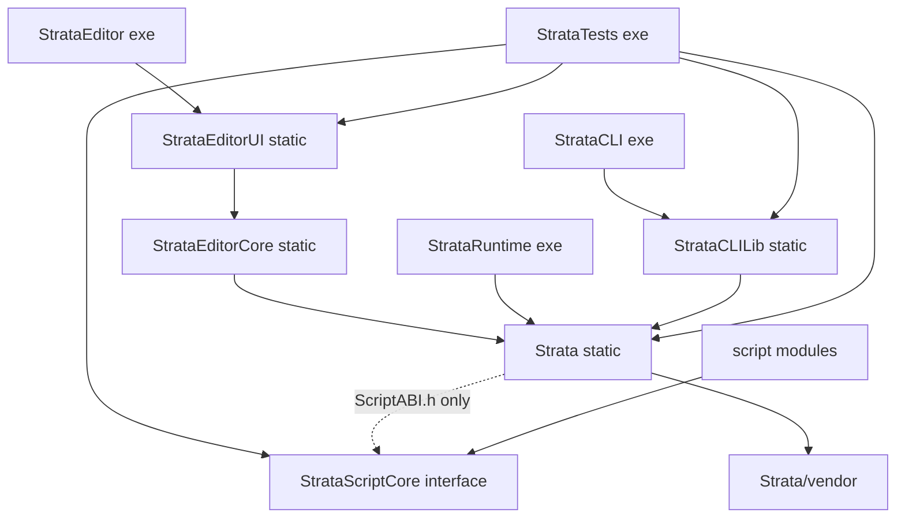

# Strata architecture

How the engine, the editor, the runtime and the tools fit together, for an engineer joining the project. Rules and
conventions (code style, testing, the review checklist) are in [AGENTS.md](../AGENTS.md) and are not repeated here;
task playbooks are the skills in [.claude/skills/](../.claude/skills/). Every section names the code it describes:
when that code changes, update this file in the same commit (AGENTS.md, review checklist item 5).

Paths are relative to the repository root. Engine modules live in `Strata/src/Strata/<Module>/`, so `Scene/Scene.h`
means `Strata/src/Strata/Scene/Scene.h`.

1. [Targets and dependencies](#targets-and-dependencies)
2. [Engine modules](#engine-modules)
3. [Application and frame loop](#application-and-frame-loop)
4. [Scene runtime lifecycle](#scene-runtime-lifecycle)
5. [Threading model](#threading-model)
6. [Asset pipeline](#asset-pipeline)
7. [Streaming and residency](#streaming-and-residency)
8. [Render scene](#render-scene)
9. [Scripting](#scripting)
10. [Editor](#editor)
11. [Export and the runtime](#export-and-the-runtime)

## Targets and dependencies

The root `CMakeLists.txt` adds `Strata/vendor`, `StrataScriptCore` and `Strata`, then the optional targets
(`STRATA_BUILD_EDITOR`, `STRATA_BUILD_RUNTIME`, `STRATA_BUILD_CLI`, `STRATA_BUILD_TESTS`). An arrow means "links".



Each target is defined in the `CMakeLists.txt` of its directory; script modules by `strata_add_script_module()` in
`StrataScriptCore/CMake/StrataScriptModule.cmake`. The brand assets (the strata mark as PNGs, raw RGBA and `.ico`, in
`StrataEditor/Resources/Brand/`) are drawn by `Tools/GenerateBrandAssets.py` and committed; `Core/Version.h` (from
`Version.h.in`) carries the version and, through `Core/VersionCommit.h`, the git commit of the build (`c_EngineCommit`),
which the `StrataVersionCommit` target reads at every build (`CMake/StrataVersionCommit.cmake`; the header changes only
when the commit does).

| Target | Kind | What it is |
| --- | --- | --- |
| `Strata` | static library | Engine modules, platform code, embedded shaders and default font (`Strata/src/`). |
| `StrataScriptCore` | interface library | Script C ABI and header-only C++ SDK; links glm only (`StrataScriptCore/`). |
| `StrataEditorCore` | static library | The editor without UI (`StrataEditor/src/Editor/`). |
| `StrataEditorUI` | static library | The ImGui interface on the core: `EditorLayer`, panels, widget kit, theme, embedded fonts; links `nfd` (`StrataEditor/src/UI/`, `Panels/`, `EditorLayer.*`). |
| `StrataEditor` | executable | Runs the UI: `EditorApplication` (options, theme and fonts, `EditorHost`) (`StrataEditor/src/EditorApplication.cpp`). Embeds the window icon (`EditorIcon.h`); on Windows `StrataEditor.rc.in` adds the `.ico` and version information. |
| `StrataRuntime` | executable | Plays exported games (`StrataRuntime/src/RuntimeApplication.cpp`); on Windows `StrataRuntime.rc.in` gives it (and every exported game) the `.ico`. |
| `StrataCLILib`, `StrataCLI` | static library, executable | Automation client and MCP server (`StrataCLI/src/`). |
| `StrataTests` | executable | doctest suites; builds the test script modules as dependencies (`StrataTests/`). |
| script modules | `MODULE` libraries | Game code: the tests' modules and every game project's `Scripts/`. |

CTest runs the `StrataTests` suites in groups selected by suite name (`StrataTests/CMakeLists.txt`; the groups and
labels are listed in AGENTS.md, "Testing"). The perf lab is one of them: suites `Perf.*` and `PerfGPU.*`
(`StrataTests/src/Perf/`) measure metrics against the budgets in `StrataTests/Perf/Budgets.json`, in Release and Dist
only, confirm a metric over its budget by measuring it again before failing (`Perf::CheckBudgetsConfirmed`), and write
`<build>/PerfResults/<config>.json` with every attempt; `Tools/PerfStability.py` runs them repeatedly and reports how
stable each metric is. `Perf.Scene`, `Perf.Scripting`, `Perf.Physics` and `PerfGPU.Renderer` measure scenes built by
`Perf/SceneGenerators.h` (flat roots, a nested tree, scripted entities, stacks of falling boxes, grids of cubes and
point lights); `Perf.Editor` (editor commands), `PerfGPU.Editor` (the real `StrataEditor`'s frame times on generated
100,000- and 1,000,000-entity scenes, read from its `editor.wait` results) and the editor frames of `PerfGPU.Renderer`
(`RendererFramePerfTests.cpp`) live in `src/Editor/`, which only builds with the editor.

What may depend on what:

- `Strata` knows nothing about the editor, the runtime executable, the CLI or the tests. It links `StrataScriptCore`
  privately and only for `StrataScript/ScriptABI.h`; it never includes the C++ SDK (comment in
  `Strata/CMakeLists.txt`). Its public dependencies are glm, EnTT, spdlog, nlohmann_json, NVRHI, Dear ImGui and
  ImGuizmo; Vulkan, GLFW, Jolt, miniaudio, stb, cgltf, MikkTSpace and meshoptimizer are private, so dependents do not
  see their headers.
- Script modules link `StrataScriptCore` only and never the engine; only two entry points are exported
  (`StrataScriptModule.cmake`). See [Scripting](#scripting).
- `StrataEditorCore` holds the editor's state and commands; `StrataEditorUI` only draws that state and calls the
  commands, and reaches the application only through `EditorHost` (`StrataEditor/src/EditorHost.h`), so tests link both
  and draw the UI without a window or GPU (`StrataTests/src/Editor/ImGuiHarness.h`).
- StrataCLI's logic lives in `StrataCLILib` so that `StrataTests` can link it (`STRATA_TESTS_HAVE_CLI`). Editor and
  CLI tests compile only when those targets exist (`StrataTests/CMakeLists.txt`).
- Platform code is in `Strata/src/Platform/` (`Windows`, `Posix`, `GLFW`, `Vulkan`), filtered per OS by
  `Strata/CMakeLists.txt`; engine modules reach it through interfaces such as `Core/Platform.h`, `Core/Window.h`,
  `Core/CrashGuard.h`, `Core/Process.h`, `Core/DynamicLibrary.h`, `Core/FileChangeNotifier.h` and
  `Renderer/GraphicsDevice.h`. Engine code outside `src/Platform/` includes no OS headers.

Applications built on `Application` (editor, runtime) get `main` from `Core/EntryPoint.h`, which calls the client's
`CreateApplication`, runs it and returns its exit code. `StrataCLI` has its own `main` and no `Application`.

## Engine modules

**Core** (`Core/`). `Application` owns the window, the graphics device, the layer stack and the main-thread queue
and runs the frame loop; `Layer`/`LayerStack` hold the client's behavior; `Window` is implemented by
`Platform/GLFW/GLFWWindow` (`SetIcon` takes RGBA images of several sizes; macOS and Wayland windows have no icon of
their own and ignore it). Services: `Log` (spdlog; `LogBuffer` backs the editor console and `log.read`), `Assert`,
`JobSystem`, `FileSystem` (UTF-8 paths), `FileReader` (one open file read at explicit offsets by any number of threads:
overlapped `ReadFile` on Windows, `pread` on POSIX), `FileWatcher`, `FileLock`, `Platform` (OS services, private directories,
process memory with peaks: `GetProcessMemory`, process uptime: `GetProcessUptime`),
`Process` (child processes), `DynamicLibrary`, `CrashGuard`, `UUID`, `Hash` (FNV-1a, and CRC-32C with the processor's CRC
instructions where it has them), `Crypto` (SHA-256, peer authentication), `Base64`,
`CommandLine`, `Timer`/`FramePacer`, `JsonUtils` (exception-free JSON reads), `SequenceLock` (lock-free hand-off to the
audio thread), `EngineServices` (process-wide interfaces a module or the program running a game offers the modules that
may not include it, such as the audio output's master volume, `IAudioOutput`, the game's window, `IGameWindow`, and its
save directory, `IGameSaves`), `SaveFiles` (a game's save files: names checked before any path is formed, atomic writes;
`SaveDirectory`), `FrameProfiler` (the always-on timer of the main thread's frame stages,
see [Frame profiler](#frame-profiler)) and `Profiling` (`ST_PROFILE_STAGE`; Tracy with `STRATA_ENABLE_TRACY`).

**Events** (`Events/`). Window, key and mouse events (`ApplicationEvent.h`, `KeyEvent.h`, `MouseEvent.h`, including
`WindowFileDropEvent` and `WindowContentScaleEvent`, raised when the window moves to a display with another DPI setting
or the setting changes) are dispatched synchronously: `Application::OnEvent` hands each one to the layers from the top
down until one marks it handled (`EventDispatcher`). An unhandled `WindowCloseEvent` ends the application, so a layer
can veto closing (the editor asks about unsaved changes).

**Input** (`Input/`). `Input` is a static polling API: down state, per-frame pressed/released transitions, mouse
position relative to the input viewport, deltas, scrolling and gamepads (up to four, the GLFW gamepad mapping:
`GamepadCodes.h`; sticks -1 to 1 with +Y up, triggers 0 released to 1 pressed, which `GLFWWindow` converts GLFW's values
to; out-of-range and non-finite values are clamped or read at rest). `GLFWWindow` feeds it (`Input::Process*`);
Input reaches the window only through `InputWindow` (size, cursor mode), which `Window` implements, so the input layer
stays below the application shell. It also has a virtual device for tools (`SimulateKey`, `SimulateGamepadButton`,
`SimulateGamepadAxis` and friends) merged with the real devices (a gamepad simulated input used counts as connected; an
axis it holds wins over the device's until released), `SetEnabled` (device input off, e.g. while the editor's game view
has no focus; sticks and triggers then read at rest) and `SetSuspended` (input frames follow the game's updates). The
cursor mode a game asks for (`SetGameCursorMode`, scripts' `Input::SetCursorMode`) applies to the window only while input
is enabled: disabling input gives the cursor back, enabling it applies the game's mode again, so a locked cursor in the
editor stays in the focused game view (the editor's UI ignores the mouse meanwhile, and the game view says that Shift+F1
frees it and Ctrl+P stops the game) and Shift+F1 frees it. `InputNames` maps key, button and gamepad control names for
the `input.*` commands.

**Math** (`Math/`). Engine conventions in `Math.h`: right-handed, +Y up, -Z forward, reversed-Z projections, Euler
angles in degrees. `AABB`, `Frustum`, `Ray`, and `Random` (thread-local generators).

**Reflection** (`Reflection/`). `PropertyType` (Bool to Entity), `PropertyInfo` (ranges, enum options, flags),
`PropertyBuilder`, `ComponentRegistry` (`ComponentInfo`: metadata plus type-erased ECS operations; components are
registered while the composition root runs and the registry is frozen afterwards, see
[Composition root and registries](#composition-root-and-registries)) and `PropertyJson` (canonical JSON plus lenient
parsing for automation). Reflection is the single description of component data: `SceneSerializer`, the inspector
(`StrataEditor/src/UI/PropertyWidgets.h`), the `component.*` commands, undo snapshots and script property access all
go through it, mostly via `Scene/ComponentAccess`.

**Scene** (`Scene/`). `Scene` owns the EnTT registry, the UUID map, the hierarchy and the cached world transforms,
and while it runs its scene systems (see [Scene runtime lifecycle](#scene-runtime-lifecycle)). `Entity` is a
non-owning handle. Components are plain structs in `Components.h`, registered with stable names in
`ComponentRegistration.cpp` (ID, Name, Transform, Relationship, Tag, Inactive, PrefabInstance, Camera, MeshRenderer,
DirectionalLight, PointLight, SpotLight, SkyLight, PostProcess, Text, RigidBody, BoxCollider, SphereCollider,
CapsuleCollider, MeshCollider, CharacterController, AudioSource, AudioListener, Script). `ComponentAccess` reads and writes them with
validation and change signals, `SceneSerializer` writes versioned JSON (keeping components it cannot read, see
[Composition root and registries](#composition-root-and-registries)), and `Prefab.h` defines the scene-shaped assets
(`EntityTemplate`, `Prefab`, `Model`, `SceneAsset`). `SceneServices.h` defines the interfaces through which the systems
of a playing scene use each other (see [Scene services](#scene-services)). See [Scene caches](#scene-caches) for how
per-frame cost follows what changed.

**Asset** (`Asset/`). `AssetManagerBase` (registry, asynchronous loading and residency, dependencies, bounds and group
loads), `AssetStreamingQueue` (the order and admission of loads), `AssetResidency` (memory pools, budgets, `AssetPin`,
eviction), `AssetManager` (the process-wide active manager), `AssetPack` (reads packs by byte range), `EditorAssetManager`
(project files, `.meta` sidecars, imports, dependency records, hot reload, pack planning), `RuntimeAssetManager` (reads
mounted `AssetPack`s), `AssetPackWriter` and `AssetDependencies` (tooling: writing packs, finding what documents
reference), `AssetImporter` with the built-in importers
(`AssetImporters.cpp`, `GltfImporter`, `TextureImporter`), `AssetLoaderRegistry` (the loaders, registered by the
modules that own the types) and `BuiltinAssets` (fixed handles; the owning module provides each object through a
factory). The asset types are Scene, Prefab, Model, Mesh, Material, Texture, AudioClip and Font (`AssetTypes.h`). See
[Asset pipeline](#asset-pipeline) and [Streaming and residency](#streaming-and-residency).

**Renderer** (`Renderer/`). `GraphicsDevice` is the device interface (NVRHI on Vulkan, implemented in
`Platform/Vulkan/VulkanGraphicsDevice.cpp`; it owns the swapchain and frames in flight, 2 by default). `Renderer`
holds the process-wide services: the device, `ShaderLibrary` (SPIR-V compiled from `Strata/shaders` by glslang at
build time and embedded, `CMake/StrataShaders.cmake`), samplers, fallback textures, `BindlessTextureTable`,
`StagingPool` (staging memory for texture and mesh uploads, reused), `DeferredReleaseQueue` (`ReleaseDeferred`:
resources dropped while the GPU may still use them, held until an event query set at the release completes and collected
every frame and at every release, never waiting; NVRHI's Vulkan backend keeps what command lists reference alive, but not
the textures of clears) and the blocking `ReadTexture`. `RenderScene` keeps a scene's render proxies in a `SpatialIndex`,
and `SceneRenderer` extracts each frame's draws from it (`SceneRendererExtraction.cpp`, resolving assets through its
`AssetResolveCache`; see [Render scene](#render-scene)). `SceneRenderer` draws a scene (light clustering, shadow cascades,
depth/normal/entity-ID prepass, GTAO, forward PBR, sky, transparents, exposure, bloom, tone mapping, FXAA, then overlays
and text) into render targets of its viewport size, which it hands to the `DeferredReleaseQueue` when it is resized
(the viewport panel, the game window) or freed (captures); its output texture exists only once a frame needed it (one
without a target, or composing overlays or text before copying into the target), so a game without text renders
straight into the back buffer and never allocates one. Its image-based lighting comes from the sky light's
environment map or its procedural sky (`IBL/ProceduralSky.comp` writes mip 0 of the environment cube, then the shared
filtering chain runs), computed again only when the source or the procedural parameters change; editor views can ask
for preview lighting, leave out screen-space text and tint entities (`SceneRenderOptions::EntityTints`: the first
overlay, `Overlay/StatusTint.frag`, blends the listed entities' colors over exactly their pixels of the entity-ID buffer,
found by binary search in a sorted (id, color) buffer like the selection outline's). How a mesh's level of detail is
chosen is a pure function (`LODSelection::GetScreenFraction`, `SelectLOD`), so tools show the level the renderer draws.
Assets: `Mesh`, `Material`, `Texture`, `Font`; procedural primitives come from `MeshFactory`; texture formats, the cooked
texture format and the block decoders are `TextureFormat`, `CookedTexture` and `BlockCompression` (see
[Texture cooking](#texture-cooking)). Also `TextRenderer`/`FontAtlas`, `DebugDraw`/`SceneGizmos`, `TextureReadback`
(non-blocking GPU readback) and `ImageWriter` (PNG). Conventions and rules: AGENTS.md, "Architecture rules" and
"Rendering".

**Physics** (`Physics/`). `PhysicsSystem` is the "Physics" scene system (Play and Simulate). `PhysicsWorld` builds a
Jolt world from RigidBody and collider components and steps it; `PhysicsRuntime` reference-counts Jolt's global
state; `PhysicsJobSystem` runs Jolt's jobs on the engine's worker pool; `PhysicsMeshShapes` cooks mesh collider shapes
on jobs and caches them process-wide; `AssetMeshProvider` supplies mesh data from the active asset manager.
`PhysicsTypes.h` has the settings and statistics. Collision layers are the scene's (`SceneSettings::PhysicsLayers`,
`Scene/PhysicsLayerSettings.h`: names for up to 32 layers and a symmetric matrix of which collide, everything by
default); `PhysicsSystem` gives its world that matrix, restricted by the default settings' (`GetDefaultSettings`), when
it creates the world and before every step after it changed (`scene.setSettings`, undo, the inspector, scripts'
`Physics::SetLayersCollide`, `PhysicsSystem::SetLayersCollide`; `PhysicsWorld::SetLayerCollisionMasks` wakes the bodies,
and character controllers read the world's live matrix). A world's capacities are fixed when it is created: those the
scene does not set (`SceneSettings::PhysicsCapacity`) are sized from the bodies the scene starts with
(`PhysicsWorld::ResolveCapacities`: at least 65,536 bodies, the next power of two of twice the bodies; four body pairs per
body slot; at least 10,240 contacts, two per body; scratch memory for them), bodies that find the world full wait for a
slot and are reported in one error, steps that overflow the pair or contact buffers are counted
(`PhysicsStats::BodyOverflowCount`, `ContactOverflowSteps`), and what a world lacked is remembered per scene
(`Scene::GetLineageID`: the scene asset it was loaded from or saved as, else the scene and its copies; never another
scene of the same name), so the scene's next world is sized for it. Jolt reserves a world's buffers when it is created
and does not survive a failed allocation, so the capacities a scene may ask for are limited (`PhysicsCapacitySettings`:
about 80 bytes per body, 90 per body pair and 830 per contact constraint, about 940 MiB at the limits). Other systems
use physics through the scene services `PhysicsSystem` offers (`ICollisionEventSource`, `IBodyMotionQuery`,
`IBodyControl`, `IPhysicsQueries`, `ICharacterControl`, with `CollisionEvent`, `RaycastHit` and `CharacterState`, in
`Scene/SceneServices.h`); collision events
collected during a step are dispatched
afterwards on the main thread to the listeners. Contacts are tracked only for pairs someone wants (every pair while a
listener of all entities is registered, otherwise pairs with a watched entity, such as one whose script has contact
callbacks): Jolt's job threads record those into buffers of their own, without a lock, which are merged and sorted after
the step, and each touching pair knows its position in the pair lists of both its entities, so it is added and removed
in constant time (`PhysicsStats::PairIndexOperations` counts the list writes). Bodies created while changes are applied
(play start, a prefab spawn, a streamed cell) join the simulation in one batch per activation mode
(`AddBodiesPrepare`/`AddBodiesFinalize`), and destroyed bodies leave it in one batch, when `ApplyPendingChanges` ends;
each Jolt body index leads to its entity and record in constant time (`BodySlot`). Jolt rebuilds a broad phase tree, and
frees the nodes of the bodies removed from it, only while the tree holds bodies, and aborts the process when its fixed
node pool runs out: so every world keeps one static anchor body in each of its two trees (static and moving bodies), on a
layer outside the 32 that collides with nothing and that no query accepts, beside its body capacity
(`c_BroadPhaseAnchorCount`). Bodies spawned and removed again before every step then cost nodes only until the next step
(`Physics.Capacity` runs such spawns in a helper process). Around each step the work on awake
bodies runs on the job system: the synchronization skips, in parallel chunks, the bodies whose entity is where the last
step put it (`Scene::FindCurrentWorldTransform` reads only current cached matrices), and the write-back writes the poses of
bodies without a dynamic ancestor in parallel chunks, each touching only its own record and `TransformComponent` through
pointers fetched beforehand, against parent world transforms read before the writes, then tells the scene about all of them
at once (`Scene::MarkTransformsChanged`, no `on_update`); bodies below other written dynamic bodies follow one by one,
parents first, and the rare cases (scale edits, failed writes, descendants to update) are handled on the main thread in body
order, so the results do not depend on the number of threads. Body order comes from a bitmap over the body indices of
which only the words that got bits are sorted, read and cleared, so a step costs what moved, not the world's capacity.

**Character controllers** (`Physics/CharacterControllers`, `CharacterControllerComponent`). An entity with an active,
enabled controller and no rigid body (an entity with both is the rigid body, with a warning) is a Jolt `CharacterVirtual`:
an upright capsule standing on the entity's origin (its rotation and scale do not change it) that moves by collision
queries, plus a kinematic presence body (90% of its radius, its top at the capsule's, carrying the entity's UUID) through
which dynamic bodies land on it, triggers detect it and queries hit it. Each fixed step, after the bodies are synchronized
and before Jolt's step, `CharacterControllerSet::Step` moves every controller: its velocity is the walk velocity its
script set (`ICharacterControl::MoveCharacter`, kept until the next call; the vertical part only without gravity), a
pending jump, accumulated root motion (`AddCharacterMotion`, the animation stream's hook) and gravity times its
`GravityScale`; standing on walkable ground it takes on the ground's velocity (moving platforms), in the air its vertical
velocity goes on (a ceiling stops a rise). Jolt's `ExtendedUpdate` then slides it along walls, walks it up steps up to
`StepHeight` and keeps it on the ground walking down, against the layers its layer collides with (the world's live
matrix) and never its own entity's bodies. The moves run in parallel batches on the job system (bounded scratch memory
per batch), each reading only the world before the step and writing only its own controller: Jolt would push dynamic
bodies from many threads in any order, so the set disables that and pushes afterwards, on the main thread in entity order
(`PushBodies`: an inelastic push, the body's effective mass at the contact times the speed the character closes in on it
along the normal, never downwards and at most `PushStrength` newtons over the step; and the character's weight, 70 kg
under its gravity, pressing on a dynamic body it stands on: all of it while it stands, the part across the surface while
it slides down steep ground), moves the presence bodies and writes each entity's translation
(`Scene::MarkTransformsChanged`; its rotation and scale stay). So the results do not depend on the number of threads
(`Physics.Character`), and 1,000 walking controllers take about 0.8 ms per step (`Perf.Physics.Characters1000Step`). An
entity moved from outside (a script writing its transform, the editor) teleports its controller at the next step. The
controllers' contacts (`GetActiveContacts`, one per touched body) join the step's contact reports, so `CollisionEvent`s
and the scripts' `OnCollisionEnter/Exit` report them like any body's; triggers and bodies landing on a controller reach
it through its presence body (`OnTriggerEnter/Exit`). The ground state (on ground, on steep ground, not supported, in
air), ground normal, velocity and entity are `CharacterState` (`ICharacterControl::GetCharacterState`).

**Audio** (`Audio/`). `AudioEngine` wraps the miniaudio mixer, output device, listener and one-shots (main-thread
API; mixing runs on miniaudio's audio thread, or is pulled with `AdvanceNullDevice`/`ReadFrames` without a device).
`AudioClip` is immutable sound data, decompressed or streamed; `AudioClipAsset` is its asset, `AudioSource` a voice
with settings, and `AudioSystem` the "Audio" scene system (Play only), which offers the scene service `IAudioPlayback`;
the module registers the engine service `IAudioOutput` (master volume). Details: AGENTS.md, "Audio".

**Scripting** (`Scripting/`). `ScriptEngine` (the loaded module, hot reload, faults, optional watchdog),
`ScriptModule` (loading, validation and guarded calls), `ScriptSystem` (the "Scripting" scene system: instances and
callbacks), `ScriptHostAPI` (the host function table), `ScriptValue` (ABI value conversions), `ScriptTypes`
(class, field and fault descriptions) and `ScriptWatchdog`. See [Scripting](#scripting).

**Project** (`Project/`). `Project` is a game project: the `.stproj` file (with the export settings,
`Export.AlwaysInclude`), the asset directory, the script sources and the intermediate directory `.strata/` (`Cache/`,
`Scripts/Build/`, `Scripts/Bin/`), plus the process-wide active project. `GameManifest` is the `.stgame` file of an exported game
(name, asset pack and patch packs, start scene, script module, window settings).

**Runtime** (`Runtime/`). `GameRuntime` runs an exported game without depending on windowing or rendering: it opens
the pack, loads the script module, starts scenes and honors their requests. `GameRenderer` draws the running scene
from its primary camera, or a message frame that names the problem, with a scene renderer that writes no entity-ID
buffer (`SceneRendererSpecification::EntityIDs`: games do not pick by pixel). See
[Export and the runtime](#export-and-the-runtime).

**Network** (`Network/`). `TcpSocket`/`TcpListener`/`SocketPoller` (`Socket.h`, implemented in
`Platform/Windows/WindowsSocket.cpp` and `Platform/Posix/PosixSocket.cpp`), `JsonRpc` (newline-delimited JSON-RPC
2.0), `RpcServer` (network thread, `RpcAuthentication` handshake, handlers on the main thread), `RpcClient`
(synchronous) and `EditorSession` (session files and discovery). Used by editor automation and StrataCLI; the
runtime does not use it. Protocol and security model: AGENTS.md, "Automation (editor RPC + MCP)".

**ImGui** (`ImGui/`). `ImGuiLayer` owns the Dear ImGui context; `Application` pushes it as an overlay when ImGui is
enabled and a window and graphics device exist, and calls `Begin`/`End` around the layers' `OnImGuiRender`. It styles
the UI for the window's content scale, on attach and on every `WindowContentScaleEvent`: the style is rebuilt from
ImGui's dark defaults by the application's style callback (`SetStyleCallback`; the editor installs its Bedrock theme) and
the fonts' DPI scale (`ImGuiStyle::FontScaleDpi`) follows; `SetContentScaleOverride` fixes the scale (`--ui-scale`).
`ImGuiPlatform` is the platform backend, written for the engine (the vendored GLFW backend is not built): ImGui's input
comes from the window's events (keys by what they type in the keyboard layout, `Window::GetLayoutKey`, with their
modifiers; typed text, also from input methods; the mouse, its wheel and `MouseLeaveEvent`; focus), its clipboard and
cursor shapes from the window (`Window::SetCursorShape`, only when ImGui asks for another shape and while the cursor
mode is Normal), and on Windows ImGui's own input method support places candidate lists through the window's handle
(`Window::GetPlatformHandle`). A frame asks the system only for the framebuffer's size: for multi-viewport support the
editor does not use, the vendored backend set the window's mouse passthrough (`SetWindowLongW`) and enumerated the
monitors every frame, and hooked the window procedure, about 0.05 ms of an idle editor frame in all.
`ImGuiRenderer` is the NVRHI backend (user textures are `nvrhi::ITexture*`); it copies the draw lists straight into
vertex and index buffers the CPU writes and the GPU reads, mapped once, one set per frame the GPU may still be drawing
(an event query says when the GPU is done with a set). Only the editor enables it. Draw callbacks
set how the following draws sample (ImGui's linear and nearest sampler callbacks) and show their textures
(`AddImGuiTextureDisplay`: `ImGuiTextureDisplay` as a push constant of `ImGui.frag`), so a texture whose stored layout
would look wrong as sampled (sRGB, one channel standing for gray, a two-channel normal map) shows its content
(`GetImGuiTextureDisplay`).

**Engine** (`Engine/`). `BuiltinModules`, the composition root (below), and nothing else: the only code that knows every
runtime module (tooling, the asset pipeline, is handed in by the programs that use it).

### Layers

The modules form a stack of layers, defined by path patterns in `StrataTests/Architecture/Layers.json` (the patterns
stand in for the library split of wave 4, so the rules apply before files move). A file may include files of its own
layer and of the layers it lists, which are always lower ones:

| Layer | Files (under `Strata/src`) | May include |
| --- | --- | --- |
| Core | `Core/**` except the application shell, `Math/**`, `stpch.h`, `Platform/Windows`, `Platform/Posix` (not the sockets) | nothing |
| Input | `Events/**`, `Input/**` | Core |
| App | `Core/Application.*`, `Layer.*`, `LayerStack.*`, `Window.h`, `EntryPoint.h`, `Platform/GLFW/**`, `Platform/Vulkan/VulkanLoader.*` | Core, Input |
| Asset | `Asset/**` except the pipeline files | Core |
| Reflection | `Reflection/**` | Core, Asset |
| Scene | `Scene/**` | Core, Asset, Reflection |
| Renderer | `Renderer/**`, `Platform/Vulkan/**` | Core, Input, App, Asset, Reflection, Scene |
| Physics, Audio | `Physics/**`, `Audio/**` | Core, Asset, Reflection, Scene |
| Scripting | `Scripting/**` | Core, Input, Asset, Reflection, Scene |
| Project | `Project/**` | Core, Asset, Reflection |
| Runtime | `Runtime/**` | Core, Input, App, Asset, Reflection, Scene, Renderer, Physics, Audio, Scripting, Project |
| Network | `Network/**`, `Platform/*/*Socket.cpp` | Core |
| ImGui | `ImGui/**` | Core, Input, App, Renderer |
| AssetPipeline | `Asset/EditorAssetManager.*`, `AssetImporter.*`, `AssetImporters.cpp`, `GltfImporter.*`, `TextureImporter.*`, `TextureCooker.*`, `BC7Encoder.*`, `AssetPackWriter.*`, `AssetDependencies.*` | Core, Asset, Reflection, Scene, Renderer, Audio |
| Engine | `Engine/**`, `Strata.h` | everything but AssetPipeline (shipped games link the composition root too; see below) |

`Architecture.Layering` (`StrataTests/src/Architecture/LayeringTests.cpp`, in `StrataTests.Core`) reads every C, C++ and
Objective-C(++) source and header under `Strata/src` (`STRATA_SOURCE_DIR`; `.h`, `.hpp`, `.inl`, `.c`, `.cpp`, `.m`, `.mm`,
so the macOS platform code too), parses its `#include`s, quoted and angle-bracketed (`Strata/src` is a public include
directory, so `<Strata/...>` reaches engine headers too; `LayeringAnalyzer`: comments, literals and `#if 0` blocks
skipped; resolved like the preprocessor, quoted includes next to the file first, both forms from `Strata/src`; standard
and third-party headers match no layer and are skipped), maps both ends to their
layers and fails on every file that is in no layer or in several, on every forbidden include that is not in
`StrataTests/Architecture/LayeringAllowlist.txt`, and on every allowlist line that matches nothing. Each allowlist line
names the include, the roadmap workstream that removes it and the reason; the list holds exactly `MaxAllowlistEntries`
lines (9: the application shell wiring services, asset uploads on the renderer and physics reading renderer meshes), so
it can only shrink. Scripting and Audio, which used to include the physics and audio systems, reach them through scene
services (see [Scene services](#scene-services)).

### Composition root and registries

The engine is extended through registries rather than through code that knows its modules: `ComponentRegistry`
(components), `AssetLoaderRegistry` (stored bytes to asset objects), `AssetImporterRegistry` (source files to stored
bytes), `BuiltinAssets` (objects of the built-in assets) and `SceneSystemRegistry` (runtime systems of playing scenes).
`Engine::RegisterBuiltinModules` (`Engine/BuiltinModules.cpp`) fills them, once per process, before anything reads
them:

```text
open the registries (BeginRegistration; not the importers')
RegisterSceneModule        Scene/SceneRegistration.cpp         components (ComponentRegistration.cpp); Scene, Prefab, Model loaders
RegisterRendererModule     Renderer/RendererRegistration.cpp   Texture, Mesh, Material, Font loaders; built-in meshes and material
RegisterScriptingModule    Scripting/ScriptingRegistration.cpp "Scripting" system
RegisterPhysicsModule      Physics/PhysicsRegistration.cpp     "Physics" system
RegisterAudioModule        Audio/AudioRegistration.cpp         AudioClip loader, "Audio" system
options.AssetPipeline      RegisterAssetPipeline, Asset/AssetImporters.cpp: opens the importer registry, importers
options.Extra              registrations of games, tools and tests
ComponentRegistry::Freeze
```

- **Callers.** The `Application` constructor calls it first thing, without options, so every application is covered;
  a client that needs options calls it earlier. The editor does, in `CreateApplication`, to hand in the asset pipeline
  (`ModuleRegistrationOptions::AssetPipeline = RegisterAssetPipeline`); `StrataTests` does in `main`, before doctest
  runs and the helper modes start. StrataRuntime keeps the constructor's call: games read cooked packs, and since the
  composition root never names the importers (the Engine layer may not include AssetPipeline), the linker leaves them
  out of the runtime. A second call is a no-op (with an error when it carries an asset pipeline or `Extra`
  registrations, which would be lost).
- **Use before registration** fails `ST_CORE_VERIFY` with a message naming `Engine::RegisterBuiltinModules`, in every
  registry: a program that forgot the composition root stops at its first lookup instead of running without
  components or loaders. The importer registry stays closed in programs without the asset pipeline, so a game that
  reached for an importer stops there too.
- **Component lifecycle.** `ComponentRegistry` is closed, then open (`BeginRegistration`: `Register<T>` is valid from
  any registering code), then frozen (`Freeze`): the set of components never changes afterwards, so reads take no lock
  and are safe from any thread (asset loads deserialize scenes on workers). `Register<T>` after `Freeze`, for a type
  that is registered already or under a name that is taken (ignoring case), logs an error and returns a builder that
  converts to false and discards what it is given; nothing aborts. A game registers its components through
  `ModuleRegistrationOptions::Extra`.
- The loader, importer, built-in asset and scene system registries stay open: tools and tests register more later
  (a later loader or importer replaces or overrides the built-in one).
- **Components of modules a build lacks survive.** A scene, prefab or snapshot can name components this build does
  not register (a game module that is not loaded, a newer engine). `SceneSerializer::DeserializeEntities` keeps them
  verbatim in the runtime-only `UnknownComponentsComponent` (`Scene/UnknownComponents.h`; not registered, so the
  editor, reflection and the feature test never see it) and warns once per component name per load
  (`SceneAsset::CreateScene` logs its warnings); the writer puts them back next to the registered components, so a save
  writes them unchanged. `Scene::Copy` (play mode), prefab snapshots (`SerializeEntities`), `Scene::DuplicateEntity`
  and the editor's undo snapshots (`EntityState`, `Editor/SceneEdit.cpp`) carry them; restoring undo snapshots does not
  warn again (`EntityInstantiationOptions::ReportUnknownComponents`).

## Application and frame loop

Startup (`Application::Application`, `Core/Application.cpp`): `Engine::RegisterBuiltinModules` (a no-op when the client
registered the modules already), opt the process out of execution-speed power throttling
(`Platform::DisableExecutionSpeedThrottling`: Windows 11 otherwise runs processes whose windows are in the background or
covered at a lower quality of service, on hybrid processors on the efficiency cores, where an editor frame takes 1.3 to
1.9 times as long; the test runner does the same, so perf suites measure what applications get), set the working
directory, `JobSystem::Init`, create
the window unless headless, `Input::Reset`, create the graphics device, swapchain and `Renderer` when
`EnableRenderer` is set (no usable device: exit code 1), `AudioEngine::Init` (the null device when headless), and push
the `ImGuiLayer` overlay. The client's constructor then pushes its layer (`EditorLayer`, `RuntimeLayer`).

One frame (`Application::Run` and `RunFrame`):

```text
 1  ExecuteMainThreadQueue           functions queued with Application::SubmitToMainThread
 2  Input::BeginFrame                new input frame; queued simulated input applies
 3  Window::ProcessEvents            glfwPollEvents: Input::Process*, events through the layers
                                     window minimized: sleep 16 ms, frame skipped (not counted)
 4  GraphicsDevice::BeginFrame       cannot begin (e.g. mid-resize): sleep 16 ms, skipped; device lost: close
    Renderer::BeginFrame
 5  Layer::OnUpdate(timestep)        every layer in stack order: the editor's or the game's work, below
 6  AudioEngine::AdvanceNullDevice   only while mixing without an output device
    AudioEngine::Update              reclaims finished one-shots
 7  RenderImGui                      ImGuiLayer::Begin, every Layer::OnImGuiRender, ImGuiLayer::End
 8  back-buffer captures, GraphicsDevice::EndFrame (present)
    frame counted; MaxFrames (--frames) closes the application; the frame pacer waits (frame rate cap)
```

`Application::GetLastFrameWorkTime` is the CPU time of the last frame: steps 1 to 7 without the wait inside
`GraphicsDevice::BeginFrame` (for the GPU's earlier frames and the swapchain image), so it measures what a frame costs
whatever the display's refresh rate. The editor records it every frame (`EditorContext::RecordFrameTime`) and
`editor.wait` reports statistics of the frames it waited through (`frameTimes`), which is how command scripts and the
`PerfGPU.Editor` perf test measure editor frames.

The timestep is the wall time since the previous frame, clamped to `ApplicationSpecification::MaxTimestep` (0.25 s).
Windowed applications are paced by vsync when it is on (`WindowSpecification::VSync`) and by their frame rate cap;
headless ones by the cap alone, which the editor and the runtime set to 60 (`MaxFrameRate`,
`StrataEditor/src/EditorApplication.cpp`, `RuntimeApplication.cpp`). The cap is the application's `FramePacer`
(`Core/Timer.h`) and can change while it runs (`Application::SetMaxFrameRate`; setting the current rate keeps the frame
schedule): the editor lowers it while it is idle (see [Editor](#editor)). The pacer's wait comes after step 8, so
`Application::GetLastFrameWorkTime` leaves it out as well: a capped frame rate changes the rate, not the cost of a
frame. An exception escaping a frame (e.g. a lost device inside NVRHI) is logged and ends the loop.

The editor's layer update (`EditorLayer::OnUpdate`, `StrataEditor/src/EditorLayer.cpp`), after recording the previous
frame's work time:

1. `EditorContext::Update`: `ScriptEngine::Update` (hot reload), `ScriptBuilder::Update` (build processes),
   `EditorAssetManager::Update` (file changes, finished imports, load finalization, eviction), then either the running
   scene's `OnUpdateRuntime` followed by the script-fault check and the game's quit and scene-load requests, or the
   edited scene's `OnUpdateEditor`; then simulated input holds, input suspension, selection pruning and viewport picks.
2. `EditorCommandRunner::Update`: polls deferred commands.
3. `EditorAutomation::Update`: mirrors new commands as RPC methods, moves the session file with the project, and runs
   queued requests (`RpcServer::ProcessRequests`) through the runner.
4. The `--commands` script advances; quit, idle-timeout and last-frame checks run.

In step 7 the editor draws its shell and panels (`EditorLayer::OnImGuiRender`); the viewport panel renders the scene
there through `ViewportRenderer`. Last, idle throttling picks the frame rate cap for the next frames
(`EditorLayer::UpdateFrameRate`).

The runtime's layer update (`RuntimeLayer::OnUpdate`, `StrataRuntime/src/RuntimeApplication.cpp`):
`GameRuntime::Update` (asset finalization and eviction, `Scene::OnUpdateRuntime`, script-fault check, scene requests),
then the headless script-crash and quit checks, then `GameRenderer::Render` into the back buffer (windowed only) and the
`--screenshot` request on the last frame. The runtime has no ImGui.

Shutdown (`Application::~Application`): layers detach and are deleted top-down, the active asset manager and project
are released, the main-thread queue drains, `JobSystem::Shutdown` runs the queued jobs and joins the threads, then
audio, the renderer, the device and the window go.

### Frame profiler

`FrameProfiler` (`Core/FrameProfiler.h`) times the stages of every frame, always (not only with Tracy), and keeps the last
600 frames in a ring. `Application::RunFrame` begins the profiler's frame at its start and ends it with the frame's work
time after presenting, so its frame time is `GetLastFrameWorkTime`; a frame the application skips is never ended and is
discarded. Code marks a stage with `ST_PROFILE_STAGE("Name")` (`Core/Profiling.h`, also a Tracy zone) for the rest of a
scope; scopes on other threads than the one that drives the frames, and outside frames, do nothing. Stages nest and record
their self time (the stages inside them excluded), so a frame's stages never add up to more than the frame, and a stage
entered several times in a frame adds up. Its cost is about 0.6 microseconds per frame of 16 stages
(`Perf.FrameProfiler`). The built-in stages, registered first in this order (`c_BuiltinFrameStages`):

| Stage | Where |
| --- | --- |
| `Input` | `Input::BeginFrame` and the window's events (`Application::RunFrame`) |
| `Assets.Update` | `AssetManagerBase::Update` and `EditorAssetManager::Update` (file changes, imports, eviction) |
| `Assets.Finalize` | `AssetManagerBase::ProcessCompletions`: finalizing arrivals, GPU uploads |
| `Scene.Scripts`, `Scene.Physics`, `Scene.Audio` | the scene systems' start and update callbacks (`SceneSystemDescriptor::ProfileStage`) |
| `Scene.Transforms` | `Scene::UpdateWorldTransforms` when something is dirty |
| `Render.Extract` | `SceneRenderer::Render`'s `RenderScene::Sync` and `PrepareExtraction`, then `CullView`, `FindShadowCasters`, `ResolveAssets`, `GatherDraws`, `GatherShadowDraws` and `CollectLights` (`SceneRendererExtraction.cpp`) |
| `Render.Submit` | the rest of `SceneRenderer::Render`: recording and submitting the command list, text |
| `Editor.UI` | `Application::RenderImGui`: the layers' `OnImGuiRender` and ImGui's drawing (the viewport's render nests in it) |
| `Present` | `GraphicsDevice::EndFrame`, after the work time is measured (outside the frame time) |

Modules and games register more (`RegisterStage`, up to 64); a scene system names its stage in its descriptor. Each frame
also records how busy the job system's worker, I/O and background threads were since the previous frame
(`JobSystem::GetStats`: per-thread busy time and completed jobs, written by each pool thread under a sequence lock and
read without stopping it).
`Summarize` gives mean, nearest-rank 50th and 95th percentiles and maximum per stage; frame listeners
(`AddFrameListener`) receive every recorded frame. The editor reports it through `editor.perf`, the Performance panel and
the status bar's frame pill (see [Editor](#editor));
`StrataRuntime --perf-log` writes it as CSV (`Runtime/FramePerfLog`, see
[Export and the runtime](#export-and-the-runtime)).

## Scene runtime lifecycle

A `Scene` that plays owns scene systems (`Scene/SceneSystem.h`), created from `SceneSystemRegistry` in update order.
The built-ins (registered by their modules, see [Composition root and registries](#composition-root-and-registries))
are, in update order:

| System | Class | Modes | Order | Role |
| --- | --- | --- | --- | --- |
| Scripting | `ScriptSystem` | Play | | Script instances of the active `ScriptEngine` (null engine: no scripts). |
| Physics | `PhysicsSystem` | Play, Simulate | After Scripting | Jolt world; steps in `OnFixedUpdate`, then dispatches contacts. |
| Audio | `AudioSystem` | Play | After Physics | Sources and listener, in `OnLateUpdate` after scripts and physics. |

- **Update order.** A `SceneSystemDescriptor` names the systems it runs `After` and `Before`. The registry keeps the
  order of these constraints that follows registration order as far as they allow: the first registered system runs as
  early as the constraints allow, then the second, and so on (built from the back, placing the latest registered system
  whose successors are placed). A system thus moves ahead of earlier registered ones only when it has to run before a
  system that runs ahead of them, and a system no constraint involves runs after every system registered before it: a
  later "Wind" that runs `Before` Physics does not pull an unconstrained "CameraFollow" registered between them ahead of
  Physics. The order is recomputed on every `Register` and `Unregister` (`Scene/SceneSystem.cpp`).
  A constraint that names an unregistered system or the system itself, or that closes a cycle, makes `Register` return
  false with an error naming the systems (e.g. `TestA -> TestB -> TestA`) and leaves the registry unchanged; so does
  unregistering a system others name. Changes are refused while any scene runs (`Scene::GetRunningSceneCount`): the
  running scenes created their systems from the registry.
- **Lookup.** `MakeSceneSystemDescriptor<T>` records the class (`SceneSystemDescriptor::Type`); `OnRuntimeStart` maps
  it to the created system, so `Scene::GetSystem<T>` is a hash lookup of the exact class (null for a class that is not
  registered, not created in the current mode, or a base class). Systems of other modules use each other through scene
  services instead (below), never through `GetSystem` of a class they would have to include.
- **Profiling.** A system's start and update callbacks run in the frame profiler stage its descriptor names
  (`SceneSystemDescriptor::ProfileStage`: `Scene.Scripts`, `Scene.Physics`, `Scene.Audio`; empty: not timed on its own),
  resolved when the scene starts; scenes updated outside a profiled frame (tests) skip the stages altogether.

```text
OnRuntimeStart(mode)   reset time, pause, steps and requests; create the systems the mode runs;
                       every OnRuntimeStart, then every OnRuntimeStarted (scripts' OnCreate: physics already runs)
OnUpdateRuntime(dt)    paused without steps: only world transforms
                       dt = timestep * time scale (one fixed step while stepping)
                       OnUpdate -> OnFixedUpdate x N (accumulator, at most MaxFixedStepsPerFrame = 8, backlog
                       dropped; with time dilation catch-up steps stop once the update's steps took longer than
                       they simulated) -> OnLateUpdate -> flush deferred destruction -> world transforms
SetPaused(bool)        OnPausedChanged on every system; Step(n) runs n single fixed steps while paused
OnRuntimeStop()        OnRuntimeStop in reverse order, systems destroyed in reverse order, destruction flushed
```

- While systems run (`Scene::IsUpdating`), `DestroyEntity` is deferred to the end of the update; before an entity
  goes, every system gets `OnEntityDestroying` (descendants first), so scripts receive `OnDestroy` with the entity
  still valid (`Scene.cpp`). The deferred requests of an update are destroyed in one batch, like `DestroyEntities`.
- Systems react to edits through EnTT signals; `ComponentAccess` and `Entity::MarkModified` emit `on_update`.
- Debug builds end every `OnUpdateRuntime` and `OnUpdateEditor` by asserting that the scene's caches match a full
  recomputation (`Scene::ValidateWorldTransforms`, `ValidateHierarchy`; see [Scene caches](#scene-caches)).
- Gameplay asks the scene's owner to quit or to switch scenes (`Scene::RequestQuit`, `RequestSceneLoad`); owners honor
  the requests after the update. The owners are the editor's play mode (`EditorContext::StartRuntime` plays a
  `Scene::Copy` of the edited scene; `Stop` discards it) and `GameRuntime`. The game's shell (its window and save files,
  engine services, see [Scene services](#scene-services)) belongs to the program running it: play mode records window
  requests without touching the editor's window and keeps saves in the project (`<project>/.strata/Saves`); starting and
  stopping play forget the requests and set the game's cursor mode back to Normal (`EditorContext::ResetGameShell`).
- **Time dilation** (`Scene::SetTimeDilation`): owners driven by the wall clock (the editor's play mode outside scripted
  runs, `EditorContextSpecification::TimeDilation`; exported games outside `--frames` runs,
  `GameRuntimeOptions::TimeDilation`) let a simulation that cannot keep up with real time slow down: an update stops its
  catch-up fixed steps once they took longer, in wall time, than the time they simulated, and drops the steps still due
  (`GetDroppedFixedStepCount`, also `PhysicsStats::DroppedSteps`). Otherwise a frame that runs eight expensive steps
  makes the next one owe even more. Tests and tools keep the default, every due step up to `MaxFixedStepsPerFrame`.
- `SceneSettings` holds gravity, the fixed timestep (1/60 s), `MaxFixedStepsPerFrame`, the physics world's capacities
  (`PhysicsCapacity`: bodies, body pairs and contact constraints; 0, the default, sizes one automatically; each up to a
  limit that bounds the memory a world reserves) and the collision layers (`PhysicsLayers`: names, unique ignoring case,
  and the pairs that do not collide; saved as `"PhysicsLayers": {"Names": {"<index>": name}, "NoCollisions": [[a, b]]}`,
  which scenes from before load as all colliding, without a format change). All of it is saved with the scene and
  changed with `scene.setSettings` (one undo step); capacities apply when a world is created, at play start, the layer
  matrix at the next step.
- A scene knows the scene asset it was loaded from or saved as (`Scene::GetSourceAsset`, set by
  `SceneAsset::CreateScene` and by the editor's save-as) and keeps an ID across its copies (`GetLineageID`: the source
  asset, else an ID of its own), by which systems recognize it from one play session to the next.

### Scene services

Systems of different modules use each other through interfaces in the Scene layer (`Scene/SceneServices.h`), so that
Scripting and Audio never include Physics or Audio headers (the layers above). A system registers each interface it offers
with its scene for as long as it exists (`Scene::RegisterService<T>` in its constructor, `UnregisterService` in its
destructor; one provider per interface, a second one is refused with an error), so a service is available from the first
`OnRuntimeStart` of any system to the last `OnRuntimeStop`; consumers look it up (`Scene::GetService<T>`) and handle null,
which means the module is not in the build or its system does not run in this mode.

| Service | Provider | Consumers |
| --- | --- | --- |
| `ICollisionEventSource`: collision listeners (all entities, or only watched ones) and watched entities | `PhysicsSystem` | `ScriptSystem` (contact callbacks), tools and tests |
| `IBodyMotionQuery`: bodies, velocities, the velocity of a point moving with a body | `PhysicsSystem` | script host (`RigidBody`), `AudioSystem` (Doppler) |
| `IBodyControl`: velocities, forces, impulses, gravity scale, wake-up, teleport | `PhysicsSystem` | script host (`RigidBody`) |
| `IPhysicsQueries`: raycasts and overlaps | `PhysicsSystem` | script host (`Physics`) |
| `ICharacterControl`: character controllers' walk velocity, jumps, teleports, root motion and state | `PhysicsSystem` | script host (`CharacterController`), animation's root motion |
| `IAudioPlayback`: sources and one-shots | `AudioSystem` (an adapter object) | script host (`AudioSource`, `Audio`) |

What outlives scenes is an engine service (`Core/EngineServices.h`): a module registers it in its registration function
while the composition root runs, e.g. the Audio module's `IAudioOutput` (the master volume, which scripts change in any
scene, also one that plays without audio). What belongs to the program running a game is provided for as long as it runs
the game (`EngineServices::ScopedProvider`, which restores the provider it replaced; scopes end in reverse order):

| Service | Provider | Consumers |
| --- | --- | --- |
| `IGameWindow`: window mode, resolution, vsync, the size the game renders at | StrataRuntime's `GameWindowService` (applied after the frame, `ApplyRequests`; headless: accepted and reported back), the editor's `EditorGameWindow` (recorded and reported, never applied: `editor.status` and a notice over the game view) | script host (`Game::SetWindowMode` and friends) |
| `IGameSaves`: the save directory | `GameRuntime` (`<user data>/<game>/Saves`, `GameRuntimeOptions::SaveFilesDirectory`), `EditorContext` (`<project>/.strata/Saves`) | script host (`Game::WriteSaveFile` and friends, through `SaveFiles`) |

### Scene caches

A frame of a scene where nothing changed costs (almost) nothing, however many entities it holds (`Scene/Scene.h`,
`Scene.cpp`):

| Cache | Kept by | Read through |
| --- | --- | --- |
| Hierarchy links: parent, first and last child, siblings, depth, child count, sibling position (`HierarchyComponent`, `Scene/SceneHierarchy.h`) | every structural operation (`CreateEntity`, `SetParent`, `SetSiblingIndex`, `PlaceEntities`, `DestroyEntities`, `DuplicateEntity`, `Copy`, deserialization), next to `RelationshipComponent`, which stays the serialized form and the authoritative child order | subtree walks, `IsDescendantOf`, `CompareHierarchyOrder`, `Entity::GetParent`/`GetChildren`; sibling positions are recomputed per sibling list when asked after a change (`GetSiblingIndex`) |
| World matrices (`WorldTransformComponent::Matrix`) | `UpdateWorldTransforms`: only the subtrees of entities marked dirty, each from its parent's cached matrix; returns at once when nothing is dirty | renderer, gizmos, bounds; `GetWorldTransform` returns the cache unless the entity or an ancestor is dirty (then it computes the same matrix top-down) |
| Activity (`WorldTransformComponent::ActiveInHierarchy`) | at once, for the affected subtree, when `InactiveComponent` is added or removed or an entity is reparented | `IsActiveInHierarchy` (constant time), script dispatch, renderer |
| Hierarchy order | `GetEntitiesInHierarchyOrder`, once per hierarchy version | serializer, physics start, script update order after a module reload |
| Hierarchy moves (a bounded log of the entities reparented or reordered, by hierarchy version) | `SetParent`, `SetSiblingIndex`, `PlaceEntities` | `GetHierarchyMoves`: the script update order places only the scripted entities that moved |
| Name and tag indices (hash buckets with constant-time removal) | `NameComponent`/`TagComponent` signals, after the first lookup built them | `FindEntityByName`, `FindEntitiesByTag` (cost: the entities with that name or tag) |

- **Dirty transforms.** `TransformComponent` `on_construct`/`on_update` (and `MarkTransformChanged` or, for many entities,
  `MarkTransformsChanged`, which physics uses for written-back poses because its own listeners must not hear them) mark the
  entity. An update drops the marked
  entities with a marked ancestor (memoized, so all checks of one update are linear), then recomputes the remaining
  subtrees level by level; once a level has 1,024 independent subtrees or more they are walked in parallel with
  `JobSystem::ParallelFor`. Writers must signal (the transform contract, AGENTS.md "Architecture rules");
  `ValidateWorldTransforms` names the entity whose write was not.
- **Change reports.** `GetTransformsVersion` changes with every cache change; `GetWorldTransformChanges(since)` lists
  the entities whose matrix or activity changed since a version, or returns false once more than
  `c_MaxTransformChanges` changes were dropped, like `AssetManagerBase::GetContentChanges`.
- **Primary camera.** `GetPrimaryCameraEntity` examines only the entities with a `CameraComponent` (an EnTT view), reads
  `Primary` and the cached activity, and keeps the first in hierarchy order.
- **Hierarchy moves.** Creating and destroying entities never changes the order of the other entities relative to
  each other; only moves do. `GetHierarchyMoves(since)` lists the entities moved since a hierarchy version, or returns
  false once more than `c_MaxHierarchyMoves` moves were dropped, so a cache of the hierarchy order of some entities
  updates only the subtrees of those.
- **Sibling positions.** `GetSiblingIndex` and `CompareHierarchyOrder` read cached positions; the first query after a
  change of a sibling list other than an append renumbers that list (linear in its length).
- **Batches.** `DestroyEntities` tells the systems about every subtree, then compacts each sibling list once;
  `PlaceEntities` rebuilds each sibling list it touches once. The editor's undo uses both, and the destruction
  deferred during an update is flushed the same way.
- **Capacity.** EnTT identifiers have a 20-bit index: a registry holds at most `Scene::c_MaxEntities` (1,048,575) live
  entities. `CreateEntity` fails with an error at that limit and deserialization reports it; so do the callers that
  create entities for people and scripts (`entity.create` and `prefab.instantiate` fail, the scripts' `CreateEntity`
  and `Instantiate` report a problem and return no entity, glTF imports reject files with more nodes).
- Diagnostics count the work: `GetTransformUpdateCount`, `GetParallelTransformUpdateCount`,
  `GetHierarchyOrderBuildCount`, `GetLookupVisitCount` and `GetLookupIndexBuildCount` (tests use them to prove that
  lookups and clean updates traverse nothing).

## Threading model

The main thread owns the scene, input, scripts, editor state and rendering submission (AGENTS.md, "Architecture
rules"). Other threads:

- **Job workers** (`JobSystem::Init`, `Core/JobSystem.cpp`; hardware threads - 1 by default, at the normal thread
  priority): `JobSystem::Submit` and `ParallelFor` work such as asset decoding, Jolt's jobs, mesh shape cooking, world
  transform propagation, the renderer's extraction of draws (see [Render scene](#render-scene)) and PNG encoding of
  captures. Much of it is frame work: a frame that waits for a batch or a Jolt job a worker has started goes on only once
  that worker has the processor again, so workers keep the main thread's priority (below it, a machine whose processors
  other programs keep busy, a build for one, would starve them and stall frames for seconds).
- **Background threads** (`JobSystem::Init`; as many as workers by default): long work no frame waits for, submitted with
  `JobPriority::Background` - imports (the project scan's and the background re-imports, with their texture
  compression) and the block compression of game exports. They run below the normal thread priority
  (`Platform::SetCurrentThreadPriority`): a pool as large as the processors busy with long jobs (an import compressing a
  4096x4096 texture keeps every thread busy for seconds) would otherwise share them evenly with the main thread, the
  workers and the graphics driver's threads, and the editor's frames, which take about 3 ms, would stretch to 10-30 ms by
  whole scheduling quanta. What background work starts (`Submit`, `ParallelFor`) stays on the background threads.
- **I/O threads** (`JobSystem::Init`; 2 by default): `JobSystem::SubmitIO` work such as asset reads (dispatched by the
  streaming queue, at most two per I/O thread at a time; a pack read hands its blocks to worker jobs to decompress while
  it reads on, and never runs other jobs while it waits for them), searches of what documents reference, saving
  captures and game exports (the pack writer compresses blocks with `ParallelFor` on the background threads).
- **File watchers** (`FileWatcher::Start`): one thread per watcher, for the project's asset directory
  (`EditorAssetManager`) and for the script module's directory (`ScriptEngine`, hot reload). Each rescans its tree when
  the platform reports a change (`FileChangeNotifier`: change notifications on Windows,
  `Platform/Windows/WindowsFileChangeNotifier.cpp`) or its poll interval has passed (Linux and macOS only poll).
- **Audio** (miniaudio): mixes for the output device. The `AudioEngine` API stays on the main thread; the listener's up
  vector reaches the mixer through a `SequenceLock` (`Audio/AudioEngine.cpp`).
- **RPC network** (`RpcServer::Start`): all socket I/O of editor automation and the built-in `rpc.*` methods.
- **Script watchdog** (`ScriptEngine::SetWatchdogTimeout`): off unless a timeout is set; only logs long script calls.
- **Process output readers** (`Core/Process.h`): read a child's output pipes (script builds).
- **MCP input** (`StrataCLI/src/CLI/McpServer.cpp`, in the StrataCLI process): reads stdin lines into a queue.

Jobs submitted before `JobSystem::Init` or after `Shutdown` run inline. A thread that waits for a job runs it itself when
no thread has started it yet (whoever claims a job first runs it), so waiting inside a job cannot deadlock; it never runs
other queued jobs, which could hold it far longer than what it waits for (a frame waiting for its own work would
otherwise pick up an import's compression). `ParallelFor`'s calling thread runs batches until none is left and then waits
only for the batches its helpers are running; helpers that had not started are dropped (`Core/JobSystem.h`). Jolt's step
is called on the main thread and its jobs run on the worker pool, with the stepping thread running them itself when the
workers are busy (`Physics/PhysicsJobSystem.cpp`).

Results come back to the main thread by polling, never through callbacks into engine state from other threads:

| Producer | Hand-off | Consumed by (main thread) |
| --- | --- | --- |
| Asset load jobs | completion queue (`AssetManagerBase::PushCompletion`) | `AssetManagerBase::Update` |
| Background imports | `BackgroundWork::CompletedImports` (only the results of imports still wanted) | `EditorAssetManager::Update` |
| File watchers | change queue | `FileWatcher::PollChanges` in `EditorAssetManager::Update`, `ScriptEngine::Update` |
| RPC network thread | request queue | `RpcServer::ProcessRequests` from `EditorAutomation::Update` |
| Job-based commands | `JobHandle` | deferred command polls, e.g. `viewport.capture` (`EditorViewportCommands.cpp`) |
| Game export | `GameExport`'s shared state (atomics, outcome under a mutex) | `GameExport::Update` from `EditorContext::Update`; `project.export`'s poll |
| Child processes | captured output | `ScriptBuilder::Update` |
| Any thread | `Application::SubmitToMainThread` | start of the next frame |

`RpcResponder::Respond` is thread-safe, so an answer may be produced on any thread; in the editor, answers are given by
the runner's completions on the main thread.

## Asset pipeline

Rules (handles in `.meta`, the cache, importer version bumps, `ReadImportDependency`, sub-asset and built-in
handles) are in AGENTS.md, "Asset pipeline". The data flow:

```text
 Editor                                                          Shipped game
 Assets/<file> + <file>.meta (handle, import settings)
   | EditorAssetManager::Scan, FileWatcher
   v
 AssetImporter (by extension) -- ReadImportDependency --> other files under Assets/
   | stored bytes; sub-assets with DeriveSubAssetHandle
   v
 .strata/Cache/<handle>.bin + <handle>.import  -- PlanAssetPack + WriteAssetPack -->  <Game>.stpak (+ patch packs)
 (JSON assets and fonts: the source file itself)                         | RuntimeAssetManager (mounted packs)
   |                                                                     |
   +-------------------------- ReadAssetData (I/O thread) ---------------+
                                     v
 AssetManagerBase: streaming queue -> I/O read -> worker decode (AssetLoadFunction) -> completion queue
                                     v
 AssetManagerBase::Update (main thread): room for the arrival, FinalizeOnMainThread (GPU uploads in steps through
                                         staging) within the upload and time budgets -> Ready; then eviction of the
                                         pools over budget
```

- **Importing** (`Asset/EditorAssetManager.h`). `Scan` registers every file with a known importer, creates missing
  `.meta` files, takes current imports from the cache and imports stale assets: in parallel before it returns
  (`ScanImports::Wait`: tools, tests, scripted editor runs), or as background jobs that `Update` applies
  (`ScanImports::InBackground`: the editor, so a project with textures to compress opens at once and its frames go on).
  Until an asset's first import is applied, a load of it waits, `Loading`, instead of failing (the manager does not
  dispatch it while `IsAwaitingImport` says so, and `ResumeLoadsAwaitingImport` starts it with the import's data or
  error); its sub-assets are registered once the import is. Afterwards the file watcher
  reports changes; `Update` re-registers files and queues re-imports as background jobs, and applies finished imports
  through `ReloadAsset`: loaded assets load again, and every reloaded asset gets a new source revision
  (`GetSourceRevisions`), announced as a content change at once when no object of it is loaded. The cache record
  (`<handle>.import`) remembers the source state, settings, importer version and dependencies, so a current import is
  reused. Editor commands take the same background path: `SetImportSettingsInBackground` saves the `.meta` and queues
  the import, `ReimportAssetInBackground` queues one even when the cached import is current (`ImportRequest::Force`;
  assets stored as-is reload at once and their references are searched again), and `IsImportPending` tells a deferred
  command (`asset.setImportSettings`, `asset.reimport`) when `Update` applied it; `SetImportSettings` and
  `ReimportAsset` import on the calling thread (tools, tests, `asset.import`).
- **Cancelling imports.** Nothing in the editor waits for a background import. Each is a `BackgroundJob` with a
  cancellation flag, the importer's `ImportContext::Cancel`: importers check it as they go (the texture cooker per block
  of a compressed level and between mip levels, the texture importer around decoding, the glTF importer between a
  model's images, primitives and levels of detail) and stop, and a cancelled import reads no more project files
  (`ImportContext::ReadFile` returns nothing). An import is cancelled when its result would be out of date or is no longer
  wanted: `QueueImport` replaces a queued or running import of the same asset (new settings, a changed file, a
  re-import) at once instead of running after it, `MoveAsset` cancels the asset's import before the file moves and queues
  it again at the new place, `DeleteAsset` and a file removed on disk cancel it before its cache goes, `ReimportAsset`
  cancels it before importing on the calling thread, and `Close` (project close, opening another project or a sample,
  quitting) cancels everything. Other assets' imports go on. A queued job that is cancelled never starts; a running one
  stops at its next check on its own. It stores nothing: an import writes its cache files under numbered temporary
  names, then publishes them and its record together under the exclusive file lock, and only while it is still wanted;
  whoever cancels sets the flag before changing files under that lock, so a cancelled import never publishes after a
  move or delete changed what it read. Results are handed over only by jobs still wanted (`BackgroundWork::Finish`, under
  the lock that cancels), and `Update` applies a result only while it comes from the source's current job. An import that
  replaced one which may have published unapplied reloads the asset even when it finds the cache current
  (`ImportRequest::Replaced`). Jobs use only `BackgroundWork` (the directories, the file lock, the job set and the
  results; `ImportContext::ResolveAsset` reaches the manager through a pointer `Close` clears), which they keep alive, so
  `Close` and the destructor return without waiting for any import; a job that outlives its manager finishes alone.
  `WaitForImports` and `BuildAssetPack` still wait for every wanted import: tools and tests. The editor's export polls
  `HasPendingImports` between frames instead (`GameExport`, "Waiting for asset imports to finish").
- **References and bounds** (`Asset/AssetDependencies.h`). What an asset references is recorded with its import:
  importers add what their stored form does not show as a document (`ImportResult::References`; a glTF mesh's default
  materials) and the local bounds of meshes (`Bounds`), and `AssetDependencies::Scan` reads the documents (scenes,
  prefabs and models: every asset property of every registered component, found through `ComponentRegistry`, and every
  script field of asset type; materials: their texture maps). Import records (version 2) keep both per asset and
  sub-asset. Engine-native assets, which are never imported, get a record of their own (`"Native": true`, cached per
  content like imports: size and time, else the content hash) written when they are scanned, saved or changed on disk:
  saving records what the caller found in the JSON it serialized (`EditorContext::SaveScene` passes
  `AssetDependencies::ScanDocument` of the scene, so a save parses no document again: a 200,000-entity scene saves in
  the time it took before references were recorded), and a file changed on disk (`asset.reimport`, the file watcher) is
  searched on an I/O job whose result, record included, the next update applies unless a later search or a save started
  meanwhile (a search that a save overtook may have read the file before the save; its record would pair the old
  references with the new file's time). Searches read the file, its size and its time together under the shared file
  lock, and so does whatever else reads documents beside saves (`ReadStoredData`, e.g. the export's check for scripts):
  a save replaces a file under the exclusive lock, which an open reader would make fail on Windows.
  The manager hands them to `AssetManagerBase::SetAssetReferences`, which keeps each valid handle once and leaves out the
  asset itself (`NormalizeReferences`); packs carry them as their dependency table and entry bounds, so `GetDependencies`
  and `GetBounds` answer the same in the editor and in the game, before anything loads.
- **Import settings** are a JSON object per asset (the importer's `GetDefaultSettings`, merged with the `.meta`'s
  `ImportSettings`). `AssetImporter::GetSettingsProperties` describes them as reflected properties of that object (built
  with `ImportSettingsBuilder`: getters read a setting or its default, setters write its canonical JSON), so the asset
  inspector draws them with the property widgets, `asset.info` lists them (`importSettingsProperties`) and
  `NormalizeImportSettings` checks and canonicalizes what `asset.setImportSettings` is given (a number outside its
  setting's range is refused with the range rather than clamped into it).
- **Importers and stored forms** (`Asset/AssetImporters.cpp`; the loaders that read the stored form are registered by
  the module that owns each type, one `Deserialize` per type, `Font::Create` for fonts):

  | Type | Sources | Importer | Stored form |
  | --- | --- | --- | --- |
  | Scene, Prefab, Material | `.stscene .stprefab .stmat` | `NativeAssetImporter` | the JSON source |
  | Texture | `.png .jpg .jpeg .tga .bmp .psd .gif .hdr` | `TextureImporter` | cooked `STTX` texture (see [Texture cooking](#texture-cooking)) |
  | Model | `.gltf .glb` | `GltfImporter` | entity template; Mesh, Material, Texture sub-assets |
  | AudioClip | `.wav .mp3 .flac .ogg` | `AudioClipImporter` | `STAU` header + the encoded file |
  | Font | `.ttf .otf` | `FontImporter` | the source, validated on import |

- **Loading** (`Asset/AssetManager.h`). `GetAsset` never blocks: it returns null until the asset is Ready and requests
  the load. `RequestLoad` queues the load in the streaming queue, which reads on the I/O pool (`ReadAssetData` of the
  subclass); decoding runs on the worker pool and queues a completion. The loader (`AssetLoadFunction`) gets the read
  bytes as an `AssetLoadData`: it reads them as a span, or takes them over (`TakeBytes`) when its asset keeps them
  (textures keep their cooked bytes and read pixels in place, fonts keep their file), so a load never holds two copies.
  `Update` finalizes completions on the main thread: `Asset::FinalizeOnMainThread` creates GPU resources on one upload
  command list, in steps, until the frame's upload or time budget is used up (`AssetFinalizeResult::Pending`: the asset
  continues next frame, first in line). Generations discard results of loads that were superseded by a reload, unload
  or cancellation. `LoadAssetSync` is for tools, tests and scene switches (unbudgeted: it finishes at once);
  `ReplaceLoadedAsset` publishes an object made in memory for a registered asset at once (editors' document edits).
  Budgets,
  eviction, uploads and the queue are described in [Streaming and residency](#streaming-and-residency).
- **Streaming**. Assets load on first use and code handles "not loaded yet" every frame: `SceneRenderer` skips or
  substitutes what is pending and counts it (`SceneRendererStats::PendingAssets`), `AssetMeshProvider` reports meshes
  as unavailable until they load, and audio sources start when their clip is ready. The content version and change
  list (`GetContentVersion`, `GetContentChanges`) let caches revalidate only what changed. Source revisions
  (`GetSourceRevisions`, `AssetSourceRevisions`: the source's, changed by registration and by every `ReloadAsset`, and
  the loaded object's) tell a cache that keeps data derived from an asset while it is evicted whether that data is still
  the source's: an eviction leaves the source's revision as it is, a reimport changes it. Revisions are unique in the
  process, so a cache that moves to another manager sees every asset as another source.
- **Built-in assets** (`Asset/BuiltinAssets.h`) are memory assets with handles 1 to 255, registered by every
  `AssetManagerBase`. Without a project the editor keeps a manager with only these active.
- **Packs** (`Asset/AssetPack.h`, written by `Asset/AssetPackWriter.h`). Version 2 (version 1 packs still load, and the
  writer can still write them): a 64-byte header with checksums, the entries' stored forms from 4 KiB boundaries, each
  cut into 256 KiB blocks compressed with zstd (stored as they are when that saves less than an eighth,
  `AssetPack::c_MinCompressionSaving`: block-compressed textures shrink by a few percent only, which does not pay for
  decompressing them), then the tables:
  entries (handle, type, parent, names, size, a 64-bit content hash, first block, dependency range, bounds of meshes),
  shared strings, blocks (file offset, stored size, size, CRC-32C of the stored bytes, codec) and dependencies. `Open`
  reads the header and the tables in two reads and validates all of them (sizes, ranges, overlapping or non-consecutive
  blocks, checksums), so a corrupt file fails with an error. Tables may point at shared targets, so `Open` also bounds
  what it builds by the file's size: entries may name no more blocks and dependencies than the tables hold (so no entry
  claims more bytes than its blocks decode to), and the names they copy, counted per entry, at most
  `AssetPackFormat::GetMaxNameBytes` (16 bytes per byte of the file, plus 1 MiB; the writer refuses more); running out
  of memory fails with an error as well. `ReadRange` reads and checks only the blocks a range covers, through one
  `FileReader` per pack that every I/O thread shares: consecutive blocks merge into chunks of up to 2 MiB
  (`c_ReadChunkBytes`; 8 MiB chunks streamed the stress world 10% slower), read up to three ahead into buffers the pack
  lends and keeps for the next reads (at most six of 2 MiB, freed with the pack, `AssetPackStats::BufferBytes`); runs of
  stored blocks wholly inside the range are read straight into the destination instead, where they are only checked
  (`AssetPackStats::BlocksReadInPlace`). Each chunk's blocks are published as soon as it is read, and the reading thread
  and worker jobs it asks for help (high priority, as many as there are blocks waiting, up to the worker count) claim
  them one at a time and check and decompress them (one decompression context per thread), so a large entry streams
  close to the speed of an uncompressed one (the stress world, with block-compressed textures, streams from version 2
  about as fast as from version 1: PerfGPU.Pack). The reading thread never waits in the job system, which would make it
  run unrelated queued jobs (a texture's decoding, a mesh cook) while the reads behind it stall: it decodes blocks of its
  own read, or sleeps until the blocks its helpers claimed are done (`AssetPack::BlockDecoding`). zstd is built with
  its BMI2 bit readers (MSVC: `/arch:AVX2`, which Jolt requires already). The writer runs on any thread, compresses each
  batch of 64 blocks in parallel on the background threads, reports progress and stops when cancelled; zstd's
  compressor is linked only by it, so shipped games contain the decompressor only.
- **Pack layout** (`EditorAssetManager::PlanAssetPack`, then `WriteAssetPack`; `BuildAssetPack` does both, blocking). Packs
  are ordered by first use: the start scene's dependency closure breadth first, then each other scene's closure (by
  path), then the rest by path. With `Prune`, only the scenes' closures and what `AlwaysInclude` names (assets or folders,
  the project's `Export.AlwaysInclude`) with their closures ship; the plan lists what it left out. A plan is a snapshot:
  the export writes it on an I/O thread while the editor goes on, reading the files as they are then. So that a pack
  never disagrees with its plan, `WriteAssetPack` scans every document it packs (scenes, prefabs, models, materials) and
  fails, naming it, when one now references what the plan did not record for it (a scene saved meanwhile with a new
  material would ship without it); other changes ship as they are read. The scan is compared as recorded references are
  made (`AssetManagerBase::NormalizeReferences`: valid handles, without the document itself), so a scene whose script
  loads it again, or a prefab whose script spawns copies of itself, exports.
- **Mounts** (`RuntimeAssetManager::Mount`). A game mounts its pack, then the manifest's `PatchPacks` in order: an entry of
  a later pack replaces the one with the same handle, and assets loaded from a replaced entry reload from the new one.
  Nothing is imported at runtime.

### Texture cooking

Textures are stored the way the GPU samples them: block-compressed, with their mips, smallest level first.

- **Formats** (`Renderer/TextureFormat.h`; the numbers are part of the cooked format, appended only):

  | Format | Value | Storage | Used for |
  | --- | --- | --- | --- |
  | `RGBA8`, `RGBA8SRGB` | 1, 2 | 4 bytes per texel | uncompressed data and color, textures made at runtime |
  | `RGBA16F`, `RGBA32F` | 3, 4 | 8, 16 bytes per texel | HDR (environment maps import as `RGBA16F`) |
  | `R8`, `RG8` | 5, 6 | 1, 2 bytes per texel | uncompressed gray data; what BC4 and BC5 decode to |
  | `BC1`, `BC1SRGB` | 7, 8 | 8 bytes per 4x4 block | opaque color at `Fast` quality |
  | `BC3`, `BC3SRGB` | 9, 10 | 16 bytes per block (BC4 alpha + BC1 color) | loaded and encoded, not chosen by the importer (BC7 stores alpha better) |
  | `BC4` | 11 | 8 bytes per block | one channel (gray data) |
  | `BC5` | 12 | 16 bytes per block | normal maps (X and Y) |
  | `BC7`, `BC7SRGB` | 13, 14 | 16 bytes per block | color (sRGB) and data of several channels (linear), with or without alpha |

  `GetTextureFormatInfo` gives block size, bytes per block, channels and color space; `GetMipByteSize` rounds a level up
  to whole blocks and is the size every count uses (validation, row pitches, uploads, `Texture::GetMemoryUsage` and so
  residency, staging).
- **Import** (`Asset/TextureImporter`, cooking in `Asset/TextureCooker`, both pipeline-only). Settings (`.meta`):
  `Usage`, `Compression` (`Auto`, the default, or `Uncompressed`), `Quality` (`High`, the default, or `Fast`: opaque
  color as BC1, half of BC7's bytes, and translucent color's BC7 searched over modes 6 and 5 only; normal maps, data and
  HDR are stored the same at either quality), `GenerateMips`, `Filter`, `Wrap`,
  `MaxSize`, `FlipVertically`. The importer writes every setting into a new `.meta`; files from before keep the
  defaults for keys they lack (the feature project's `.meta` files hold every key, which its test checks). The image
  decodes with only the channels its format needs (color keeps RGB or RGBA, gray color becomes RGB, normal maps XYZ,
  data its own channels), and `TextureImporter::ChooseFormat` picks the format: color `BC7SRGB` (at `Fast`, `BC1SRGB`
  when every texel is opaque), normal maps `BC5`, data `BC4` for one channel (marked grayscale, below), else `BC7`, HDR
  `RGBA16F`; `Uncompressed` gives `RGBA8SRGB`, `RGBA8` or `R8`. The channels of data vary independently (occlusion,
  roughness and metallic in one texture): the colors of a BC1 or BC3 block lie on one line through RGB space, so a
  metallic edge inside a block would shift the roughness beside it by up to a sixth of its range, while BC7 splits such
  a block into subsets or stores one channel apart (the 256x256 test texture of `Asset.TextureImport` keeps every
  channel at 45.9 dB or more). BC7's single-subset modes 6 and 5, which `Fast` tries, have BC1's line too (in mode 6
  alone that texture's roughness falls to 31 dB, with errors up to 31 of 255), so data's BC7 is searched over every
  mode at either quality. `GltfImporter` cooks a model's textures the same way (base color and emissive as color, the
  normal texture as a normal map, metallic-roughness and occlusion as data; its `TextureCompression` and
  `TextureQuality` settings).
- **Mips** are filtered from the previous level with stb_image_resize2's Mitchell filter: sRGB color in linear space,
  color with alpha weighted by it (alpha is coverage), edges read the way the texture wraps (repeat, clamp, mirror), and
  normal maps renormalized in every level (level 0 too). HDR mips use a box filter: a sharper one rings around a bright
  sun into negative light. `TextureUtils::GenerateMips` (a 2x2 box) stays for textures made at runtime. Cooking holds
  two levels' texels at a time: each level is encoded, then the next is filtered from it.
- **Encoding** (`TextureCooker::EncodeLevel`): stb_dxt for BC1 and BC3 (two endpoint refinements at `High`, one at
  `Fast`), BC4 and BC5; Strata's own BC7 encoder (`Asset/BC7Encoder`, written from the format's definition in
  `Renderer/BC7Format.h`, which the decoder shares) for BC7. Batches of block rows (`TextureCooker::GetEncodeBatchCount`;
  256 blocks per batch for BC7, 4096 for the others) run in parallel on `JobSystem::ParallelFor`, the same bytes with or
  without workers.
- **BC7** (`BC7Encoder::EncodeBlock`; details in its header). Every candidate is fitted alike: per subset the principal
  axis of its texels gives the endpoints, quantized to the mode's precision with p-bits; each texel takes the nearest
  interpolated color; least-squares refits of the endpoints to that assignment follow while they lower the error, and
  anchor indices are fixed up by swapping endpoints. `High` screens every mode - mode 6; modes 4 and 5 in the channel
  rotation their estimate prefers (mode 4 with both index selections); the 64 partitions of modes 1, 3 and 7 and of
  modes 2 and 0 ranked by an estimate (the part of each subset's spread off its principal axis, from per-row sums of
  the block, plus quantization along it) and the best two of each mode (mode 0: one) - then fits the two best and
  mode 6 in full (three refits, every p-bit combination), so no block ends worse than mode 6 alone. Blocks of one color
  are mode 5, exact; once a candidate errs by at most one squared step per texel, partitions are not searched; mode 7
  is skipped in opaque blocks, where mode 3 stores everything it can. `Fast` fits mode 6 (and mode 5 when alpha varies)
  with one refit; the importer uses it for color only. Opaque blocks always decode with alpha 255 (alpha endpoints are
  pinned to 255). The error is the sum of squared RGBA differences; the encoder reports it and the texels it predicts,
  which the tests compare with the
  decoder. Measured (Release, one thread of an i7-13700K, `Perf.TextureCook.BC7High` and `BC7Fast`): about 15 us per
  block at `High` and 1.2 us at `Fast` on the stress textures' noise (every block searched in full); the feature
  test's checker is exact and a smooth 256x256 gradient reaches 54 dB at `High` (BC1: 43.6 and 45.6 dB).
- **Where imports run**: on the background threads (`JobPriority::Background`, below the frame's priority), and so does
  their encoding (`ParallelFor` from background work stays there). `EditorAssetManager::Scan` imports what needs it as
  background jobs when the editor opens a project, or in parallel while its caller waits (tools, tests, scripted runs);
  re-imports after file changes run as background jobs and are applied between frames, and so do `asset.reimport` and
  `asset.setImportSettings` (see
  [Importing](#asset-pipeline): their commands answer once the import is applied); the editor's `asset.import` still
  imports inside the command, the main thread taking part in the encoding (about a fifth of the stress project's cold
  import, 1.5 s, for a 4096x4096 color texture in Release), until `content-and-prefabs` makes it asynchronous
  (Docs/Roadmap.md).
- **Cooked form** (`Renderer/CookedTexture.h`, `STTX` version 2): a 40-byte header (format, size, mip count, flags,
  filter, wrap, name length, data offset), a mip table (width, height, offset, size per level), the debug name, then the
  levels smallest first, each 16-byte aligned. The mip tail - every level up to 128x128 - is therefore one range right
  after the header (`CookedTextureLayout::GetMipTailByteRange`, `Texture::GetMipTailByteRange`), which streaming can
  read on its own. `ParseCookedTexture` validates everything (format, sizes per level in whole blocks, offsets inside the
  data and aligned, levels that do not overlap and are stored smallest first, known flags) and returns a
  `CookedTextureView` that refers to the data without copying; `Texture::Deserialize` builds on it and keeps the levels'
  `CookedTextureLayout` (offsets, sizes and their format) after the CPU copy is gone. Version 1 (the
  uncompressed formats, largest level first) is still read: packs exported before contain it. Flags: `Grayscale`
  (bit 0) marks one-channel textures that stand for gray.
- **Loading on devices without BC support**: `Renderer::Init` sets `Texture::SetBlockCompressionSupported` from the
  device (`GraphicsDeviceInfo::SupportsBCCompression`); without it the texture loader decodes block-compressed data on
  its worker (`Texture::Decompress`, decoders in `Renderer/BlockCompression`, written from the formats' specifications)
  to `RGBA8`/`RGBA8SRGB`, `R8` (BC4) or `RG8` (BC5), and residency counts the decoded size. The decoded texture keeps the
  cooked layout of the data it came from (block-compressed, where streaming reads levels again). GPUs decode BC7 exactly
  like the CPU decoder; BC1 to BC5 interpolation may differ by a fraction of a block's endpoint distance (the
  specifications leave it open; the GPU tests measure it).
- **Uploads** go in bands of whole rows of blocks; block-compressed levels are copied from single-level staging textures
  a whole number of blocks wide, the tail's levels stacked below each other in one (a staging texture with mips would
  have levels below 4 texels, whose rows are not whole blocks). Stacked under a level as wide as its first, a tail takes
  more staging than its blocks (1.5 times for a square chain), so the rest of a chain goes in one step only once its
  staging fits in a band: a 2048x2048 BC1 chain goes up as level 0 (2 MiB) and then the tail, 3.1 MB of staging for
  2.8 MB of blocks.
- **Shading**: material texture slots carry a grayscale bit (`RenderData::c_TextureSlotGrayscale`), so `BC4`/`R8` data
  samples as `(r, r, r, 1)` like the gray image it came from; `Forward.frag` reconstructs every normal map's Z from X and
  Y (`sqrt(saturate(1 - dot(xy, xy)))`), so `BC5` and `RGBA8` normal maps shade alike.

## Streaming and residency

Asset memory is bounded by budgets, not by everything a session ever touched (`Asset/AssetResidency.h`,
`Asset/AssetStreamingQueue.h`, `AssetManagerBase` in `Asset/AssetManager.h`).

- **Accounting**. Every asset reports what it holds per pool (`Asset::GetMemoryUsage`, an `AssetMemoryUsage` of `Cpu`,
  `GpuTextures` and `GpuBuffers`): textures their CPU mips until uploaded, then their GPU mip chain; meshes their CPU
  geometry and their GPU buffers, each counted once (once uploaded, the CPU keeps only the positions and indices physics
  reads; the vertex attributes live on the GPU alone); materials their parameters; fonts
  and audio clips their data; prefabs, models and scenes an estimate of their parsed JSON. The manager reads it when an
  asset is published and keeps per-pool totals (`AssetManagerStats::Resident`; `LoadedMemory` is their sum).
  `AssetMetadata::StoredSize` is the size of what a load reads: the cache file or engine-native source in the editor,
  the pack entry at runtime.
- **Budgets** (`AssetResidencyBudgets`). With a graphics device, GPU textures may use 50% and GPU buffers 15% of the
  device's memory budget (`GraphicsDevice::GetMemoryBudget`, VK_EXT_memory_budget); without one they are unlimited. The
  CPU pool is unlimited; loads in flight may hold 128 MiB; finalization may upload 64 MiB and take 4 ms per frame, and
  texture and mesh uploads may hold 32 MiB of staging (see Staging). `AssetManagerBase::SetResidencyBudgets` replaces
  them (`GameRuntimeOptions::AssetBudgets`, StrataRuntime's `--asset-budget-mb`, the editor's `asset.setBudget`).
- **Requests and pins**. Requests (`GetAsset`, `RequestLoad`, `Pin`) stamp an asset with the manager's frame counter,
  which `Update` advances. Whatever draws or uses assets requests them every frame (`SceneRenderer` requests the meshes,
  materials and textures of what is in view, each once per frame, through its `AssetResolveCache`; see
  [Render scene](#render-scene)), so the stamp is a least-recently-used signal; arriving is no request. Each
  pool keeps its resident evictable assets that hold memory of it ordered by the stamp (a map keyed by frame and request
  order: a request moves an asset to the end in constant time, an arrival is placed by its latest request in logarithmic
  time), so eviction for a pool looks only at assets that free its memory. An `AssetPin` (`AssetManagerBase::Pin`) keeps
  an asset resident while it lives; pins add up and refer to their manager weakly. The scripts of a playing scene pin
  what they request (`Assets::RequestLoad`, `ScriptSystem::RequestAsset`) until they release it (`Assets::Release`, the
  host function `ReleaseAsset`) or play stops.
- **Eviction** (`Update`, after finalization). For each pool over its budget, the least recently requested assets that
  hold memory of it are evicted until it fits. Never evicted: pinned assets, assets requested within the grace window
  (`GetEvictionGraceFrames`: the device's frames in flight plus two), memory and built-in assets, and assets still in
  use outside the manager (a `Ref` held elsewhere, or `Asset::IsDataShared`, e.g. a voice playing a clip): evicting
  those would free nothing, and the next request would load a second copy. An evicted asset is Unloaded with a new
  generation and a published content change (caches revalidate; physics keeps the colliders it built and audio keeps
  playing clips), and it loads again on its next request. `TrimUnused(frames)` evicts every evictable asset not
  requested in that many frames, whatever the budgets (assets holding no memory stay: evicting them would free nothing);
  `ScheduleTrim` runs it a few updates later. `GameRuntime::LoadScene`, `EditorContext::OpenScene` and the editor's
  scene switches in play mode (`EditorContext::SwitchRuntimeScene`) schedule `TrimUnused(3)` three frames after a scene
  switch, so what the new scene draws or requests by then stays. `AssetManagerStats::EvictionChecks` counts the assets
  eviction looked at.
- **Streaming queue** (`AssetStreamingQueue`). A request marks the asset Loading and queues it keyed by priority, then
  score (higher first; e.g. how large on screen it is needed), then request order; repeating it raises a queued request,
  never lowers it. Loads are dispatched to `JobSystem::SubmitIO` while the stored bytes of loads not yet finalized stay
  below `InFlightBytes` (1 MiB counts for an unknown size; one load always runs when none does) and fewer than two
  reads per I/O thread are outstanding, so a burst of requests cannot fill memory with data the main thread has not
  finalized. Requests, `Update`, finished reads and handled completions pump it; a pump requested while one runs is
  left to that one, so loads that run inline (no job system) never recurse. `CancelLoad` and `UnloadAsset` remove queued
  requests; dispatched loads check their generation before reading and before decoding.
- **Room before arrival**. Before an asset is finalized, the manager asks what it will hold (`GetFinalizedMemoryUsage`)
  and, when the asset is in use (requested within the grace window, so it will stay), evicts what that would put over
  budget in the pools it needs first (`MakeRoomFor`), beside the memory reserved for earlier arrivals that made room and
  are not published yet; its own memory stays reserved until it is published. GPU memory of evicted textures is released
  only when no frame in flight can use it (the bindless table holds them frames in flight + 1 frames), so with a
  renderer an arrival that allocates GPU memory and evicted some waits that long before it uploads: the device holds the
  budget, not the budget plus the arrivals. Arrivals that allocate no GPU memory (materials, documents) never wait for
  that. Arrivals are finalized in order: those behind a waiting one wait for it, but make room at once for up to a
  frame's upload budget of GPU memory in all, so that arrivals that need room in the same frame wait their releases out
  together instead of one after another. Making room further ahead, or letting them overtake (they would allocate, and
  materials would request their textures, while what the waiting arrival replaces and its loaded data are still held),
  raised the peak private memory of the stress sweep by 20 to 60 MB. An arrival nobody requested lately makes no room;
  it may be evicted itself.
- **Bounded uploads**. Assets upload in steps of at most `c_AssetUploadStepBytes` (4 MiB, about a millisecond of
  memcpy): textures in bands of rows of a level (rows of 4x4 blocks for block-compressed formats), or the rest of the
  mip chain once it fits in one band; meshes in ranges
  of their buffers. Each finalization call gets what is left of the frame's budget (`AssetFinalizeContext`: upload
  bytes, a deadline and the staging budget) and takes no step beyond the upload bytes except its first, and none beyond
  the deadline except the first step of the frame's first call (`AssetFinalizeContext::FirstOfFrame`; a later call past
  the deadline does not even create its GPU resource), so a frame overshoots `UploadBytesPerFrame` by one step and
  `FinalizeMsPerFrame` by its first step at most; textures also skip a step
  that would end after the deadline at the speed of the latest steps. Texture and mesh steps also wait for staging room
  (see Staging), except the frame's first step: every frame makes progress, also without device frames, while a later
  call may take no step at all; the others leave a step of the staging budget for it
  (`AssetFinalizeContext::GetStagingRoom`), so it never takes staging beyond the budget. A texture is published (and
  gets its bindless slot) once its whole chain is uploaded; its CPU copy goes then. Freeing a large copy takes
  milliseconds (its pages go back to the system), so it is timed like a step and waits for the next call when it would
  end after the deadline; it stays on the main thread, because freed on a worker it would still be held while the
  frame's next arrivals allocate.
  Uploads report the bytes they copied (`AssetFinalizeContext::UploadedBytes`).
- **Staging** (`Renderer/StagingPool.h`). Texture bands go through CPU-writable staging textures of the renderer's
  pool, mesh ranges through its CPU-writable staging buffers (powers of two from 64 KiB, copied from with
  `copyBuffer`), reused once the GPU has copied from them, so streaming allocates no staging memory once warm. An
  event query set after the command lists with the copies were executed tells when: the asset managers set it as soon
  as they executed a frame's uploads (`Renderer::ExecuteUploads`, `StagingPool::FenceReleased`), and
  `Renderer::BeginFrame` sets one for whatever else was released. The queries are polled, never waited for: at
  `BeginFrame`, before staging is acquired and when a budgeted step finds no room. The GPU runs a frame's uploads ahead
  of its rendering, so the staging of a frame's uploads is reusable in the next frame once the GPU has run them (fenced
  only at the next `BeginFrame`, it waited for the frame's rendering too and was polled a frame later: reused two frames
  after its release, half the budget per frame). Budgeted uploads wait while the staging still in flight leaves no room
  within the staging budget (`AssetResidencyBudgets::StagingBytes`, 32 MiB) less the step kept for the next frame's
  first, and staging created for them first releases idle staging of other
  shapes until the pool as a whole (idle, in flight and new) fits the budget: the graphics driver keeps freed staging
  memory committed for a while, so a process pays for the most staging it ever held, and idle staging must not come on
  top of the budget (before, idle staging and NVRHI's upload chunks of mesh ranges came on top of 64 MiB in flight: the
  exported stress game held about 86 MiB of host-visible memory more while it loaded, and kept it). Sustained uploads
  reach the budget less a step per frame (28 MiB) when the GPU has run a frame's uploads by the next frame's
  finalization, which it does when frames take longer than the copies (a frame that finalizes for milliseconds); when
  frames follow each other faster, frames that find the previous one's staging still in flight take only their first
  step, about half the budget per frame on average. `UploadBytesPerFrame` and `FinalizeMsPerFrame` bound them too (a
  loading screen raises all three). Idle staging is kept up to 16 MiB and all of it is returned after 120 frames
  without uploads. What else records `writeBuffer` on the upload command list goes through NVRHI's upload manager,
  which pools the staging memory of each command list without a limit: after `c_StagingReleaseFrames` (120) frames
  without uploads the manager drops its upload command list (submissions in flight keep it alive until the GPU is done)
  and creates a new one with the next upload.
- **Dependency prefetch** (`AssetManagerBase::GetDependencies`). When the read of a requested asset completes, its
  direct dependencies are queued at its priority with a lower score (`c_DependencyPrefetchScore`, behind direct
  requests), before its read slot frees: a material's textures load alongside the material, a mesh's default materials
  alongside the mesh. Documents that place entities (scenes, prefabs, models) prefetch nothing: what their entities use
  is requested by whatever draws or plays it, once it is needed (prefetching a scene's meshes and materials raised the
  stress sweep's peak private memory by 60 to 100 MB; loading screens take a closure with a group load). Prefetches
  never evict anything: a dependency is prefetched only while its stored size fits in every pool with a budget beside
  what is resident, reserved for arrivals, on its way (the stored bytes of every load queued or in flight, prefetches
  included, until it is finalized) and a window of `InFlightBytes` kept free for the requests to come, so tight budgets
  prefetch nothing (the stress sweep's 128 MB for 447 MB of textures: prefetching textures into the room beside what was
  on its way still raised its peak by about 25 MB on average); and an arrival nobody requested meanwhile is dropped
  unfinalized when what it holds does not fit beside what is resident, reserved and on its way (it would be uploaded
  only to be evicted). They are not requests either: no use is recorded, so their arrivals make no room and are evicted
  first until something requests them, and they do not chain: an asset that was only prefetched prefetches nothing, and
  its finalizer requests nothing (`AssetFinalizeContext::Prefetched`), until something requests it (`GetAsset`,
  `RequestLoad`, `Pin`); its dependencies are prefetched then, as they are when a requested asset is read. The queue
  bounds them like every load. `asset.stats` reports the prefetches started and dropped. Requested materials request the
  textures no prefetch is loading when they are finalized (all of them, from managers that know no dependencies:
  version 1 packs), as they always did; a material that arrives only prefetched leaves its textures to whatever draws
  with it (requests make room by evicting, which a prefetch must never cause).
- **Group loads** (`RequestLoadWithDependencies`, `AssetGroupRequest`). A loading screen pins an asset's dependency closure
  (`GetDependencyClosure`, breadth first) at a priority: `Progress` (the share of the members' stored bytes that finished,
  never decreasing), `IsComplete`, `HasFailed` and `Cancel` (releases the pins and abandons the loads that have not
  finished: queued reads never start). `IsLoadedWithDependencies` tells whether a closure is Ready, and
  `ReadStoredRange` reads part of an asset's stored form without loading it (packs decode only the blocks it covers).
- **Statistics** (`GetStats`, `GetResidencyInfo`): resident bytes and budget per pool, queued loads per priority, loads
  and bytes in flight with their high-water mark, uploaded bytes and finalization milliseconds (last frame and maximum
  of the last 120) with the staging budget, evictions and eviction checks, cancellations, staging releases, dependency
  prefetches started and dropped, and the `GetAsset` calls made (tests take differences to count what a frame looks
  up); per asset its state, memory, latest request and pins. `GetStats` costs the same with any number of assets: the
  counts of assets per state and of pinned assets change with the entries (`SetStateLocked`, `AddEntryLocked`,
  `RemoveEntryLocked`, `Pin`, `Unpin`; every change of an entry's state goes through them), so the editor reads them
  every frame. `GetResidencySamples` gives the per-asset part without names into a vector the caller reuses, and
  `GetMetadataVersion` changes with every registration and metadata change, so a view of tens of thousands of assets
  reads names only when they change.
  The editor reports them, apart from the `GetAsset` calls, through `asset.stats`, the `assets` section of
  `editor.status`, the Streaming panel and the status bar's assets pill.
- **Measured** by the perf test `PerfGPU.Streaming` (`StrataTests/src/Perf/StreamingPerfTests.cpp`): it writes the
  stress project (`StrataTests/src/Perf/StressProject.h`: 16 textures of 2048² and one of 4096², which cook to 111.8 MB
  of BC7 (447.4 MB of RGBA8 before texture cooking v2), one material per district of a 2000-unit world, 2,000 objects
  over a 512² terrain grid), imports it and builds its pack, then runs two camera sweeps at 60 frames per second in
  helper processes (peak memory belongs to a whole process):
  - the evicting sweep: 600 frames at 1280x720 with a 32 MB texture budget (the share of the textures the 128 MB budget
    held of their RGBA8 form). Every sweep must keep the textures within the budget plus the largest one, evict, settle
    every camera stop and fail no load; `StrataTests/Perf/Budgets.json` judges its peak private bytes, largest resident
    texture memory, longest frame finalization and the most frames a stop took to settle. A sweep over a budget is
    confirmed by up to two more sweeps (the graphics driver's commit charge varies by about 150 MB from sweep to sweep,
    and a frame the machine's other work preempted finalizes for longer);
  - the all-resident sweep: 300 frames at 1920x1080 over twelve stops whose views take in every district, with a budget
    that holds every texture, confirmed like the evicting one. Every sweep must bring every texture in, evict none and
    fail no load; `Budgets.json` judges its peak private bytes (at most 650 MB, texture cooking's limit) and its longest
    frame finalization (below the 8 ms the streaming work allows any frame).

  Then it exports the stress game (`.stgame` manifests next to the pack) and runs `StrataRuntime` in a window of
  1920x1080 pixels (`--resolution`, whatever the display's scale; each run checks its swapchain's size) for 600 frames
  from the world's overview camera with `--perf-log` and the evicting sweep's texture budget, again confirmed by up to two
  more runs: every log must have a row per frame, and `Budgets.json` judges the slowest frame's `Assets.Finalize` stage.
  Then the game runs with its own budgets (nothing evicted) from the overview camera, which shows about two thirds of the
  textures (`RuntimePeakPrivateMemory`, the peak private memory its log ends with), and last texture cooking's acceptance
  criterion itself, "the exported stress game at 1920x1080 over 300 frames, with all textures resident, peaks at 650 MB
  private or less" (`RuntimePeakPrivateMemoryAllResident`, budget 650 MB): 300 frames of the game started in the stress
  project's `TopDown` scene, the world seen from above (`WriteStressTopDownScene`), with its own budgets; every texture
  of the pack must be resident at the end, none evicted and none loading. The all-resident sweep only stands in for
  this. `Perf.TextureCook` (`TextureCookPerfTests.cpp`) imports the same project cold (once per
  attempt) and checks the import time, the stored sizes of its largest 2048x2048 texture, of its 4096x4096 texture and of
  all of them, and the pack size, and measures the BC7 encoder's time per block on one thread.
  `GPU.Assets.Streaming` runs the same sweep on a small stress project under the validation layers.

## Render scene

The renderer's CPU cost and asset traffic follow what is visible and what changed, not the size of the scene
(`Renderer/RenderScene.h`, `SpatialIndex.h`, `AssetResolveCache.h`, `SceneRenderer.h` and `SceneRendererExtraction.cpp`).
A frame of `SceneRenderer::Render`:

```text
RenderScene::Get(scene).Sync()   world transforms, then the proxies of signaled mesh renderers and changed transforms,
                                 then the mesh layouts of meshes the asset manager loaded, reloaded or dropped since
AssetResolveCache::BeginFrame    the frame's asset manager
CullView                         SpatialIndex::QueryFrustum; screen fractions and request priorities (parallel chunks);
                                 meshes of unknown bounds as if in view; QuerySphere for the prefetch distance
FindShadowCasters                cascade boxes; QueryPlanes per cascade, then the exact test in light space
ResolveAssets                    each mesh and material used once: Resolve, Prefetch or FindResident
GatherDraws, GatherShadowDraws   draws per chunk on the job system, merged in chunk order; RadixSort; batches
UploadSceneData                  changed instances, changed materials, the changed range of each draw list
ReleaseFrameAssets               (when Render returns, however it ends) every reference the frame took, and the manager
```

- **Proxies** (`RenderScene`). One per entity with a `MeshRendererComponent` (and a world transform), kept in
  structure-of-arrays form: 3x4 world matrix, local and world bounds, mesh and material override with their slots, flags
  (active, casts shadows, mirrored, indexed, bounds from the mesh) and the entity ID. A scene's render scene lives in its
  registry's context, created on first use and shared by every renderer of the scene (the viewport's and the captures').
  It listens to the component's signals: created and signaled (`on_update`: `ComponentAccess`, `MarkModified`) mesh
  renderers are read at the next `Sync`, destroyed ones lose their proxy at once; world transforms and activity come
  from `Scene::GetWorldTransformChanges` (every proxy is compared when the scene no longer knows). Writes to
  `MeshRendererComponent` fields must therefore signal, like transform writes (AGENTS.md, "Architecture rules"); Debug
  builds compare the proxies with the scene after every `Sync` (`RenderScene::Validate`). Signaled entities wait for the
  next `Sync` in a queue that holds each entity once (destroyed ones leave it), so a scene that changes while nothing
  renders it (a hidden view, an agent capturing now and then) queues no more than its entities.
- **Mesh layouts**. The bounds, submeshes and submesh materials of a mesh are learned from the loaded mesh
  (`SetMeshLayout`) and kept when it is evicted. `Sync(assets)` keeps them current with the asset manager whatever the
  renderers look at: it reads the manager's content changes since its own content version (all of them when the
  manager changed or forgot that far back, so a scene that was not rendered for a while catches up), and compares the
  meshes that changed, and the meshes new to the scene, with their loaded objects. A reload with other bounds or
  submeshes therefore applies at the next sync even when the old bounds were out of view, or the scene was not rendered
  when it happened; a sync after which nothing loaded, reloaded or was dropped compares no mesh
  (`RenderSceneStats::LastSyncMeshChecks`). A mesh that is not loaded keeps its layout while its source revision is the
  one the layout was learned from (`AssetSourceRevisions`): an eviction keeps it, but a reimport of the evicted mesh,
  which publishes a content change without loading anything, makes the render scene forget it: the bounds the reimport
  recorded stand in (below), or, without a record, its bounds are unknown, so it is never culled with bounds it may no
  longer have. While a reload of a loaded mesh is under way the
  previous version's layout stays, as renderers draw that version meanwhile.
- **Unknown bounds are visible**. Until a mesh's layout is known, the bounds the asset database recorded for it stand in
  (`RenderScene::ResolveUnloadedBounds`: `AssetManagerBase::GetBounds`, from the editor's import records and from the
  bounds table of a game's pack), so an imported or packed mesh is culled and requested where it is before it ever
  loads; recorded bounds that change (an import finished after the scene was first drawn, a patch pack) are content
  changes, which the next sync reads. A mesh with neither (one the manager does not know, a record without bounds) has
  unknown bounds (`GetMeshesWithoutBounds`): its proxies sit in the spatial index with placeholder
  bounds (`GetPlaceholderBounds`, a box of one unit around the entity's origin, scaled with it) that say nothing about
  the mesh, so every renderer requests such a mesh as if it were in view, at Normal priority (High where a placeholder
  is large in view), while any of its proxies is active (`GetIndexedUserCount`;
  `SceneRendererStats::MeshesWithoutBounds`). A terrain or level mesh whose origin is out of view is thus loaded, gets
  its real bounds and is drawn; meshes that failed to load, or that the manager does not know, are asked for every
  frame (one lookup each), so that a fixed or newly imported one shows.
- **Slots and instances**. Meshes and materials get dense slots shared by their users. Every submesh of a proxy whose
  mesh layout is known has an `InstanceData` (64 bytes: the 3x4 world matrix, the material slot, the entity ID, flags) in
  one array that persists between frames. Changes are logged by version (`GetInstanceChanges`, the latest 65,536), so
  each renderer uploads only the instances that changed since its own last upload, in ranges. Shaders find an instance
  through the frame's draw list (`u_DrawList[gl_InstanceIndex]`) and derive the normal matrix from the 3x4 rows.
- **Spatial index** (`SpatialIndex`). A loose grid: a proxy lives in the 32-unit cell that holds the center of its
  bounds, cells keep the union of their proxies' bounds and form blocks of 8x8x8 cells, and proxies longer than four
  cells are kept in a list of their own. Queries (frustum, convex planes, sphere) skip blocks and cells outside the
  volume, take those inside whole and test the proxies of straddling cells with the same test a brute-force scan applies,
  so results are exact. Edits cost constant time; bounds grow at once and shrink at `Refresh` (each `Sync`).
- **Requests follow visibility** (`AssetResolveCache`). Proxies in the view frustum request their mesh and materials at
  High priority above `HighPriorityScreenFraction` (5%) of the viewport height and at Normal below; proxies within
  `PrefetchDistance` (100 units) of the camera request them at Low (also a mesh another lookup of the frame found not
  loaded); meshes of unknown bounds are requested as if in view (above); shadow casters outside the view and the
  prefetch distance are drawn only from what is resident. Each distinct mesh, material and texture is looked up once
  per frame (one `GetAsset`, which also
  stamps it for the least-recently-used order; `AssetManagerStats::GetAssetCalls` counts them at the manager). The
  references are held only while the frame is rendered (the command lists keep the GPU resources they use, the bindless
  table its textures), and the manager only during the frame (a weak reference tells the next frame whether it is the
  same one), so what leaves the view becomes evictable after the manager's grace frames, also when the renderer stops
  rendering (a capture renderer between captures, a hidden view), and a closed project's manager goes with it. Two
  caches outside the resolve cache keep assets across frames: `SceneRenderer`'s environment cache holds the sky light's
  environment map (the source of its cube maps) until the environment changes, also while the renderer idles or after
  its project closed, and `TextRenderer`'s glyph atlases hold their fonts as long as the fonts are loaded.
  Batches name meshes by slot (`SceneDrawBatch::MeshSlot`), so what `GetOpaqueBatches` reports after the frame holds no
  pointers.
- **Batching**. Draws are gathered in chunks of 2,048 proxies on the job system and merged in chunk order (the same
  result on any number of threads), then sorted with a stable radix sort (`Core/RadixSort.h`) of 64-bit keys: cascade,
  alpha mask, winding, culling, mesh slot, submesh and level of detail. The sort reads the keys once to find the bytes
  that differ and spends passes and histograms on those only (draws of one mesh share a key: nothing to sort). The
  material is not in the key, so the instances of a mesh share a draw call whatever their materials: shaders read
  `u_Materials[instance.MaterialIndex]` (`SceneRendererSpecification::BatchAcrossMaterials` off splits batches by
  material, for comparisons). Transparent surfaces stay one draw each, back to front. Material data (by slot) is built
  every frame for the materials drawn and uploaded where it changed.
- **A still frame** updates no proxy and uploads no instance, material or draw list (`SceneRendererStats::ProxyUpdates`,
  `InstanceBytesUploaded`, `MaterialBytesUploaded`). Each frame publishes the materials it drew with their largest size
  on screen and texture tiling (`GetVisibleMaterials`, for mip streaming) and its counts and times (`VisibleProxies`,
  `ProxyUpdates`, `InstanceUploadRanges`, `ExtractMs`, `SortMs`, `RequestsByVisibility`, `PrefetchRequests`,
  `GetAssetCalls`, `MeshesWithoutBounds`, `OpaqueDrawCalls`, `ShadowDrawCalls`), most of which the viewport's stats
  overlay shows.
- **Overlays that scale**. `DrawSceneGizmos` given the view (`SceneGizmoView`) leaves out shapes outside it or beyond
  `MaxDistance` and draws lights and cameras whose shapes would be smaller on screen than `MinShapePixels` (too small to
  read) as icons of `IconPixels`; the editor draws collider shapes of the selection only unless
  `ViewportSettings::AllColliders`; circles take their points from tables.
  `ViewportRenderer` keeps the selection's subtrees until the selection or the scene's hierarchy changes, and
  `SceneRenderer` keeps the sorted outline IDs and their upload while the same entities stay selected.

## Scripting

Rules for the ABI, host functions and the SDK are in AGENTS.md, "Scripting"; writing scripts is the
`strata-scripting` skill. The layers:

```text
 game code (Script subclasses)    StrataScriptCore/Include/StrataScript/*.h   C++ SDK, header-only
 module entry points              StrataScriptCore/Source/ScriptModuleEntry.cpp
 ----------------------------- C ABI: StrataScript/ScriptABI.h --------------------------------------------
 ScriptModule        library loading, validation, CrashGuard around every call       Scripting/ScriptModule.h
 ScriptEngine        the loaded module, hot reload, faults, active engine            Scripting/ScriptEngine.h
 ScriptSystem        instances and callbacks of one playing scene                     Scripting/ScriptSystem.h
 ScriptHostAPI       StrataScriptHostAPI table: engine services for scripts           Scripting/ScriptHostAPI.cpp
```

- **ABI**. A module exports `StrataScript_GetABIVersion` and `StrataScript_Load`. The engine refuses a version other
  than `ST_SCRIPT_ABI_VERSION`, then calls `StrataScript_Load` with the host table and a `StrataScriptModuleAPI` whose
  `StructSize` bounds what the module may write. The module describes its classes (`StrataScriptClassDesc`: create,
  destroy, field access, callbacks) and fields; only plain C data crosses the boundary.
- **Loading** (`ScriptModule::Load`). The library loads in place or from a private copy (`ScriptModuleLoadMode`);
  copies live in a per-process directory under `Platform::GetUserRuntimeDirectory`. A file that is already loaded is
  always loaded from a copy. The ABI version query, `StrataScript_Load` and reading the description all run guarded;
  the description is validated before the module is used.
- **Active engine**. Scenes use the engine that is active when they start (`ScriptEngine::SetActive`). The editor
  owns one per open project (`EditorContext::OpenScriptEngine`) and activates it again on `Play`; `GameRuntime` owns
  the game's.
- **Instances** (`ScriptSystem`). One instance per Script component entry, constructed with its field overrides;
  `OnCreate` runs at the next sync point (in `OnRuntimeStarted` for the initial set). Updates follow hierarchy order,
  then entry order. At the start of a frame new instances are inserted at their entity's position (a binary search
  comparing hierarchy positions), instances of scripted entities that moved (`Scene::GetHierarchyMoves`) are placed
  again in a pass over the instances, and destroyed ones stay listed but skipped until they could make up an eighth of
  the order, which is then compacted; frames that only create, destroy or move entities without scripts leave it alone,
  and it walks the whole scene only after a module reload or for more changes than are worth placing one by one
  (`GetUpdateOrderRebuildCount`, `GetFullUpdateOrderBuildCount`). Each update callback walks a list of just the
  instances whose class implements it, reading activity from the cached `ActiveInHierarchy` through each instance's
  entity handle. Instances and the module's script objects are separate heap blocks, so the walk prefetches them a few
  instances ahead (`Prefetch`, `Core/Prefetch.h`): the hardware prefetchers anticipate such reads only when they
  recognize the pattern by the address of the reading instruction, which made the cost of a frame depend on how
  unrelated code moved the loop (6.6 or 9.8 ms for 300,000 trivial scripts with identical sources). Contacts come from
  the scene's `ICollisionEventSource` (the `PhysicsSystem`), whose listener only hears watched entities: each instance
  whose class has a contact callback watches its entity. Entity destruction requested by scripts waits until the scene
  can do it safely (`ScriptSystem::DestroyEntity`), and removed instances are destroyed at the next sync point.
- **Host functions** (`ScriptHostAPI.cpp`). Every function runs in `HostCall` (no exception unwinds into the module)
  and starts with `ResolveContext`, which rejects calls from other threads, outside callbacks or from a crashed module.
  The table is built from `ST_SCRIPT_HOST_FUNCTIONS`, which counts calls for the feature test.
- **Crash guard** (`Core/CrashGuard.h`). Windows: structured exception handling around the call
  (`Platform/Windows/WindowsCrashGuard.cpp`, `__try`/`__except`, with `_resetstkoflw` after a stack overflow); SDK
  modules turn `abort()` into a structured exception from a SIGABRT handler in their static C runtime. POSIX: handlers
  for SIGSEGV, SIGBUS, SIGFPE, SIGILL and SIGTRAP on an alternate signal stack, leaving through `siglongjmp` (Linux) or
  by returning into a recovery routine (macOS); SIGABRT is reported, not contained
  (`Platform/Posix/PosixCrashGuard.cpp`). What is and is not contained is listed in `Scripting/ScriptEngine.h`.
- **Faults**. An exception thrown by a script is caught by the SDK and disables only that instance. A crash faults the
  whole module: it is never called again, its instances are abandoned, and `ScriptEngine::IsFaulted`/`GetFault` report
  it. The editor stops play mode and refuses `play.start` until the module is rebuilt or reloaded; `GameRuntime`
  disables the scripts for the session.
- **Where a crash happened** (`Core/Symbolizer.h`). The crash guard keeps the faulting instruction and, on Windows x64,
  the return addresses of its callers, unwound from the exception's context with the functions' unwind data
  (`CrashInfo::Stack`). `ScriptModule::RecordFault` names every frame's module while the module is still loaded
  (`Symbolizer::Describe`) and resolves the module's own frames on an I/O job (`Symbolizer::Resolve`): on Windows DbgHelp
  reads the module's PDB (calls serialized, a session of its own, the module read from its file as built at the base and
  size it was loaded with, so hot-reload copies resolve too, `Platform/Windows/WindowsSymbolizer.cpp`), including the
  calls the compiler inlined at each address (`Symbolizer::Frame::Inlined`, from DbgHelp's inline trace), which come
  before their frame in `Stack` (`ScriptCodeLocation::Inlined`), so an optimized build names the line that ran rather
  than the call of the function it was inlined into; on Linux the
  function comes from the ELF symbol table of the module's file and on macOS from dladdr, never a file or line
  (`Platform/Posix/PosixSymbolizer.cpp`). `ScriptFault::Location` is the first of the module's frames with a source that
  is neither C runtime nor the SDK's entry code (the abort handler), `Stack` all frames; `ScriptModule::GetFault` merges
  the job's result once it is done (`Symbolized`). The editor reports the location when it arrives
  (`EditorContext::UpdateScriptFaultLocation`), as `GameRuntime` does. Script modules write a PDB in every configuration
  (`strata_add_script_module`).
- **Hot reload** (`ScriptEngine::Update`). With hot reload enabled the engine watches the module's directory (300 ms
  debounce, so the linker has finished) and reloads between frames, never while script code is on the stack; failed
  reloads of a file that is still busy are retried. Running systems snapshot fields (`BeginModuleReload`), the new
  module replaces the old one, and instances are recreated with their fields and get `OnReload`
  (`EndModuleReload`). A load that fails keeps the running module.
- **Watchdog** (`ScriptWatchdog`). Native code cannot be interrupted; with a timeout set the watchdog thread only
  logs calls that run too long.

## Editor

```text
 StrataEditor      EditorApplication      options, Bedrock theme and fonts installed into ImGuiLayer, EditorHost
 --------------------------------------------------------------------------------------------------------------
 StrataEditorUI    EditorLayer            owns everything below: menu bar, main toolbar, status pills, default
                                          layout, shortcuts, idle throttling, file dialogs (nfd)
                   EditorPanelRegistry    the panels (Viewport, Hierarchy, Inspector, Asset, Console, Problems,
                                          Content Browser, Streaming, Performance): windows, View menu, open
                                          state in imgui.ini
                   EditorActions          selection actions (delete, duplicate, cut, copy, paste, select all)
                                          for the Edit menu and the focus-scoped shortcuts
                   UI kit                 Theme (palette, ApplyTheme), EditorFonts, Icons, Widgets, ItemProbe
 --------------------------------------------------------------------------------------------------------------
 StrataEditorCore  EditorContext          project, EditorAssetManager, edited and running scene, play mode,
                                          selection, UndoStack, ScriptEngine + ScriptBuilder, EditorViewport,
                                          SimulatedInput, the game's shell (EditorGameWindow, save directory)
                   EditorCommandRegistry  every operation as a named command with a JSON Schema
                   EditorCommandRunner    deferred commands; EditorCommandScript runs --commands files
                   EditorAutomation       RpcServer exposing the commands; session files
```

- **UI** (`StrataEditorUI`). `EditorLayer` (`StrataEditor/src/EditorLayer.h`) reaches the application only through
  `EditorHost` (close, exit code, frame count, time, window title, size and focus, UI scale, frame rate cap, the last
  frame's work time, screenshots, process uptime, GPU description), which `EditorApplication.cpp` implements on
  `Application` and the UI tests fake. Each frame it draws either the **launcher** or the editor. While no project is
  open (and the user did not choose Continue without a project) it draws a window with a short menu bar (File, Help) and
  the launcher panel
  (`Panels/WelcomePanel`, registered with `EditorPanelPlacement::Launcher` and drawn by `EditorPanelRegistry::DrawLauncher`
  instead of the docked panels): a hero band with the strata, New Project, Open Project and Open Sample, the recent
  projects as cards, template and sample cards, "Connect an AI agent" (the `claude mcp add` line for `StrataCLI mcp`
  next to the editor, and the automation server's state) and a footer with the version, commit, GPU and the startup time
  (process creation to the first frame on screen, `Platform::GetProcessUptime`). Otherwise it draws the
  dock space host (menu bar, the main toolbar under it, the dock space) and the status bar, then the panels through
  `EditorPanelRegistry` (`UI/EditorPanelRegistry.h`), which begins each open panel's window (`###<id>` names, so docking
  and settings survive title changes), asks the panel for window options, calls `OnImGuiRender` while it is visible
  and `OnHidden` otherwise, and saves which panels are open with the layout version in imgui.ini (`StrataPanels`); a
  saved layout of another version is replaced by the default one (`EditorLayer::c_LayoutVersion`). Over either, the
  layer draws the dialogs it owns: New Project and Open Sample (`UI/ProjectDialogs`: template cards from
  `project.templates`, name and location fields, then `project.create` or `project.openSample`; the location they last
  used is kept in imgui.ini, `StrataLauncher`, first `<home>/StrataProjects`), About Strata (`UI/AboutDialog`: build,
  GPU, startup time, and `ThirdPartyNotices.md` compiled in and shown through `UI/Markdown`) and the unsaved-changes
  question. Panels reach them through `EditorPanelContext::Shell` (`UI/EditorShell.h`, implemented by `EditorLayer`).
  A `.stproj` file dropped on the window opens its project. The look comes from
  `UI/Theme` (the Bedrock palette and its meanings; `ApplyTheme` is the `ImGuiLayer` style callback), `UI/EditorFonts`
  (Inter, Inter SemiBold and JetBrains Mono embedded with `strata_embed_file`, Lucide's icons merged into the Inter
  fonts' Private Use Area, and behind them the system's fonts for Chinese, Japanese and Korean, read on an I/O thread)
  and the widget kit (`UI/Widgets`), whose widgets record their rectangles in `UI/ItemProbe`.
  Rules for UI code: AGENTS.md, "Editor UI rules". **Idle throttling**: after drawing, `EditorLayer::UpdateFrameRate`
  sets the cap to 0 (full rate) while anything happens and to 30 (10 unfocused) frames per second otherwise; headless,
  `--frames` and command-script runs are never throttled. The frame time shown (status bar, viewport stats,
  `editor.status`) is `Application::GetLastFrameWorkTime` averaged over 60 frames: a frame's CPU time without the waits
  for the GPU, the display and the pacer, which panels get in `EditorPanelContext::Frame`. **Instruments**: the
  Streaming panel (`Panels/StreamingPanel`) and the Performance panel (`Panels/PerformancePanel`) are closed until the
  status bar's assets and frame pills (or the View menu) open them, docked beside the Console (`DockNewToolPanels` for
  layouts saved before them). Panels collect what the status bar shows in `OnUpdate`, also while closed: the Streaming
  panel takes the active asset manager's `GetStats` once per frame after the frame's commands ran (so its totals equal
  what `asset.stats` returned in that frame) and keeps 120 frames of uploaded bytes, the Performance panel samples the
  job system for the frame pill's job count. The assets pill shows the pool closest to its budget
  (`GetMostPressuredPool`), whose pressure also colors it. The Streaming panel draws a budget bar per pool (Ochre,
  Sulfur from 85% of the budget, Cinnabar beyond it), the loads in flight against their limit (in a neutral color: it
  throttles reads, it is no memory budget), the queue per priority, an upload sparkline against the per-frame budget
  (saying so when nothing was uploaded), evictions and cancellations, and beside them (in a wide dock) a sortable,
  filtered, clipped table of the listed assets: failed ones first, loading ones in Sulfur and failed ones in Cinnabar as
  in the viewport's streaming view (`GetAssetStateColor`), sub-assets named by their file and key. At most four times a
  second, and when the sort or the filter changes, the main thread copies `GetResidencySamples` (and `GetAllMetadata` when
  `GetMetadataVersion` changed) and a job (`StreamingPanel::BuildTable`) names, sorts and filters the rows, which the
  table shows once the job finished; so no frame sorts or names tens of thousands of rows. A click on a row reveals the
  asset in the Content Browser (`ContentBrowserPanel::RevealAsset`). The Performance panel stacks the frame profiler's
  stage self times of the last 600 frames (newest at the right, untimed work on top, reference lines at 16.7 and 33.3
  ms), scaled to the 95th percentile frame (taller frames are cut at the top), marks spikes (frames over twice the median
  and a 60 FPS frame), explains the frame under the mouse, lists per-stage statistics under the frame's totals (frozen
  under the header) and copies `editor.perf`'s JSON (Copy as JSON); its statistics are computed four times a second. The
  timeline takes at most 40% of the panel's height, or sits beside the table in a short, wide dock, so the table keeps
  rows in view. Color swatches are drawn as rectangles: the monospaced font has no icons. **UI tests**
  (`StrataTests/src/Editor/ImGuiHarness.h`) create an ImGui context with the editor's fonts and theme (styled by an
  unattached `ImGuiLayer`), honor ImGui's texture requests without a renderer, inject input (clicks, keys, typed text),
  keep their own clipboard, and find kit widgets through the probe; the `Editor.UI` and `Editor.Launcher` suites draw the
  real `EditorLayer` this way, with a `FakeEditorHost` (`StrataTests/src/Editor/HarnessEditor.h`).
- **EditorContext** (`StrataEditor/src/Editor/EditorContext.h`) is the state with no UI. Opening a project creates and
  activates its `EditorAssetManager` (scan included), opens a `ScriptEngine` (hot reload on by default,
  `EditorContextSpecification::HotReloadScripts`) and loads the built module, restores the viewport state, opens
  the start scene and puts the project at the front of the recent projects (`RecentProjects`, a JSON file in the user
  data directory that the user's editors share; changes a read-only list cannot save are kept in memory and applied over
  every read, and the launcher reads it and checks its projects on an I/O thread). Creating a project applies a template
  (`ProjectTemplates`: `empty`, or `basic3d` with a saved, lit start scene whose ground has a material of the project,
  `Materials/Ground.stmat`, and a static box collider whose top is the ground plane). Samples (`ProjectSamples`) are
  finished projects listed by `Samples.json` in a samples directory next to the executable, which the `StrataSamples` build target fills from the repository's `Samples/`
  (`CMake/StrataCopySamples.cmake`, without local `.strata` data); `project.openSample` copies one, again without its
  `.strata`, into a new directory and opens the copy, so the shipped sample never changes. Opening a scene restores the editor camera it was last shown with (stored per
  scene handle in the viewport state) or frames what it renders (`EditorViewport::FrameScene`, `SceneBounds`).
  `GetActiveScene` is the running copy while playing, else the edited scene. The **inspection target** says what the
  inspectors show: the selected entities, or one asset (`SetInspectedAsset`, from the Content Browser or
  `selection.set {asset}`), which keeps the entities selected. Selecting an entity, deleting the asset or closing the
  project returns to the entities; `GetInspectionVersion` changes with every switch and every asset inspected (also
  the one shown already), so the panels bring the matching inspector to the front.
- **Commands** (`EditorCommands.h`). Handlers take a JSON object and return an `EditorCommandResult`: a value, an error
  with an `EditorCommandError` kind, or `Defer(poll)`. The built-in groups are registered by
  `EditorSceneCommands.cpp` (scene, entity, component, prefab), `EditorAssetCommands.cpp` (asset, material, prefab,
  project, including `project.templates`, `project.samples`, `project.openSample`, `project.close`, `project.export`,
  `project.exportStatus`, `project.cancelExport` and `project.setExportSettings`),
  `EditorStateCommands.cpp` (edit, editor including `editor.recentProjects`, `editor.removeRecentProject` and `editor.perf`,
  log, play, selection), `EditorViewportCommands.cpp` (camera, viewport), `EditorScriptCommands.cpp` (script),
  `EditorInputCommands.cpp` (input), `EditorStreamingCommands.cpp` (`asset.stats`, `asset.setBudget`) and
  `EditorCommands.cpp` (`editor.commands`); the UI's `EditorLayer` adds `editor.showPanel`, the one command about its
  window. Conventions: AGENTS.md, "Editor".
- **Runner** (`EditorCommandRunner.h`). `Run` executes a command; a deferred one is polled once per frame from the next
  frame on, in issue order, and reports through its completion callback. Automation and command scripts always use the
  runner. UI actions that finish at once call the registry through `RunEditorCommand`
  (`UI/EditorActions.cpp`), which rejects pending results; Build Scripts, Apply of import settings and Reimport use the
  runner (`EditorLayer.cpp`, `Panels/AssetInspectorPanel.cpp`).
- **Undo** (`SceneEdit.h`, `UndoStack.h`). A `SceneEditTransaction` snapshots the entities an edit touches as
  `EntityState` (components as JSON, parent, sibling index from `Scene::GetSiblingIndex`); `Commit` records a
  `SceneEditAction` holding the states before and after, and undo or redo re-applies them with the same UUIDs
  (`SceneEdit::ApplyEntities`: one `DestroyEntities` batch, one recreation batch, one `PlaceEntities` batch of every
  recorded entity of each sibling list in which one differs, since positions can agree by chance while the order does
  not). Commands that change many entities record one step: `entity.setParent {entities, index}` (one `PlaceEntities`
  batch), `entity.duplicate {entities}` (one deserialization of all of them, so references between copies in different
  sibling lists are remapped too, then one placement batch), `entity.paste`, `entity.setActive {entities}`,
  `component.add {entities}`, `component.remove {entities}` (all or nothing) and `component.set {entities}`;
  `PropertyEdit`'s multi-entity `SetPropertyWithUndo` is the inspector's
  form (it writes only the vector components an edit changed). Continuous
  edits merge by key; the stack keeps 512 steps and a save point for the modified flag, which only steps that change the
  scene move (`EditorAction::ChangesScene`). Edits while playing are not recorded. The selection keeps its order in a
  vector and answers `IsSelected` from a set.
- **Hierarchy model** (`HierarchyView.h`). The hierarchy panel's rows without UI: the visible entities of the active
  scene as a flat depth-first list (`HierarchyRow`: handle, ID, depth, has-children, expanded, match), walked along the
  scene's sibling links into expanded entities only, or, with a filter (`HierarchyFilter`: name words, `c:` component,
  `t:` tag, all case-insensitive substrings), the matches with their ancestors. `Update` rebuilds only when the scene
  (a weak reference, so a new scene at the same address is noticed), its hierarchy version, the expansion or the filter
  changed, or, while filtering, a name, tag or filtered component did: it connects to those types' signals through
  `ComponentInfo::Observe` only while a filter is on. An unchanged frame costs about 10 ns and rebuilding 100,000
  top-level rows about 0.6 ms (`Perf.Editor`). `Reveal` expands an entity's collapsed ancestors and returns its row,
  `GetDropTarget` maps a drop at a fraction of a row's height (top quarter before, bottom quarter after, the middle
  inside) to `entity.setParent`'s parent and final index, and `GetTopmostInHierarchyOrder` orders a selection for
  moving, copying and duplicating.
- **Asset documents** (`AssetEdit.h`). Materials (and any engine-native document) are edited through `AssetEdit`:
  `ApplyDocument` validates the new document with the type's loader, writes the file (`EditorAssetManager::SaveNativeAsset`)
  and publishes the loaded object at once (`AssetManagerBase::ReplaceLoadedAsset`, which finalizes it, discards a load in
  flight and publishes a content change), so the viewport shows an edit in the frame it is made; `PreviewDocument` only
  publishes (`material.set {save: false}`, a value being dragged). `SetMaterialProperties` (used by `material.set` and
  the asset inspector) records an `AssetDocumentAction` holding the document's bytes before (the file, previews not
  included) and after; undo and redo apply them again, and steps with the same merge key
  (`Material/<handle>/<property>`) merge until `UndoStack::BreakMerge`, so a drag that saves every frame is one step.
  The action refers to the project's asset manager weakly and does not change the scene, so it never marks it unsaved.
- **Authoring panels** (`Panels/SceneHierarchyPanel`, `InspectorPanel`, `AssetInspectorPanel`, `UI/PropertyWidgets`,
  `UI/MaterialEditor`, `UI/EditorActions`). They draw state and run commands, and their cost follows what is on screen:
  - The **Hierarchy** draws `HierarchyView`'s rows through `ImGuiListClipper` inside one `ImGui::BeginMultiSelect` scope
    (the entity's handle as selection data, so a range still starts at the entity clicked first when rows appear above
    it, e.g. a parent opened with its arrow; requests applied to `EditorContext::SetSelection`, the row clicked last
    being the primary selection; clicks select on release so any row can be dragged, a box starts in the empty space;
    while filtering, Ctrl+A, ranges and boxes skip the ancestors shown for context).
    A primary selection that changed elsewhere is revealed (`HierarchyView::Reveal`, then the list scrolls to its row).
    Rows are tree nodes with the entity's icon (`UI/EntityIcons`), its name, a prefab badge on an instance's root (a
    click inspects the prefab) and an eye (`entity.setActive`); a drag carries the topmost dragged entities
    (`DragDrop::c_Entities`) and a drop asks `HierarchyView::GetDropTarget` for `entity.setParent`'s parent and index.
    The rename field is drawn after the selection's scope and activated by id: a keyboard move out of that scope would
    make ImGui clear the selection. With 100,000 roots the panel costs about 0.012 ms per frame (it drew every root
    before: 12.9 ms; `Perf.Editor`).
  - The **Inspector** shows the components every selected entity has. `GetSharedProperty` gives each widget its value and
    which components (axes, Euler angles) differ, which `DrawPropertyWidget` shows as mixed; an edit goes through the
    multi-entity `SetPropertyComponentsWithUndo` with the components the widget changed (one step; each entity keeps its
    other components), or `SetPropertyWithUndo` for other types. Rotations of several entities go through a
    `RotationAnglesEdit` with the Euler angles the widget edited, kept by the Inspector until the widget reports the edit
    finished: each entity's own angles are read once, when the edit begins, in the form closest to the angles shown (a
    rotation has two sets, and reading one back from the quaternion folds a yaw past 90 degrees; at a yaw of exactly
    90 degrees only the difference of pitch and roll survives), and every frame of a drag replaces the edited angles in
    them. The edit continues only while the entities keep the rotations it gave them (`Continues`), and the first entity
    gets exactly the widget's angles: the rotation widget keeps the angles it edits only while the rotation is exactly
    the one they made, so any other change (an undo) shows the angles of the rotation the entity has. Axis labels reset
    their axis to the value of a new component (`GetDefaultPropertyValues`). Property tables (`UI::BeginPropertyTable`)
    are instances of one ImGui table per window, so the label column has one width in a panel, resizable by its
    divider; float fields show numbers as people write them ("0.8", "-4", up to three decimals; ImGui's own text is
    drawn transparent), and values and labels that do not fit end in an ellipsis with the whole text in a tooltip, so a
    laptop-sized window clips nothing. Colors are channel fields behind R, G, B, A labels in the axis colors and a
    swatch (the swatch alone where the fields would be unreadable) that opens a picker with the channels under it; mixed
    channels, colors and texts show "--". Sliders are a track with a handle and the number in a field beside it. A
    component's menu copies and pastes its settable values through the clipboard as JSON
    (`EditorActions::CopyComponentValues`) and runs `component.set`/`component.remove {entities}`. With nothing selected
    it shows the scene's settings (gravity, the fixed step, and the physics world's capacities: 0, automatic sizing,
    reads "Auto", `PropertyWidgetOptions::ZeroLabel`), applied by one `scene.setSettings` when a drag ends, the
    collision layers (the named ones edited in place, "Name a Layer" for the next one without a name, and a matrix of
    check boxes, one per pair of the layers shown: layer 0, the named ones and those with a pair that does not collide;
    every edit is one `scene.setSettings`) and the first active sky light (the renderer's), in sections that start
    closed: their headers sum them up ("Gravity 9.81 m/s² · 60 steps/s", "2 named · 1 pair passes through", the sky's
    source; the summaries are formatted again only when their values change), and their rows,
    live widgets that cost frame time while they are drawn, show once a section is opened (it stays open while the
    editor runs).
  - The **Asset** inspector is tabbed with the Inspector: `EditorLayer` brings the tab of the inspection target forward
    when `GetInspectionVersion` changes (`EditorPanelRegistry::ShowTab`, which leaves the keyboard focus where it is).
    Materials are drawn by `MaterialEditor` (a drag previews, its release saves: one write and one undo step), import
    settings as a draft of the settings JSON that Apply hands to `asset.setImportSettings` through the runner; a setting
    the draft's other settings leave without effect (`AssetImporter::GetInactiveReason`: a texture's Quality while it is
    uncompressed, data or HDR) is shown disabled, its label's tooltip saying why. A texture's preview shows its content as
    materials read it (`UI::TextureImage`: sRGB colors encoded again for the display, grayscale BC4/R8 as gray,
    two-channel normal maps with their Z), and its caption names the stored format Compression and Quality chose and what
    the texture takes on the GPU.
  - **Shortcuts**: `EditorLayer` keeps the global ones (Ctrl+Z, Ctrl+Y, Ctrl+S, Ctrl+P, Ctrl+B); Delete, Ctrl+D, Ctrl+C,
    Ctrl+X, Ctrl+V, Ctrl+A and F2 are `ImGuiInputFlags_RouteFocused` shortcuts of the Hierarchy and the Viewport
    (`EditorActions::HandleSelectionShortcuts`), so they act only where the keyboard focus is; the clipboard holds
    `entity.copy`'s data.
- **Automation** (`EditorAutomation.h`, `Network/RpcServer.h`). The server's network thread does the socket work;
  each frame `EditorAutomation::Update` registers new or changed commands as methods and runs queued requests through
  the runner, so a deferred command answers when it completes. Clients find the editor through session files
  (`Network/EditorSession.h`). StrataCLI (`StrataCLI/src/CLI/`) connects with `RpcClient` (`EditorConnection`),
  starts editors (`EditorLauncher`) and serves MCP (`McpServer`, one tool per command).
- **Viewport** (`EditorViewport.h`, `ViewportRenderer.h`). `EditorViewport` holds the editor camera (and the cameras of
  the project's other scenes), the settings and two `ViewportRenderer`s (panel and captures). The panel renders during
  `OnImGuiRender`; `ResolveViewportView` picks the scene's primary camera while playing and the editor camera otherwise,
  and `GetViewportRenderOptions` gives editor views (the editor camera outside play mode) preview lighting and a hidden
  HUD as the settings say (`viewport.getSettings`, `viewport.setSettings`). The settings' debug view
  (`ViewportDebugView`: `none`, `streaming`, `lod`) colors every view of the viewport, the game view too: before each
  render `StreamingView` (`Editor/StreamingView.h`) takes the render proxies the scene's `RenderScene` finds in the view
  (its spatial index, culled with the bounds the renderer culls with: a mesh's own, else those the asset pipeline
  recorded) and lists tints for the renderer (`SceneRenderOptions::EntityTints`). It observes streaming without changing
  it: it reads the active asset manager's states and peeks at loaded objects (`AssetManagerBase::PeekLoadedAsset`), so
  it requests nothing and marks nothing as used, and what only the view looks at is evicted like anything else. The
  streaming view follows the renderer's choice of mesh, material and textures: entities with a mesh, material or texture
  still loading are tinted in the pending color, failed ones in the failed color, and entities whose mesh is not there
  (nothing is drawn, so nothing can be tinted) get a placeholder box of the mesh's recorded bounds, or a unit box without
  them (at most `c_MaxPlaceholderBoxes`). The LOD view tints each entity by the most simplified level its submeshes are
  drawn at (`LODSelection`, with the viewport renderer's threshold). The colors are `ViewportSettings::DebugColors`,
  which the UI sets from the theme (not saved).
  Picking reads one pixel of the entity-ID buffer asynchronously and completes in `EditorContext::Update`.
  `viewport.capture` renders on the next frame (with its own `debugView` if given), polls a `TextureReadback`, encodes
  the PNG on a worker and saves on an I/O thread (`EditorViewportCommands.cpp`).
- **Script builds** (`ScriptBuild.h`). `ScriptBuilder` runs CMake configure and build as child processes (one build at
  a time, ended as a process tree when cancelled), polled once per frame; its output streams to the log and is parsed
  into diagnostics. When a build finishes, `EditorContext` loads or hot reloads the module. With a Visual Studio
  generator it first checks the build tree's depth (`CheckScriptBuildPathLength`): MSBuild's file tracker cannot create
  logs at paths over 259 characters, even where Windows allows long paths, and the build would fail without naming the
  cause, so a project in too deep a folder builds in a per-user directory instead (`ResolveScriptBuildLocation`:
  `<user data>/Strata/Builds/<hash>`, said in the build's log), and only one too deep even for that is refused, naming a
  shorter folder. Every build brings `Scripts/CMakePresets.json` up to date for IDEs (`UpdateScriptCMakePresets`: the
  same toolchain and `STRATA_ENGINE_DIR`, an IDE build tree of its own, the module's output where the editor loads it).
- **The scripting workflow**. `script.create` writes a class from a template (`Editor/ScriptProject.cpp`). The script
  sources are listed by `Editor/ScriptSources` (`ListScriptSources`: the script directory's code and CMake files without
  hidden folders and build trees, each code file read for its `ST_SCRIPT_CLASS` registrations outside comments, string
  and raw string literals and preprocessor lines, unchanged files lending what an earlier listing found; at most 4,096
  files and 65,536 directory entries) for `script.list` and for `UI/ScriptBrowser`, the view of the script sources a
  panel draws (the Content Browser's Scripts root once Content Browser v2 hosts it): it lists on an I/O thread
  (`ScriptSourceList`, whose job compares the new listing with the one before and shares it immutable, so the main
  thread neither copies nor compares files) when it is first drawn and every second while it is drawn, never while it is
  not, and rebuilds its rows only when the files or the search changed. New Script (`UI/ScriptDialogs`) runs
  `script.create` and starts a build at once, since the Inspector offers the classes of the loaded module only. Play builds
  first: `play.start` asks `EditorContext::GetPlayBuildReason` and, when there is a reason, starts the build
  (`StartPlayBuild`) and defers until it finished. The reasons: the project's module not loaded while a scene or prefab
  uses scripts (`DoScenesUseScripts`, the edited scene's Script components and a scan of the project's scene and prefab
  files on an I/O thread when the project opens), or the sources changed since the module was built. Every build stamps
  the sources it compiles when it starts (`StampScriptSources`: path, size and write time of the files `ListScriptSources`
  finds, without reading them), and a successful one keeps that stamp with the module file it left (its write time and
  size); while the module is still that file, the sources are compared with the stamp (`FindScriptSourceChange`: a file
  changed, added or removed), so a build that left the module as it was (an up-to-date build, a header nothing includes,
  a CMake comment) settles the reason, and deleted or renamed files count. A module someone else wrote (an IDE's build, an
  earlier session) has no stamp: a source newer than it is the reason then. A failed build fails the command and raises
  `GetProblemsPanelRequests`, which `EditorLayer` turns into showing the Problems panel; a cancelled one
  (`ScriptBuildResult::Cancelled`, the "Building to play" pill) fails `play.start` as `Cancelled` and asks for nothing.
  The Problems panel (`Panels/ProblemsPanel`) lists the last build's diagnostics and the crash with its stack (the crash
  row names the function that crashed besides the callback when they differ, the stack rows the callers, without the
  SDK's internal `Strata::Detail` frames), rebuilt only when the build or the crash changed; its summary leads with the
  crash. The project's files show relative to it, other paths cut at their start where the column is narrow, so file
  names stay readable, the cut texts computed again only when the column's width changes. Sources
  open in the person's code editor (`Editor/ExternalEditor`: `ExternalEditorLauncher` starts the command template's
  program directly, without a shell, from the user's settings or `STRATA_EXTERNAL_EDITOR`, else the default
  application); the Problems panel's double click, the Console's click on a message naming a source line
  (`FindSourceReference`) and `script.open` go through `EditorContext::OpenScriptSource`, which opens only code, CMake
  and text files of the project or the engine. People's guide: [Manual/Scripting.md](Manual/Scripting.md).

## Export and the runtime

`project.export` (`StrataEditor/src/Editor/GameExport.cpp`) exports without blocking a frame. `GameExport::Start` checks
at once what it can and fails without side effects: a saved, stopped scene, a start scene (or the open scene), no
running script build, a loaded script module that is still the file that was loaded (scenes or prefabs that use scripts
need one), what `Export.AlwaysInclude` names (with `prune`; `EditorAssetManager::CheckAlwaysInclude` matches the entries
without planning), and a usable output directory (`CheckExportDirectory`: absolute, local, outside the project, not a
file, no reserved device names; each refusal says what to do instead). It then waits for background imports (polling
`HasPendingImports` once per frame, `WaitingForImports`; the frames go on), plans the pack once on the main thread (`EditorAssetManager::PlanAssetPack`) and writes everything on an I/O thread (failing, with
the document named, when a document saved meanwhile references what the plan does not hold), reporting its progress in
bytes and stage (`GetProgress`, `GetStage`; `project.exportStatus`); one export runs at a time
(`EditorContext::StartGameExport`), `project.cancelExport` stops it between blocks, and closing the project or the
editor cancels it and waits for it. The command answers when it finished, with the files, the asset count, the excluded
assets, the pack's size, the seconds it took and the editor's frame times from the frame that started it. The UI is the
Export dialog (`UI/ExportDialog`: File > Export Game..., or the main toolbar's Export button, which shows the share done
while an export runs): the command's fields with its defaults (no script symbols in Dist editors; the directory is
checked when its text changes or the dialog opens, since the check asks the file system), then a strata-band progress
bar (`UI::StrataProgressBar`) and Open Folder. Exports that a command or an agent started show the same way while the
dialog is open, with Cancel.
It writes:

| File | Source |
| --- | --- |
| `<Game>.stpak` | `EditorAssetManager::WriteAssetPack` of the plan: every project asset, or with `prune` what the scenes and `Export.AlwaysInclude` use, ordered by first use |
| script module (and its PDB) | `EditorContext::ReadRunningScriptModule`: the loaded module, checked by digest |
| `<Game>.stgame` | `GameManifest` (version 3): name, pack, start scene, module, window settings |
| `<Game>[.exe]`, `ThirdPartyNotices.md` | `StrataRuntime` from the editor's directory, renamed (`includeRuntime`) |

The module's PDB is copied when it exists, except in Dist builds or with `includeScriptSymbols: false`
(`GameExportOptions::IncludeScriptSymbols`). Pruning is off by default: scripts may load assets by path, which no scene
shows, so a game that does lists them in `Export.AlwaysInclude` (`project.setExportSettings`).

`StrataRuntime` (`StrataRuntime/src/RuntimeApplication.cpp`) runs `--game <file>`, or the manifest found next to the
executable (`GameManifest::FindForExecutable`). It logs to `<user data>/<Game>/Logs/Game.log` and keeps the game's save
files in `<user data>/<Game>/Saves` (`<Game>` is the manifest's name made a safe directory name,
`SaveFiles::MakeGameDirectoryName`; `--save-directory <dir>` puts them elsewhere, as the CTests do). What the game asks
of its window (`Game::SetWindowMode`, `SetResolution`, `SetVSync`) applies after the frame (`GameWindowService`; the
swapchain follows at the next frame); what the window already is changes nothing and is not logged (a resolution asked for
again applies again only when the window was resized since), so a game may apply its options every frame; a headless run
accepts the requests and reports them back. `--headless` disables
the window and the renderer and paces at 60 frames per second; `--windowed` overrides a fullscreen manifest,
`--resolution <width>x<height>` opens a window of exactly that many pixels whatever the display's scale (the manifest's
window size is in screen coordinates, which the display's scale multiplies: 1280x720 is 1920x1080 pixels at 150%;
`WindowSpecification::SizeInPixels`), so perf logs and screenshots compare across displays, `--frames N` with
`--screenshot out.png` saves the last frame, `--asset-budget-mb <n>` sets the GPU texture budget
of the game's assets (the other budgets keep their defaults), and `--perf-log <csv>` writes a row for every frame, also
headless (`Runtime/FramePerfLog`, a frame profiler listener, so writing costs the measured frame nothing): the frame's
work time and interval, each stage's milliseconds, the job threads' busy percentages and the asset manager's streaming
numbers after the frame (loading, queued and in-flight loads, uploaded MB, finalization ms, resident MB per pool,
evictions) and the process's private memory with its peak so far (`PrivateMB`, `PeakPrivateMB`). A log that cannot be written fails the run (exit code 1).
`GameRuntime::Create` loads the manifest, makes a
`RuntimeAssetManager` on the pack active (with `GameRuntimeOptions::AssetBudgets` when given; the manifest's optional
`PatchPacks` are mounted over it in order, and a missing one stops the game), loads the script module
into its own `ScriptEngine` without hot reload and makes it active, and starts the start scene in Play mode.
Each frame it finalizes loads, updates the scene and honors requests: a quit ends the process with the game's exit
code, a scene load replaces the scene synchronously from the pack and schedules the release of what only the previous
scene used ([Streaming and residency](#streaming-and-residency)). Exit codes: 1 when the game cannot start, 2 when
the scripts crashed in a headless run (a windowed game keeps running without scripts), otherwise the code the game
quit with. Exported games are the end-to-end check of the whole pipeline: the CTest export chain
(`StrataEditor.Export`, `StrataRuntime.Smoke`, ...) is listed in the `strata-build-test` skill, the feature test
runners in AGENTS.md, "Testing".
