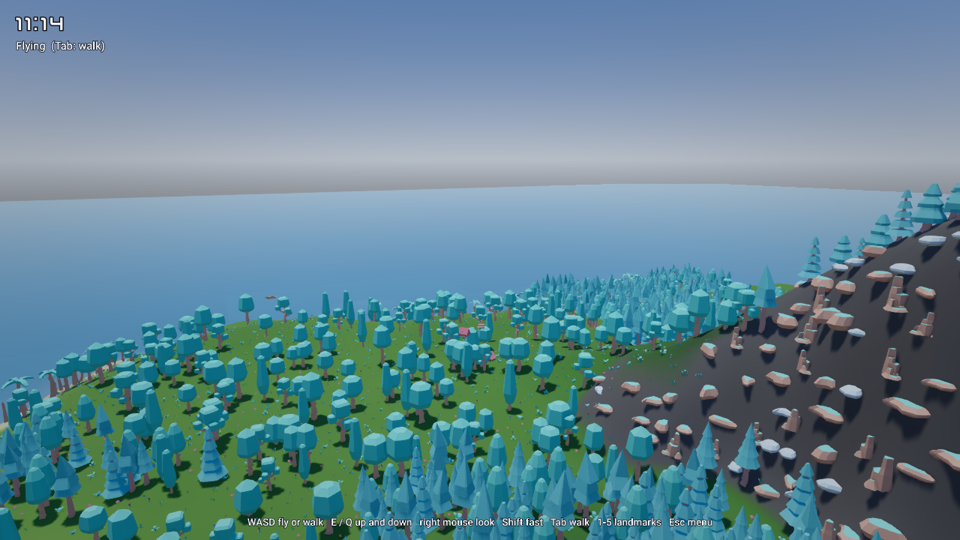
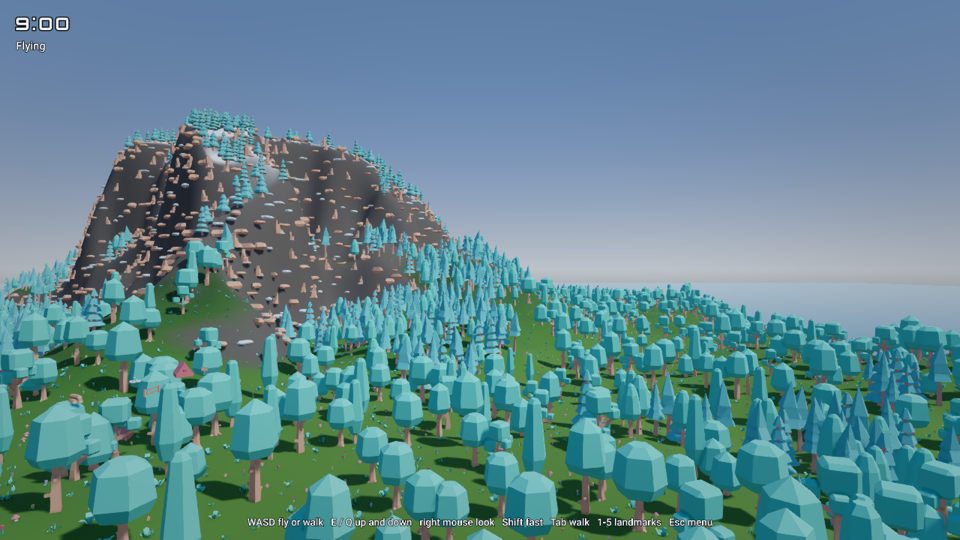

# Open World

A 768 m island you fly over or walk on: a generated terrain, about 20,000 trees, rocks, flowers and grass tufts, five camps
with campfires, 30 foxes that wander about, and a day that turns into night. The world streams in cells around you, so
only what is near is loaded. An AI agent made it through the editor alone, the way
[`strata-make-a-game`](https://github.com/2042Third/GameEngine/blob/main/.claude/skills/strata-make-a-game/SKILL.md) describes.

## What it shows

| Engine feature | Where |
| --- | --- |
| World streaming: a World asset with three layers in 64 m cells (Vegetation 192 m, Wildlife 128 m, Landmarks 320 m), a streaming source on the player, cooked cells in the export ([Worlds](https://github.com/2042Third/GameEngine/blob/main/Docs/Manual/Worlds.md)) | `Worlds/Island.stworld`, `Worlds/Island/` |
| GPU-driven rendering at scale: 20,000 instances of 26 one-entity prefabs culled and drawn by the GPU in a few indirect draws, with cascaded shadows | `Prefabs/Nature/` |
| Prefetching before a teleport (`World::RequestCellsAround`, `World::IsLoadedAround`) and a raycast that waits for the ground | `Scripts/Explorer.cpp` |
| A character controller on terrain: 97 terrain tiles with static, non-convex mesh colliders on the Terrain collision layer | the persistent scene's `Tile_*` entities |
| Skinned animation in streamed cells: foxes with an animation controller (Survey, Walk, Run) | `Prefabs/Fox.stprefab`, `Scripts/Wander.cpp` |
| Lighting that changes: a sun that turns in steps (the shadow cascades stay cached between steps) under the physical atmosphere, which colors the sky and dims and reddens the sunlight by itself (blue by day, red at sunset), the same light as a dim moon at night, campfire point lights at dusk that cast shadows (their stones cast none, so they do not hide the ground), a lantern that is always lit casting shadows in the shade of an oak ahead of the start, a height fog the sky lights (it takes the atmosphere's horizon) | `Scripts/DayNight.h`, `Worlds/Island.stscene` (Height Fog, Lantern), the Landmarks cells |
| Game UI: a clock, the mode, a pause menu with a day-length slider and the credits | `Scripts/IslandHud.cpp` |
| The export's loading scene with a progress bar (`Game::GetSceneLoadProgress`) | `Scenes/Loading.stscene`, `Scripts/LoadingScreen.cpp` |

It has no sound: there was no CC0 ambience or campfire loop that fit. Distant vegetation is not loaded: a light height
fog hazes the distance, and the streaming distances and the camera's far plane keep its edge far away.

## Controls

| Input | Action |
| --- | --- |
| Any key or click | End the tour and take over |
| W A S D | Fly, or walk |
| E / Q | Up / down (flying) |
| Shift | Faster |
| Right mouse button | Look around |
| Tab | Walk on the ground / fly again |
| Space | Jump (walking) |
| 1 to 5 | Teleport to a camp |
| Esc | Pause menu |

## Open it

In the launcher, Open Sample > Open World makes a copy of it in a folder you choose (or `project.openSample {"sample":
"OpenWorld"}`); press Play, which builds the scripts first. The game starts with a tour; set the Player's `TourOnStart`
field to false to start flying at once.

## How it was made

`Tools/GenerateIslandTerrain.py terrain` wrote the island's 97 terrain tiles and their palette, imported with
`asset.import` (without LODs, which would open seams between tiles) and placed in the persistent scene, each tile given a
static mesh collider. `world.create` made the world and its layers. `Tools/GenerateIslandTerrain.py scatter` wrote the
command script that makes the Vegetation layer the edit layer, pins its cells (`world.edit`, `world.loadCells`) and
places 20,000 props by biome with `prefab.instantiate {instances}` steps (palms on beaches, oaks and pines inland, rocks
on slopes), so that none lands in the persistent scene; the camps and foxes
were placed the same way in their layers and set on the terrain with `entity.dropToGround`. `world.cook` measured the
cells for the export. `StrataTests/Editor/OpenWorldCommands.json.in` is the regression (CTest `StrataEditor.OpenWorld`).

## Credits

Nature models and a font by [Kenney](https://kenney.nl) (CC0). Fox: model by PixelMannen (CC0 1.0); rigging and
animation by tomkranis (CC BY 4.0); glTF conversion by @AsoboStudio and @scurest (CC BY 4.0); from the
[Khronos glTF Sample Assets](https://github.com/KhronosGroup/glTF-Sample-Assets). See [CREDITS.md](CREDITS.md).
