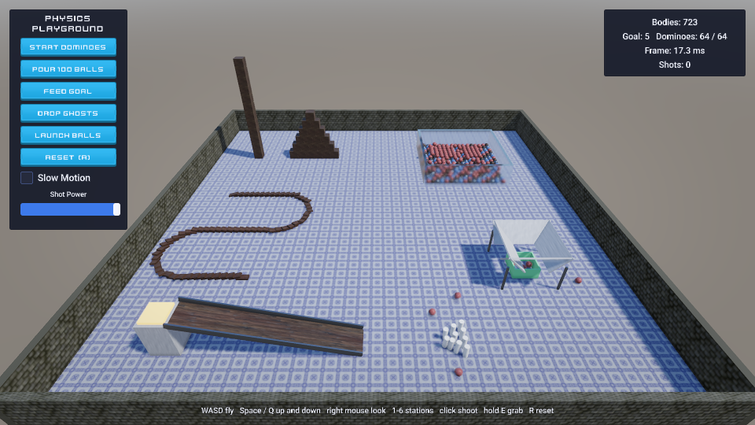
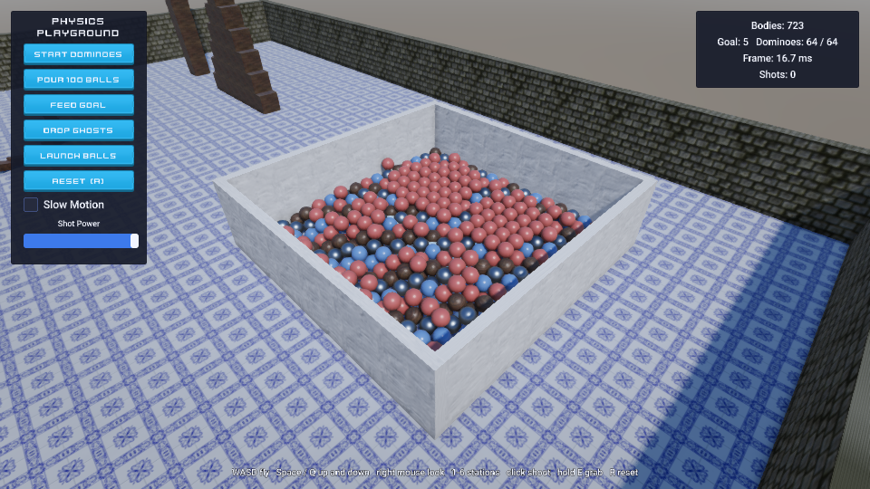

# Physics Playground

An arena of six physics stations, about 600 bodies, that you fly through and play with: a crate tower and pyramid, a
domino run, a pit of 500 balls of four materials, a goal that counts what its funnel catches, ghost boxes that sink
through the balls, and a ramp that sends balls into ten pins. An AI agent made it through the editor alone, the way
[`strata-make-a-game`](https://github.com/2042Third/GameEngine/blob/main/.claude/skills/strata-make-a-game/SKILL.md) describes.

## What it shows

| Engine feature | Where |
| --- | --- |
| Rigid bodies at scale: stacks, a domino run, a ball pit; restitution, friction and mass per material ([Scripting](https://github.com/2042Third/GameEngine/blob/main/Docs/Manual/Scripting.md), Physics) | `Prefabs/` (crates, dominoes, four kinds of ball, pins, ghosts), `Scenes/Main.stscene` |
| Triggers and contacts: the goal's basket counts balls (`OnTriggerEnter`), the launch pad sends them down the ramp, impacts sound by material (`OnCollisionEnter`) | `Scripts/GoalBasket.cpp`, `LaunchPad.cpp`, `Impact.cpp` |
| Collision layers: the Ghost layer does not collide with the Ball layer (the scene's layer matrix) | Scene settings, the Ghost prefab |
| Raycasts and impulses: shoot a ball through the cursor, grab a body and pull it | `Scripts/Playground.cpp` (`Shoot`, `UpdateGrab`) |
| Spawning many at once: a pour of 100 balls in one `Scene::InstantiateMany` call, at the ball prefab's scale (an instance's root takes the scale it is given) | `Playground::SpawnBalls` |
| GPU-driven rendering: hundreds of instanced bodies with shadows; PBR materials from ambientCG | `Materials/`, `Textures/` |
| Clear coat and glass: the plastic balls' glossy coat over their matte base, and the pit's glass walls, which show the balls behind them refracted through their 30 cm of slightly green glass | `Materials/PlasticBlue.stmat`, `Materials/Glass.stmat` |
| Game UI: a tool panel of buttons drawn with sliced images (Kenney UI Pack: corners kept, edges and middle stretched), a slow-motion toggle (`Time::SetTimeScale`), a shot-power slider and a HUD ([Game UI](https://github.com/2042Third/GameEngine/blob/main/Docs/Manual/GameUI.md)) | `UI` in the scene, `Assets/UI/` |
| Audio: one-shots heard where bodies meet, louder the harder they hit, within a budget of voices | `Scripts/Impact.cpp` |
| Hot reload: the fields keep their values when the scripts are rebuilt while playing | `Playground::OnReload` |
| Export: the game runs a demo of its stations by itself (`AutoDemo`) | `project.export` |

## Controls

| Input | Action |
| --- | --- |
| W A S D | Fly |
| Space / Q | Up / down |
| Shift | Fly faster |
| Right mouse button | Look around |
| 1 to 6 | Fly to a station |
| Left click | Shoot a ball through the cursor (power: the slider) |
| Hold E | Grab the body under the cursor and pull it |
| R | Reset the arena (the scene is loaded again) |

The tool panel starts the dominoes, pours 100 balls, feeds the goal, drops the ghosts again and launches balls.

## Open it

In the launcher, Open Sample > Physics Playground makes a copy of it in a folder you choose (or `project.openSample
{"sample": "PhysicsPlayground"}`); press Play, which builds the scripts first.

## How it was made

`project.create` from the `basic3d` template; `asset.import` of the texture sets, sounds and font; `material.create` for
each material; `entity.create` plus `prefab.create` for the bodies; `prefab.instantiate {instances}` for the stacks, the
domino run (points 0.55 m apart along a serpentine) and the 500 balls; `scene.setSettings` for the collision layers;
`ui.create` for the tool panel and the HUD; `script.build`, then playing with `input.click`, `input.key` and
`input.mouseButton` and looking at `viewport.capture`. `StrataTests/Editor/PhysicsPlaygroundCommands.json.in` is the
regression (CTest `StrataEditor.PhysicsPlayground`): it plays the stations paused, waiting with `until` for each outcome in
exact fixed steps, shoots, hot reloads, resets and exports, and the exported game runs its demo headless.

## Credits

Textures from [ambientCG](https://ambientcg.com) and sounds, UI images and a font from [Kenney](https://kenney.nl), all CC0: see
[CREDITS.md](CREDITS.md).
