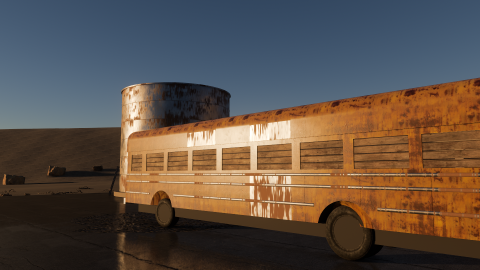

# High Desert Outpost

A derelict fuel stop in a rocky high-desert valley the day after rain: a bus with flat tyres on a cracked, wet asphalt
apron, a weathered steel oil tank, a green fuel tank, a plaster-and-plank hut, drums, a fire pit and lanterns, boulders
and a cliff band, with the low sun's highlights on sheet steel and wet ground at three times of day. It is Strata's
graphical showcase, made by an AI agent through the editor alone, the way
[`strata-make-a-game`](https://github.com/2042Third/GameEngine/blob/main/.claude/skills/strata-make-a-game/SKILL.md)
describes.

## What it holds

The project, its scanned assets and what the engine repository's generators made from them:

| Folder | What |
| --- | --- |
| `Assets/Scans/` | Twelve Poly Haven models at 1K: boulders and a cliff, dead brush, drums, a fire pit, a lantern, a tyre, a covered car, a ladder. The rocks keep six levels of detail, the lantern and the ladder five |
| `Assets/Textures/` | Ten Poly Haven texture sets (base color, OpenGL normal map, and AO, roughness and metalness packed as `arm`) for the ground, the apron, mud, plaster, planks and painted sheet metal |
| `Assets/Generated/Terrain/` | The ground, written by the engine repository's `Tools/GenerateShowcaseTerrain.py` and imported: a 300 m valley at 1 m resolution inside a 2.7 km ring of hills and mountains, the asphalt apron with its potholes and shallow puddles, their water and mud patches. The generator also checks the design the shots rest on (the low sun clears the hills from the apron, pads are flat) and computes where each shot's camera sees the sun reflected |
| `Assets/Generated/Props/` | The props, written by the engine repository's `Tools/GenerateShowcaseProps.py` and imported: a derelict bus of painted and bare sheet steel (its letterboard, where the low sun's highlight runs, is vertical), a weathered steel oil tank with its weld seams, pipes and a valve, a green fuel tank on saddles, a plaster-and-plank hut with a lean-to, embers and a lantern's wick; and the bare steel's color, metal/roughness and normal maps from one tileable field over 4 m: rust, rain streaks that dull and darken it, and the sheet's waves and dents that break the sun's reflection into the streaks that read as metal |
| `Assets/Materials/` | The materials: scans with their real sizes as tiling, the painted metal sets dielectric (their metalness maps are empty), bare steel metal by its own map |
| `Assets/Prefabs/` | Bus (on six scanned tyres), OilTank (with its pipes and a leaning ladder), FuelTank, Hut (with its lean-to), FirePit (stones, embers, the light `Fire`) and Lantern (wick and the light `Light`), each with convex colliders |
| `Assets/Scenes/Outpost.stscene` | The start scene, laid out by `GenerateShowcaseTerrain.py layout` and dressed by its `dress` (drums and tyres along the bus, stones on the apron's edge, rocks on the rim): the ground with its materials and colliders (layer `Terrain`), every prop on the surface under it (layer `Props`), the cliff band, boulders and dead brush, six reflection probes (`Probe.<Dawn, Golden or Dusk>.<Yard or Hut>`), the tour's markers (`Shot<N>.From`, `.Key`, `.To`, `.Look`), the camera rig (`Player` and its `Eye`), the fog, the overlay and the director `Outpost`. It is saved at golden hour |
| `Assets/Lighting/Outpost/` | The six probes' captures, baked by `GenerateShowcaseTerrain.py bake`: the yard and the hut at dawn, golden hour and dusk |
| `Assets/Scenes/Loading.stscene` | The exported game's loading scene: the title and a progress bar |
| `Scripts/` | `Outpost` (the director: the three times of day, the camera tour, the walk and flight, the photo mode), `Flicker` (the fire's and the lanterns' flames), `LoadingScreen`, and the tables they share with the generator (`Stations.h`, `TourPath.h`) |

Play it and the tour runs: six shots of about 80 seconds, dawn over the valley from the rim, the low sun on the bus's
side, on the oil tank and in the puddles, the hut's interior and dusk with the fire lit; it loops. Each time of day
switches its own baked probes on (the old ones stay on for a second, so a reflection never falls to the sky).

| Control | Keyboard and mouse | Gamepad |
| --- | --- | --- |
| Take over from the tour, walk | `W` `A` `S` `D`, the mouse looks | Left stick, right stick |
| Run (flying: fast) | `Left Shift` | Right bumper |
| Fly, and back to walking | `Tab`; up `E`, down `Q`; the right mouse button looks | `Y`; triggers |
| Photo mode | `P` | Start |
| Hide the game's UI | `H` | Back |
| The tour again | `T` | |
| Bookmarks: the six shots and a rock macro | `1` to `7` | |

The photo mode sets the time of day (6:30 to 19:00: the light follows the hour, the reflections snap to the nearest of
the three baked times), the exposure, the field of view, the focus (by hand or automatic), the f-number and depth of
field, and the players' graphics options (the quality preset and anti-aliasing) for the session. The scene, its probes
and the director's controls were made by the generators' command scripts (`GenerateShowcaseProps.py materials`, `tune`
and `prefabs`, `GenerateShowcaseTerrain.py layout`, `controls`, `dress` and `bake`), run in the editor; the exported
game shows a loading scene while the outpost streams in.

## Known limits

- No grass (masked grass vanishes by 30 m at 4K without coverage-preserving alpha), no people, no sound.
- In the photo mode the light follows the hour, but reflections snap to the nearest of the three baked times of day.
- At Medium, screen-space reflections are traced in a checkerboard that needs TAA: with FXAA or no anti-aliasing the
  puddles reflect only the probes.
- The metal and the wet ground are tuned against the engine's screen-space reflections as they are today; a reflections
  update of the engine retunes them.

## Credits

Every scan is CC0 1.0 from [Poly Haven](https://polyhaven.com); `CREDITS.md` names each one's source and authors.
