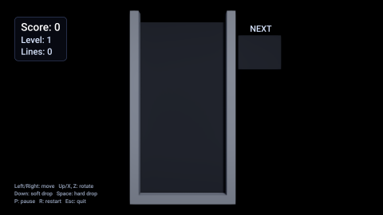

# Tetris

The falling-block classic: seven pieces in a 10 x 20 well, line clears, levels that speed up gravity, a ghost piece, a
preview of the next piece, pause and game over. An AI agent made it through the editor alone, the way
[`strata-make-a-game`](../../.claude/skills/strata-make-a-game/SKILL.md) describes.

## What it shows

| Engine feature | Where |
| --- | --- |
| C++ game scripts with fields, built and hot-reloaded by the editor ([Scripting](../../Docs/Manual/Scripting.md)) | `Scripts/TetrisBoard.cpp` (the game), `Scripts/TetrisGame.h` (rules without the engine, tested on their own) |
| Entities created and destroyed by a script, instanced rendering of the cells | The `Cells` child of the board |
| Game UI: a canvas with a HUD, a panel and texts the script writes ([Game UI](../../Docs/Manual/GameUI.md)) | `HUD` in `Assets/Scenes/Main.stscene` |
| Audio: one-shot sounds for moves, locks, clears and game over | `Assets/Sounds/` |
| Keyboard input with key repeat | `TetrisBoard::OnUpdate` |
| Export: a game that runs on its own | `project.export` |

## Controls

| Key | Action |
| --- | --- |
| Left / Right or A / D | Move (held keys repeat) |
| Down or S | Soft drop |
| Space | Hard drop |
| Up or X / Z | Rotate clockwise / counterclockwise |
| P | Pause |
| R or Enter | Restart |
| Escape | Quit |

## Open it

In the launcher, Open Sample > Tetris makes a copy of it in a folder you choose (or `project.openSample {"sample":
"Tetris"}` through the automation API); press Play, which builds the scripts first.

## How it was made

`project.create`, `material.create` for the piece colors, `entity.create` for the camera, light, walls and board,
`ui.create` for the HUD, `script.build`, then play with `input.key` and look at `viewport.capture` until it was right. The
sounds were generated as WAV files and imported. `StrataTests/Editor/TetrisCommands.json.in` replays a game against the
saved scene (CTest `StrataEditor.Tetris`): moves from the fixed piece sequence clear a line, gravity ends the game, it
restarts, and the exported game runs headless.

## Credits

Everything in this sample was made for Strata: see [CREDITS.md](CREDITS.md).
