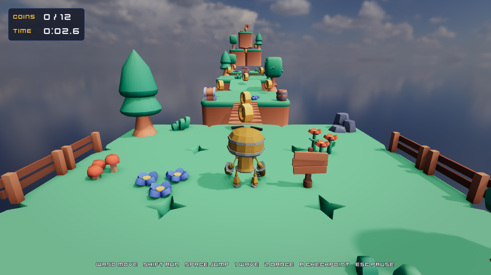
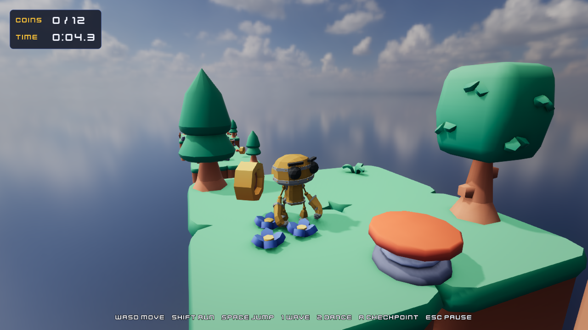

# Third-Person Adventure: Sky Islands

A small platformer over floating islands: an animated robot runs, jumps and pushes a crate across a pit, bounces on jump
pads to the higher islands, collects twelve coins and races for the best time to the flag. It has a main menu with a
settings menu and scrolling credits, a pause menu, a loading screen, and an attract mode that plays the course by
itself when nobody touches the menu. An AI agent made it through the editor alone, the way
[`strata-make-a-game`](https://github.com/2042Third/GameEngine/blob/main/.claude/skills/strata-make-a-game/SKILL.md) describes.

## What it shows

| Engine feature | Where |
| --- | --- |
| Skeletal animation with a controller: Speed, Grounded, Jump, Wave and Dance parameters, cross-fades between Idle, Walk, Run, Jump, Wave and Dance, and Footstep events at the foot contacts ([Animation](https://github.com/2042Third/GameEngine/blob/main/Docs/DeveloperGuide.md#animation)) | `Animations/Robot.stanimator`, `Scripts/Footsteps.cpp` |
| A character controller: camera-relative movement, running, jumps with coyote time, pushing a dynamic crate, checkpoints and falling off the islands | `Scripts/ThirdPersonPlayer.cpp`, `Scripts/Pushable.cpp` |
| A third-person camera that orbits with the mouse or the right stick, zooms, and shortens its arm with a raycast so that walls never hide the player | `Scripts/FollowCamera.cpp` |
| Triggers: spinning coins (sphere triggers), jump pads and the goal (box triggers), each a prefab ([Prefabs](https://github.com/2042Third/GameEngine/blob/main/Docs/Manual/Prefabs.md)) | `Prefabs/Coin.stprefab`, `Prefabs/JumpPad.stprefab`, `Scripts/Coin.cpp`, `Scripts/JumpPad.cpp`, `Scripts/Goal.cpp` |
| Static mesh colliders: the course is 35 Platformer Kit blocks with non-convex mesh colliders | `Prefabs/Course/` |
| Several scenes: a main menu, the course and the export's loading scene, switched with `Game::LoadScene` and `Game::ReloadScene`; state the script module keeps across scene loads (the attract mode) ([Scripting](https://github.com/2042Third/GameEngine/blob/main/Docs/Manual/Scripting.md)) | `Scripts/MainMenu.cpp`, `Scripts/ThirdPerson.cpp`, `Scenes/` |
| Game UI: buttons and panels drawn with sliced images (Kenney UI Pack), sliders and toggles, a credits text scrolling inside a `UIMask`, a HUD, keyboard and gamepad navigation, a pause menu at time scale 0 ([Game UI](https://github.com/2042Third/GameEngine/blob/main/Docs/Manual/GameUI.md)) | `Scripts/MainMenu.cpp`, `Scripts/PauseMenu.cpp`, `Scripts/SettingsMenu.cpp`, `Scripts/CourseState.cpp`, `Assets/UI/` |
| Save files: the settings (`settings.json`) and the best time, read when the game starts | `Scripts/ThirdPerson.cpp`, `Scripts/CourseState.cpp` |
| Display options: fullscreen and vsync from the settings (`Game::SetWindowMode`, `Game::SetVSync`) and the master volume (`Audio::SetMasterVolume`) | `Scripts/ThirdPerson.cpp` |
| An object in a hand: the menu robot holds a flag through an `AttachToJoint` component | `Scenes/MainMenu.stscene` |
| Image-based lighting from an HDR sky, a sun with cascaded shadows, post-processing (ambient occlusion, bloom, ACES) | the scenes' `Sky`, `Sun` and `Post Process` |
| Point lights that cast shadows: two lanterns under trees of the course, lighting their canopies from below | `Scenes/Course.stscene` (`Lantern A`, `Lantern B`), `Materials/LanternGlow.stmat` |
| Reflection probes baked in the editor (`lighting.bakeProbes`): four boxes along the course, so the robot's metal and the coins reflect the islands around them rather than the open sky | `Scenes/Course.stscene` (`Reflection Probes`), `Lighting/Course/` |
| Sound: footsteps and landings at the robot (3D), coins, jumps, jump pads, the goal and the menus' clicks | `Sounds/` |

The robot's three facial expressions are morph targets, which the engine does not import yet (the importer says so
once): its face stays neutral. There is no music: no CC0 loop that fit was found.

## Controls

| Input | Gamepad | Action |
| --- | --- | --- |
| W A S D or the arrow keys | Left stick | Walk where the camera looks |
| Shift | Right bumper | Run |
| Space | A | Jump |
| Mouse | Right stick | Look around (the cursor is locked while you play) |
| Scroll wheel | | Zoom |
| 1 / 2 | X / Y | Wave / dance (standing) |
| R | | Back to the last checkpoint |
| Esc | Start | Pause menu (Esc again resumes) |

Menus work with the mouse, the arrow keys and Enter, or the gamepad's d-pad and A. Push the crate off its ledge into the
pit and along it to the far wall: it is the step that gets you out.

## Open it

In the launcher, Open Sample > Third-Person Adventure makes a copy of it in a folder you choose (or
`project.openSample {"sample": "ThirdPerson"}`); press Play, which builds the scripts first. The game starts in the main
menu; after ten seconds without input it plays its demo (set `AttractDelaySeconds` on the menu's Game entity to 0 to turn
that off). To start in the course, open `Scenes/Course.stscene` and press Play.

## How it was made

The project began as `project.create` with the basic3d template. `asset.import` brought in the robot, 20 Platformer Kit
models, the HDR sky, the sounds and the font; `animation.createController` made the robot's controller (its footstep
event times were read off the clips' foot keys). Prefabs for the course's pieces (each model at twice its size, static
with a mesh collider) and for the coin and the jump pad were made with `entity.create` and `prefab.create`, and the
course was laid out on a 4 m grid with `prefab.instantiate {instances}`. The menus are `ui.create` presets with their
`EventTarget`s on the scenes' Game entities; `scene.saveAs` made the menu and the loading scene, and
`project.setStartScene` and `project.setExportSettings` made them the start and the export's loading scene.
`StrataTests/Editor/ThirdPersonCommands.json.in` is the regression (CTest `StrataEditor.ThirdPerson`): it plays the
menu and the course with simulated input and exports the game, whose headless runs play the attract mode.

## Credits

The robot by Tomás Laulhé (Quaternius), modified by Don McCurdy (CC0); the course, sounds and font by
[Kenney](https://kenney.nl) (CC0); the sky by Greg Zaal and Jarod Guest, [Poly Haven](https://polyhaven.com) (CC0). See
[CREDITS.md](CREDITS.md).
